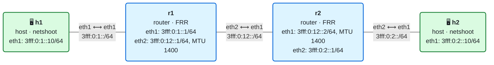

# 02 · La cabecera IPv6 y las cabeceras de extensión

> **Objetivo**: saber qué lleva un paquete IPv6, campo a campo, y cómo se encadenan las cabeceras de extensión.
>
> **Por qué importa para SRv6**: SRv6 *es* una cabecera de extensión, la Segment Routing Header. Y todo su funcionamiento se apoya en una regla de IPv6 que verás en este módulo: las cabeceras de extensión solo las procesa el nodo cuya dirección va en el destino del paquete.

## El laboratorio de este módulo

<!-- topologia:inicio -->

<!-- topologia:fin -->

Dos hosts separados por dos routers. El enlace central tiene una **MTU de 1400 bytes**, menor que la del resto, para poder observar la fragmentación y el descubrimiento de la MTU del camino. Las direcciones y las rutas ya vienen configuradas: en este módulo nos interesan los paquetes, no la configuración. En **h1** tienes un script, `paquetes.py`, que fabrica paquetes con las cabeceras que quieras para ver cómo reacciona cada nodo. Al terminar la teoría, la [práctica](practica.md) te guía paso a paso.

## 1. Un paquete son cabeceras dentro de cabeceras

Cuando h1 hace `ping` a h2, el mensaje viaja envuelto en varias capas. Cada capa añade su **cabecera** delante de lo que recibe de la capa superior:

```
┌──────────────┬──────────────────┬──────────────────┬───────────┐
│   Ethernet   │       IPv6       │      ICMPv6      │   datos   │
│   14 bytes   │     40 bytes     │      8 bytes     │           │
│ EtherType    │ Next Header = 58 │ Type 128 = Echo  │           │
│   0x86DD     │                  │       Request    │           │
└──────────────┴──────────────────┴──────────────────┴───────────┘
```

Cada cabecera dice qué viene detrás:

- Ethernet lo indica con el **EtherType**. `0x86DD` significa "lo que sigue es IPv6" (IPv4 es `0x0800`).
- IPv6 lo indica con el campo **Next Header**. `58` significa "lo que sigue es ICMPv6".

Esa idea de "cada cabecera anuncia la siguiente" es la clave de todo el módulo.

## 2. La cabecera IPv6, campo a campo

La cabecera IPv6 tiene siempre **40 bytes**. Este es su formato, tal y como aparece en el [RFC 8200](https://www.rfc-editor.org/rfc/rfc8200):

```
 0                   1                   2                   3
 0 1 2 3 4 5 6 7 8 9 0 1 2 3 4 5 6 7 8 9 0 1 2 3 4 5 6 7 8 9 0 1
+-+-+-+-+-+-+-+-+-+-+-+-+-+-+-+-+-+-+-+-+-+-+-+-+-+-+-+-+-+-+-+-+
|Version| Traffic Class |              Flow Label               |
+-+-+-+-+-+-+-+-+-+-+-+-+-+-+-+-+-+-+-+-+-+-+-+-+-+-+-+-+-+-+-+-+
|         Payload Length        |  Next Header  |   Hop Limit   |
+-+-+-+-+-+-+-+-+-+-+-+-+-+-+-+-+-+-+-+-+-+-+-+-+-+-+-+-+-+-+-+-+
|                                                               |
+                                                               +
|                     Source Address (128 bits)                 |
+                                                               +
|                                                               |
+-+-+-+-+-+-+-+-+-+-+-+-+-+-+-+-+-+-+-+-+-+-+-+-+-+-+-+-+-+-+-+-+
|                                                               |
+                                                               +
|                  Destination Address (128 bits)               |
+                                                               +
|                                                               |
+-+-+-+-+-+-+-+-+-+-+-+-+-+-+-+-+-+-+-+-+-+-+-+-+-+-+-+-+-+-+-+-+
```

Cada fila son 32 bits (4 bytes). Las dos primeras filas son los 8 campos "de control"; las otras ocho son las dos direcciones de 128 bits.

| Campo | Bits | Para qué sirve |
|-------|-----:|----------------|
| **Version** | 4 | Siempre `6`. Por eso todo paquete IPv6 empieza por el dígito hexadecimal `6` |
| **Traffic Class** | 8 | Prioridad del paquete para la calidad de servicio (QoS). Los 6 bits altos son el **DSCP** y los 2 bajos, el **ECN** (aviso de congestión). Equivale al campo ToS de IPv4 |
| **Flow Label** | 20 | Marca los paquetes de un mismo flujo para que los routers los traten igual, por ejemplo para que el reparto de carga (ECMP) envíe todo un flujo por el mismo camino ([RFC 6437](https://www.rfc-editor.org/rfc/rfc6437)) |
| **Payload Length** | 16 | Longitud de lo que va **detrás** de esta cabecera, en bytes. No incluye los 40 bytes de la propia cabecera |
| **Next Header** | 8 | Qué cabecera viene a continuación: una de extensión o la de la capa superior (TCP, UDP, ICMPv6…) |
| **Hop Limit** | 8 | Cuántos saltos puede dar el paquete. Cada router lo resta en 1 y, si llega a 0, lo descarta y avisa al origen con un ICMPv6 *Time Exceeded*. Es el TTL de IPv4 con un nombre más honesto |
| **Source Address** | 128 | Quién envía |
| **Destination Address** | 128 | A quién va |

### Un ejemplo en hexadecimal

Así se ven los 40 bytes de un ping de h1 a h2:

```
6000 0000 0018 3a40 3fff 0000 0001 0000
0000 0000 0000 0010 3fff 0000 0002 0000
0000 0000 0000 0010
```

- `6` → Version 6.
- `00` → Traffic Class 0.
- `00000` → Flow Label 0.
- `0018` → Payload Length 24 bytes (8 de ICMPv6 + 16 de datos).
- `3a` → Next Header 58, ICMPv6.
- `40` → Hop Limit 64.
- `3fff 0000 0001 0000 0000 0000 0000 0010` → origen `3fff:0:1::10`.
- `3fff 0000 0002 0000 0000 0000 0000 0010` → destino `3fff:0:2::10`.

### Qué se quitó respecto a IPv4

La cabecera IPv6 es más sencilla que la de IPv4, aunque las direcciones sean cuatro veces más largas:

| En IPv4 | En IPv6 | Por qué |
|---------|---------|---------|
| Longitud de cabecera variable (IHL) | Desaparece | La cabecera mide siempre 40 bytes. Los routers saben dónde termina sin calcular nada |
| Checksum de cabecera | Desaparece | Ya lo comprueban Ethernet por debajo y TCP/UDP por encima. Así los routers no lo recalculan en cada salto al cambiar el Hop Limit |
| Campos de fragmentación | Pasan a una cabecera de extensión | En IPv6 los routers no fragmentan nunca (sección 5) |
| Opciones | Pasan a cabeceras de extensión | Solo se añaden cuando hacen falta |

Resultado: una cabecera de tamaño fijo, fácil de procesar en hardware a gran velocidad.

## 3. Las cabeceras de extensión

Todo lo que no cabe en los 40 bytes fijos va en **cabeceras de extensión**, que se colocan entre la cabecera IPv6 y la de la capa superior. Se encadenan con el mismo mecanismo de antes: cada una tiene su propio campo *Next Header* que dice qué viene detrás.

```
┌────────────────┐  ┌────────────────┐  ┌────────────────┐  ┌────────────┐
│ IPv6           │  │ Hop-by-Hop     │  │ Routing        │  │ TCP        │
│ Next Header=0  │─▶│ Next Header=43 │─▶│ Next Header=6  │─▶│            │
└────────────────┘  └────────────────┘  └────────────────┘  └────────────┘
```

### Los valores de Next Header

| Valor | Qué viene detrás |
|------:|------------------|
| 0 | Hop-by-Hop Options |
| 6 | TCP |
| 17 | UDP |
| 41 | **Un paquete IPv6 completo** (IPv6 dentro de IPv6) |
| 43 | Routing Header |
| 44 | Fragment Header |
| 50 / 51 | ESP / AH (IPsec) |
| 58 | ICMPv6 |
| 59 | Nada (*No Next Header*) |
| 60 | Destination Options |

Fíjate en el **41** y el **43**: son los dos que verás en todos los paquetes SRv6.

### Los tipos de cabecera de extensión

| Cabecera | Next Header | Quién la procesa | Para qué sirve |
|----------|------------:|------------------|----------------|
| **Hop-by-Hop Options** | 0 | **Todos** los nodos del camino | Opciones que cada router debe mirar, como la *Router Alert* que usa MLD |
| **Routing** | 43 | El nodo indicado en el destino | Indica nodos por los que debe pasar el paquete. **La SRH de SRv6 es un Routing Header de tipo 4** |
| **Fragment** | 44 | El destino final | Datos para reensamblar un paquete fragmentado |
| **Destination Options** | 60 | El nodo indicado en el destino | Opciones solo para el destinatario |
| **AH / ESP** | 51 / 50 | El destino final | Autenticación y cifrado (IPsec) |

Cuando hay varias, el RFC 8200 recomienda este orden: Hop-by-Hop, Destination Options (las que debe ver cada nodo listado en un Routing Header), Routing, Fragment, AH, ESP, Destination Options (las del destino final) y, por último, la capa superior. Hop-by-Hop, si está, **siempre va la primera**.

### La regla que hace posible SRv6

> Las cabeceras de extensión **no las examina ningún nodo del camino**, salvo Hop-by-Hop. Solo las procesa el nodo cuya dirección figura en el campo *Destination Address*.

Un router intermedio mira la dirección de destino, consulta su tabla de rutas y reenvía. No abre la cadena de cabeceras. Esto tiene dos consecuencias importantes:

1. Los routers de tránsito reenvían rápido, aunque el paquete lleve muchas cabeceras de extensión.
2. Un Routing Header solo lo procesa el nodo al que va dirigido el paquete en cada momento. Ese nodo lo lee, cambia la dirección de destino por la del siguiente punto del camino y lo reenvía. **Así funciona exactamente SRv6**: los nodos de tránsito no necesitan saber nada de SRv6, y solo los nodos nombrados en la lista ejecutan instrucciones.

### Opciones desconocidas

Las cabeceras Hop-by-Hop y Destination Options transportan **opciones**. Cada opción empieza con un byte de tipo, cuyos dos bits más altos dicen qué hacer si el nodo **no la reconoce**:

| Bits altos | Acción si la opción es desconocida |
|:---:|---|
| `00` | Saltarla y seguir procesando |
| `01` | Descartar el paquete en silencio |
| `10` | Descartar el paquete y enviar un ICMPv6 *Parameter Problem* al origen |
| `11` | Lo mismo que `10`, pero solo si el destino no era multicast |

En la práctica enviarás opciones `00` y `10` y verás quién responde: con Destination Options contesta el destino; con Hop-by-Hop, el primer router.

### Routing Header tipo 0: un ejemplo de lo que salió mal

El RFC original de IPv6 definía un Routing Header **tipo 0** que permitía a cualquiera indicar por qué nodos debía pasar un paquete. Se descubrió que servía para amplificar ataques (un paquete podía rebotar muchas veces entre dos routers) y el [RFC 5095](https://www.rfc-editor.org/rfc/rfc5095) lo prohibió en 2007. La SRH (tipo 4, [RFC 8754](https://www.rfc-editor.org/rfc/rfc8754)) recupera la idea con protecciones: solo se procesa dentro de un dominio de confianza y en nodos con SRv6 activado.

## 4. Las cabeceras de extensión en Internet

En la teoría, cualquier router reenvía un paquete con cabeceras de extensión. En la práctica, muchos operadores y cortafuegos los descartan: los mismos paquetes sin cabeceras de extensión llegan casi siempre, y con ellas se pierden en una proporción importante ([RFC 7872](https://www.rfc-editor.org/rfc/rfc7872), [RFC 9098](https://www.rfc-editor.org/rfc/rfc9098)). Los motivos son de rendimiento (algunos equipos tienen que mandar esos paquetes a la CPU) y de seguridad (son difíciles de inspeccionar).

Por eso SRv6 se despliega **dentro del dominio de un operador**, donde él controla todos los equipos, y no a través de Internet. En el módulo 17 veremos cómo se filtra SRv6 en el borde.

## 5. Fragmentación y MTU del camino

La **MTU** (*Maximum Transmission Unit*) es el tamaño máximo de paquete que cabe en un enlace. Si un paquete no cabe:

- En **IPv4**, el router lo trocea (fragmenta) y sigue.
- En **IPv6**, **los routers nunca fragmentan**. Descartan el paquete y envían al origen un ICMPv6 **Packet Too Big** con la MTU del enlace que no ha podido usar.

El origen aprende así la MTU del camino (**PMTUD**, *Path MTU Discovery*, [RFC 8201](https://www.rfc-editor.org/rfc/rfc8201)), la guarda en su caché y, a partir de entonces, si tiene que enviar algo más grande, lo fragmenta **él mismo** y añade a cada fragmento una **Fragment Header** (Next Header 44).

```
h1 ──── r1 ════ r2 ──── h2
MTU 9500   MTU 1400   MTU 9500

1. h1 envía 2048 bytes  ─────▶ r1: "no cabe en 1400"
2. r1 ◀───── ICMPv6 Packet Too Big, MTU = 1400
3. h1 guarda "hacia h2, MTU 1400" y fragmenta:
   fragmento 1: 40 IPv6 + 8 Fragment + 1352 datos = 1400 bytes
   fragmento 2: 40 IPv6 + 8 Fragment +  656 datos =  704 bytes
4. h2 reensambla
```

Cada fragmento salvo el último lleva un número de bytes de datos múltiplo de 8, porque el campo *Fragment Offset* cuenta en unidades de 8 bytes.

Dos cifras que conviene recordar:

- **1280 bytes** es la MTU mínima que todo enlace IPv6 debe soportar. Un paquete de 1280 bytes o menos llega siempre sin fragmentar.
- **Si se filtra el ICMPv6 Packet Too Big, PMTUD se rompe**: los paquetes grandes se pierden sin aviso y las conexiones "se cuelgan" al transferir datos. Por eso nunca hay que bloquear todo el ICMPv6 en un cortafuegos ([RFC 4890](https://www.rfc-editor.org/rfc/rfc4890)).

> **Conexión con SRv6**: SRv6 encapsula el paquete original dentro de otro IPv6, y con SRH añade aún más bytes. Un paquete de 1500 bytes del cliente puede convertirse en uno de 1580 o más dentro de la red. Por eso las redes SRv6 usan MTU grandes (9000 o más) en el núcleo. Lo veremos en el módulo 17.

## 6. Así se ve un paquete SRv6

Con todo lo anterior ya puedes leer el paquete que capturamos en el laboratorio SRv6 de la wiki, a la entrada de r2:

```
IP6 (hlim 64, next-header Routing (43), payload length 144) 2001:db8::1 > fc00:0:2:e000::
  RT6 (len=4, type=4, segleft=1, last-entry=1, [0]fc00:0:3:e000::, [1]fc00:0:2:e000::)
  IP6 (hlim 64, next-header ICMPv6 (58), payload length 64) 2001:db8::1 > 2001:db8::3
    ICMP6, echo request
```

```
┌───────────────────┐  ┌──────────────────────┐  ┌───────────────────┐  ┌────────┐
│ IPv6 exterior     │  │ Routing Header       │  │ IPv6 interior     │  │ ICMPv6 │
│ Next Header = 43  │─▶│ tipo 4 = SRH         │─▶│ Next Header = 58  │─▶│ echo   │
│ dst = SID activo  │  │ Next Header = 41     │  │ el paquete        │  │        │
└───────────────────┘  │ lista de SIDs        │  │ original, intacto │  └────────┘
                       └──────────────────────┘  └───────────────────┘
```

- La cabecera exterior dice `next-header Routing (43)`: detrás viene un Routing Header.
- `RT6 (… type=4 …)`: es una SRH.
- La SRH dice que detrás viene un IPv6 (Next Header 41): el paquete original completo.
- `len=4` es el campo *Hdr Ext Len*: la longitud de la SRH en unidades de 8 bytes **sin contar los 8 primeros**. Dos SIDs de 16 bytes son 32 bytes = 4 unidades, así que la SRH mide 8 + 32 = 40 bytes.
- `payload length 144` = 40 (SRH) + 40 (IPv6 interior) + 64 (ICMPv6).

En el módulo 07 estudiaremos la SRH a fondo. Lo importante ahora es que ya no es una caja negra: es una cabecera de extensión más, encadenada con el mismo mecanismo que todas las demás.

## 7. Resumen

- La cabecera IPv6 mide siempre **40 bytes** y tiene 8 campos. Cada router solo modifica uno: el **Hop Limit**.
- El campo **Next Header** encadena las cabeceras: cada una dice cuál viene detrás.
- Las **cabeceras de extensión** van entre la cabecera IPv6 y la de la capa superior. Solo las procesa el nodo cuya dirección va en el destino, salvo **Hop-by-Hop**, que la procesan todos.
- El bit alto de cada opción decide qué hacer si no se reconoce: saltarla o descartar el paquete y avisar.
- En IPv6 **los routers no fragmentan**: envían un *Packet Too Big* y fragmenta el origen. La MTU mínima es **1280**.
- Un paquete SRv6 es un IPv6 (Next Header 43) con una SRH (Routing Header tipo 4) que lleva dentro otro IPv6 (Next Header 41).

## Siguiente paso

Haz la [práctica](practica.md) con el laboratorio de este módulo.

## Para saber más

- [RFC 8200](https://www.rfc-editor.org/rfc/rfc8200) — Especificación de IPv6
- [RFC 8201](https://www.rfc-editor.org/rfc/rfc8201) — Path MTU Discovery para IPv6
- [RFC 6437](https://www.rfc-editor.org/rfc/rfc6437) — Flow Label
- [RFC 5095](https://www.rfc-editor.org/rfc/rfc5095) — Prohibición del Routing Header tipo 0
- [RFC 7872](https://www.rfc-editor.org/rfc/rfc7872) — Pérdida de paquetes con cabeceras de extensión en Internet
- [RFC 8754](https://www.rfc-editor.org/rfc/rfc8754) — Segment Routing Header
- [SRv6.md · Cabecera SRH](https://srv6.md/es/cabecera-srh/)
