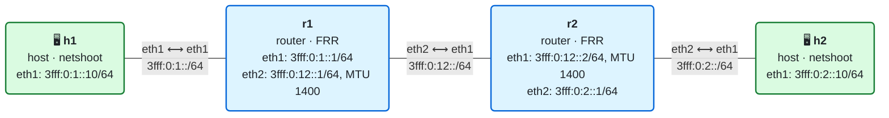

# 02 · Práctica: la cabecera IPv6 y las cabeceras de extensión

Antes de empezar, lee la [teoría del módulo](README.md).

## Topología

<!-- topologia:inicio -->

<!-- topologia:fin -->

> El fichero editable para draw.io está en [`lab/topologia.drawio`](lab/topologia.drawio).

- **h1** y **h2** son hosts con direcciones fijas. Su puerta de enlace es `::1` en su red.
- **r1** y **r2** son routers FRR con rutas estáticas preconfiguradas (el enrutamiento lo veremos en el módulo 04).
- El enlace **r1–r2 tiene MTU 1400**; el resto, la de containerlab por defecto (9500).
- En h1 está montado el script `/lab/paquetes.py`, que fabrica paquetes con Scapy. Para ver la lista de experimentos:

```bash
$ docker exec clab-m02-h1 python3 /lab/paquetes.py
```

## Parte A · Ejercicios en papel

Hazlos sin ordenador. Las soluciones están en [soluciones.md](soluciones.md).

**A1.** Decodifica esta cabecera IPv6 campo a campo:

```
6b81 2345 0020 0040 3fff 0000 0001 0000
0000 0000 0000 0010 3fff 0000 0002 0000
0000 0000 0000 0010
```

**A2.** El Traffic Class del ejercicio anterior vale `0xb8`. ¿Qué valor tienen el DSCP y el ECN?

**A3.** Un `ping` con 56 bytes de datos (lo que envía `ping` por defecto). ¿Cuánto vale el Payload Length? ¿Cuántos bytes mide el paquete IPv6 completo? ¿Y la trama Ethernet?

**A4.** Un paquete lleva, en este orden: cabecera IPv6, Hop-by-Hop, Routing, Fragment y TCP. Escribe el valor del campo *Next Header* de cada una de las cuatro primeras.

**A5.** En el laboratorio, h1 envía un paquete a h2 (`h1 → r1 → r2 → h2`). Para cada caso, ¿qué nodos procesan la cabecera de extensión?

1. Hop-by-Hop Options
2. Destination Options
3. Routing Header, con destino h2

**A6.** ¿Qué hace un nodo que **no reconoce** una opción de cada uno de estos tipos? `0x1e`, `0x5e`, `0x9e`, `0xde`.

**A7.** h1 envía un `ping -s 3000` a h2 y ya sabe que la MTU del camino es 1400. ¿Cuántos fragmentos envía? ¿Cuántos bytes mide cada uno y qué *Fragment Offset* lleva?

**A8.** Una SRH lleva **tres** SIDs. ¿Cuánto mide? ¿Qué valor tiene el campo *Hdr Ext Len*? Si se usa para encapsular un paquete, ¿cuántos bytes se añaden en total?

## Parte B · Laboratorio

### B0. Levantar el laboratorio

```bash
$ cd 02-cabecera-ipv6/lab
$ sudo containerlab deploy -t lab.clab.yml
$ ./verificar.sh
```

Si todas las comprobaciones salen en verde, empieza la práctica.

> **Cómo capturar en dos terminales.** En muchos ejercicios tendrás que capturar en un nodo mientras envías desde otro. Abre una segunda terminal para la captura, lánzala primero y luego envía el paquete desde la primera.

### B1. El Hop Limit, salto a salto

En una terminal, captura en h2:

```bash
$ docker exec clab-m02-h2 tcpdump -ni eth1 -vv -c 2 'icmp6 and ip6[40]==128'
```

En otra, haz ping desde h1:

```bash
$ docker exec clab-m02-h1 ping -c2 3fff:0:2::10
```

1. ¿Con qué Hop Limit (`hlim`) llega el *echo request* a h2? ¿Con cuál salió de h1?
2. ¿Qué otros campos de la cabecera reconoces en la salida de `tcpdump`?

### B2. Cuando el Hop Limit se agota

```bash
$ docker exec clab-m02-h1 python3 /lab/paquetes.py hoplimit 1
$ docker exec clab-m02-h1 python3 /lab/paquetes.py hoplimit 2
$ docker exec clab-m02-h1 python3 /lab/paquetes.py hoplimit 3
```

1. ¿Quién responde en cada caso y con qué mensaje?
2. ¿Qué herramienta conocida funciona exactamente así?

### B3. Traffic Class y Flow Label

Captura en h2 como en B1 y envía:

```bash
$ docker exec clab-m02-h1 python3 /lab/paquetes.py tc
$ docker exec clab-m02-h1 python3 /lab/paquetes.py flow
```

1. Busca `class` y `flowlabel` en la captura. ¿Llegan intactos a h2?
2. ¿Los han modificado r1 o r2?

### B4. Ver la cabecera en hexadecimal

```bash
$ docker exec clab-m02-h2 tcpdump -ni eth1 -x -c1 'icmp6 and ip6[40]==128'
```

(y en otra terminal, `docker exec clab-m02-h1 ping -c1 3fff:0:2::10`)

1. Localiza en el volcado los 40 bytes de la cabecera IPv6 y decodifica cada campo, como en el ejercicio A1.

### B5. Hop-by-Hop: lo miran todos

```bash
$ docker exec clab-m02-h1 python3 /lab/paquetes.py hbh-saltar
$ docker exec clab-m02-h1 python3 /lab/paquetes.py hbh-descartar
```

1. ¿Quién responde en cada caso?
2. En el segundo, mira el campo `ptr` (*pointer*) de la respuesta. ¿A qué byte del paquete original apunta?
3. ¿Por qué no ha llegado el paquete a h2?

### B6. Destination Options: solo lo mira el destino

```bash
$ docker exec clab-m02-h1 python3 /lab/paquetes.py dst-saltar
$ docker exec clab-m02-h1 python3 /lab/paquetes.py dst-descartar
```

1. ¿Quién responde ahora a `dst-descartar`?
2. Compáralo con B5. ¿Qué te dice esto sobre lo que hacen r1 y r2 con las cabeceras de extensión?

### B7. Routing Header tipo 0

```bash
$ docker exec clab-m02-h1 python3 /lab/paquetes.py rh0
```

1. ¿Quién responde y con qué mensaje?
2. ¿Por qué un nodo moderno rechaza este tipo de Routing Header?

### B8. Una SRH a un nodo sin SRv6

```bash
$ docker exec clab-m02-h1 python3 /lab/paquetes.py srh
```

El paquete lleva una SRH con *Segments Left* = 0, es decir, ya no quedan segmentos por recorrer.

1. ¿Responde h2?
2. Comprueba si h2 tiene SRv6 activado:

   ```bash
   $ docker exec clab-m02-h2 sysctl net.ipv6.conf.all.seg6_enabled net.ipv6.conf.eth1.seg6_enabled
   ```

3. Actívalo y repite el envío:

   ```bash
   $ docker exec clab-m02-h2 sysctl -w net.ipv6.conf.all.seg6_enabled=1 net.ipv6.conf.eth1.seg6_enabled=1
   $ docker exec clab-m02-h1 python3 /lab/paquetes.py srh
   ```

   ¿Qué cambia? ¿Por qué crees que Linux se comporta así por defecto?

### B9. La cadena de cabeceras

Captura en h2 y envía un paquete con dos cabeceras de extensión:

```bash
$ docker exec clab-m02-h2 tcpdump -ni eth1 -vv -c1 'ip6 and src 3fff:0:1::10'
$ docker exec clab-m02-h1 python3 /lab/paquetes.py cadena
```

1. Dibuja la cadena de cabeceras con el valor de *Next Header* de cada una.
2. ¿Cuánto vale el *Payload Length* y de dónde sale esa cifra?

### B10. Fragmentación y Packet Too Big

En una terminal, captura en h1 los mensajes ICMPv6 de error y los fragmentos:

```bash
$ docker exec clab-m02-h1 tcpdump -ni eth1 -vv '(icmp6 and ip6[40]==2) or ip6[6]==44'
```

En otra, mira primero la ruta hacia h2 y después envía pings grandes:

```bash
$ docker exec clab-m02-h1 ip -6 route get 3fff:0:2::10
$ docker exec clab-m02-h1 ping -c3 -s 2000 3fff:0:2::10
$ docker exec clab-m02-h1 ip -6 route get 3fff:0:2::10
```

1. ¿Qué ocurre con el primer ping? ¿Quién envía el *Packet Too Big* y qué MTU indica?
2. ¿Qué ha cambiado en la salida de `ip -6 route get` después del ping?
3. En la captura, localiza los fragmentos. ¿Cuántos hay por cada ping y de qué tamaño? ¿Coincide con lo que calculaste en la teoría?
4. ¿Por qué el *echo reply* de h2 también puede llegar fragmentado?

### B11. Limpieza

```bash
$ sudo containerlab destroy -t lab.clab.yml --cleanup
```

## Reto

Bloquea en r1 los mensajes *Packet Too Big* que envía hacia h1 y repite B10 con otra dirección de destino que h1 no tenga en caché (por ejemplo, reinicia el laboratorio):

```bash
$ docker exec clab-m02-r1 ip6tables -A OUTPUT -p icmpv6 --icmpv6-type packet-too-big -j DROP
```

¿Qué le pasa ahora al ping de 2000 bytes? ¿Y a uno de 1000? Explica por qué filtrar todo el ICMPv6 en un cortafuegos rompe conexiones que "a veces funcionan".

> Si la imagen de FRR no trae `ip6tables`, haz el reto con `nft` o simplemente razónalo con lo que has aprendido en B10.
