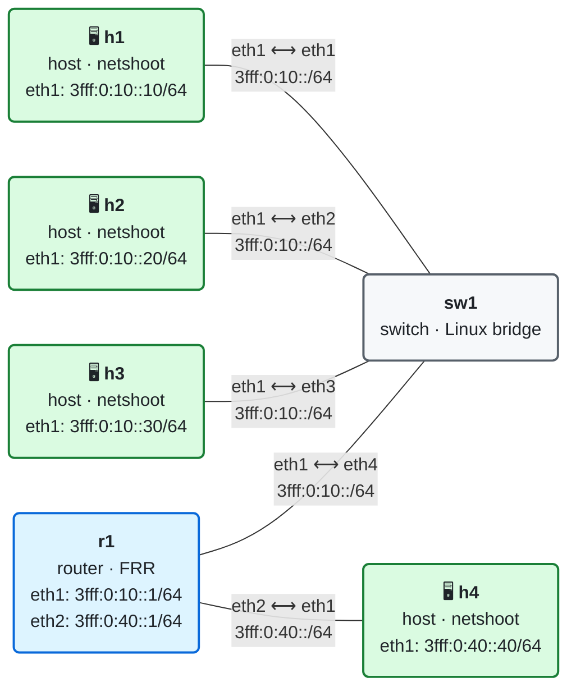

# 03 · ICMPv6 y Neighbor Discovery

> **Objetivo**: entender para qué sirve ICMPv6 y cómo, gracias a él, los equipos de una misma red se encuentran entre sí, descubren su router y comprueban que su dirección no está repetida.
>
> **Por qué importa para SRv6**: en una red SRv6 los routers se hablan a través de direcciones link-local, y el siguiente salto de cada SID End.X es una link-local que hay que traducir a una MAC. Esa traducción la hace Neighbor Discovery. Si ND falla, SRv6 no funciona.

## El laboratorio de este módulo

<!-- topologia:inicio -->

<!-- topologia:fin -->

Tres hosts y un router comparten una LAN a través de un switch (**sw1**, un bridge de Linux que solo conmuta tramas y no tiene IPv6). El router **r1** anuncia la red con *Router Advertisements* y da salida hacia una segunda red, donde está **h4**. Los hosts de la LAN tienen direcciones fijas fáciles de recordar (`::10`, `::20`, `::30`) y aprenden su router por defecto escuchando a r1. Al terminar la teoría, la [práctica](practica.md) te guía paso a paso.

## 1. ICMPv6: imprescindible, no opcional

En IPv4, ICMP es casi un accesorio: sirve para `ping`, `traceroute` y algún mensaje de error, y muchas redes lo filtran sin que pase nada grave. En IPv6 no es así. **ICMPv6** ([RFC 4443](https://www.rfc-editor.org/rfc/rfc4443)) asume funciones que en IPv4 hacían otros protocolos:

| Función | En IPv4 | En IPv6 |
|---------|---------|---------|
| Averiguar la MAC de un vecino | ARP | ICMPv6 (Neighbor Discovery) |
| Encontrar el router | DHCP o configuración manual | ICMPv6 (Router Advertisement) |
| Detectar direcciones duplicadas | ARP gratuito (opcional) | ICMPv6 (DAD, obligatorio) |
| Unirse a grupos multicast | IGMP | ICMPv6 (MLD) |
| Avisar de que un paquete no cabe | ICMP, pero el router suele fragmentar | ICMPv6 Packet Too Big (imprescindible) |

Por eso **filtrar todo el ICMPv6 rompe IPv6**. El [RFC 4890](https://www.rfc-editor.org/rfc/rfc4890) indica qué mensajes se pueden filtrar y cuáles nunca.

### Formato de un mensaje ICMPv6

ICMPv6 va detrás de la cabecera IPv6, con *Next Header* = 58. Todos los mensajes empiezan igual:

```
 0                   1                   2                   3
 0 1 2 3 4 5 6 7 8 9 0 1 2 3 4 5 6 7 8 9 0 1 2 3 4 5 6 7 8 9 0 1
+-+-+-+-+-+-+-+-+-+-+-+-+-+-+-+-+-+-+-+-+-+-+-+-+-+-+-+-+-+-+-+-+
|     Type      |     Code      |          Checksum             |
+-+-+-+-+-+-+-+-+-+-+-+-+-+-+-+-+-+-+-+-+-+-+-+-+-+-+-+-+-+-+-+-+
|                     Cuerpo del mensaje                        |
```

El **Type** dice qué mensaje es y el **Code** concreta la variante. Los tipos del 0 al 127 son **errores**; del 128 al 255, **mensajes informativos**.

| Type | Mensaje | Lo viste en |
|-----:|---------|-------------|
| 1 | Destination Unreachable (códigos: sin ruta, prohibido, dirección inalcanzable, puerto inalcanzable…) | Este módulo |
| 2 | Packet Too Big | Módulo 02 |
| 3 | Time Exceeded | Módulo 02 (`hoplimit`) |
| 4 | Parameter Problem | Módulo 02 (opciones desconocidas) |
| 128 / 129 | Echo Request / Echo Reply | `ping` |
| 130–132, 143 | MLD (gestión de grupos multicast) | Este módulo |
| **133** | **Router Solicitation (RS)** | Este módulo |
| **134** | **Router Advertisement (RA)** | Módulo 01 |
| **135** | **Neighbor Solicitation (NS)** | Este módulo |
| **136** | **Neighbor Advertisement (NA)** | Este módulo |
| **137** | **Redirect** | Este módulo |

Los cinco últimos forman **Neighbor Discovery**.

## 2. Neighbor Discovery

**Neighbor Discovery** (ND, [RFC 4861](https://www.rfc-editor.org/rfc/rfc4861)) agrupa todo lo que necesita un equipo para convivir con sus vecinos de enlace:

| Mensaje | Lo envía | Para qué |
|---------|----------|----------|
| **RS** · Router Solicitation | Un host | "¿Hay algún router por aquí?" |
| **RA** · Router Advertisement | Un router | "Soy un router; estos son los prefijos de la red" |
| **NS** · Neighbor Solicitation | Cualquiera | "¿Cuál es la MAC de esta dirección?" o "¿sigues ahí?" |
| **NA** · Neighbor Advertisement | Cualquiera | "Esa dirección es mía y esta es mi MAC" |
| **Redirect** | Un router | "Para ese destino hay un camino mejor que yo" |

Todos los mensajes ND se envían con **Hop Limit 255**, y el receptor descarta los que llegan con otro valor. Como cualquier router lo habría restado, un 255 garantiza que el mensaje se generó **en el propio enlace** y no viene de fuera.

> **En la práctica, no todos lo comprueban.** La regla es obligatoria en el RFC, pero algunos núcleos (como el de este laboratorio) aceptan mensajes ND con otro Hop Limit. Es un buen recordatorio de por qué la seguridad de ND no puede confiar solo en esta regla y se refuerza en el switch (sección 8).

## 3. Resolución de direcciones: el sustituto de ARP

Para enviar un paquete a `3fff:0:10::20` por Ethernet, h1 necesita la MAC de h2. En IPv4, ARP lo pregunta **a todo el mundo** con un broadcast. IPv6 no tiene broadcast y lo resuelve de una forma más fina.

### El grupo solicited-node

Cada dirección unicast tiene asociado un grupo multicast, el **solicited-node**, que se forma con sus últimos 24 bits (lo viste en el módulo 01):

```
3fff:0:10::20  →  últimos 24 bits: 00:0020  →  ff02::1:ff00:20
```

Cada equipo se une a los grupos solicited-node de sus propias direcciones. h1 pregunta enviando el NS **solo a ese grupo**, no a todos.

### De grupo multicast a MAC multicast

En Ethernet, un multicast IPv6 se envía a una MAC que empieza por `33:33` seguida de los **últimos 32 bits** de la dirección IPv6 ([RFC 2464](https://www.rfc-editor.org/rfc/rfc2464)):

```
ff02::1:ff00:20  →  últimos 32 bits: ff00:0020  →  MAC 33:33:ff:00:00:20
ff02::1          →  últimos 32 bits: 0000:0001  →  MAC 33:33:00:00:00:01
```

La tarjeta de red de h3 descarta en hardware las tramas dirigidas a `33:33:ff:00:00:20`, porque no pertenece a ese grupo; el sistema operativo ni se entera. Con ARP, en cambio, todos los equipos de la red tienen que leer cada pregunta.

### El intercambio completo

```
h1 (3fff:0:10::10)                                     h2 (3fff:0:10::20)
      │                                                       │
      │ NS  origen 3fff:0:10::10   destino ff02::1:ff00:20    │
      │     MAC destino 33:33:ff:00:00:20                     │
      │     "¿quién tiene 3fff:0:10::20? Mi MAC es …"         │
      │──────────────────────────────────────────────────────▶│
      │                                                       │
      │ NA  origen 3fff:0:10::20   destino 3fff:0:10::10      │
      │     flags: Solicited, Override                        │
      │     "3fff:0:10::20 es mía. Mi MAC es …"               │
      │◀──────────────────────────────────────────────────────│
      │                                                       │
      │ ICMPv6 Echo Request (por fin)                         │
      │──────────────────────────────────────────────────────▶│
```

El NS lleva la MAC de h1 en la opción *Source Link-Layer Address*, así que h2 aprende la de h1 sin tener que preguntar. El NA lleva la de h2 en la opción *Target Link-Layer Address* y tres flags:

| Flag | Significado |
|------|-------------|
| **R** · Router | Quien responde es un router |
| **S** · Solicited | Es la respuesta a un NS |
| **O** · Override | Hay que sustituir la entrada que tuviera el receptor en su caché |

## 4. La caché de vecinos y sus estados

Cada equipo guarda lo que aprende en su **caché de vecinos** (la tabla equivalente a la de ARP; en Linux, `ip -6 neigh`). Cada entrada pasa por varios estados, controlados por el mecanismo **NUD** (*Neighbor Unreachability Detection*):

```
             NS enviado, sin respuesta todavía
          ┌──────────────┐
          │  INCOMPLETE  │──── 3 NS sin respuesta ────▶ FAILED
          └──────┬───────┘
                 │ llega el NA
                 ▼
          ┌──────────────┐
   ┌─────▶│  REACHABLE   │  confirmado hace poco (unos 30 s)
   │      └──────┬───────┘
   │             │ pasa el tiempo sin confirmación
   │             ▼
   │      ┌──────────────┐
   │      │    STALE     │  "probablemente sigue ahí"; se puede usar
   │      └──────┬───────┘
   │             │ se envía un paquete
   │             ▼
   │      ┌──────────────┐
   │      │    DELAY     │  espera 5 s por si TCP confirma por su cuenta
   │      └──────┬───────┘
   │             │ sin confirmación
   │             ▼
   │      ┌──────────────┐
   └──────│    PROBE     │  NS unicast directo al vecino, hasta 3 intentos
  NA      └──────┬───────┘
                 └──── sin respuesta ────▶ FAILED
```

- **REACHABLE** dura un tiempo aleatorio alrededor de 30 segundos (entre 15 y 45), para que no caduquen todas las entradas a la vez.
- **STALE** no significa "roto": la entrada se sigue usando. Solo indica que hay que volver a confirmarla la próxima vez que se use.
- En **PROBE**, el NS ya no va al grupo solicited-node sino **directamente** a la dirección y la MAC del vecino: solo hay que comprobar que sigue vivo.

## 5. Descubrimiento de routers

Un host no necesita configurar a mano su puerta de enlace: la descubre escuchando los **Router Advertisements**.

- Los routers envían RA periódicos a `ff02::1` (todos los nodos). En el laboratorio, cada 10 segundos.
- Un host que acaba de arrancar no quiere esperar: envía un **RS** a `ff02::2` (todos los routers) y el router responde con un RA en el momento.

Un RA contiene, entre otras cosas:

| Campo u opción | Para qué |
|----------------|----------|
| **Router Lifetime** | Durante cuánto tiempo puede usarse este router como puerta de enlace. 0 = "no me uses como router por defecto" |
| **Prefix Information** | Prefijos de la red, con los flags **L** (*on-link*: están en este enlace) y **A** (*autonomous*: se pueden usar para SLAAC) |
| **Flags M y O** | Si hay que pedir dirección (M) u otros datos (O) por DHCPv6 |
| **MTU** | MTU del enlace, si el router quiere anunciarla |
| **Source Link-Layer Address** | La MAC del router, para ahorrarse un NS |

El host apunta al router en su **lista de routers por defecto**. Fíjate en un detalle que ya viste en el módulo 01: **la puerta de enlace es la dirección link-local del router**, no una global.

### Destino en la red o fuera de ella

Cuando h1 quiere enviar un paquete, primero decide si el destino está **en su enlace** (*on-link*) o fuera:

- `3fff:0:10::20` está dentro de un prefijo on-link → h1 resuelve **la MAC de h2** y se lo envía directamente.
- `3fff:0:40::40` no lo está → h1 resuelve **la MAC del router** y se lo entrega a él. h1 nunca pregunta por la MAC de h4, que está en otra red.

### Redirect

Si en una LAN hay dos routers y un host envía tráfico al que no es el mejor para cierto destino, ese router lo reenvía igualmente y además le manda un **Redirect**: "para ese destino, usa directamente a este otro vecino". Es el único mensaje ND que puede cambiar la ruta de un host sin intervención del administrador.

## 6. Detección de direcciones duplicadas (DAD)

Antes de usar una dirección nueva, un equipo comprueba que nadie más la tiene. Mientras tanto, la dirección está en estado **tentative** y no se puede usar.

```
h3 quiere usar 3fff:0:10::20, que ya tiene h2

h3: NS  origen ::   destino ff02::1:ff00:20
        "¿alguien usa 3fff:0:10::20?"
h2: NA  origen 3fff:0:10::20   destino ff02::1
        "yo"
h3: marca la dirección como "dadfailed" y no la usa
```

El NS de DAD lleva como origen la **dirección no especificada `::`**, porque el equipo todavía no tiene ninguna dirección válida que usar. Si en un segundo nadie responde, la dirección pasa a ser utilizable.

## 7. MLD: unirse a grupos multicast

Para que los switches y routers sepan qué equipos quieren recibir cada grupo multicast, los equipos lo anuncian con **MLD** (*Multicast Listener Discovery*, [RFC 9777](https://www.rfc-editor.org/rfc/rfc9777)), que también va sobre ICMPv6. Cuando un equipo configura una dirección, envía un informe MLD para unirse a su grupo solicited-node.

Un switch con **MLD snooping** escucha esos informes y entrega cada multicast solo por los puertos interesados. En el laboratorio el snooping está **desactivado**: sw1 inunda todo el multicast por todos sus puertos, como un hub, para que puedas ver todos los NS desde cualquier host.

Los informes MLD llevan una cabecera **Hop-by-Hop** con la opción *Router Alert*, para que los routers los examinen aunque no vayan dirigidos a ellos. Es el uso más habitual de Hop-by-Hop que verás en una red real.

## 8. Seguridad: ND confía en todo el mundo

Neighbor Discovery no tiene autenticación. Cualquiera en la LAN puede:

- **Suplantar a un vecino**: enviar un NA falso con el flag O ("tengo `3fff:0:10::20` y mi MAC es esta") y desviar hacia sí el tráfico dirigido a otro equipo. Es el equivalente IPv6 del *ARP spoofing*. Lo harás en el reto de la práctica.
- **Hacerse pasar por router**: enviar RA falsos (*rogue RA*) para convertirse en la puerta de enlace de toda la red.
- **Impedir que otros configuren su dirección**: responder a todos los NS de DAD.

Las defensas se aplican en los switches de acceso:

| Defensa | Qué hace |
|---------|----------|
| **RA Guard** ([RFC 6105](https://www.rfc-editor.org/rfc/rfc6105)) | Solo acepta RA en los puertos donde hay un router legítimo |
| **ND Inspection / Source Guard** | El switch aprende qué dirección corresponde a cada puerto y descarta NA falsos |
| **SEND** ([RFC 3971](https://www.rfc-editor.org/rfc/rfc3971)) | Firma criptográfica de los mensajes ND. Está estandarizado, pero casi nadie lo usa |

## 9. Conexión con SRv6

En el laboratorio SRv6 de la wiki viste rutas como esta:

```
fc00:0:1:1::/64 encap seg6local action End.X nh6 fe80::a8c1:abff:fea9:14ac dev eth1
```

El SID End.X significa "envía el paquete a este vecino concreto", y el vecino se identifica por su **dirección link-local**. Para enviarlo, el router necesita la MAC de esa link-local, y la obtiene con **Neighbor Discovery**. Lo mismo pasa con todas las rutas IS-IS (`via fe80::…`). Por eso, cuando un laboratorio SRv6 falla, una de las primeras comprobaciones es `ip -6 neigh`: si el vecino está en `FAILED` o `INCOMPLETE`, el problema no es SRv6.

## 10. Resumen

- **ICMPv6** es imprescindible en IPv6: no se puede filtrar entero.
- **Neighbor Discovery** sustituye a ARP y añade descubrimiento de routers, DAD y redirect, con cinco mensajes: RS, RA, NS, NA y Redirect.
- La resolución de direcciones pregunta al grupo **solicited-node** (`ff02::1:ffXX:XXXX`), que se traduce a una MAC `33:33:…`, y no a toda la red.
- La **caché de vecinos** pasa por los estados INCOMPLETE, REACHABLE, STALE, DELAY, PROBE y FAILED.
- Los hosts encuentran su router con **RS/RA**, y su puerta de enlace es la **link-local** del router.
- **DAD** comprueba que una dirección no está repetida antes de usarla, con un NS desde `::`.
- ND no tiene autenticación: se protege en los switches con **RA Guard** y **ND Inspection**.

## Siguiente paso

Haz la [práctica](practica.md) con el laboratorio de este módulo.

## Para saber más

- [RFC 4443](https://www.rfc-editor.org/rfc/rfc4443) — ICMPv6
- [RFC 4861](https://www.rfc-editor.org/rfc/rfc4861) — Neighbor Discovery
- [RFC 4862](https://www.rfc-editor.org/rfc/rfc4862) — SLAAC y DAD
- [RFC 4890](https://www.rfc-editor.org/rfc/rfc4890) — Recomendaciones para filtrar ICMPv6
- [RFC 6105](https://www.rfc-editor.org/rfc/rfc6105) — RA Guard
- [RFC 9777](https://www.rfc-editor.org/rfc/rfc9777) — MLDv2
