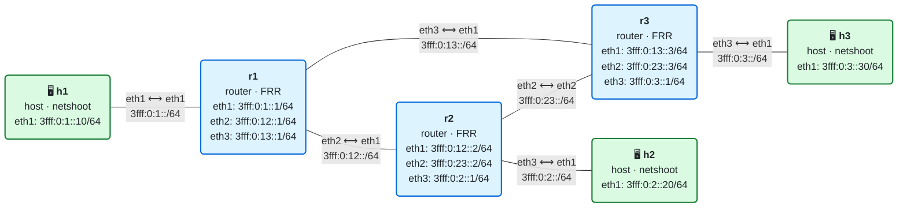

# 04 · Enrutamiento IPv6: rutas estáticas y longest-prefix match

> **Objetivo**: entender cómo un router decide por dónde enviar cada paquete: la tabla de rutas, la regla del prefijo más largo, la métrica, el multicamino y la ruta por defecto.
>
> **Por qué importa para SRv6**: un *locator* de SRv6 no es más que un prefijo IPv6 en la tabla de rutas, y los routers de tránsito lo reenvían con la **misma** regla del prefijo más largo que cualquier otra dirección. Entender el reenvío IPv6 normal es entender el 90 % de SRv6; lo que SRv6 añade solo ocurre en los nodos dueños de los SID.

## El laboratorio de este módulo

<!-- topologia:inicio -->

<!-- topologia:fin -->

Tres routers en triángulo (**r1**, **r2**, **r3**), cada uno con un host. Como hay varios caminos entre las redes, podrás estudiar qué pasa cuando hay más de una ruta hacia el mismo destino. Todas las rutas son **estáticas**, configuradas a mano: así se ve con claridad qué decide cada router, sin la "magia" de un protocolo de enrutamiento (eso llega en el módulo 05). Al terminar la teoría, la [práctica](practica.md) te guía paso a paso.

## 1. Qué hace un router con cada paquete

Cuando a un router le llega un paquete que no es para él, hace tres cosas:

1. Mira la **dirección de destino**.
2. Busca en su **tabla de rutas** la entrada que mejor encaja con esa dirección.
3. Reenvía el paquete al **siguiente salto** (*next hop*) de esa entrada, por la interfaz indicada, tras restar 1 al Hop Limit.

No hay nada más. El router no conoce el camino completo ni le importa: solo sabe "para llegar a esa red, el siguiente es este vecino". Esto es el **reenvío salto a salto** (*hop-by-hop forwarding*), y es la base de IP.

## 2. La tabla de rutas

Cada entrada de la tabla asocia un **prefijo de destino** con cómo llegar a él. En Linux la ves con `ip -6 route`; en FRR, con `show ipv6 route`. Una entrada tiene:

| Elemento | Qué es |
|----------|--------|
| **Prefijo** | La red de destino, con su longitud: `3fff:0:2::/64` |
| **Siguiente salto** | La dirección del vecino al que entregar el paquete: `via 3fff:0:12::2` |
| **Interfaz** | Por dónde sale: `dev eth2` |
| **Origen (proto)** | Quién puso la ruta: `kernel`/`connected`, `static`, `ra`, un protocolo (`isis`, `bgp`)… |
| **Métrica** | El "coste" de la ruta; a menor métrica, más preferida |

### De dónde salen las rutas

| Tipo | Cómo aparece |
|------|--------------|
| **Conectada** | Automática, al poner una dirección en una interfaz. `3fff:0:1::/64 dev eth1` es "esta red está aquí mismo" |
| **Estática** | La configura el administrador a mano, como en este laboratorio |
| **Aprendida por RA** | La instala un *Router Advertisement* (la ruta por defecto del módulo 01) |
| **Dinámica** | La calcula un protocolo de enrutamiento: IS-IS, OSPFv3, BGP (módulos 05 y siguientes) |

### FDB, RIB y FIB

Conviene distinguir dos tablas:

- La **RIB** (*Routing Information Base*) es la tabla "de control": todas las rutas que el router conoce, de todos los orígenes. Es lo que muestra `show ipv6 route` en FRR.
- La **FIB** (*Forwarding Information Base*) es la tabla "de datos": las rutas que de verdad se usan para reenviar, ya elegidas e instaladas en el kernel o en el hardware. Es lo que muestra `ip -6 route`.

Cuando hay varias rutas al mismo destino, la RIB las tiene todas y solo la mejor baja a la FIB. En FRR, esa ruta activa se marca con `>` y `*`.

## 3. Longest-prefix match: la regla de oro

¿Y si varias rutas encajan con el destino? Por ejemplo, una tabla con:

```
::/0               via A      (ruta por defecto: encaja con todo)
3fff:0:3::/48      via B      (encaja con 3fff:0:3:...)
3fff:0:3::/64      via C      (encaja con 3fff:0:3::...)
3fff:0:3::30/128   via D      (encaja solo con 3fff:0:3::30)
```

Un paquete para `3fff:0:3::30` encaja con **las cuatro**. El router elige siempre la de **prefijo más largo** (la más específica), aquí el `/128` vía D. Es la regla del **longest-prefix match (LPM)**, y es universal en IP.

La intuición: una ruta más específica describe el destino con más detalle, así que se considera mejor informada. La métrica solo decide **entre rutas del mismo prefijo**; nunca hace que una ruta más corta gane a una más larga.

| Destino buscado | Rutas que encajan | Gana |
|-----------------|-------------------|------|
| `3fff:0:3::30` | `::/0`, `/48`, `/64`, `/128` | `/128` vía D |
| `3fff:0:3::99` | `::/0`, `/48`, `/64` | `/64` vía C |
| `3fff:0:3:abcd::1` | `::/0`, `/48` | `/48` vía B |
| `3fff:0:9::1` | `::/0` | `::/0` vía A |

> **Conexión con SRv6**: cuando un paquete SRv6 viaja hacia un SID como `5f00:0:2:e000::`, los routers de tránsito lo buscan por LPM y encuentran el locator `5f00:0:2::/48` de r2. Lo reenvían hacia r2 exactamente igual que cualquier paquete IPv6. Solo r2, el dueño del locator, mira "más adentro" y ejecuta la instrucción del SID.

## 4. La ruta por defecto

La ruta `::/0` es la de prefijo más corto: encaja con cualquier dirección y, por LPM, es la que menos gana. Por eso sirve de **comodín**: "si ninguna ruta más específica sirve, envía por aquí". Es la puerta de enlace que usan los hosts para salir de su red, y la que un router de borde usa para mandar a Internet todo lo que no conoce.

Un host típico tiene una tabla mínima: la ruta conectada a su propia red y una ruta por defecto hacia su router. Todo lo demás, lo resuelve el router.

## 5. Cuando hay varias rutas al mismo prefijo

Dos rutas al **mismo** prefijo compiten por la métrica:

### Distinta métrica: una activa, otra de reserva

> **Métrica y distancia administrativa.** "Métrica" es el término general para el coste de una ruta. Cada origen (estático, IS-IS, BGP…) tiene además una **distancia administrativa**, que decide qué origen gana cuando dos protocolos ofrecen una ruta al mismo prefijo. En las rutas estáticas de FRR, el número que escribes (`ipv6 route PREFIJO SALTO 200`) es la distancia administrativa, y hace de métrica para elegir entre estáticas del mismo prefijo: menor valor, más preferida.

```
3fff:0:2::/64 via 3fff:0:12::2  metric 20    ← activa
3fff:0:2::/64 via 3fff:0:13::3  metric 200   ← reserva
```

Solo la de métrica 20 baja a la FIB. Si su siguiente salto se vuelve inalcanzable (por ejemplo, se cae el enlace), FRR la retira e instala la de reserva. Es el **failover**: un camino alternativo listo por si falla el principal.

### Misma métrica: multicamino (ECMP)

```
3fff:0:3::/64 via 3fff:0:12::2  metric 20
3fff:0:3::/64 via 3fff:0:13::3  metric 20
```

Si dos rutas tienen la misma métrica, el router instala **las dos** y reparte el tráfico entre ellas: es **ECMP** (*Equal-Cost Multi-Path*). El reparto no es paquete a paquete, sino por **flujo**: el router calcula un *hash* de unas cuantas cabeceras (direcciones de origen y destino, puertos y, en IPv6, a veces el *Flow Label*) y todos los paquetes con el mismo hash siguen el mismo camino. Así se aprovechan los dos enlaces sin que los paquetes de una conexión lleguen desordenados.

ECMP es importantísimo en las redes modernas (por ejemplo, en los *fabrics* de centro de datos) y es una de las razones del campo *Flow Label* que vimos en el módulo 02.

## 6. Cuando no hay ruta

Si ninguna entrada encaja con el destino (ni siquiera una ruta por defecto), el router no puede reenviar. Descarta el paquete y envía al origen un **ICMPv6 Destination Unreachable** con código 0 (*no route to destination*). El `ping` lo muestra como `Destination unreachable: No route`.

Hay además dos tipos de ruta que descartan a propósito:

- **blackhole**: descarta el paquete en silencio.
- **unreachable** / **prohibit**: lo descarta y envía el ICMPv6 correspondiente.

Se usan, por ejemplo, para "agujerear" un prefijo agregado o para frenar tráfico indeseado.

## 7. Enrutamiento asimétrico

El camino de ida y el de vuelta **no tienen por qué coincidir**. En el triángulo del laboratorio, un paquete de h1 a h3 puede ir por r1→r3, y la respuesta volver por r3→r2→r1 si así lo dicen las tablas de r3 y r2. Cada router decide por su cuenta, mirando solo la dirección de destino de cada paquete.

El enrutamiento asimétrico es normal y no es un error, pero conviene conocerlo: complica el filtrado con estado (un cortafuegos que ve solo un sentido) y el diagnóstico (un `traceroute` solo muestra la ida).

## 8. Resumen

- Un router reenvía mirando **solo la dirección de destino** y su **tabla de rutas**, salto a salto.
- Las rutas son **conectadas**, **estáticas**, aprendidas por **RA** o **dinámicas**.
- Entre varias rutas que encajan, gana siempre la de **prefijo más largo** (LPM). La **métrica** solo decide entre rutas del mismo prefijo.
- La **ruta por defecto** `::/0` es el comodín de último recurso.
- Mismo prefijo y distinta métrica → **failover**; misma métrica → **ECMP** (reparto por flujo).
- Sin ruta, el router descarta y avisa con **Destination Unreachable (no route)**.
- Los caminos de ida y vuelta pueden ser distintos: **enrutamiento asimétrico**.

## Siguiente paso

Haz la [práctica](practica.md) con el laboratorio de este módulo.

## Para saber más

- [RFC 4291](https://www.rfc-editor.org/rfc/rfc4291) — Arquitectura de direccionamiento IPv6 (define el LPM)
- [RFC 4443](https://www.rfc-editor.org/rfc/rfc4443) — ICMPv6 (Destination Unreachable)
- [Documentación de FRR: static routing](https://docs.frrouting.org/en/latest/staticd.html)
- [SRv6.md · ¿Qué es SRv6?](https://srv6.md/es/que-es-srv6/)
