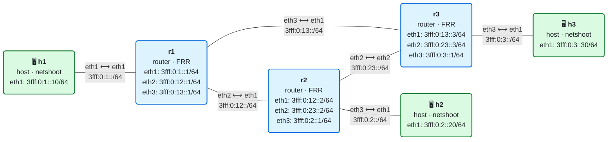

# 04 · Práctica: enrutamiento IPv6

Antes de empezar, lee la [teoría del módulo](README.md).

## Topología

<!-- topologia:inicio -->

<!-- topologia:fin -->

> El fichero editable para draw.io está en [`lab/topologia.drawio`](lab/topologia.drawio).

- **r1**, **r2** y **r3** forman un triángulo. Cada uno tiene un host: **h1** tras r1, **h2** tras r2, **h3** tras r3.
- Las redes de host son `3fff:0:1::/64`, `3fff:0:2::/64` y `3fff:0:3::/64`. Los enlaces entre routers son `3fff:0:12::/64` (r1–r2), `3fff:0:13::/64` (r1–r3) y `3fff:0:23::/64` (r2–r3).
- Todas las rutas son **estáticas**. Las verás y las modificarás con la CLI de FRR (`vtysh`).

> **Dos formas de ver las rutas.** `docker exec clab-m04-r1 vtysh -c "show ipv6 route"` muestra la RIB de FRR (todas las rutas, con la activa marcada `>*`). `docker exec clab-m04-r1 ip -6 route` muestra la FIB del kernel (solo las activas). `vtysh -c "show ipv6 route 3fff:0:3::30"` resuelve un destino concreto por longest-prefix match.

## Parte A · Ejercicios en papel

Hazlos sin ordenador. Las soluciones están en [soluciones.md](soluciones.md).

**A1.** Esta es la tabla de rutas de un router:

```
::/0               via 3fff:0:12::2   metric 1
3fff:0:3::/48      via 3fff:0:13::3   metric 20
3fff:0:3::/64      via 3fff:0:23::2   metric 20
3fff:0:3:5::/80    via 3fff:0:13::3   metric 20
```

¿Por qué siguiente salto sale cada destino?

1. `3fff:0:3::30`
2. `3fff:0:3:5::1`
3. `3fff:0:3:abcd::1`
4. `3fff:0:9::1`
5. `3fff:0:3::/64` entero (la red, no una dirección)

**A2.** Un router tiene dos rutas a `3fff:0:2::/64`: una `metric 20` vía r2 y otra `metric 20` vía r3. ¿Cuál usa? Si fueran `metric 20` y `metric 100`, ¿cuál?

**A3.** En el triángulo del laboratorio, traza a mano el camino de ida de un paquete de **h1 a h2**, según las rutas estáticas configuradas (las tienes en `lab/r1/frr.conf`, etc.). ¿Y el de **h2 a h1**? ¿Coinciden?

**A4.** ¿Qué diferencia hay entre una ruta `blackhole` y que simplemente no exista ninguna ruta para un destino?

**A5.** Un router de tránsito recibe un paquete SRv6 cuyo destino es `5f00:0:2:e000::`. En su tabla tiene `5f00:0:2::/48 via …` y `::/0 via …`. ¿Por cuál lo reenvía? ¿Necesita entender SRv6 para hacerlo?

## Parte B · Laboratorio

### B0. Levantar el laboratorio

```bash
$ cd 04-enrutamiento/lab
$ sudo containerlab deploy -t lab.clab.yml
$ ./verificar.sh
```

### B1. Las rutas de r1

```bash
$ docker exec clab-m04-r1 vtysh -c "show ipv6 route"
```

1. Identifica, por su código (la letra del principio): las rutas **conectadas** (`C`), las **estáticas** (`S`) y las **locales** (`L`). ¿Cuántas de cada una hay?
2. ¿Qué significan los símbolos `>` y `*` en las rutas activas?
3. ¿Cuál es la ruta conectada hacia la red de h1? ¿Por qué no tiene siguiente salto?

### B2. Longest-prefix match en acción

Pregunta a r1 por dónde saldría cada destino:

```bash
$ docker exec clab-m04-r1 vtysh -c "show ipv6 route 3fff:0:3::30"
$ docker exec clab-m04-r1 vtysh -c "show ipv6 route 3fff:0:2::20"
```

1. ¿Por qué siguiente salto sale cada uno?

Ahora añade en r1 una ruta **más específica** solo para h3, que lo desvíe por r2 en vez de por r3:

```bash
$ docker exec clab-m04-r1 vtysh -c "configure terminal" -c "ipv6 route 3fff:0:3::30/128 3fff:0:12::2"
$ docker exec clab-m04-r1 vtysh -c "show ipv6 route 3fff:0:3::30"
$ docker exec clab-m04-r1 vtysh -c "show ipv6 route 3fff:0:3::99"
```

2. ¿Por dónde sale ahora el tráfico hacia `3fff:0:3::30`? ¿Y hacia `3fff:0:3::99`?
3. Compruébalo de verdad con traceroute desde h1:

   ```bash
   $ docker exec clab-m04-h1 traceroute -6 -n 3fff:0:3::30
   ```

   ¿Pasa por r2 (`3fff:0:12::2` y luego `3fff:0:23::3`) o por r3 directo? Fíjate en que h3 sí responde: la ruta más específica solo cambia el camino, no rompe la conectividad.

4. Quita la ruta y vuelve al estado inicial:

   ```bash
   $ docker exec clab-m04-r1 vtysh -c "configure terminal" -c "no ipv6 route 3fff:0:3::30/128 3fff:0:12::2"
   ```

### B3. Métrica y failover

En r1 hay una sola ruta a la red de h2 (`3fff:0:2::/64`), vía r2. Añade una de **reserva** por el camino largo (r1→r3→r2), con peor **distancia administrativa** (en FRR, el número final de una ruta estática es la distancia, no la métrica; cuanto más baja, más preferida):

```bash
$ docker exec clab-m04-r1 vtysh -c "configure terminal" -c "ipv6 route 3fff:0:2::/64 3fff:0:13::3 200"
$ docker exec clab-m04-r1 vtysh -c "show ipv6 route 3fff:0:2::/64"
```

1. ¿Cuántas rutas a `3fff:0:2::/64` ve FRR (`show ipv6 route 3fff:0:2::/64` muestra las dos entradas)? ¿Cuál está marcada como `best`? ¿Por qué esa?

Ahora simula que se cae el enlace r1–r2, apagando la interfaz eth2 de r1:

```bash
$ docker exec clab-m04-r1 vtysh -c "configure terminal" -c "interface eth2" -c "shutdown"
$ docker exec clab-m04-r1 vtysh -c "show ipv6 route 3fff:0:2::/64"
$ docker exec clab-m04-h1 ping -c2 3fff:0:2::20
```

2. ¿Qué ruta está activa ahora en r1? ¿Por qué la de distancia 200 no se usaba antes y ahora sí?
3. **Sorpresa**: el ping de h1 a h2 **falla**, aunque r1 ya tiene camino hacia la red de h2. ¿Por qué? Piensa en el camino de **vuelta**: ¿cómo llega la respuesta de h2 hasta h1? ¿Qué ruta usa r2 para la red de h1 y qué le ha pasado a esa ruta? (Este fallo es la mejor motivación para el módulo 05.)

Levanta la interfaz y quita la ruta de reserva:

```bash
$ docker exec clab-m04-r1 vtysh -c "configure terminal" -c "interface eth2" -c "no shutdown"
$ docker exec clab-m04-r1 vtysh -c "configure terminal" -c "no ipv6 route 3fff:0:2::/64 3fff:0:13::3 200"
```

### B4. ECMP: dos caminos a la vez

Añade en r1 una segunda ruta a la red de h3 con la **misma** métrica que la que ya hay (por defecto, 20), por el otro lado del triángulo:

```bash
$ docker exec clab-m04-r1 vtysh -c "configure terminal" -c "ipv6 route 3fff:0:3::/64 3fff:0:12::2"
$ docker exec clab-m04-r1 vtysh -c "show ipv6 route 3fff:0:3::/64"
$ docker exec clab-m04-r1 ip -6 route show 3fff:0:3::/64
```

1. ¿Cómo muestra FRR que la ruta tiene dos siguientes saltos? ¿Y el kernel (`ip -6 route`)?
2. Lanza varios pings con origen distinto y mira por dónde salen:

   ```bash
   $ for s in 1 2 3 4; do docker exec clab-m04-r1 ip -6 route get 3fff:0:3::30 from 3fff:0:13::1 oif eth$s 2>/dev/null; done
   $ docker exec clab-m04-r1 vtysh -c "show ipv6 route 3fff:0:3::30"
   ```

   El reparto ECMP depende de un hash de las cabeceras; con `ip route get` y distintos orígenes puedes ver que no siempre elige el mismo siguiente salto.
3. Quita la ruta añadida:

   ```bash
   $ docker exec clab-m04-r1 vtysh -c "configure terminal" -c "no ipv6 route 3fff:0:3::/64 3fff:0:12::2"
   ```

### B5. Sin ruta

```bash
$ docker exec clab-m04-h1 ping -c2 3fff:0:99::1
$ docker exec clab-m04-r1 vtysh -c "show ipv6 route 3fff:0:99::1"
```

1. ¿Qué mensaje da el ping y quién lo genera? (r1 no tiene ruta a `3fff:0:99::/64` ni ruta por defecto.)
2. Añade en r1 una ruta por defecto hacia r3 y repite:

   ```bash
   $ docker exec clab-m04-r1 vtysh -c "configure terminal" -c "ipv6 route ::/0 3fff:0:13::3"
   $ docker exec clab-m04-h1 ping -c2 3fff:0:99::1
   ```

   ¿Cambia algo? ¿Por qué el ping sigue sin recibir respuesta aunque ahora r1 **sí** reenvía el paquete? (Pista: piensa en r3 y en la vuelta.)
3. Quita la ruta por defecto:

   ```bash
   $ docker exec clab-m04-r1 vtysh -c "configure terminal" -c "no ipv6 route ::/0 3fff:0:13::3"
   ```

### B6. Enrutamiento asimétrico

Fuerza que el tráfico de h1 a h3 vaya por r2, pero deja la vuelta como está:

```bash
$ docker exec clab-m04-r1 vtysh -c "configure terminal" -c "ipv6 route 3fff:0:3::/64 3fff:0:12::2 10"
$ docker exec clab-m04-h1 traceroute -6 -n 3fff:0:3::30
$ docker exec clab-m04-h3 traceroute -6 -n 3fff:0:1::10
```

1. ¿Por qué routers pasa la ida (h1→h3)? ¿Y la vuelta (h3→h1)?
2. ¿Coinciden? ¿Sigue funcionando el ping? Compruébalo:

   ```bash
   $ docker exec clab-m04-h1 ping -c2 3fff:0:3::30
   ```

3. Deshaz el cambio:

   ```bash
   $ docker exec clab-m04-r1 vtysh -c "configure terminal" -c "no ipv6 route 3fff:0:3::/64 3fff:0:12::2 10"
   ```

### B7. Limpieza

```bash
$ sudo containerlab destroy -t lab.clab.yml --cleanup
```

## Reto

En r1, haz que la red de h3 (`3fff:0:3::/64`) sea un **agujero negro**: que r1 descarte en silencio todo el tráfico hacia ella.

```bash
$ docker exec clab-m04-r1 vtysh -c "configure terminal" -c "ipv6 route 3fff:0:3::/64 blackhole 5"
```

¿Por qué hace falta darle una métrica mejor (5) que la de la ruta normal (20) para que surta efecto? Comprueba con `show ipv6 route 3fff:0:3::/64` cuál queda activa, y con un ping desde h1 qué ocurre. ¿Recibe h1 algún mensaje de error, o el paquete desaparece sin más? Compáralo con lo que pasaba en B5 cuando no había ninguna ruta.
