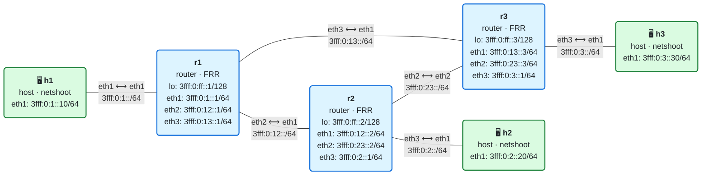
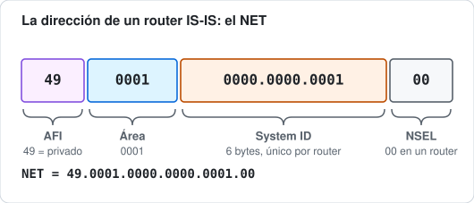
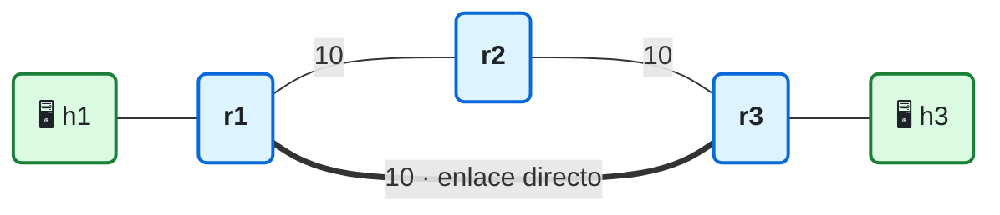

# 05 · IS-IS para IPv6

> **Objetivo**: entender cómo un protocolo de estado de enlace calcula las rutas automáticamente, y conocer las piezas de IS-IS: adyacencias, LSP, base de datos, SPF, niveles y áreas.
>
> **Por qué importa para SRv6**: IS-IS es el protocolo de enrutamiento que más se usa con SRv6. No solo calcula los caminos del núcleo: también es quien **anuncia los locators y los SID** por toda la red ([RFC 9352](https://www.rfc-editor.org/rfc/rfc9352)). El LSP de IS-IS que diseccionaste en el laboratorio SRv6 de la wiki es exactamente lo que vas a construir aquí.

## El laboratorio de este módulo

<!-- topologia:inicio -->

<!-- topologia:fin -->

El mismo triángulo del módulo 04, pero sin una sola ruta estática: los tres routers usan **IS-IS**. Cada uno tiene un *loopback* (`3fff:0:ff::N/128`) que anuncia por el protocolo, y las redes de los hosts se anuncian como interfaces pasivas. Al terminar verás lo que el módulo 04 no podía hacer: cuando se cae un enlace, **todos** los routers recalculan sus tablas solos, en los dos sentidos, y la comunicación sigue. Al terminar la teoría, la [práctica](practica.md) te guía paso a paso.

## 1. Por qué un protocolo de enrutamiento

En el módulo 04 configuraste cada ruta a mano, y viste el problema: cuando se cae un enlace, hay que rehacer las tablas de **todos** los routers afectados. Con tres routers ya es incómodo; con trescientos, imposible.

Un **protocolo de enrutamiento dinámico** automatiza eso. Los routers se descubren entre sí, se intercambian información de la topología y **cada uno calcula sus propias rutas**. Cuando algo cambia (un enlace cae, aparece una red nueva), se avisan y **todos** recalculan en segundos. A esto se le llama **convergencia**.

Los protocolos que funcionan dentro de una misma red (un operador, una empresa) se llaman **IGP** (*Interior Gateway Protocol*). Los dos IGP de estado de enlace son **IS-IS** y **OSPF**. Entre redes distintas (entre operadores) se usa **BGP**, que es otra familia. Este módulo trata IS-IS; BGP llega en el bloque de servicios.

## 2. Estado de enlace: el mapa compartido

Hay dos grandes familias de IGP:

- **Vector de distancia** (RIP): cada router solo sabe "para esa red, mi vecino está a tantos saltos". Nadie tiene el mapa completo. Convergen despacio y pueden formar bucles.
- **Estado de enlace** (IS-IS, OSPF): cada router describe **sus propios enlaces** y se inunda esa descripción por toda la red. Así **todos los routers acaban teniendo el mismo mapa completo** de la red, y cada uno calcula los caminos más cortos sobre ese mapa.

La idea del estado de enlace es la clave: la red se comporta como si todos miraran el mismo plano. Esto se consigue en tres pasos:

1. **Adyacencias**: cada router descubre a sus vecinos directos.
2. **Inundación**: cada router anuncia qué enlaces tiene, y esos anuncios se propagan a todos.
3. **Cálculo (SPF)**: cada router aplica el algoritmo de Dijkstra sobre el mapa y obtiene el camino más corto a cada destino.

## 3. IS-IS es diferente: vive en la capa 2

IS-IS tiene una peculiaridad que conviene entender desde el principio: **no viaja dentro de IP**. OSPF va sobre IP (protocolo 89 en IPv4, OSPFv3 en IPv6); IS-IS, en cambio, se envía **directamente sobre la capa de enlace** (Ethernet), con su propio formato de paquetes heredado del mundo OSI/CLNS.

Esto tiene dos consecuencias prácticas:

- **IS-IS es "agnóstico" del protocolo que transporta.** El mismo IS-IS puede anunciar rutas IPv4 e IPv6 a la vez, sin cambiar nada de su funcionamiento interno, porque las direcciones viajan como datos dentro de sus mensajes, no como la dirección del propio paquete. Para IPv6 solo se añadieron unos TLV nuevos ([RFC 5308](https://www.rfc-editor.org/rfc/rfc5308)).
- **Es fácil de extender.** La información de IS-IS se organiza en **TLV** (*Type-Length-Value*): bloques "tipo, longitud, valor" que un router puede ignorar si no entiende. Añadir una función nueva es definir un TLV nuevo. Por eso IS-IS se ha convertido en el favorito para Segment Routing: los locators y los SID de SRv6 son, simplemente, TLV nuevos ([RFC 9352](https://www.rfc-editor.org/rfc/rfc9352)).

### Direcciones de IS-IS: el NET

Como IS-IS viene del mundo OSI, no identifica a los routers por una dirección IP, sino por una dirección **NSAP**, que en su forma de router se llama **NET** (*Network Entity Title*). Tiene este aspecto:

- El **System ID** (`0000.0000.0001`) identifica al router de forma única en todo el dominio. Suele derivarse de una dirección de loopback: `3fff:0:ff::1` → `0000.0000.0001`, o con otra convención. En el laboratorio lo asignamos a mano.
- El **área** (`0001`) agrupa routers, como verás en la sección 6.
- El **NSEL** final es siempre `00` para un router.

En las capturas y en los LSP verás los System ID, no las direcciones IP. Por eso es cómodo darles nombre: FRR muestra `r1`, `r2`… en lugar de `0000.0000.0001`.

## 4. Adyacencias: los Hello

Para descubrir a sus vecinos, cada router envía mensajes **Hello** (IIH, *IS-IS Hello*) por sus interfaces. Si dos routers se oyen y sus parámetros son compatibles, forman una **adyacencia**: cada uno apunta al otro como vecino directo.

Hay dos tipos de enlace:

| Tipo | Cómo se usa | Ejemplo |
|------|-------------|---------|
| **Punto a punto** | Dos routers y nada más. La adyacencia es directa y sencilla | El enlace entre r1 y r2 del laboratorio |
| **Broadcast** (LAN) | Varios routers en la misma red | Varios routers colgando de un switch |

En un enlace **broadcast**, para no inundar N×N mensajes, los routers eligen un **DIS** (*Designated Intermediate System*) que representa a la LAN como un "pseudonodo". En las redes modernas casi todos los enlaces entre routers son **punto a punto** (como en el laboratorio y en las redes SRv6), así que el DIS importa menos; basta saber que existe.

Una adyacencia se mantiene viva con los Hello periódicos. Si dejan de llegar durante el **holdtime**, el router da al vecino por caído y lo retira del mapa. Ese es el disparador de una reconvergencia por fallo de enlace.

## 5. LSP, base de datos e inundación

Cada router describe su parte del mapa en un **LSP** (*Link State PDU*): "soy r1, mis vecinos son r2 (coste 10) y r3 (coste 10), y tengo estas redes IPv6". Los LSP se **inundan**: cada router los reenvía a sus vecinos, que a su vez los reenvían, hasta que todos tienen una copia.

El conjunto de todos los LSP es la **LSDB** (*Link State Database*), el mapa compartido. Cuando la red ha convergido, **todos los routers tienen una LSDB idéntica**. Puedes verla con `show isis database`; cada LSP lleva:

| Campo | Qué es |
|-------|--------|
| **LSP ID** | Quién lo generó: `r1.00-00` (System ID + pseudonodo + fragmento) |
| **Sequence Number** | Versión del LSP; sube con cada cambio, para distinguir el más reciente |
| **Holdtime** | Cuánto vale el LSP antes de caducar si no se refresca |
| **TLVs** | La información en sí: vecinos y costes, prefijos IPv6, capacidades… y, con SRv6, los locators y SID |

Para que nadie se quede con un mapa viejo, IS-IS usa mensajes de sincronización, los **SNP** (*Sequence Number PDU*): **CSNP** (un resumen de toda la LSDB, que el DIS envía periódicamente) y **PSNP** (para pedir o confirmar LSP concretos). Así, si un router se perdió un LSP, lo detecta y lo pide.

## 6. Niveles y áreas

En una red grande no conviene que todos los routers tengan el mapa de todo: la LSDB sería enorme y cualquier cambio haría recalcular a toda la red. IS-IS divide el dominio en **áreas** y usa dos **niveles**:

| Nivel | Alcance | Papel |
|-------|---------|-------|
| **Level 1 (L1)** | Dentro de un área | Conoce el detalle de su área. Para salir, manda al router L1/L2 más cercano |
| **Level 2 (L2)** | Entre áreas | Forma la "columna vertebral" que une las áreas |

Un router puede ser L1, L2 o **L1/L2** (los dos a la vez, en el borde de un área). Es parecido a las áreas de OSPF, con una diferencia: en IS-IS **la frontera de área cae en el enlace** (cada router pertenece entero a un área), mientras que en OSPF cae en el router.

En el laboratorio usamos **un solo nivel, L2** (`is-type level-2-only`), que es lo más habitual en redes SRv6 modernas: muchas se diseñan como una sola área L2 plana y delegan la escala en otras técnicas. La teoría de L1/L2 la necesitarás para redes grandes, pero para SRv6 basta empezar con L2.

## 7. SPF: el cálculo del camino más corto

Con la LSDB completa, cada router ejecuta el algoritmo **SPF** (*Shortest Path First*, el Dijkstra): se pone a sí mismo en la raíz de un árbol y va añadiendo los nodos por orden de **coste acumulado**, hasta tener el camino más corto a cada destino.

El coste de cada enlace es su **métrica**. Por defecto en IS-IS vale **10** en cada interfaz, y el coste de un camino es la suma de las métricas de sus enlaces:

| Camino de r1 a r3 | Coste |
|---|:-:|
| r1 → r3, directo (en grueso) | **10** ← el que elige SPF |
| r1 → r2 → r3 | 20 |

Si bajas la métrica de un enlace, lo haces más "atractivo"; si la subes, SPF lo evita. Cuando dos caminos tienen el **mismo** coste, IS-IS instala los dos y hace **ECMP**, como viste en el módulo 04.

> **El coste de un prefijo lleva un salto más.** SPF calcula el coste a cada **nodo** (r3 está a 10 de r1 por el enlace directo). Pero el coste de una **red** incluye además la métrica de la interfaz que la anuncia. Como el loopback y las redes de host se anuncian por interfaces pasivas con métrica 10, su coste total desde r1 es 10 (llegar a r3) + 10 (interfaz pasiva) = **20**. Por eso `show isis route` dirá "r3 a coste 10" y `show ipv6 route isis` dirá "loopback de r3 a coste 20": miden cosas distintas, el nodo y el prefijo.
>
> **IS-IS usa next-hop link-local.** Fíjate en que las rutas que instala IS-IS salen `via fe80::…`, no por la dirección global del vecino. Es lo normal en IPv6: el IGP usa las link-local como siguiente salto, igual que hacía Neighbor Discovery (módulo 03). Lo verás otra vez en SRv6: el siguiente salto de un SID End.X es una link-local.

> **Métricas estrechas y anchas.** La métrica original de IS-IS era de 6 bits (máximo 63 por enlace, 1023 por camino): son las *narrow metrics*. Hoy se usan las *wide metrics* (32 bits), imprescindibles para Segment Routing y para Flex-Algo. FRR las usa por defecto.

## 8. La reconvergencia: lo que las rutas estáticas no podían hacer

Esta es la diferencia que hace útil a IS-IS. Cuando se cae un enlace:

1. Los routers de sus extremos dejan de recibir Hello y declaran la adyacencia caída (o lo detectan al instante si el enlace baja físicamente).
2. Generan un **LSP nuevo** (con un número de secuencia mayor) que ya no incluye ese enlace, y lo **inundan**.
3. **Todos** los routers actualizan su LSDB y **vuelven a ejecutar SPF**.
4. Cada uno instala las rutas nuevas. En segundos, la red entera tiene caminos alternativos, **de ida y de vuelta**.

En el módulo 04, al caer el enlace r1–r2, la respuesta de h2 se quedaba sin camino porque r2 no sabía recalcular. Aquí, r2 y todos los demás recalculan solos, así que el ping sobrevive. Lo comprobarás en la práctica.

## 9. Conexión con SRv6

Cuando en el módulo 11 añadamos SRv6 a este mismo IS-IS, lo único que cambiará es que los LSP llevarán **TLV adicionales**:

- El **SRv6 Locator TLV**: "yo, r2, soy dueño del locator `5f00:0:2::/48`". Se anuncia como un prefijo IPv6 normal, y todos los routers instalan una ruta hacia él por SPF.
- Los **sub-TLV de SID**: los End.X de cada adyacencia, con su comportamiento y su estructura.

Todo lo de este módulo (adyacencias, LSP, LSDB, SPF, métricas) sigue funcionando igual. SRv6 no cambia el motor del IGP; solo le añade carga útil. Por eso dominar IS-IS es dominar la mitad de SRv6, y por eso el LSP que diseccionaste en la wiki tenía la misma estructura que los que verás aquí, pero sin los TLV de SRv6.

## 10. Resumen

- Un **IGP** calcula las rutas automáticamente y **reconverge** cuando la red cambia.
- IS-IS es un protocolo de **estado de enlace**: todos los routers comparten el mismo mapa (la **LSDB**) y cada uno calcula sus rutas con **SPF** (Dijkstra).
- IS-IS viaja **sobre la capa 2**, identifica routers por su **NET/System ID** y organiza la información en **TLV**, lo que lo hace fácil de extender; de ahí su encaje con SRv6.
- Se forman **adyacencias** con Hello, se describe la topología en **LSP** que se **inundan**, y los **SNP** mantenen la LSDB sincronizada.
- IS-IS escala con **niveles (L1/L2) y áreas**; en SRv6 es común una sola área **L2**.
- El coste de un enlace es su **métrica** (10 por defecto; *wide metrics* para SR); caminos de igual coste hacen **ECMP**.
- Al caer un enlace, **toda** la red recalcula sola, ida y vuelta: eso es lo que las rutas estáticas no podían.

## Siguiente paso

Haz la [práctica](practica.md) con el laboratorio de este módulo. Con esto cierras el bloque de fundamentos: ya tienes todo lo necesario para empezar con Segment Routing.

## Para saber más

- [RFC 1195](https://www.rfc-editor.org/rfc/rfc1195) — IS-IS para encaminar IP
- [RFC 5308](https://www.rfc-editor.org/rfc/rfc5308) — IS-IS para IPv6
- [RFC 5305](https://www.rfc-editor.org/rfc/rfc5305) — Wide metrics (TE)
- [RFC 9352](https://www.rfc-editor.org/rfc/rfc9352) — IS-IS para SRv6
- [Documentación de FRR: IS-IS](https://docs.frrouting.org/en/latest/isisd.html)
- [SRv6.md · Implementación en FRRouting](https://srv6.md/implementations/frrouting/)
