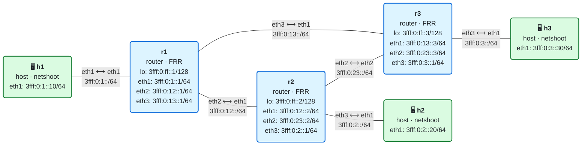

# 05 · Práctica: IS-IS para IPv6

Antes de empezar, lee la [teoría del módulo](README.md).

## Topología

<!-- topologia:inicio -->

<!-- topologia:fin -->

> El fichero editable para draw.io está en [`lab/topologia.drawio`](lab/topologia.drawio).

- **r1**, **r2** y **r3** forman un triángulo y usan **IS-IS** (área única, nivel 2). Ninguna ruta es estática.
- Cada router anuncia su **loopback** `3fff:0:ff::N/128` y, como interfaz pasiva, la red de su host.
- Los enlaces entre routers son **punto a punto**, con métrica por defecto **10**.

## Parte A · Ejercicios en papel

Hazlos sin ordenador. Las soluciones están en [soluciones.md](soluciones.md).

**A1.** Descompón el NET `49.0001.0000.0000.0002.00` en sus partes (AFI, área, System ID, NSEL). ¿A qué router del laboratorio corresponde?

**A2.** ¿Por qué se dice que IS-IS es "agnóstico" del protocolo de red? ¿Qué ventaja le da eso frente a OSPF de cara a SRv6?

**A3.** Con las métricas por defecto (10 por enlace), calcula el coste de r1 a cada destino y di por dónde sale:

1. loopback de r2 (`3fff:0:ff::2`)
2. loopback de r3 (`3fff:0:ff::3`)
3. red de h2 (`3fff:0:2::/64`)
4. red de h3 (`3fff:0:3::/64`)

**A4.** Si subes a **30** la métrica del enlace r1–r3 (en la interfaz eth3 de r1 y eth1 de r3), ¿por dónde pasará ahora r1 para llegar al loopback de r3? ¿Cuál será el coste?

**A5.** En el módulo 04, al caer el enlace r1–r2 el ping de h1 a h2 se rompía. Explica, con lo que sabes de IS-IS, por qué aquí no se romperá.

## Parte B · Laboratorio

### B0. Levantar el laboratorio

```bash
$ cd 05-isis/lab
$ sudo containerlab deploy -t lab.clab.yml
$ ./verificar.sh
```

IS-IS tarda unos segundos en converger. Espera a que el verificador salga en verde.

### B1. Las adyacencias

```bash
$ docker exec clab-m05-r1 vtysh -c "show isis neighbor"
```

1. ¿Con cuántos vecinos tiene adyacencia r1? ¿Quiénes son?
2. ¿En qué estado están (`State`)? ¿Por qué interfaz se forma cada una?
3. ¿Por qué r1 **no** tiene una adyacencia por eth1 (hacia h1), si esa interfaz también está en IS-IS?

### B2. La base de datos de estado de enlace

```bash
$ docker exec clab-m05-r1 vtysh -c "show isis database"
$ docker exec clab-m05-r1 vtysh -c "show isis database detail r3.00-00"
```

1. ¿Cuántos LSP hay en la base de datos? ¿De quién es cada uno?
2. Compara la base de datos de r1 con la de r3:

   ```bash
   $ docker exec clab-m05-r3 vtysh -c "show isis database"
   ```

   ¿Son iguales? ¿Por qué deberían serlo?
3. En el LSP de r3 (`detail`), localiza: sus vecinos con el coste de cada enlace (*Extended Reachability*) y las redes IPv6 que anuncia (*IPv6 Reachability*). ¿Aparece el loopback `3fff:0:ff::3/128`? ¿Y la red de h3?

### B3. Las rutas que calcula SPF

```bash
$ docker exec clab-m05-r1 vtysh -c "show ipv6 route isis"
```

1. ¿Qué rutas ha aprendido r1 por IS-IS (código `I`)? ¿Cuál es la métrica de cada una (el segundo número entre corchetes, `[115/X]`)?
2. ¿Por qué siguiente salto llega r1 al loopback de r3? ¿Coincide con lo que calculaste en A3?
3. Mira el árbol SPF:

   ```bash
   $ docker exec clab-m05-r1 vtysh -c "show isis route"
   ```

   ¿Qué coste tiene r1 hasta r3? ¿Y hasta r2?

### B4. Cambiar una métrica

Sube a 30 la métrica del enlace r1–r3 en los dos extremos:

```bash
$ docker exec clab-m05-r1 vtysh -c "conf t" -c "interface eth3" -c "isis metric 30"
$ docker exec clab-m05-r3 vtysh -c "conf t" -c "interface eth1" -c "isis metric 30"
$ sleep 3
$ docker exec clab-m05-r1 vtysh -c "show ipv6 route 3fff:0:ff::3/128"
$ docker exec clab-m05-r1 traceroute -6 -n 3fff:0:3::30
```

1. ¿Por dónde llega ahora r1 al loopback de r3? ¿Cuánto cuesta ese camino?
2. El traceroute de r1 a la red de h3, ¿pasa ahora por r2? ¿Coincide con A4?
3. Deja las métricas como estaban:

   ```bash
   $ docker exec clab-m05-r1 vtysh -c "conf t" -c "interface eth3" -c "no isis metric 30"
   $ docker exec clab-m05-r3 vtysh -c "conf t" -c "interface eth1" -c "no isis metric 30"
   ```

### B5. La reconvergencia (lo que el módulo 04 no podía)

Deja un ping continuo de h1 a h3 en una terminal:

```bash
$ docker exec clab-m05-h1 ping 3fff:0:3::30
```

En otra terminal, confirma que ahora mismo el camino es directo r1→r3 y luego **corta el enlace r1–r3**:

```bash
$ docker exec clab-m05-h1 traceroute -6 -n 3fff:0:3::30
$ docker exec clab-m05-r1 vtysh -c "conf t" -c "interface eth3" -c "shutdown"
```

1. Mira el ping de la primera terminal. ¿Se interrumpe del todo o pierde solo algún paquete y sigue?
2. Vuelve a trazar el camino y mira las rutas y la base de datos:

   ```bash
   $ docker exec clab-m05-h1 traceroute -6 -n 3fff:0:3::30
   $ docker exec clab-m05-r1 vtysh -c "show ipv6 route 3fff:0:3::/64"
   ```

   ¿Por dónde va ahora h1 a h3? ¿Quién recalculó: solo r1, o también r2 y r3?
3. Comprueba que la **vuelta** también se ha arreglado sola (esto es lo que fallaba en el módulo 04):

   ```bash
   $ docker exec clab-m05-h3 traceroute -6 -n 3fff:0:1::10
   ```

4. Levanta el enlace y observa que el camino directo vuelve:

   ```bash
   $ docker exec clab-m05-r1 vtysh -c "conf t" -c "interface eth3" -c "no shutdown"
   $ sleep 5
   $ docker exec clab-m05-h1 traceroute -6 -n 3fff:0:3::30
   ```

   Para la primera terminal con Ctrl-C y mira el resumen de pérdidas: ¿cuántos paquetes se perdieron en todo el proceso?

### B6. Ver IS-IS en el cable

IS-IS no va sobre IP, así que se captura por su tipo de trama, no con un filtro IPv6. Captura los Hello en el enlace r1–r2:

```bash
$ docker run --rm -it --net container:clab-m05-r1 nicolaka/netshoot:v0.13 \
    tcpdump -ni eth2 -vv 'isis'
```

1. ¿Cada cuánto envía r1 un Hello? ¿Qué tipo de PDU ves además de los Hello (busca `lsp`, `csnp`, `psnp`)?
2. ¿Ves alguna dirección IPv6 como origen o destino de estas tramas? ¿Por qué no?

### B7. Limpieza

```bash
$ sudo containerlab destroy -t lab.clab.yml --cleanup
```

## Reto

Haz que el tráfico entre la red de h1 y la de h3 tenga **dos caminos de igual coste** (ECMP) y compruébalo.

Pista: el camino directo r1–r3 cuesta 10 y el camino por r2 cuesta 20. Si subes la métrica del enlace directo a **20**… no, eso lo igualaría a 20 pero el directo seguiría siendo un solo enlace. Piensa qué métricas hacen que `r1→r3 directo` y `r1→r2→r3` sumen lo mismo, configúralas en las interfaces correspondientes y verifica con `show ipv6 route 3fff:0:3::/64` que r1 instala **dos** siguientes saltos. ¿Qué métrica del enlace directo iguala los dos caminos?
