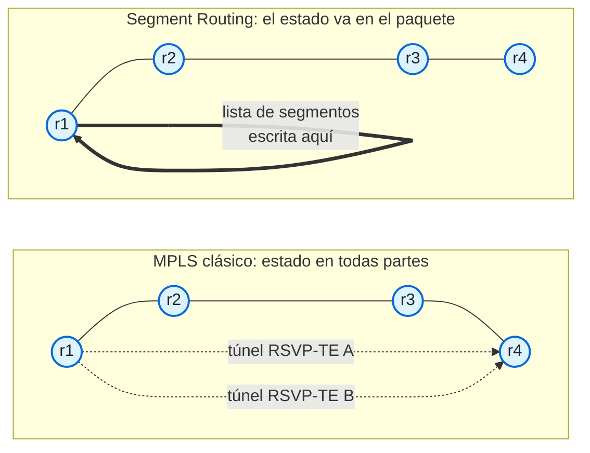

# 06 · De MPLS a Segment Routing: el porqué

> **Objetivo**: entender qué problemas de las redes de operador tradicionales resuelve Segment Routing, y por qué SRv6 lleva la idea un paso más allá que SR-MPLS.
>
> **Por qué importa para SRv6**: antes de ver *cómo* funciona SRv6 (el SID, la SRH, los behaviors), conviene tener claro *por qué* existe. Si no, SRv6 parece "IPv6 con una cabecera rara". Con el porqué claro, cada pieza que veas en los módulos siguientes tendrá sentido.

> **Este módulo no tiene laboratorio.** Es conceptual: cierra la transición entre los fundamentos (bloques que ya has montado) y el plano de datos de SRv6 (módulo 07 en adelante). En lugar de práctica de containerlab, tiene [ejercicios de repaso](ejercicios.md) con soluciones. El siguiente laboratorio llega en el módulo 08.

## 1. Dónde estamos

En el bloque de fundamentos construiste, pieza a pieza, una red IPv6 que funciona: direcciones, reenvío por *longest-prefix match* y un IGP (IS-IS) que calcula los caminos más cortos y reconverge solo. Eso es una red que **mueve paquetes por el camino más corto**. Para muchas cosas, basta.

Pero una red de operador necesita **dos cosas más** que el "camino más corto" no da por sí solo:

1. **Ingeniería de tráfico (TE)**: a veces quieres que *cierto* tráfico vaya por un camino que **no** es el más corto. Por ejemplo, llevar el tráfico de voz por el enlace de menor latencia, o apartar un flujo grande de un enlace congestionado, o garantizar dos caminos totalmente separados para un cliente.
2. **Servicios (VPN)**: quieres transportar las redes privadas de muchos clientes por la misma infraestructura, sin que se mezclen y sin tener que conocer, en el núcleo, las direcciones de cada cliente.

Durante dos décadas, la respuesta a esas dos necesidades fue **MPLS**. Segment Routing es la forma moderna de conseguir lo mismo con muchas menos piezas.

## 2. La forma MPLS: un protocolo para cada cosa

MPLS no reenvía por la dirección IP, sino por una **etiqueta** corta que se antepone al paquete. En cada salto, el router mira la etiqueta, la cambia por otra y reenvía. El problema no es MPLS en sí, sino **cuántos protocolos hacen falta** para que funcione:

| Trabajo | Cómo se hace en MPLS clásico | Qué cuesta |
|---------|------------------------------|------------|
| Topología y alcance | IS-IS u OSPF | (esto ya lo tenías) |
| **Etiquetas de transporte** | **LDP**: reparte una etiqueta por destino, en cada salto | Otro protocolo que mantener, sincronizado con el IGP |
| **Ingeniería de tráfico** | **RSVP-TE**: crea túneles con reserva de recursos | **Estado por túnel en cada router intermedio** |
| **Servicios VPN** | **BGP** con etiquetas de VPN | (BGP ya hacía falta, pero añade etiquetas) |
| Protección rápida | RSVP-TE FRR, o LFA con huecos de cobertura | Complejo, o incompleto |

Dos de estos protocolos son los que más duelen:

- **LDP** es un protocolo entero cuyo único trabajo es repartir etiquetas que **siguen exactamente al IGP**. Es información duplicada: el IGP ya sabe los caminos, pero LDP vuelve a distribuirlos en forma de etiquetas. Y si LDP y el IGP se desincronizan, aparecen agujeros negros.
- **RSVP-TE** es el peor en cuanto a escala. Para tener ingeniería de tráfico entre *N* routers de borde, necesitas una malla de túneles del orden de **N²**, y **cada router intermedio guarda estado de cada túnel que lo cruza**. Con decenas de routers, son miles de túneles y un estado enorme repartido por toda la red.

## 3. El problema de fondo: el estado en el núcleo

Fíjate en el patrón: el núcleo de la red tiene que **guardar estado por cada camino**. LDP mantiene etiquetas por destino; RSVP-TE mantiene túneles por par origen-destino. Cuanto más crece la red y más caminos quieres controlar, más estado hay que mantener, sincronizar y diagnosticar en **todos** los routers.

Ese es el problema que resuelve Segment Routing, y lo hace con una idea vieja y elegante: el **encaminamiento desde el origen** (*source routing*).

## 4. La idea de Segment Routing

En Segment Routing ([RFC 8402](https://www.rfc-editor.org/rfc/rfc8402)), **el camino lo decide y lo escribe el router de entrada** (el *headend*), dentro del propio paquete, como una lista ordenada de instrucciones llamadas **segmentos**. Los routers intermedios solo ejecutan la instrucción que les toca y reenvían. **El núcleo no guarda ningún estado por camino.**

La analogía de la wiki lo resume bien: es como un GPS con puntos de paso. El conductor (el headend) marca unos pocos puntos intermedios; entre uno y otro, el GPS elige la mejor carretera (el camino más corto del IGP), y nadie por el camino necesita conocer el itinerario completo. En cada punto de paso puede ocurrir algo (recoger a un pasajero, cambiar de carril): eso es la *función* del segmento.

Las consecuencias son enormes:

- **Adiós a LDP**: los segmentos "de transporte" los reparte el **propio IGP** (IS-IS u OSPF), con unas extensiones, como viste en el módulo 05. Un protocolo menos.
- **Adiós a RSVP-TE**: la ingeniería de tráfico se hace escribiendo una lista de segmentos en el headend (una *SR Policy*). **El estado vive solo en el headend**, no en el núcleo. Se acabó la malla de N² túneles.
- **La protección rápida (TI-LFA)** se vuelve sencilla y con cobertura total, porque el camino de respaldo también se expresa como una lista de segmentos.

Segment Routing no sustituye al IGP: **se apoya en él**. Todo lo que aprendiste en el módulo 05 sigue ahí; SR solo le añade la capacidad de llevar instrucciones en el paquete.

## 5. Dos planos de datos: SR-MPLS y SRv6

Segment Routing define *qué* es un segmento de forma abstracta. Luego hay **dos formas** de llevarlos en el paquete:

| | **SR-MPLS** | **SRv6** |
|---|-------------|----------|
| Un segmento es… | una **etiqueta MPLS** (20 bits) | una **dirección IPv6** (128 bits), el SID |
| La lista viaja en… | una pila de etiquetas MPLS | la dirección de destino + la SRH (módulo 07) |
| El plano de datos es… | MPLS (hay que tenerlo en todas partes) | IPv6 nativo |
| Reparte los segmentos… | el IGP (extensiones) | el IGP (los locators son prefijos) |

**SR-MPLS** ya elimina LDP y RSVP-TE, pero **sigue necesitando MPLS** en el plano de datos: todos los routers tienen que saber conmutar etiquetas, y MPLS se detiene en el borde del dominio (en el centro de datos, en los hosts, no hay MPLS).

**SRv6** da el paso siguiente: expresa cada segmento como una **dirección IPv6 normal**. Eso cambia las reglas del juego.

## 6. Por qué SRv6 va más lejos

Al ser el segmento una dirección IPv6, SRv6 consigue cosas que SR-MPLS no puede:

- **Un solo plano de datos de extremo a extremo.** La misma red IPv6 lleva el tráfico por el WAN, el metro, el centro de datos e incluso por los *hosts* Linux. No hay que "coser" dominios con VXLAN o GRE. El tráfico IPv4 se transporta como carga útil.
- **El servicio vive en la dirección.** Un SID puede significar "desencapsula y busca en la VRF del cliente azul". Una VPN no necesita una etiqueta aparte: el servicio está codificado en el SID, como viste al diseccionar `End.DT6`.
- **Los locators se sumarizan.** Como son prefijos IPv6 (`5f00:0:2::/48`), se agregan como cualquier prefijo. Esto ayuda a escalar redes multiárea y multidominio, algo que con LDP (que necesita rutas de host) era imposible.
- **La red se vuelve programable.** Encadenar instrucciones (ir a este nodo, pasar por este firewall, entrar en esta VPN) es escribir un "programa de red" en la lista de SIDs ([RFC 8986](https://www.rfc-editor.org/rfc/rfc8986)). De ahí el nombre *network programming*.
- **Los routers de tránsito solo necesitan IPv6.** Como viste en el módulo 02, un router que no entiende SRv6 reenvía el paquete igual, mirando la dirección de destino por *longest-prefix match*. SRv6 puede cruzar partes de la red que nunca han oído hablar de él.

El precio a pagar lo estudiaste en los fundamentos y lo veremos en detalle en el módulo 18:

- **Sobrecarga de cabecera**: 40 bytes de IPv6 exterior + 8 de SRH + 16 por cada SID. Por eso las redes SRv6 usan MTU grandes, y por eso existe **uSID** (módulo 10), que mete varias instrucciones en una sola dirección y recorta muchísimo esa sobrecarga.
- **Las cabeceras de extensión en Internet**: recuerda del módulo 02 que muchos equipos las descartan. Por eso SRv6 se despliega **dentro del dominio de un operador**, no a través de Internet abierto.

## 7. La tabla que lo resume todo

| | MPLS con LDP/RSVP-TE | SR-MPLS | SRv6 |
|---|---|---|---|
| **Plano de datos** | Etiquetas MPLS | Etiquetas MPLS | IPv6 nativo |
| **Tamaño de instrucción** | Etiqueta de 4 bytes | Etiqueta de 4 bytes | SID de 16 bytes (o uSID de ~2) |
| **Reparto de segmentos** | LDP + RSVP-TE | Extensiones del IGP | Extensiones del IGP (locators = prefijos) |
| **Estado de TE en el núcleo** | Por túnel (RSVP-TE) | Ninguno | Ninguno |
| **Cruza redes solo IP** | No | No | Sí |
| **Sumariza nodos** | No (rutas de host) | No (un SID por nodo) | Sí (locators sumarizables) |
| **Programación de red** | Solo etiquetas VPN | Limitada | Amplia (función + argumentos) |
| **Protocolos a mantener** | IGP + LDP + RSVP-TE + BGP | IGP + BGP | IGP + BGP |

La fila que mejor resume el porqué es la última: SRv6 hace el mismo trabajo con **la mitad de protocolos**.

## 8. Para qué se usa SRv6 en el mundo real

No es teoría: SRv6 está en servicio comercial desde 2019. Algunos usos:

- **Ingeniería de tráfico** con rutas explícitas o de baja latencia, sin estado en el núcleo (SR Policy, Flex-Algo).
- **L3VPN y EVPN** transportadas por un SID de servicio, sin MPLS ni VXLAN.
- **Protección TI-LFA** por debajo de 50 ms con cobertura total.
- ***Network slicing*** y **transporte 5G** (SRv6 MUP sustituye los túneles GTP-U).
- **Fabrics de IA**: ubicar cada flujo de forma determinista en clústeres de GPU (Microsoft, OpenAI, Meta, Google).

Lo usan operadores como SoftBank, Bell Canada, Swisscom, China Mobile o Verizon, y redes de nube e IA de Microsoft, Meta, OpenAI y Google. Hay una lista con enlaces a cada anuncio en la wiki.

## 9. Resumen

- Una red de operador necesita, además del camino más corto, **ingeniería de tráfico** y **servicios VPN**.
- La forma MPLS clásica lo resuelve con **muchos protocolos** (LDP, RSVP-TE…) y **estado por camino en el núcleo**, que no escala.
- **Segment Routing** usa *source routing*: el headend escribe la lista de segmentos en el paquete y **el núcleo no guarda estado por camino**. El IGP reparte los segmentos, así que **desaparecen LDP y RSVP-TE**.
- Hay dos planos de datos: **SR-MPLS** (segmentos = etiquetas, sigue necesitando MPLS) y **SRv6** (segmentos = direcciones IPv6).
- **SRv6** añade: un solo plano de datos de extremo a extremo, el servicio en la dirección, locators sumarizables, programabilidad y tránsito con IPv6 puro. A cambio: sobrecarga de cabecera (que uSID mitiga) y despliegue dentro del dominio del operador.
- SR **se apoya** en el IGP que ya montaste; no lo sustituye.

## Siguiente paso

Haz los [ejercicios de repaso](ejercicios.md). Luego, en el módulo 07, entramos en el plano de datos: la estructura del SID y la Segment Routing Header, campo a campo.

## Para saber más

- [RFC 8402](https://www.rfc-editor.org/rfc/rfc8402) — Arquitectura de Segment Routing
- [RFC 8660](https://www.rfc-editor.org/rfc/rfc8660) — Segment Routing con plano de datos MPLS
- [RFC 8986](https://www.rfc-editor.org/rfc/rfc8986) — SRv6 Network Programming
- [SRv6.md · ¿Qué es SRv6?](https://srv6.md/es/que-es-srv6/)
- [SRv6.md · SRv6 vs SR-MPLS](https://srv6.md/topics/srv6-vs-sr-mpls/)
