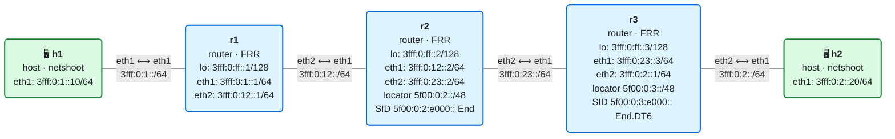

# 07 · El SID y la Segment Routing Header

> **Objetivo**: conocer el plano de datos de SRv6 campo a campo: cómo se estructura un SID y cómo es la Segment Routing Header (SRH) que lleva la lista de segmentos.
>
> **Por qué importa para SRv6**: esto es el corazón de SRv6. Todo lo demás (los behaviors, los servicios, la ingeniería de tráfico) se construye sobre estas dos piezas. Si lees una SRH con soltura, puedes diagnosticar casi cualquier problema de SRv6 con una captura.

## El laboratorio de este módulo

<!-- topologia:inicio -->

<!-- topologia:fin -->

Una cadena lineal de tres routers. r2 y r3 tienen instalados dos SID (con iproute2: `End` en r2 y `End.DT6` en r3, que estudiaremos a fondo en el módulo 08). En **h1** tienes `srh.py`, un script que **fabrica un paquete SRv6**, te lo muestra campo a campo y lo envía para que recorra la cadena. El objetivo aquí no es configurar behaviors, sino **leer la cabecera**: verás la SRH que construyes y cómo muta al pasar por cada router. Al terminar la teoría, la [práctica](practica.md) te guía paso a paso.

## 1. El SID: una dirección que es una instrucción

Ya lo viste por encima en el módulo 06: en SRv6, cada segmento se identifica con un **SID** (*Segment Identifier*) de 128 bits que se escribe como una dirección IPv6. El [RFC 8986](https://www.rfc-editor.org/rfc/rfc8986) lo divide en tres partes:

```
   5f00:0000 : 0002 : e000 : 0000:0000:0000:0000
   └───┬───┘  └─┬─┘  └─┬─┘  └────────┬────────┘
    bloque     nodo   func        argumentos
   └──── localizador ────┘
     "a dónde ir"       "qué hacer"   "datos opcionales"
```

| Parte | Qué es | En el laboratorio |
|-------|--------|-------------------|
| **Localizador** (bloque + nodo) | Un **prefijo IPv6 enrutable** que lleva al nodo dueño del SID. Se anuncia por el IGP como cualquier prefijo | `5f00:0:2::/48` (de r2) |
| **Función** | Qué **comportamiento** (behavior) ejecuta ese nodo: End, End.X, End.DT6… | `e000` → End en r2 |
| **Argumentos** | Datos por paquete que usan algunos behaviors (EVPN, MUP…). Casi siempre `0` | `0` |

Ideas clave que conviene fijar:

- **El localizador es lo que hace que SRv6 funcione sobre IPv6 normal.** Es un prefijo, se enruta por *longest-prefix match*, y los routers de tránsito lo reenvían sin saber nada de SRv6. Lo viste en el módulo 04: un prefijo más.
- **La función solo tiene sentido en el nodo dueño del SID.** `e000` significa "End" en r2 y podría significar otra cosa en r3. Cada router mantiene su propia tabla de SID locales (la *My SID table* del RFC 8986), que en Linux son las rutas `seg6local` que viste en tu PR.
- **El reparto de los bits es una elección del operador.** Solo el total de 128 está fijado. El formato de este curso es `block-len 32, node-len 16, func-bits 16`, el **F3216**, estándar de facto para uSID (módulo 10).

IANA reservó el bloque **`5f00::/16`** para SID ([RFC 9602](https://www.rfc-editor.org/rfc/rfc9602)), para que sean fáciles de identificar y filtrar. En laboratorios heredados verás también `fc00::` (ULA); nosotros usamos `5f00::/16`, que es lo correcto hoy.

## 2. La idea central: el SID activo va en la dirección de destino

Esto ya lo adelantamos, pero es **la** regla de SRv6, así que la repetimos:

> La **dirección IPv6 de destino** del paquete contiene siempre el **SID activo**: la instrucción que hay que ejecutar ahora.

Por eso:

- Un router que **no** es dueño de ese SID hace *longest-prefix match* sobre el destino y reenvía. Es IPv6 normal.
- El router que **sí** es dueño ejecuta la función, pone el **siguiente** SID en el destino y reenvía de nuevo.

Si el "programa" tiene una sola instrucción, basta con ese SID en la dirección de destino: **no hace falta ninguna cabecera extra**. Una VPN entre dos PE suele ser exactamente eso. La SRH solo aparece cuando hay **más de un** SID que llevar.

## 3. La Segment Routing Header (SRH)

Cuando el camino necesita varios SID, los que aún no están activos viajan en la **SRH**. Como viste en el módulo 02, es una cabecera de extensión de enrutamiento de IPv6: **Next Header 43**, **Routing Type 4** ([RFC 8754](https://www.rfc-editor.org/rfc/rfc8754)).

```
 0                   1                   2                   3
 0 1 2 3 4 5 6 7 8 9 0 1 2 3 4 5 6 7 8 9 0 1 2 3 4 5 6 7 8 9 0 1
+-+-+-+-+-+-+-+-+-+-+-+-+-+-+-+-+-+-+-+-+-+-+-+-+-+-+-+-+-+-+-+-+
|  Next Header  |  Hdr Ext Len  | Routing Type=4| Segments Left |
+-+-+-+-+-+-+-+-+-+-+-+-+-+-+-+-+-+-+-+-+-+-+-+-+-+-+-+-+-+-+-+-+
|  Last Entry   |    Flags      |              Tag              |
+-+-+-+-+-+-+-+-+-+-+-+-+-+-+-+-+-+-+-+-+-+-+-+-+-+-+-+-+-+-+-+-+
|            Segment List[0]  (128 bits) — ÚLTIMO del camino    |
|                              ...                              |
|            Segment List[n]  (128 bits) — PRIMERO del camino   |
+-+-+-+-+-+-+-+-+-+-+-+-+-+-+-+-+-+-+-+-+-+-+-+-+-+-+-+-+-+-+-+-+
|              TLVs opcionales (HMAC, padding…)                 |
+-+-+-+-+-+-+-+-+-+-+-+-+-+-+-+-+-+-+-+-+-+-+-+-+-+-+-+-+-+-+-+-+
```

| Campo | Qué significa |
|-------|---------------|
| **Next Header** | Qué va detrás de la SRH. En modo encap, `41` (un IPv6 interior); en insert, la capa superior |
| **Hdr Ext Len** | Longitud de la SRH en unidades de 8 bytes, **sin contar** los 8 primeros. Con *n* SID: `2n` |
| **Routing Type** | `4` = SRH. (El tipo `0`, prohibido, lo viste en el módulo 02) |
| **Segments Left (SL)** | **Índice del SID activo** dentro de la lista. Cada endpoint lo decrementa en 1 |
| **Last Entry** | Índice del último elemento de la lista (con *n* SID: `n−1`) |
| **Flags / Tag** | Marcado del paquete. Hoy no hay flags definidos |
| **Segment List** | Los SID, en **orden inverso**: `[0]` es el último del camino y `[n]` el primero |
| **TLVs** | Datos opcionales: el HMAC para autenticar la SRH, relleno… |

### El orden inverso: la parte que más confunde

La lista de segmentos se guarda **al revés**. Si quieres que el paquete pase por **r2 y luego r3**, la SRH contiene:

```
Segment List[0] = r3   (el último del camino)
Segment List[1] = r2   (el primero del camino)
Segments Left   = 1    (apunta al índice 1, que es r2: el primero que hay que ejecutar)
```

¿Por qué al revés? Porque así el reenvío es una simple cuenta atrás: *SL* empieza en el índice más alto (el primer salto) y **baja** hasta 0 (el último). Cada endpoint hace: copia `Segment List[SL]` al destino, resta 1 a `SL`. Cuando `SL` llega a 0, el paquete está en el último segmento.

### Dos modos de llevar el paquete original

| Modo | Estructura | Quién lo usa |
|------|-----------|--------------|
| **Encap** (H.Encaps) | IPv6 exterior + SRH + **IPv6 interior completo** + carga | El habitual: TE, VPN, todo lo de verdad. El interior puede ser IPv4 o IPv6 |
| **Insert** | Una sola cabecera IPv6 + SRH + carga | Más simple, pero con pegas; se usa poco y se desaconseja |

En **encap**, el paquete del cliente viaja **intacto** dentro, y el nodo final lo "saca" con un behavior de desencapsulado (End.DT4/DT6). Es lo que verás en el laboratorio y lo que capturaste en la wiki. El `srh.py` del laboratorio construye modo encap.

## 4. El recorrido de un paquete, salto a salto

Sigue un paquete del laboratorio con la lista `[r2, r3]`, es decir, SID `5f00:0:2:e000::` (End en r2) y `5f00:0:3:e000::` (End.DT6 en r3), con un ICMPv6 a h2 dentro.

**En h1 (origen) y r1 (tránsito):**

```
IPv6 exterior: src=h1  dst=5f00:0:2:e000::   (SID activo = r2)
SRH:  SL=1  LastEntry=1  [0]=5f00:0:3:e000::  [1]=5f00:0:2:e000::
IPv6 interior: src=h1  dst=3fff:0:2::20 (h2)
ICMPv6 echo request
```

r1 no es dueño de `5f00:0:2:e000::`, así que hace LPM (`5f00:0:2::/48` va hacia r2) y reenvía. No toca la SRH. Solo resta 1 al **Hop Limit exterior**.

**En r2 (dueño del SID activo → ejecuta End):**

1. Resta 1 a SL: `SL = 0`.
2. Copia `Segment List[0]` al destino exterior: `dst = 5f00:0:3:e000::`.
3. Reenvía según ese nuevo destino. El Hop Limit exterior baja otra vez.

```
IPv6 exterior: src=h1  dst=5f00:0:3:e000::   (SID activo = r3)
SRH:  SL=0  [0]=5f00:0:3:e000::  [1]=5f00:0:2:e000::
IPv6 interior: intacto
```

**En r3 (dueño del SID activo, SL=0 → ejecuta End.DT6):**

Con SL=0 no quedan más segmentos. End.DT6 **desencapsula**: quita la cabecera IPv6 exterior y la SRH, se queda con el **IPv6 interior** y lo entrega buscando su destino (`3fff:0:2::20`) en la tabla de rutas. El paquete llega a h2 como un IPv6 normal, **sin rastro de SRv6**.

h2 responde a `3fff:0:1::10` (h1) con un echo reply normal, que vuelve por el IGP sin SRv6. Fíjate en una cosa importante: el **Hop Limit interior** no cambió en todo el trayecto. Para el paquete del cliente, todo el túnel SRv6 fue **un solo salto**.

## 5. La cuenta de los bytes

La sobrecarga de una SRH en modo encap es:

```
40 bytes  (cabecera IPv6 exterior)
+  8 bytes  (SRH fija: los campos hasta Segment List)
+ 16 bytes  × (número de SID)
```

En el laboratorio, con 2 SID: 40 + 8 + 32 = **80 bytes** añadidos al paquete del cliente. El paquete total que verás en la captura son esos 80 más el IPv6 interior (40) y el ICMPv6, como diseccionaste en el módulo 02.

Dos formas de recortar esta sobrecarga, que ya se asomaron:

- **H.Encaps.Red** (*reduced*): como el primer SID ya va en el destino exterior, se puede **omitir de la lista**. Con un solo SID, la SRH desaparece entera.
- **uSID** (módulo 10): mete **varias** instrucciones en una sola dirección de 128 bits, así que muchos caminos no necesitan SRH.

## 6. Los flavors: PSP, USP y USD

Los behaviors de endpoint (End, End.X…) admiten unas variantes llamadas **flavors**, que cambian **qué se hace con la SRH en el penúltimo y último salto**. No cambian el camino, solo el "aseo" de la cabecera:

| Flavor | Nombre | Qué hace |
|--------|--------|----------|
| **PSP** | *Penultimate Segment Pop* | El **penúltimo** endpoint elimina la SRH, para que el último reciba un paquete más limpio |
| **USP** | *Ultimate Segment Pop* | El **último** endpoint (SL=0) elimina la SRH él mismo |
| **USD** | *Ultimate Segment Decapsulation* | El último endpoint desencapsula directamente el paquete interior (lo que hace End.DT en la práctica) |

Para empezar, basta con saber que **existen** y que son optimizaciones de la SRH, no cambios de ruta. En las capturas de FRR verás a menudo `End` anunciado con el flavor PSP. Los detalles están en el RFC 8754 y en la wiki.

## 7. Resumen

- Un **SID** es una dirección IPv6 de 128 bits = **localizador** (prefijo enrutable, "a dónde") + **función** (behavior, "qué hacer") + **argumentos**.
- El **SID activo va siempre en la dirección de destino**. Los routers de tránsito reenvían por LPM; solo el dueño del SID ejecuta la función y pone el siguiente.
- La **SRH** (Next Header 43, Routing Type 4) lleva la lista de SID **en orden inverso**; **Segments Left** es el índice del activo y baja de salto en salto.
- El modo **encap** mete el paquete original entero dentro; el nodo final lo saca con End.DT4/DT6.
- Sobrecarga: **40 + 8 + 16·n** bytes. H.Encaps.Red y uSID la recortan.
- Los **flavors** PSP/USP/USD solo afectan a cuándo se quita la SRH, no al camino.

## Siguiente paso

Haz la [práctica](practica.md): fabricarás una SRH, la leerás campo a campo y la verás mutar en cada router. Luego, en el módulo 08, construirás tú mismo los behaviors (End, End.X, End.DT4/DT6, H.Encaps) con iproute2.

## Para saber más

- [RFC 8754](https://www.rfc-editor.org/rfc/rfc8754) — IPv6 Segment Routing Header (SRH)
- [RFC 8986](https://www.rfc-editor.org/rfc/rfc8986) — SRv6 Network Programming (SID y behaviors)
- [RFC 9602](https://www.rfc-editor.org/rfc/rfc9602) — El bloque `5f00::/16` para SID
- [SRv6.md · Estructura del SID](https://srv6.md/es/estructura-del-sid/)
- [SRv6.md · La cabecera SRH](https://srv6.md/es/cabecera-srh/)
