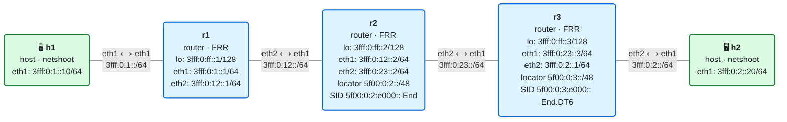

# 07 · Práctica: el SID y la Segment Routing Header

Antes de empezar, lee la [teoría del módulo](README.md).

## Topología

<!-- topologia:inicio -->

<!-- topologia:fin -->

> El fichero editable para draw.io está en [`lab/topologia.drawio`](lab/topologia.drawio).

- Cadena lineal **h1 — r1 — r2 — r3 — h2** con IS-IS para la reachability.
- **r2** tiene el SID `5f00:0:2:e000::` con behavior **End**, y **r3** el SID `5f00:0:3:e000::` con **End.DT6** (instalados con iproute2; los estudiarás en el módulo 08).
- En **h1** está el script `/lab/srh.py` para fabricar y diseccionar paquetes SRv6. Para ver la ayuda:

```bash
$ docker exec clab-m07-h1 python3 /lab/srh.py
```

## Parte A · Ejercicios en papel

Hazlos sin ordenador. Las soluciones están en [soluciones.md](soluciones.md).

**A1.** Disecciona el SID `5f00:0:3:e000::` en localizador (bloque + nodo), función y argumentos, con el formato F3216 (bloque 32 bits, nodo 16, función 16).

**A2.** Quieres un camino que pase por los nodos **A, B y C** en ese orden, con SID `5f00:0:a::`, `5f00:0:b::` y `5f00:0:c::`. Escribe el contenido de la SRH: la Segment List (con sus índices), el valor de **Segments Left**, el de **Last Entry** y qué dirección va en el **destino** del paquete al salir del origen.

**A3.** Una SRH lleva 4 SID. ¿Cuánto vale **Hdr Ext Len**? ¿Cuántos bytes mide la SRH? ¿Cuántos bytes añade en total un encap con esos 4 SID?

**A4.** En el recorrido del laboratorio, rellena la tabla con el valor del **destino exterior** y de **Segments Left** en cada punto:

| Punto | Destino exterior | SL |
|-------|------------------|----|
| sale de h1 | ? | ? |
| sale de r2 | ? | ? |
| llega a r3 | ? | ? |

**A5.** ¿Por qué un router de tránsito como r1 puede reenviar este paquete sin entender SRv6? ¿Qué mira para decidir por dónde?

## Parte B · Laboratorio

### B0. Levantar el laboratorio

```bash
$ cd 07-sid-srh/lab
$ sudo containerlab deploy -t lab.clab.yml
$ ./verificar.sh
```

### B1. Diseccionar un SID

```bash
$ docker exec clab-m07-h1 python3 /lab/srh.py sid 5f00:0:2:e000::
$ docker exec clab-m07-h1 python3 /lab/srh.py sid 5f00:0:3:e000::
```

1. ¿Qué localizador tiene cada uno? ¿A qué router lleva?
2. ¿Qué valor de función llevan? ¿Significan lo mismo en los dos routers?

### B2. Fabricar una SRH y leerla

```bash
$ docker exec clab-m07-h1 python3 /lab/srh.py construir
```

El script construye el paquete con la lista `[5f00:0:2:e000::, 5f00:0:3:e000::]` y lo muestra entero.

1. En la salida, localiza la cabecera IPv6 **exterior**: ¿cuál es su destino? ¿Coincide con el primer SID del camino?
2. Localiza la **SRH**: ¿qué valor tienen `segleft` y `lastentry`? ¿En qué orden está la `Segment List`?
3. Localiza la cabecera IPv6 **interior**: ¿cuál es su destino? ¿Qué lleva dentro?
4. Mira la cuenta de bytes al final: ¿cuántos bytes añade este encap de 2 SID?

### B3. Ver la SRH viajar y mutar

Prepara **tres** capturas, cada una en una terminal, para ver el mismo paquete en tres puntos. Captura solo los paquetes con Routing Header (`ip6[6]==43`):

```bash
# Terminal 1 — entrada de r2 (desde r1)
$ docker run --rm -it --net container:clab-m07-r2 nicolaka/netshoot:v0.13 \
    tcpdump -ni eth1 -vv 'ip6[6]==43'

# Terminal 2 — entrada de r3 (desde r2)
$ docker run --rm -it --net container:clab-m07-r3 nicolaka/netshoot:v0.13 \
    tcpdump -ni eth1 -vv 'ip6[6]==43'

# Terminal 3 — salida hacia h2 (¿llega SRv6 o IPv6 normal?)
$ docker run --rm -it --net container:clab-m07-r3 nicolaka/netshoot:v0.13 \
    tcpdump -ni eth2 -vv
```

En una cuarta terminal, envía el paquete:

```bash
$ docker exec clab-m07-h1 python3 /lab/srh.py enviar
```

1. **Entrada de r2** (terminal 1): ¿cuál es el destino exterior? ¿Cuánto vale `segleft`? ¿Qué SID está activo?
2. **Entrada de r3** (terminal 2): ¿qué ha cambiado en el destino exterior y en `segleft`? ¿Quién lo cambió y qué behavior ejecutó?
3. **Salida hacia h2** (terminal 3): ¿el paquete que sale hacia h2 lleva todavía SRH, o es un IPv6 normal? ¿Por qué?
4. Compara el **Hop Limit exterior** entre la entrada de r2 y la de r3. ¿Y el del paquete interior que llega a h2? Explica la diferencia.

### B4. La My SID table de cada router

```bash
$ docker exec clab-m07-r2 ip -6 route show 5f00:0:2:e000::/128
$ docker exec clab-m07-r3 ip -6 route show 5f00:0:3:e000::/128
```

1. ¿Qué behavior tiene el SID de cada router?
2. En r2, el bloque `5f00:0:2::/64` también está como ruta conectada. Cuando llega un paquete a `5f00:0:2:e000::`, ¿por qué gana la ruta `/128` del SID y no la `/64` conectada?

### B5. Un solo SID: sin SRH

Envía un paquete con **un único** SID (solo el End.DT6 de r3):

```bash
$ docker exec clab-m07-h1 python3 /lab/srh.py construir 5f00:0:3:e000::
```

1. ¿Cuántos bytes añade ahora el encap?
2. Mira el `segleft` y la `Segment List`. Con un solo SID, ¿sigue haciendo falta la SRH? (La respuesta corta: con H.Encaps.Red, no; el script la mantiene para que veas la estructura.)

### B6. Alargar el camino

Envía un paquete que pase por r2 **dos veces** (r2 → r3 → r2 no tiene sentido físico aquí, así que usa r2 y r3 y observa). Prueba a invertir el orden:

```bash
$ docker exec clab-m07-h1 python3 /lab/srh.py enviar 5f00:0:3:e000::,5f00:0:2:e000::
```

1. ¿Llega la respuesta? ¿Por qué el orden importa? (Pista: ¿qué hace End.DT6 en r3 si lo pones el primero?)

### B7. Limpieza

```bash
$ sudo containerlab destroy -t lab.clab.yml --cleanup
```

## Reto

Captura el paquete SRv6 **en hexadecimal** a la entrada de r2 y localiza a mano, byte a byte, la cabecera IPv6 exterior y la SRH:

```bash
$ docker run --rm -it --net container:clab-m07-r2 nicolaka/netshoot:v0.13 \
    tcpdump -ni eth1 -x -c1 'ip6[6]==43'
# y en otra terminal: docker exec clab-m07-h1 python3 /lab/srh.py enviar
```

Identifica en el volcado: el byte del **Next Header** de la cabecera IPv6 (debe ser `2b` = 43), el **Routing Type** (`04`), el **Segments Left**, el **Last Entry** y los dos SID de 16 bytes de la Segment List. Comprueba que el primer SID de la lista (`[0]`) es el de r3, no el de r2.
