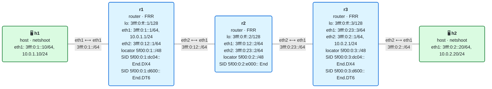

# 08 · Network programming con iproute2

> **Objetivo**: construir tú mismo, con `iproute2`, cada **behavior** de SRv6 (End, End.X, End.DT4/DT6/DT46, End.DX4/DX6, H.Encaps) y ver qué hace cada uno en una captura.
>
> **Por qué importa para SRv6**: los behaviors son el "repertorio de instrucciones" de SRv6. Un SID no es más que una dirección que apunta a uno de ellos. Entender el catálogo es entender qué puede hacer SRv6: desde pasar por un nodo hasta entregar una VPN. Y hacerlo a mano con iproute2 es la mejor forma de verlo sin la "magia" de un plano de control (eso llega en el bloque III).

## El laboratorio de este módulo

<!-- topologia:inicio -->

<!-- topologia:fin -->

h1 y h2 son **dual-stack** (IPv4 e IPv6). El núcleo r1–r2–r3 **solo habla IPv6** y usa IS-IS. El laboratorio arranca con los SID y las rutas de encap ya puestos para que **el tráfico IPv4 de h1 a h2 viaje encapsulado en SRv6** (H.Encaps en el borde, End en r2, End.DT4 en el otro borde). Es la promesa de SRv6 hecha realidad: un plano de datos IPv6 que transporta IPv4. En la práctica inspeccionarás esos behaviors y añadirás los demás. Al terminar la teoría, la [práctica](practica.md) te guía paso a paso.

## 1. ¿Qué es un behavior?

Como viste en el módulo 07, un SID se divide en **localizador** (a dónde ir) y **función** (qué hacer). Esa función es un **behavior**: una instrucción que ejecuta el nodo dueño del SID cuando el paquete llega a él. El [RFC 8986](https://www.rfc-editor.org/rfc/rfc8986) define un catálogo, y los nombres siguen un patrón:

- **End** = "endpoint": el behavior base, pasar al siguiente segmento.
- El sufijo dice qué se hace además:
  - **.X** = reenviar por una **adyacencia** concreta (un enlace o vecino).
  - **.T** = hacer una búsqueda en una **tabla** de rutas (*Table lookup*).
  - **.D** = **desencapsular** (quitar la cabecera SRv6 exterior).
  - **.DT4 / .DT6 / .DT46** = desencapsular y buscar en una tabla IPv4 / IPv6 / ambas.
  - **.DX4 / .DX6** = desencapsular y hacer *cross-connect* a un vecino concreto, sin búsqueda.

Y un behavior especial que **no** empieza por End:

- **H.Encaps** = el del *headend*: **encapsular** el paquete del cliente dentro de SRv6 y ponerle la lista de SID.

En Linux, los behaviors de endpoint se instalan con `ip -6 route add <SID> encap seg6local action <behavior> …`, y el de encap con `ip route add <prefijo> encap seg6 mode encap segs <lista> …`. Cada SID instalado es una entrada de la **My SID table** del nodo.

## 2. H.Encaps: la puerta de entrada

Todo empieza en el **headend**. H.Encaps toma el paquete del cliente (IPv4 o IPv6), le añade una **cabecera IPv6 exterior + SRH** con la lista de SID, y lo envía al primer segmento.

```bash
# En r1: todo lo que vaya a la red IPv4 de h2 entra en SRv6,
# pasando por el SID End de r2 y terminando en el End.DT4 de r3.
ip sr tunsrc set 3fff:0:ff::1          # dirección de origen del túnel
ip route add 10.0.2.0/24 \
   encap seg6 mode encap segs 5f00:0:2:e000::,5f00:0:3:dc04:: dev eth2
```

- `mode encap` = modo encapsulado (el que viste en el módulo 07): el paquete original viaja entero dentro.
- `segs a,b` = la lista de segmentos **en orden del camino** (iproute2 ya la coloca invertida en la SRH).
- `tunsrc` = la dirección que irá como origen de la cabecera exterior.

El `H.Encaps.Red` (reducido) es una variante que omite el primer SID de la SRH, porque ya va en el destino. Lo veremos en el módulo 09.

## 3. End y End.X: moverse por el núcleo

| Behavior | Qué hace | iproute2 |
|----------|----------|----------|
| **End** | Decrementa Segments Left, copia el siguiente SID al destino y reenvía por la **ruta normal** (lo que decida el IGP) | `action End` |
| **End.X** | Igual que End, pero reenvía por una **adyacencia concreta** (un enlace o vecino), ignorando el IGP | `action End.X nh6 <link-local-del-vecino>` |

```bash
# En r2: un End normal (sigue el camino más corto hacia el siguiente SID)
ip -6 route add 5f00:0:2:e000::/128 encap seg6local action End dev eth1

# En r2: un End.X que fuerza la salida por el enlace hacia r3
ip -6 route add 5f00:0:2:e100::/128 \
   encap seg6local action End.X nh6 fe80::...(r3) dev eth2
```

La diferencia es la clave de la **ingeniería de tráfico**: con **End** dejas que el IGP elija; con **End.X** fuerzas un enlace concreto, salto a salto. Una lista de End.X describe un camino explícito, enlace por enlace. En tu PR del lab de la wiki, los SID que IS-IS instalaba automáticamente (`seg6local action End.X nh6 fe80::…`) eran precisamente End.X, uno por cada adyacencia.

## 4. Los behaviors de desencapsulado: entregar el paquete

En el nodo final, hay que **sacar** el paquete del cliente de dentro de SRv6 y entregarlo. Según qué se haga con el paquete interior:

| Behavior | Qué hace | Para qué |
|----------|----------|----------|
| **End.DT6** | Desencapsula y busca el destino **IPv6 interior** en una tabla | L3VPN IPv6 |
| **End.DT4** | Desencapsula y busca el destino **IPv4 interior** en una tabla | L3VPN IPv4 (IPv4 sobre IPv6) |
| **End.DT46** | Desencapsula y busca en la tabla IPv4 **o** IPv6 según el paquete | L3VPN dual-stack con un solo SID |
| **End.DX6** | Desencapsula y hace *cross-connect* directo a un vecino IPv6, **sin búsqueda** | Entrega directa a un CE |
| **End.DX4** | Igual, pero a un vecino IPv4 | Entrega directa a un CE |

La diferencia **DT vs DX**:

- **DT** (*Table*) hace una **búsqueda** del destino interior en una tabla de rutas. Es lo normal cuando detrás del PE hay una red (no un único equipo).
- **DX** (*cross-connect*) **no busca**: entrega el paquete directamente a un vecino fijo. Es más rápido y se usa cuando el SID representa "este cliente concreto en esta interfaz".

```bash
# En r3: End.DX4 — desencapsula IPv4 y lo entrega directo a h2 (sin VRF)
ip -6 route add 5f00:0:3:dc04::/128 \
   encap seg6local action End.DX4 nh4 10.0.2.20 dev eth2
# (End.DT4 sería 'action End.DT4 vrftable <tabla-de-una-VRF>'; necesita una VRF, ver el reto)

# En r3: End.DT6 — desencapsula IPv6 y busca en la tabla main
ip -6 route add 5f00:0:3:d600::/128 \
   encap seg6local action End.DT6 table 254 dev eth1

# En r3: End.DX6 — desencapsula y entrega directo a h2, sin búsqueda
ip -6 route add 5f00:0:3:dc06::/128 \
   encap seg6local action End.DX6 nh6 3fff:0:2::20 dev eth2
```

> **Ojo: End.DT4 necesita una VRF en Linux.** End.DT6 funciona con una tabla normal (`table 254`, la *main*), pero la implementación de **End.DT4 y End.DT46** en el kernel de Linux **exige una VRF de verdad** (`vrftable`), no vale la tabla main. Por eso, en el laboratorio, la **entrega de IPv4** se hace con **End.DX4** (cross-connect, que no necesita tabla ni VRF) y la de IPv6 con End.DT6. Montar End.DT4 con su VRF es el reto del final.

### La tabla y las VRF

El número de tabla es lo que da a SRv6 su capacidad de **VPN**. Si cada cliente tiene su propia tabla (su VRF), un SID `End.DT4 vrftable 10` entrega el tráfico del cliente de la tabla 10, y otro `vrftable 20` el del cliente 20, aunque usen las mismas direcciones IPv4 privadas. El SID codifica **en qué VPN** entregar. En el laboratorio usamos la tabla main para simplificar; las VRF de verdad llegan en el módulo 12.

## 5. El ejemplo del laboratorio: IPv4 sobre un núcleo IPv6

Junta todas las piezas. El núcleo r1–r2–r3 no sabe enrutar IPv4. Aun así, h1 llega a la IPv4 de h2:

```
h1 (10.0.1.10) ──IPv4──> r1
   r1: H.Encaps  →  [IPv6 ext | SRH: 5f00:0:2:e000::, 5f00:0:3:d400:: | IPv4 interior]
   r2: End       →  avanza al SID de r3
   r3: End.DX4   →  desencapsula y entrega el IPv4 directo a h2 (sin búsqueda)
h2 (10.0.2.20) <──IPv4── r3
```

El paquete IPv4 **nunca se enruta como IPv4 en el núcleo**: viaja como carga de un paquete IPv6 con SRH. r2, que solo habla IPv6, lo reenvía sin enterarse de que dentro hay IPv4. Esto es, literalmente, IPv4 sobre SRv6, montado con cuatro comandos de iproute2. (Usamos End.DX4 para la entrega; con una VRF sería End.DT4, una L3VPN completa.)

## 6. El catálogo completo (resumen)

| Behavior | Rol | Acción |
|----------|-----|--------|
| **H.Encaps** | headend | Encapsula el paquete en SRv6 con la lista de SID |
| **H.Encaps.Red** | headend | Igual, pero omite el primer SID de la SRH (módulo 09) |
| **End** | tránsito | Siguiente segmento, por la ruta del IGP |
| **End.X** | tránsito | Siguiente segmento, por una adyacencia concreta |
| **End.T** | tránsito | Siguiente segmento, buscando en una tabla concreta |
| **End.DT4/DT6/DT46** | final | Desencapsula y busca en tabla (VPN) |
| **End.DX4/DX6** | final | Desencapsula y entrega directo a un vecino |
| **End.DX2** | final | Igual, pero para tramas Ethernet (EVPN) |
| **End.B6 / End.BM** | binding | Mete el paquete en otra política SRv6 o SR-MPLS |

Hay más (End.B6.Encaps, los de MUP para 5G…), pero con estos cubres el 95 % de lo que verás. Los **flavors** PSP/USP/USD, que modifican qué se hace con la SRH, son el tema del módulo 09.

## 7. Resumen

- Un **behavior** es la instrucción que ejecuta el nodo dueño de un SID. Se instala con `ip -6 route … encap seg6local action …`.
- **H.Encaps** (headend) encapsula el paquete del cliente y le pone la lista de SID (`encap seg6 mode encap segs …`).
- **End** avanza por la ruta del IGP; **End.X** fuerza una adyacencia concreta (base de la TE).
- Los behaviors **End.DT4/DT6/DT46** desencapsulan y **buscan en una tabla** (VPN); **End.DX4/DX6** entregan directo a un vecino sin búsqueda.
- El **número de tabla/VRF** del SID es lo que codifica en qué VPN entregar el tráfico.
- Con esto se monta una **L3VPN IPv4 sobre un núcleo IPv6** con unos pocos comandos, como en el laboratorio.

## Siguiente paso

Haz la [práctica](practica.md): inspeccionarás el IPv4-sobre-SRv6 que ya funciona y construirás tú mismo End.X, End.DT6 y End.DX6. Luego, en el módulo 09, verás cómo recortar la SRH con H.Encaps.Red y los flavors.

## Para saber más

- [RFC 8986](https://www.rfc-editor.org/rfc/rfc8986) — SRv6 Network Programming (el catálogo de behaviors)
- [Linux kernel: SRv6](https://docs.kernel.org/networking/seg6-sysctl.html) y `man ip-route` (sección seg6local)
- [SRv6.md · Network Programming](https://srv6.md/topics/network-programming/)
- [SRv6.md · Implementación en Linux](https://srv6.md/implementations/linux-kernel/)
