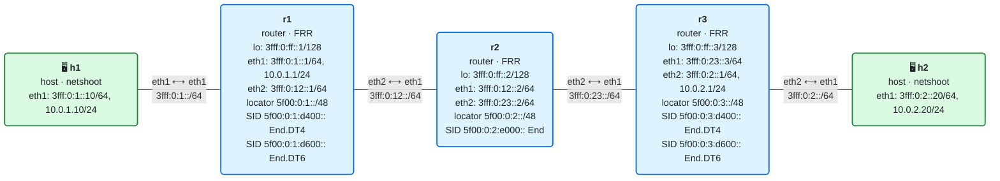

# 08 · Práctica: network programming con iproute2

Antes de empezar, lee la [teoría del módulo](README.md).

## Topología

<!-- topologia:inicio -->

<!-- topologia:fin -->

> El fichero editable para draw.io está en [`lab/topologia.drawio`](lab/topologia.drawio).

- **h1** y **h2** son dual-stack: IPv6 (`3fff:0:1::10`, `3fff:0:2::20`) e IPv4 (`10.0.1.10`, `10.0.2.20`).
- El núcleo **r1–r2–r3** solo habla IPv6 (IS-IS). El tráfico IPv4 entre h1 y h2 viaja **encapsulado en SRv6**.
- Al arrancar ya están puestos: `End` en r2, `End.DT4` y `End.DT6` en r1 y r3, y las rutas de encap. Tú los inspeccionarás y añadirás más.

## Parte A · Ejercicios en papel

Hazlos sin ordenador. Las soluciones están en [soluciones.md](soluciones.md).

**A1.** Para cada behavior, di en una frase qué hace: `End`, `End.X`, `End.DT4`, `End.DX6`, `H.Encaps`.

**A2.** ¿Cuál es la diferencia entre `End.DT6` y `End.DX6`? ¿Cuándo usarías cada uno?

**A3.** Quieres que el tráfico IPv6 de h1 a h2 vaya por un camino explícito r1→r2→r3 usando **End.X** en cada salto (no End). Escribe la lista de segmentos (conceptual) y di qué behavior tendría el SID de r2 y el de r3.

**A4.** En el laboratorio, un `ping` de `10.0.1.10` a `10.0.2.20`. Enumera, en orden, qué behavior ejecuta cada router (r1, r2, r3) y qué le pasa a la cabecera en cada uno.

**A5.** ¿Por qué `End.DT4` usa la palabra clave `vrftable` y no `table`? ¿Qué papel juega ese número en una VPN real?

## Parte B · Laboratorio

### B0. Levantar el laboratorio

```bash
$ cd 08-network-programming/lab
$ sudo containerlab deploy -t lab.clab.yml
$ ./verificar.sh
```

### B1. La My SID table de cada router

```bash
$ docker exec clab-m08-r2 ip -6 route show | grep seg6local
$ docker exec clab-m08-r3 ip -6 route show | grep seg6local
$ docker exec clab-m08-r1 ip route show 10.0.2.0/24
```

1. ¿Qué behavior tiene cada SID instalado?
2. En r1, ¿cómo se ve una ruta de **encap** (H.Encaps)? ¿Qué lista de segmentos lleva?

### B2. IPv4 sobre SRv6, en vivo

Captura en el núcleo (r2) los paquetes con Routing Header mientras haces un ping IPv4:

```bash
# Terminal 1
$ docker run --rm -it --net container:clab-m08-r2 nicolaka/netshoot:v0.13 \
    tcpdump -ni eth1 -vv 'ip6[6]==43'
# Terminal 2
$ docker exec clab-m08-h1 ping -c2 10.0.2.20
```

1. ¿Qué lleva la cabecera IPv6 exterior del paquete capturado? ¿Y la SRH (SID, Segments Left)?
2. ¿Qué hay **dentro** del paquete SRv6? ¿Es IPv4 o IPv6? ¿Lo "sabe" r2?
3. Captura ahora a la salida de r3 hacia h2 (`eth2`). ¿El paquete que llega a h2 es IPv4 normal o sigue encapsulado? ¿Qué behavior lo desencapsuló?

### B3. Construir tú un End.X

El SID End de r2 sigue el camino del IGP. Vas a crear un **End.X** que fuerce la salida por el enlace hacia r3. Primero averigua la link-local de r3 en el enlace r2–r3:

```bash
$ docker exec clab-m08-r2 ip -6 neigh show dev eth2
# si está vacío, fuerza el aprendizaje: docker exec clab-m08-r2 ping -c1 3fff:0:23::3
```

Instala el End.X en r2 (sustituye `<LL-r3>` por la link-local de r3):

```bash
$ docker exec clab-m08-r2 ip -6 route add 5f00:0:2:e100::/128 \
    encap seg6local action End.X nh6 <LL-r3> dev eth2
$ docker exec clab-m08-r2 ip -6 route show 5f00:0:2:e100::/128
```

1. ¿En qué se diferencia esta entrada de la del End normal (`5f00:0:2:e000::`)?
2. Cambia la ruta de encap de r1 para que use el End.X de r2 en vez del End, y comprueba que el ping IPv4 sigue funcionando:

   ```bash
   $ docker exec clab-m08-r1 ip route replace 10.0.2.0/24 \
       encap seg6 mode encap segs 5f00:0:2:e100::,5f00:0:3:d400:: dev eth2
   $ docker exec clab-m08-h1 ping -c2 10.0.2.20
   ```

   ¿Funciona igual? ¿Qué diferencia práctica hay entre haber usado End y End.X aquí? (Pista: en esta topología lineal el camino es el mismo; la diferencia se notaría si hubiera varios caminos.)
3. Deja la ruta de encap como estaba:

   ```bash
   $ docker exec clab-m08-r1 ip route replace 10.0.2.0/24 \
       encap seg6 mode encap segs 5f00:0:2:e000::,5f00:0:3:d400:: dev eth2
   ```

### B4. IPv6 sobre SRv6 con End.DT6

Por defecto, el IPv6 de h1 a h2 va por el IGP (sin SRv6), porque el núcleo sí sabe enrutar IPv6. Vas a **forzar** que la IPv6 de h2 pase por SRv6, usando una ruta de encap **más específica** (un /128 que gana por longest-prefix match):

```bash
$ docker exec clab-m08-r1 ip -6 route add 3fff:0:2::20/128 \
    encap seg6 mode encap segs 5f00:0:2:e000::,5f00:0:3:d600:: dev eth2
$ docker exec clab-m08-r1 ip -6 route get 3fff:0:2::20
```

1. ¿Por dónde sale ahora el tráfico hacia `3fff:0:2::20`? ¿Por qué gana esta ruta a la del IGP?
2. Captura en r2 (`ip6[6]==43`) y haz `docker exec clab-m08-h1 ping -c2 3fff:0:2::20`. ¿Viaja ahora dentro de SRv6? ¿Qué SID final lleva (fíjate: `d600`, el End.DT6)?
3. Quita la ruta:

   ```bash
   $ docker exec clab-m08-r1 ip -6 route del 3fff:0:2::20/128
   ```

### B5. End.DX6: entrega directa, sin búsqueda

Instala en r3 un End.DX6 que entregue directo a h2, sin buscar en la tabla:

```bash
$ docker exec clab-m08-r3 ip -6 route add 5f00:0:3:dc06::/128 \
    encap seg6local action End.DX6 nh6 3fff:0:2::20 dev eth2
$ docker exec clab-m08-r3 ip -6 route show 5f00:0:3:dc06::/128
```

Usa ese SID como destino final desde r1:

```bash
$ docker exec clab-m08-r1 ip -6 route add 3fff:0:2::20/128 \
    encap seg6 mode encap segs 5f00:0:2:e000::,5f00:0:3:dc06:: dev eth2
$ docker exec clab-m08-h1 ping -c2 3fff:0:2::20
```

1. ¿Funciona? ¿En qué se diferencia End.DX6 de End.DT6 en lo que hace r3?
2. ¿Cuándo preferirías End.DX6 (cross-connect) frente a End.DT6 (búsqueda en tabla)?
3. Limpia:

   ```bash
   $ docker exec clab-m08-r1 ip -6 route del 3fff:0:2::20/128
   ```

### B6. La sobrecarga en bytes

```bash
$ docker exec clab-m08-h1 ping -c2 -s 1400 10.0.2.20
$ docker exec clab-m08-h1 ping -c2 -M do -s 1440 10.0.2.20
```

1. El primero funciona. ¿Cuánto mide el paquete que viaja por el núcleo (IPv4 interior + lo que añade SRv6)?
2. El segundo (con `-M do`, sin fragmentar, 1440 bytes) puede fallar. ¿Por qué? Relaciónalo con la sobrecarga de SRv6 y con la MTU del módulo 02.

### B7. Limpieza

```bash
$ sudo containerlab destroy -t lab.clab.yml --cleanup
```

## Reto

Monta un **End.DT46** en r3: un solo SID que sirva tanto para IPv4 como para IPv6. Instálalo, haz que r1 lo use como SID final para las dos familias (una ruta de encap para `10.0.2.0/24` y otra para `3fff:0:2::20/128`, las dos terminando en el mismo SID End.DT46) y comprueba que los dos pings funcionan.

```bash
$ docker exec clab-m08-r3 ip -6 route add 5f00:0:3:d046::/128 \
    encap seg6local action End.DT46 vrftable 254 dev eth1
```

¿Por qué un solo SID puede servir para las dos familias? ¿Qué mira End.DT46 para decidir en qué tabla buscar? Si tu kernel no soporta `End.DT46`, anótalo y razónalo con la teoría.
