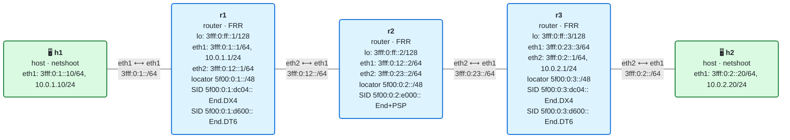
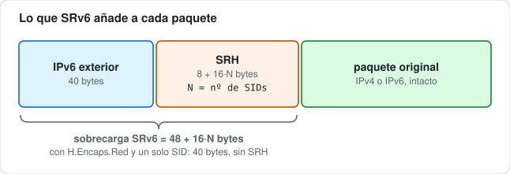
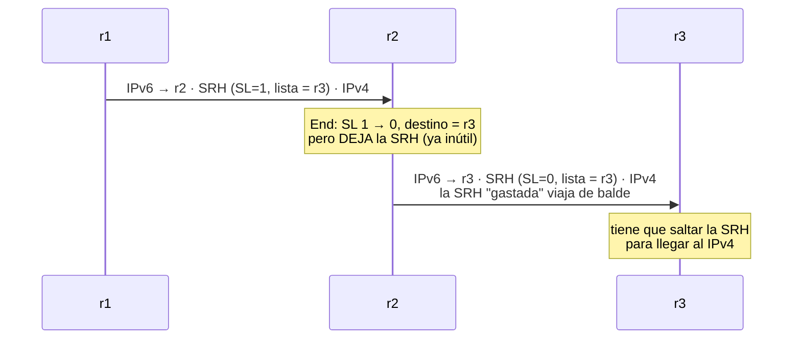
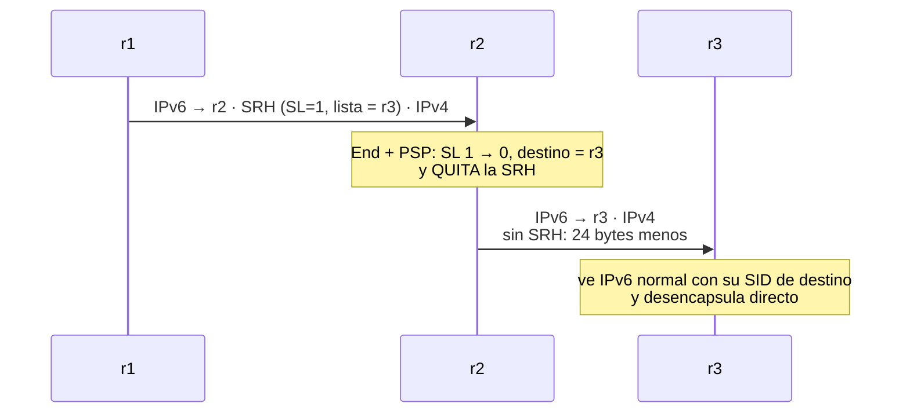

# 09 · Reducción de cabeceras: H.Encaps.Red y los flavors PSP/USP/USD

> **Objetivo**: entender por qué SRv6 añade bytes de más y cómo se recortan, con dos mecanismos que verás en toda red SRv6 real: el **encapsulado reducido** (`H.Encaps.Red`) y los **flavors** `PSP`, `USP` y `USD`, que quitan la SRH cuando ya no hace falta.
>
> **Por qué importa para SRv6**: en el módulo 02 viste que cada cabecera de extensión cuesta bytes, y en el 08 que SRv6 añade unos 40 (IPv6 exterior) + 8 + 16 por SID (SRH). Esa sobrecarga se paga en **cada paquete**. Reducirla no es cosmética: afecta a la MTU, al rendimiento del hardware de reenvío y a cuánto tráfico de cliente cabe. Por eso, casi nadie despliega el encapsulado "completo"; se usa el reducido con PSP. Entenderlo es entender cómo se ve SRv6 en producción.

## El laboratorio de este módulo

<!-- topologia:inicio -->

<!-- topologia:fin -->

Es la **misma topología del módulo 08** (h1–r1–r2–r3–h2, núcleo IPv6 con IS-IS, hosts dual-stack), pero cambia **cómo se encapsula**:

- **r1** y **r3** encapsulan en modo **`encap.red`** (reducido), no `encap`.
- **r2** ejecuta `End` con el flavor **`psp`**.

El tráfico IPv4 de h1 a h2 sigue viajando sobre SRv6, pero ahora con **menos cabecera**. Lo medirás byte a byte en la [práctica](practica.md).

## 1. El problema: SRv6 engorda cada paquete

Recordemos qué le pone un headend (r1) a un paquete del cliente cuando lo mete en SRv6, como en el módulo 08:



- **IPv6 exterior**: 40 bytes fijos.
- **SRH**: 8 bytes de cabecera + **16 bytes por cada SID** de la lista.

Con 2 SID son `40 + 8 + 32 = 80` bytes de sobrecarga en **cada** paquete. Si el cliente manda paquetes pequeños (voz, telemetría, ACKs de TCP), la sobrecarga puede ser mayor que los datos. Y como el núcleo necesita MTU suficiente para el paquete + la sobrecarga, cada byte ahorrado cuenta.

La buena noticia: gran parte de esa SRH es **redundante**, y se puede quitar.

## 2. La idea clave: el primer SID ya va en el destino

Repasa cómo funciona la SRH (módulo 07). Para un camino `[S1, S2]` (primero S1, luego S2):

- El **destino** de la cabecera IPv6 exterior es **S1** (el primer SID).
- La SRH guarda la lista **en orden inverso**: `Segment List[0]=S2`, `Segment List[1]=S1`, con `Segments Left=1`.

¿Ves la redundancia? **S1 aparece dos veces**: una en el destino exterior y otra en la SRH (`Segment List[1]`). El primer SID siempre está en el destino, porque es a donde va el paquete ahora mismo. Guardarlo también en la SRH es gastar 16 bytes para nada.

## 3. H.Encaps.Red: el encapsulado reducido

**H.Encaps.Red** (*Reduced*) es exactamente eso: encapsula igual que H.Encaps, pero **no mete el primer SID en la SRH**. Como el primer SID ya está en el destino, la SRH solo lleva **los SID restantes**.

Compara, para el camino `[5f00:0:2:e000::, 5f00:0:3:dc04::]` (r2, luego r3):

**H.Encaps (completo)** — la SRH lleva los 2 SID:
```
IPv6 ext [dst=5f00:0:2:e000::] | SRH{ SL=1, [0]=5f00:0:3:dc04::, [1]=5f00:0:2:e000:: } | IPv4
                                     └── 2 entradas = 32 bytes ──┘
```

**H.Encaps.Red (reducido)** — la SRH omite el primer SID (ya va en el destino):
```
IPv6 ext [dst=5f00:0:2:e000::] | SRH{ SL=1, [0]=5f00:0:3:dc04:: } | IPv4
                                     └── 1 entrada = 16 bytes ──┘
```

Se ahorran **16 bytes** (un SID). El procesamiento en los nodos es idéntico: r2 ejecuta su `End`, decrementa `Segments Left` de 1 a 0, copia `Segment List[0]` (el SID de r3) al destino y reenvía. El resultado para el paquete es el mismo; solo que la SRH empezó más pequeña.

### El caso extremo: un solo SID, sin SRH

Si el camino tiene **un único SID** `[S1]`, el reducido omite ese SID de la SRH… y entonces la SRH se queda **vacía**. Una SRH vacía no aporta nada, así que `H.Encaps.Red` **no pone SRH en absoluto**:

```
H.Encaps     [S1] →  IPv6 ext [dst=S1] | SRH{ SL=0, [0]=S1 } | carga     (8+16 bytes de SRH)
H.Encaps.Red [S1] →  IPv6 ext [dst=S1] | carga                           (0 bytes de SRH)
```

El paquete por el núcleo es **IPv6 normal** encapsulando al cliente: ni rastro de SRH. Es el caso más común en L3VPN sencillas (un solo SID de servicio en el PE de destino): el encapsulado reducido deja la red con **cero sobrecarga de SRH**, solo los 40 bytes de la IPv6 exterior. Lo verás en la práctica.

En Linux, el modo reducido es `mode encap.red` (frente a `mode encap`):

```bash
# r1: encap REDUCIDO hacia [r2, r3]
ip route add 10.0.2.0/24 \
   encap seg6 mode encap.red segs 5f00:0:2:e000::,5f00:0:3:dc04:: dev eth2
```

## 4. Los flavors: quitar la SRH por el otro extremo

El reducido ahorra el **primer** SID. Los **flavors** atacan el **final**: cuando a un paquete ya no le queda ningún segmento por visitar (`Segments Left = 0`), la SRH ya no sirve para nada… pero sigue ahí, ocupando bytes y obligando al último nodo a procesarla. Los flavors la **quitan**.

Un *flavor* es una **variante** de un behavior (`End`, `End.X`, `End.T`) que cambia qué se hace con la SRH al final del camino. El [RFC 8986](https://www.rfc-editor.org/rfc/rfc8986) define tres:

| Flavor | Nombre | Quién actúa | Qué hace |
|--------|--------|-------------|----------|
| **PSP** | Penultimate Segment Pop | el **penúltimo** nodo | Al pasar a `SL=0`, **quita la SRH** antes de reenviar al último nodo |
| **USP** | Ultimate Segment Pop | el **último** nodo | Al recibir con `SL=0`, **quita la SRH** y sigue procesando |
| **USD** | Ultimate Segment Decapsulation | el **último** nodo | Al recibir con `SL=0`, **desencapsula** la cabecera exterior + SRH y reenvía el paquete interior |

Las tres se pueden combinar en un mismo SID. Vamos una a una.

### PSP — el penúltimo quita la SRH

Este es el importante, el que verás desplegado. Fíjate en quién lo ejecuta: el **penúltimo** nodo del camino, es decir, el nodo cuyo `End` hace que `Segments Left` llegue a 0.

En nuestro laboratorio, con el camino `[r2, r3]`, el penúltimo es **r2**:

**Sin PSP:**



**Con PSP en r2:**



PSP tiene dos ventajas: **ahorra** los bytes de la SRH en el último salto, y **descarga** al último nodo (que a menudo es un PE ocupado haciendo de puerta de VPN) de tener que procesar una SRH que ya no aporta nada.

En Linux, el flavor se añade al behavior del SID del penúltimo nodo:

```bash
# r2: End con flavor PSP
ip -6 route add 5f00:0:2:e000::/128 encap seg6local action End flavors psp dev eth1
```

> **¿PSP borra información del camino?** No para lo que importa. Cuando `SL` llega a 0, el paquete **ya ha recorrido** todos los segmentos; la SRH solo guardaba el historial. Quitarla al final no cambia a dónde va el paquete. (Sí afecta a herramientas que leen la SRH a posteriori, como algunos OAM; es un compromiso conocido y aceptado.)

### USP — el último quita la SRH

Con **USP**, quien quita la SRH es el **último** nodo, no el penúltimo. El paquete llega al último SID **con** la SRH (`SL=0`), y el nodo la quita antes de seguir procesando.

¿Para qué sirve si el penúltimo ya podía hacerlo con PSP? Para casos donde el **último** behavior **no** desencapsula (un `End` o `End.X` final que reenvía el paquete tal cual), pero quieres dejar el paquete limpio de SRH. También cuando no controlas el penúltimo nodo (no todos los equipos soportan PSP). PSP y USP resuelven el mismo problema —quitar la SRH agotada— desde extremos distintos.

### USD — el último desencapsula

**USD** va un paso más allá: el último nodo, al recibir con `SL=0`, **desencapsula** la cabecera IPv6 exterior **y** la SRH, y reenvía el **paquete interior**. Es lo que hace falta cuando el tráfico llegó **encapsulado** (H.Encaps) y en el último salto hay que sacar el paquete original y entregarlo.

De hecho, los behaviors de desencapsulado que ya conoces —`End.DT4`, `End.DT6`, `End.DX4`, `End.DX6`— **llevan el comportamiento USD de serie**: por definición desencapsulan. Por eso en el laboratorio no necesitamos escribir `flavors usd` en r3: su `End.DX4` ya desencapsula. El flavor `usd` explícito se usa para que un `End` o `End.X` **normal** (no de la familia `.D`) pueda, además, desencapsular cuando es el último.

### Cómo encajan las tres

Para un camino `[S1, S2]`, donde **S1** es el penúltimo segmento y **S2** el último:

| Flavor | Quién quita la SRH | Qué hace |
|---|---|---|
| **PSP** | S1, el penúltimo | Quita la SRH al procesar su SID, antes de reenviar |
| **USP** | S2, el último | Quita la SRH y después sigue procesando el paquete |
| **USD** | S2, el último | Quita la IPv6 exterior y la SRH, y reenvía el paquete interior (desencapsula; va implícito en `End.DT*` y `End.DX*`) |

La combinación más habitual en producción es **`encap.red` + `PSP`**: el reducido quita el primer SID, PSP quita la SRH en el último salto. Juntos, para un camino de 2 SID, dejan el núcleo casi sin sobrecarga de SRH. Es justo lo que monta este laboratorio.

## 5. Lo que verás en la práctica

Capturando en los dos tramos del núcleo con un simple `ping` IPv4 de h1 a h2:

```
r1 ──────────── r2 ──────────── r3
   IPv6 + SRH        IPv6 SIN SRH
   (1 SID: r3)       (IPv4 dentro)
   reducido          PSP la quitó
```

- Entre **r1 y r2**: la SRH existe, pero **reducida** (1 SID en vez de 2).
- Entre **r2 y r3**: **no hay SRH**; el IPv4 viaja directo dentro de la IPv6 exterior, porque **PSP** la quitó en r2.

Y en el caso de un solo SID, verás que **no hay SRH en ningún tramo**: SRv6 con cero sobrecarga de Routing Header.

## 6. Resumen

- SRv6 añade **40 + 8 + 16·N** bytes por paquete (IPv6 exterior + SRH con N SID). Reducir esa sobrecarga es clave en producción.
- **H.Encaps.Red** (`mode encap.red`) omite el **primer** SID de la SRH, porque ya va en el destino exterior. Ahorra 16 bytes; con un solo SID, **elimina la SRH entera**.
- Los **flavors** quitan la SRH por el final cuando `Segments Left = 0`:
  - **PSP**: la quita el **penúltimo** nodo (lo más desplegado).
  - **USP**: la quita el **último** nodo.
  - **USD**: el **último** nodo **desencapsula** (implícito en `End.DT*`/`End.DX*`).
- La combinación típica es **`encap.red` + `PSP`**: deja el núcleo casi sin sobrecarga de SRH.
- En Linux: `mode encap.red` en el encap, y `action End flavors psp` en el SID del penúltimo nodo.

## Siguiente paso

Haz la [práctica](practica.md): medirás byte a byte el ahorro del reducido frente al completo, verás con `tcpdump` cómo PSP hace desaparecer la SRH entre r2 y r3, y comprobarás el caso de un solo SID sin ninguna SRH. Luego, en el módulo 10, llega la compresión de SIDs con **uSID**, que lleva la reducción al extremo metiendo varios SID en una sola dirección.

## Para saber más

- [RFC 8986 · SRv6 Network Programming](https://www.rfc-editor.org/rfc/rfc8986) — define H.Encaps.Red (§6.2) y los flavors PSP/USP/USD (§4.16)
- [RFC 8754 · IPv6 Segment Routing Header](https://www.rfc-editor.org/rfc/rfc8754) — la SRH y el procesamiento de `Segments Left`
- `man ip-route` (sección *seg6* y *seg6local*) — modos `encap.red` y la palabra clave `flavors`
- [SRv6.md · Network Programming](https://srv6.md/topics/network-programming/)
