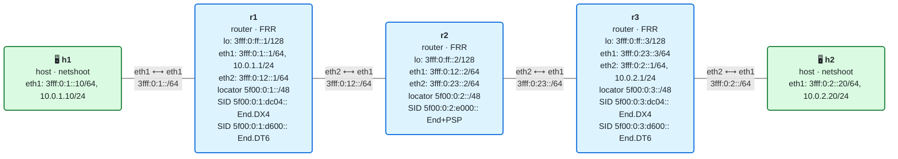

# 09 · Práctica: reducción de cabeceras (H.Encaps.Red y PSP/USP/USD)

Antes de empezar, lee la [teoría del módulo](README.md).

## Topología

<!-- topologia:inicio -->

<!-- topologia:fin -->

> El fichero editable para draw.io está en [`lab/topologia.drawio`](lab/topologia.drawio).

- Misma topología que el módulo 08: **h1** y **h2** dual-stack; núcleo **r1–r2–r3** solo IPv6 (IS-IS).
- La diferencia está en el plano de datos: **r1 y r3 encapsulan en `mode encap.red`** (reducido) y **r2 ejecuta `End flavors psp`**.
- Al arrancar, el IPv4 de h1 a h2 ya viaja sobre SRv6 con cabecera reducida y con PSP quitando la SRH en el último salto. Lo vas a medir y a comparar con el modo completo.

## Parte A · Ejercicios en papel

Hazlos sin ordenador. Las soluciones están en [soluciones.md](soluciones.md).

**A1.** Un headend encapsula un paquete hacia el camino `[S1, S2, S3]` (3 SID). Di cuántos bytes de **SRH** (cabecera 8 + 16 por SID) lleva el paquete con `H.Encaps` (completo) y con `H.Encaps.Red` (reducido). ¿Cuánto se ahorra?

**A2.** ¿Por qué el encapsulado reducido puede omitir el primer SID de la SRH sin perder información? ¿Dónde está ese SID si no está en la SRH?

**A3.** Con un camino de **un solo SID**, ¿qué cabeceras lleva el paquete por el núcleo con `H.Encaps.Red`? ¿Cuántos bytes de SRH?

**A4.** Explica, en una frase cada uno, qué hace `PSP`, `USP` y `USD` y **qué nodo** (penúltimo o último) actúa en cada caso.

**A5.** En el laboratorio, r3 entrega el IPv4 con `End.DX4` y **no** le hemos puesto `flavors usd`. ¿Por qué funciona igual la desencapsulación? (Pista: ¿qué llevan de serie los behaviors `End.D*`?)

**A6.** Para el camino `[r2, r3]` con `encap.red` + `PSP`, dibuja qué cabeceras viajan en el tramo **r1→r2** y en el tramo **r2→r3**. ¿En cuál hay SRH y en cuál no?

## Parte B · Laboratorio

### B0. Levantar el laboratorio

```bash
$ cd 09-reduccion-cabeceras/lab
$ sudo containerlab deploy -t lab.clab.yml
$ ./verificar.sh
```

Comprueba que el IPv4 de h1 a h2 funciona de entrada:

```bash
$ docker exec clab-m09-h1 ping -c2 10.0.2.20
```

### B1. Ver el modo de encap y el flavor instalados

```bash
$ docker exec clab-m09-r1 ip route show 10.0.2.0/24
$ docker exec clab-m09-r2 ip -6 route show 5f00:0:2:e000::/128
```

1. En la ruta de r1, ¿qué modo de encap aparece? (Busca `encap.red` o un texto equivalente como `mode encap.red`.)
2. En el SID de r2, ¿ves el flavor `psp`? ¿Qué significa que esté ahí?

### B2. PSP en vivo: la SRH desaparece entre r2 y r3

Aquí está el corazón del módulo. Vas a capturar en **los dos tramos** del núcleo a la vez mientras haces ping.

El truco para distinguir: en la cabecera IPv6, el campo **Next Header** vale **43** si viene una **SRH** (Routing Header), y **4** si viene directamente un **IPv4** encapsulado (sin SRH). En tcpdump: `ip6[6]==43` (hay SRH) frente a `ip6[6]==4` (IPv4 encapsulado, sin SRH).

```bash
# Terminal 1 — tramo r1→r2 (entrada a r2):
$ docker run --rm -it --net container:clab-m09-r2 nicolaka/netshoot:v0.13 \
    tcpdump -ni eth1 -vv 'ip6 and (ip6[6]==43 or ip6[6]==4)'

# Terminal 2 — tramo r2→r3 (salida de r2):
$ docker run --rm -it --net container:clab-m09-r2 nicolaka/netshoot:v0.13 \
    tcpdump -ni eth2 -vv 'ip6 and (ip6[6]==43 or ip6[6]==4)'

# Terminal 3 — genera tráfico:
$ docker exec clab-m09-h1 ping -c3 10.0.2.20
```

1. En **eth1** (r1→r2), ¿el paquete lleva SRH (`srcrt`/`rt6`, Next Header 43) o IPv4 directo (Next Header 4)?
2. En **eth2** (r2→r3), ¿qué lleva? ¿Hay SRH o ha desaparecido?
3. Junta las dos observaciones: ¿qué ha hecho r2 con la SRH? ¿Qué flavor es el responsable?

### B3. Medir el ahorro: reducido vs completo

Vamos a ver los bytes. Primero, con el reducido (estado actual), mira el **tamaño** del paquete que entra a r2 y los SID que lleva la SRH:

```bash
$ docker run --rm -it --net container:clab-m09-r2 nicolaka/netshoot:v0.13 \
    tcpdump -ni eth1 -e -vv 'ip6[6]==43' &
$ docker exec clab-m09-h1 ping -c2 10.0.2.20
```

Fíjate en la **longitud** y en cuántos SID lista la SRH (`[0] ... [1] ...`).

Ahora cambia r1 al modo **completo** (`encap`, sin `.red`) con el **mismo** camino y repite:

```bash
$ docker exec clab-m09-r1 ip route replace 10.0.2.0/24 \
    encap seg6 mode encap segs 5f00:0:2:e000::,5f00:0:3:dc04:: dev eth2
$ docker run --rm -it --net container:clab-m09-r2 nicolaka/netshoot:v0.13 \
    tcpdump -ni eth1 -e -vv 'ip6[6]==43' &
$ docker exec clab-m09-h1 ping -c2 10.0.2.20
```

1. ¿Cuántos SID lista ahora la SRH? ¿Cuánto más mide el paquete que con el reducido?
2. ¿Coincide la diferencia con los 16 bytes de un SID?
3. Vuelve al reducido:

   ```bash
   $ docker exec clab-m09-r1 ip route replace 10.0.2.0/24 \
       encap seg6 mode encap.red segs 5f00:0:2:e000::,5f00:0:3:dc04:: dev eth2
   ```

### B4. El caso extremo: un solo SID, cero SRH

Si el camino tiene un único SID (el de r3, que entrega), el reducido no pone **ninguna** SRH. Cámbialo para ir **directo** a r3 (r2 solo reenvía por IGP, sin ser un segmento):

```bash
$ docker exec clab-m09-r1 ip route replace 10.0.2.0/24 \
    encap seg6 mode encap.red segs 5f00:0:3:dc04:: dev eth2
```

Captura en **los dos tramos** (como en B2) y haz ping:

```bash
$ docker exec clab-m09-h1 ping -c3 10.0.2.20
```

1. ¿Aparece alguna SRH (`ip6[6]==43`) en algún tramo? ¿O todo es IPv4-en-IPv6 directo (`ip6[6]==4`)?
2. ¿Qué sobrecarga de SRv6 queda entonces? ¿Solo los 40 bytes de la IPv6 exterior?
3. ¿Sigue haciendo algo el flavor PSP de r2 en este caso? (Pista: ¿es r2 un segmento del camino ahora?)
4. Vuelve al estado inicial:

   ```bash
   $ docker exec clab-m09-r1 ip route replace 10.0.2.0/24 \
       encap seg6 mode encap.red segs 5f00:0:2:e000::,5f00:0:3:dc04:: dev eth2
   ```

### B5. Apagar PSP para ver la diferencia

Quita el flavor de r2 (deja un `End` normal) y observa cómo **reaparece** la SRH entre r2 y r3:

```bash
$ docker exec clab-m09-r2 ip -6 route replace 5f00:0:2:e000::/128 \
    encap seg6local action End dev eth1
```

Captura en **eth2** de r2 (tramo r2→r3) y haz ping:

```bash
$ docker run --rm -it --net container:clab-m09-r2 nicolaka/netshoot:v0.13 \
    tcpdump -ni eth2 -vv 'ip6 and (ip6[6]==43 or ip6[6]==4)' &
$ docker exec clab-m09-h1 ping -c3 10.0.2.20
```

1. Ahora, ¿qué Next Header lleva el paquete en r2→r3: 43 (SRH) o 4 (IPv4 directo)? ¿Qué `Segments Left` tiene esa SRH?
2. ¿Qué diferencia práctica hay entre esta SRH (sin PSP) y lo que veías en B2 (con PSP)?
3. Vuelve a activar PSP:

   ```bash
   $ docker exec clab-m09-r2 ip -6 route replace 5f00:0:2:e000::/128 \
       encap seg6local action End flavors psp dev eth1
   ```

### B6. Limpieza

```bash
$ sudo containerlab destroy -t lab.clab.yml --cleanup
```

## Reto: USP en un End final

En el laboratorio, el último SID (r3) es un `End.DX4`, que desencapsula de serie (lleva USD implícito). Para **ver USP** necesitas un `End` final que **no** desencapsule y que, con el flavor `usp`, quite la SRH agotada.

Investiga y prueba: ¿acepta tu versión de iproute2 combinar flavors, por ejemplo `action End flavors psp,usp` o `action End.X ... flavors usp`? Mira el `man ip-route` (sección seg6local) en el contenedor:

```bash
$ docker exec clab-m09-r2 sh -c 'ip -6 route help 2>&1 | grep -iA3 flavors || man ip-route 2>/dev/null | grep -iA5 flavors'
```

1. ¿Qué flavors soporta tu iproute2? ¿Se pueden combinar en un mismo SID?
2. Razona: si el último nodo fuera un `End` (no un `.D*`) y quisieras que el paquete siguiera por enrutamiento normal **sin** la SRH agotada, ¿qué flavor le pondrías, `usp` o `usd`? ¿Por qué?
3. ¿Por qué `End.DX4` y `End.DT6` no necesitan que les pongas `usd` explícitamente?

> Nota: no todas las versiones de kernel/iproute2 exponen los tres flavors ni permiten todas las combinaciones. Si alguno no está disponible, anótalo: en una red real, el soporte de flavors depende de la plataforma, y por eso PSP (el más extendido) es el que casi siempre se usa.
