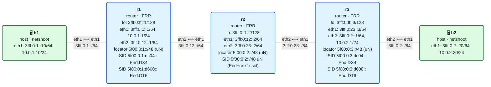
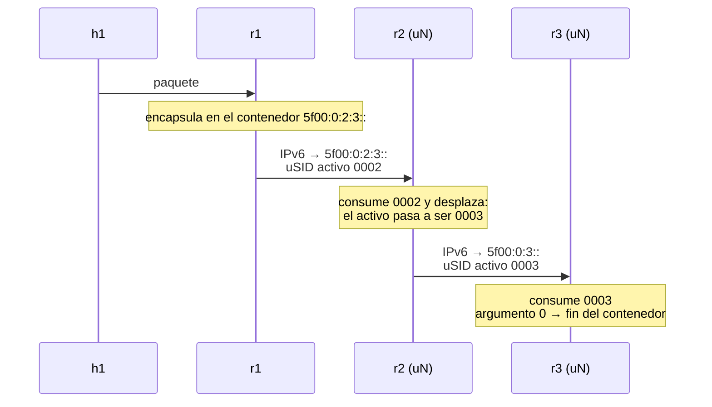

# 10 · uSID: SIDs comprimidos (NEXT-C-SID)

> **Objetivo**: entender la **compresión de SIDs** de SRv6 —los **uSID** (micro-SID), que el IETF llama **NEXT-C-SID**— con los que un camino de varios saltos cabe en **una sola dirección IPv6**, sin SRH. Montarás el behavior **uN** en Linux (`End flavors next-csid`) y verás cómo un router "consume" su uSID y desplaza el resto.
>
> **Por qué importa para SRv6**: en el módulo 09 recortaste la SRH quitando SIDs redundantes y vacíos. uSID ataca el problema de raíz: en vez de una lista de SIDs de 128 bits cada uno, mete **varios** segmentos de 16 bits **dentro de una dirección IPv6**. Un camino de 4-6 saltos puede viajar **sin SRH**, solo en el destino. Es lo que despliegan hoy los grandes operadores (es la variante SRv6 de Cisco, Arista y otros), y es la razón principal por la que SRv6 escala en el núcleo.

## El laboratorio de este módulo

<!-- topologia:inicio -->

<!-- topologia:fin -->

Misma topología que los módulos 08/09, pero el núcleo usa **uSID**:

- **r2** y **r3** instalan el behavior **uN** (`End` con el flavor `next-csid`): **una sola ruta `/48`** por router que procesa cualquier contenedor que pase por él.
- **r1** encapsula el IPv4 de h1 hacia h2 en un **contenedor** que empaqueta los saltos `[r2, r3]` en **una dirección**, más un *service SID* para la entrega.

Lo medirás y lo verás "desplazarse" salto a salto en la [práctica](practica.md).

## 1. El problema de escala: una lista de direcciones enteras

Recuerda cómo viaja un camino en SRv6 "clásico" (módulos 07-09): una **lista de SIDs**, cada uno una dirección IPv6 **completa de 128 bits (16 bytes)**. Un camino de ingeniería de tráfico de 5 saltos son 5 × 16 = **80 bytes** solo de lista, más los 8 de la cabecera SRH, más los 40 de la IPv6 exterior. Por cada paquete.

Pero fíjate en el desperdicio: todos esos SIDs comparten el mismo **bloque** (el prefijo del operador, p. ej. `5f00:0:...`). Lo único que cambia de un SID a otro son unos pocos bits que identifican al **nodo**. Estamos gastando 128 bits para transmitir, en realidad, unos 16 bits de información útil por salto.

uSID elimina ese desperdicio.

## 2. La idea: varios micro-SID dentro de una dirección

Un **uSID** (micro-SID, o **C-SID** en el IETF) es un identificador **corto** —típicamente **16 bits**— que representa a un nodo o a una función. En lugar de una dirección por salto, se **empaquetan varios uSID dentro de una única dirección IPv6**, que se llama **contenedor** (*container* o *carrier*).

Una dirección IPv6 tiene 128 bits. Si reservamos:

- **32 bits** para el **bloque** (`locator-block`): el prefijo común, igual en toda la red.
- **16 bits** por cada **uSID** (`C-SID`).

…caben `(128 − 32) / 16 = 6` uSID en una sola dirección. Esta combinación se llama **formato F3216** (bloque **32**, C-SID **16**).

Ejemplo de contenedor con el bloque `5f00:0` y los uSID `0002` (r2) y `0003` (r3):


- El **uSID activo** es el que está **justo después del bloque** (`0002`): el nodo al que se dirige el paquete **ahora mismo**.
- Los demás (`0003`, …) esperan su turno en lo que el IETF llama el **argumento**.
- Los uSID a `0000` del final son "vacíos": marcan que no queda nada más.

## 3. uN: "consumir y desplazar"

El behavior que procesa un uSID de nodo se llama **uN** (la versión micro de `End`). Cuando un paquete llega a un router con su uSID activo, el router hace **shift-and-continue** ("desplazar y continuar"):

1. Comprueba su uSID activo (el que está tras el bloque): es el suyo.
2. Mira el **argumento** (el resto de uSID):
   - Si **no es cero**, quedan saltos: **desplaza** el argumento 16 bits hacia la izquierda, de modo que el **siguiente** uSID pase a la posición activa, y rellena con ceros por la derecha. Reenvía al nuevo destino.
   - Si **es cero**, se acabó el contenedor: no quedan más uSID aquí.

Visualmente, para el contenedor `5f00:0:2:3::` que pasa por r2 y luego r3:



- En **r1→r2**, el destino es `5f00:0:2:3::` (uSID activo = `0002`, el de r2).
- **r2 (uN)** consume su `0002` y **desplaza**: el destino pasa a `5f00:0:3::` (ahora el activo es `0003`, el de r3). **Sin tocar ninguna SRH**: todo ocurre en la dirección de destino.
- En **r2→r3**, el destino es `5f00:0:3::`.
- **r3 (uN)** consume su `0003`; el argumento ya es `0` → fin del contenedor.

Lo importante: **dos saltos (r2 y r3) viajaron en una sola dirección, sin ningún SID en una SRH**. En SRv6 clásico eso habrían sido dos entradas de 16 bytes en la lista de segmentos.

### Una ruta por nodo, no por camino

Hay una segunda gran ventaja, menos obvia. El uN de un router se instala como **una única ruta `/48`** (bloque + su uSID de nodo):

```bash
# r2: su uN. UNA ruta que vale para CUALQUIER contenedor con 0002 activo.
# metric 100 para que gane a la ruta conectada del locator en lo (que tiene metric 256).
ip -6 route replace 5f00:0:2::/48 \
   encap seg6local action End flavors next-csid lblen 32 nflen 16 metric 100 dev eth1
```

> **Dos detalles de Linux** (los descubrimos montando este lab):
> 1. **Métrica**: el locator se configura en `lo` para que IS-IS lo anuncie, y eso crea una ruta **conectada** con `metric 256`. Si instalas el uN sin métrica, queda con una mayor y **pierde**. Por eso el uN lleva una **métrica menor** (`100`) para ganar el *match* en la tabla main.
> 2. **La dirección base no puede ser local**: cuando el contenedor se desplaza y el uSID del nodo queda solo (argumento a cero), el destino es exactamente la **base** del locator (`5f00:0:3::`). Al asignar el locator `/48` a `lo`, el kernel crea automáticamente esa base como **dirección *anycast* de subred** en la **tabla `local`**, que se consulta **antes** que la main: interceptaría el aterrizaje del contenedor y el paquete se entregaría localmente (fallando al procesar la SRH). Por eso, en el laboratorio, cada router **borra esa entrada anycast** al arrancar (`ip -6 route del anycast 5f00:0:3:: dev lo table local`), de modo que la base la procese el uN. (Asignamos además el locator como `::1/48` por limpieza, pero lo decisivo es quitar la anycast. En un plano de control real —módulo 11— FRR gestiona el locator de forma nativa y nada de esto hace falta.)

Esa `/48` cubre **todos** los contenedores que lleguen con `0002` activo, sea cual sea el resto del argumento (`5f00:0:2:3::`, `5f00:0:2:5:9::`, lo que sea). El router **no necesita una entrada por cada camino**: con una sola ruta procesa infinitos contenedores. Esto mantiene **pequeñas** las tablas de reenvío por mucho que crezca el número de políticas de TE. (Compáralo con MPLS, donde cada LSP consume etiquetas y estado.)

- `lblen 32` = longitud del bloque (*locator-block*), 32 bits.
- `nflen 16` = longitud del uSID de nodo (*locator-node + function*), 16 bits.

## 4. uA, uDT, uDX: el resto del repertorio micro

Igual que en SRv6 clásico hay un catálogo de behaviors, uSID tiene sus versiones "micro":

| uSID | Equivale a | Qué hace |
|------|-----------|----------|
| **uN** | `End` | Consume el uSID de nodo y desplaza (reenvía por el IGP) |
| **uA** | `End.X` | Consume el uSID y reenvía por una **adyacencia concreta** (TE) |
| **uDT4 / uDT6** | `End.DT4 / DT6` | Último uSID: **desencapsula** y busca en una tabla (VPN) |
| **uDX4 / uDX6** | `End.DX4 / DX6` | Último uSID: desencapsula y entrega directo a un vecino |

En Linux, el flavor `next-csid` está disponible para **`End`** (uN, desde el kernel 6.1) y **`End.X`** (uA, desde el 6.6). Los micro-behaviors de **desencapsulado** (uDT/uDX) **no** están expuestos como flavor en todas las versiones. Por eso, en este laboratorio, el **tránsito** se hace con **uN** (comprimido) y la **entrega final** con un *service SID* **clásico** (`End.DX4`), al que se llega cuando el contenedor se agota:

```bash
# r3: uN para el tránsito...
ip -6 route replace 5f00:0:3::/48 encap seg6local action End flavors next-csid lblen 32 nflen 16 dev eth1
# ...y un service SID clásico /128 (más específico) para desencapsular y entregar
ip -6 route add 5f00:0:3:dc04::/128 encap seg6local action End.DX4 nh4 10.0.2.20 dev eth2
```

El contenedor de ida es `5f00:0:2:3::` con un service SID `5f00:0:3:dc04::` detrás:

```bash
# r1: encapsula el IPv4 en el contenedor [r2, r3] + service SID de r3
ip route add 10.0.2.0/24 \
   encap seg6 mode encap.red segs 5f00:0:2:3::,5f00:0:3:dc04:: dev eth2
```

> En una red uSID "pura" (con uDT4/uDT6), ese último service SID también sería un uSID y se metería en el **mismo** contenedor, sin SRH alguna. Aquí lo dejamos como SID clásico por el soporte de Linux; conceptualmente, es el mismo papel.

### Cómo se agota el contenedor y salta al service SID

Cuando r3 procesa su uN y el argumento ya es cero (fin del contenedor), toma el **siguiente segmento** (el service SID `5f00:0:3:dc04::`) como nuevo destino. Como ese `/128` es **más específico** que la ruta uN `/48`, gana por *longest-prefix match* y se procesa el `End.DX4`: desencapsula y entrega el IPv4 a h2. Las dos entradas de r3 (la `/48` uN y la `/128` service) conviven sin pisarse.

## 5. ¿uSID o SRH comprimida? Dos sabores de compresión

El draft del IETF ([Compressed SRv6 Segment List Encoding](https://datatracker.ietf.org/doc/draft-ietf-spring-srv6-srh-compression/)) define dos variantes de C-SID:

- **NEXT-C-SID** (lo que la industria llama **uSID**): el "desplazar y continuar" que acabas de ver. Es el más desplegado.
- **REPLACE-C-SID**: una variante donde el nodo **reemplaza** su parte en lugar de desplazar. Menos común.

Nos centramos en **NEXT-C-SID/uSID** porque es el que verás en producción y el que soporta Linux.

> **Ojo: aún es un borrador.** A fecha de hoy, la compresión de SIDs es un *Internet-Draft* del grupo SPRING, no un RFC publicado. La arquitectura está estable y desplegada, pero los detalles finos pueden cambiar. Los behaviors base (RFC 8986) sí son estándar.

## 6. La ganancia, en números

Para un camino de **N saltos** de tránsito hacia un servicio:

| | SRv6 clásico (lista de SIDs) | uSID (F3216) |
|---|---|---|
| Bytes por salto | 16 (un SID entero) | 2 (un uSID de 16 bits) |
| Saltos en el destino, sin SRH | 0 | hasta 5 (y 6 con el service) |
| Rutas en cada router | una por SID/camino | **una `/48` por nodo** |

Con F3216, un camino de hasta **6 nodos cabe en una sola dirección IPv6**, viajando **sin ninguna SRH**. Solo cuando el camino es más largo se encadena un segundo contenedor en una SRH. Para la inmensa mayoría de los caminos de una red real, SRv6 con uSID significa **cero sobrecarga de SRH**.

## 7. Resumen

- Un **uSID** (micro-SID / **C-SID** / **NEXT-C-SID**) es un identificador corto (típicamente **16 bits**) que representa a un nodo o función.
- Varios uSID se **empaquetan en una sola dirección IPv6**, el **contenedor**: bloque (32 bits) + varios C-SID (16 bits cada uno). Es el formato **F3216** (caben 6).
- El behavior **uN** (`End flavors next-csid`) hace **shift-and-continue**: consume su uSID activo y **desplaza** el resto, sin tocar ninguna SRH.
- Cada router instala **una sola ruta `/48`** (su uN) que procesa **cualquier** contenedor que pase por él: tablas pequeñas, independientes del número de caminos.
- En Linux: `action End flavors next-csid lblen 32 nflen 16` (uN, kernel ≥ 6.1) y `End.X` (uA, ≥ 6.6). La entrega final, por soporte, se hace aquí con un **service SID clásico**.
- Resultado: caminos de varios saltos **sin SRH**. Es la clave de la escalabilidad de SRv6 en producción.

## Siguiente paso

Haz la [práctica](practica.md): instalarás los uN, verás con `tcpdump` cómo el destino **se desplaza** de `5f00:0:2:3::` a `5f00:0:3::` al pasar por r2, comprobarás que **no hay SRH** en el tránsito y medirás el ahorro frente al SID clásico. Con esto cierras el **Bloque II**. En el **Bloque III** llega el plano de control con FRR: IS-IS anunciará automáticamente los locators y los SIDs, y dejarás de instalar rutas a mano.

## Para saber más

- [draft-ietf-spring-srv6-srh-compression · Compressed SRv6 Segment List Encoding](https://datatracker.ietf.org/doc/draft-ietf-spring-srv6-srh-compression/) — define NEXT-C-SID (uSID) y REPLACE-C-SID
- [RFC 8986 · SRv6 Network Programming](https://www.rfc-editor.org/rfc/rfc8986) — los behaviors base de los que derivan uN/uA/uDT/uDX
- [SRv6 uSID en el kernel de Linux (netdev 0x19, 2025)](https://www.segment-routing.net/images/20250311-srv6-usid-linux-netdev-0x19.pdf) — soporte y ejemplos de `next-csid`
- [SRv6.md · uSID](https://srv6.md/topics/usid/)
