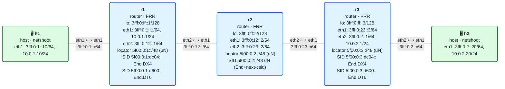

# 10 · Práctica: uSID (SIDs comprimidos / NEXT-C-SID)

Antes de empezar, lee la [teoría del módulo](README.md).

## Topología

<!-- topologia:inicio -->

<!-- topologia:fin -->

> El fichero editable para draw.io está en [`lab/topologia.drawio`](lab/topologia.drawio).

- Misma topología que los módulos 08/09: **h1** y **h2** dual-stack; núcleo **r1–r2–r3** solo IPv6 (IS-IS).
- Ahora el núcleo usa **uSID**: r2 y r3 tienen un **uN** (`End flavors next-csid`) en su `/48`, y r1 encapsula el IPv4 de h1 hacia h2 en un **contenedor** `5f00:0:2:3::` que empaqueta los saltos `[r2, r3]`, más un *service SID* `5f00:0:3:dc04::` para la entrega.
- Formato **F3216**: bloque `5f00:0` (32 bits) + uSID de 16 bits por nodo (`0001`=r1, `0002`=r2, `0003`=r3).

## Parte A · Ejercicios en papel

Hazlos sin ordenador. Las soluciones están en [soluciones.md](soluciones.md).

**A1.** En formato F3216 (bloque 32 bits, uSID 16 bits), ¿cuántos uSID caben en una sola dirección IPv6? Haz la cuenta.

**A2.** Un camino de ingeniería de tráfico recorre 5 nodos de tránsito. ¿Cuántos **bytes** ocupa la lista de segmentos en SRv6 clásico (un SID de 16 bytes por salto)? ¿Y en uSID (2 bytes por salto)? ¿Hace falta SRH en cada caso?

**A3.** Dado el contenedor `5f00:0:2:3::` con el bloque `5f00:0`: identifica el **bloque**, el **uSID activo** y el **argumento**. ¿A qué router se dirige el paquete ahora mismo?

**A4.** Explica el "shift-and-continue" de **uN**: ¿qué hace el router con el argumento si no es cero? ¿Y si es cero?

**A5.** Tras pasar `5f00:0:2:3::` por r2 (uN), ¿cuál es el nuevo destino del paquete? Escríbelo.

**A6.** ¿Por qué un router uSID necesita **una sola ruta `/48`** para procesar muchísimos caminos distintos, mientras que en SRv6 clásico hacía falta un SID por cada punto del camino? ¿Qué ventaja operativa tiene esto?

## Parte B · Laboratorio

### B0. Levantar el laboratorio

```bash
$ cd 10-usid/lab
$ sudo containerlab deploy -t lab.clab.yml
$ ./verificar.sh
```

Comprobación rápida de que el IPv4 de h1 a h2 funciona sobre uSID:

```bash
$ docker exec clab-m10-h1 ping -c2 10.0.2.20
```

### B1. El uN de cada router: una ruta /48

```bash
$ docker exec clab-m10-r2 ip -6 route show 5f00:0:2::/48
$ docker exec clab-m10-r3 ip -6 route show 5f00:0:3::/48
```

1. ¿Qué `action` y qué `flavor` aparecen? ¿Ves `next-csid`, `lblen 32`, `nflen 16`?
2. Fíjate en que es un **`/48`**, no un `/128`. ¿Qué contenedores procesa esa única entrada? (Pista: todos los que lleguen con el uSID de ese nodo activo.)

### B2. El "shift" en vivo: el destino se desplaza

Esta es la observación estrella. Vas a capturar en los dos tramos del núcleo y ver cómo **el destino cambia** al pasar por r2.

```bash
# Terminal 1 — tramo r1→r2 (entrada a r2):
$ docker run --rm -it --net container:clab-m10-r2 nicolaka/netshoot:v0.13 \
    tcpdump -ni eth1 -nn 'ip6 and dst net 5f00::/16'

# Terminal 2 — tramo r2→r3 (salida de r2):
$ docker run --rm -it --net container:clab-m10-r2 nicolaka/netshoot:v0.13 \
    tcpdump -ni eth2 -nn 'ip6 and dst net 5f00::/16'

# Terminal 3 — genera tráfico:
$ docker exec clab-m10-h1 ping -c3 10.0.2.20
```

1. ¿Cuál es la dirección **destino** del paquete en **eth1** (r1→r2)? Debería ser el contenedor completo `5f00:0:2:3::`.
2. ¿Cuál es la dirección **destino** en **eth2** (r2→r3)? ¿Ha cambiado? ¿A qué?
3. Junta las dos: ¿qué le ha hecho r2 al contenedor? ¿Dónde está ahora el uSID de r3?
4. ¿Ves alguna **SRH** (Next Header 43) en el tránsito, o el IPv4 va con la mínima cabecera?

### B3. ¿Hay SRH? Compara la cabecera

Mira con detalle qué cabeceras lleva el paquete en el núcleo:

```bash
$ docker run --rm -it --net container:clab-m10-r2 nicolaka/netshoot:v0.13 \
    tcpdump -ni eth1 -vv -c2 'ip6 and dst net 5f00::/16' &
$ docker exec clab-m10-h1 ping -c2 10.0.2.20
```

1. ¿El Next Header de la IPv6 exterior indica una SRH (43) o directamente el service SID / IPv4? ¿Cuántos bytes de SRH ves frente al SID clásico del módulo 09?
2. Recuerda: en este lab, el service SID final (`5f00:0:3:dc04::`) sí viaja en una pequeña SRH de 1 entrada (por el soporte de Linux a uDT/uDX). El **tránsito** (`[r2, r3]`), en cambio, va comprimido **en el destino**. Identifica las dos partes en la captura.

### B4. El uN procesa cualquier contenedor (una ruta, muchos caminos)

Demuestra que la **misma** ruta `/48` de r2 sirve para otro contenedor distinto. Crea en r1 una ruta de prueba que mande el IPv6 de h2 por un contenedor diferente pero que también pase por r2:

```bash
# Un contenedor [r2, r3] con service SID End.DT6 (en vez de DX4), para la IPv6 de h2
$ docker exec clab-m10-r1 ip -6 route add 3fff:0:2::20/128 \
    encap seg6 mode encap.red segs 5f00:0:2:3::,5f00:0:3:d600:: dev eth2
$ docker exec clab-m10-h1 ping -c2 3fff:0:2::20
```

1. ¿Funciona sin haber tocado la configuración de r2? ¿Por qué? (La ruta uN `/48` de r2 ya procesaba cualquier contenedor con `0002` activo.)
2. ¿Qué service SID se usa ahora en r3 y qué hace con el paquete IPv6 interior?
3. Limpia:

   ```bash
   $ docker exec clab-m10-r1 ip -6 route del 3fff:0:2::20/128
   ```

### B5. Desmontar el contenedor a mano (opcional)

Para fijar el mecanismo, calcula tú el desplazamiento. El contenedor es `5f00:0:2:3::`. Exprésalo en hexteto completo:

```
5f00:0000:0002:0003:0000:0000:0000:0000
 └─bloque─┘ └a┘  └b┘ └────── argumento ──────┘
```

1. ¿Qué uSID está activo (tras el bloque)? ¿Cuál es el argumento?
2. Aplica el shift (desplaza el argumento 16 bits a la izquierda tras el bloque, rellena con 0). Escribe la dirección resultante y compárala con lo que viste en B2 en el tramo r2→r3.

### B6. Limpieza

```bash
$ sudo containerlab destroy -t lab.clab.yml --cleanup
```

## Reto: un contenedor de 3 saltos

Fuerza un camino explícito **r1 → r2 → r3 → r2 → r1** no tiene sentido (hay bucles); en esta topología lineal solo hay un tránsito real (r2) antes de r3. Pero puedes practicar el **empaquetado** de más uSID y observar que el reenvío sigue el contenedor:

1. Construye a mano el contenedor que representaría el camino `[r2, r3]` **más** un cuarto uSID ficticio `0009` al final (`5f00:0:2:3:9::`) y razona, sobre el papel, cómo quedaría el destino tras cada salto.
2. Investiga en la ayuda de iproute2 del contenedor si tu versión soporta los micro-behaviors de desencapsulado (uDT/uDX) como flavor:

   ```bash
   $ docker exec clab-m10-r3 sh -c 'ip route help 2>&1 | grep -iA4 next-csid || true'
   ```

   ¿Aparece `next-csid`? ¿Se menciona algún flavor de desencapsulado? Anótalo: si tu kernel/iproute2 los soporta, podrías meter también el service SID dentro del contenedor y eliminar la última SRH.
3. Razona: en un núcleo real con 6 saltos, ¿cuántas direcciones/SRH harían falta con uSID frente a SRv6 clásico?

> Nota: el soporte de uSID en Linux/iproute2 evoluciona rápido y no todas las versiones exponen uDT/uDX. Si algo no está disponible, anótalo: en producción, el soporte de uSID depende de la plataforma, y por eso aquí combinamos uN (tránsito comprimido) con un service SID clásico para la entrega.
