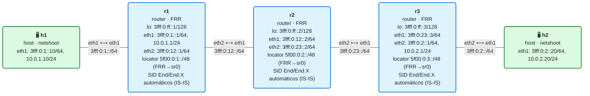

# 11 · IS-IS con SRv6: el plano de control

> **Objetivo**: dejar de instalar SIDs a mano. En este módulo, **FRR** anuncia el **locator** por IS-IS e **instala solo** los SIDs (el `End` del locator y los `End.X` de cada adyacencia) en el plano de datos. Configurarás SRv6 en FRR con unas pocas líneas y verás aparecer, automáticamente, todo lo que en los módulos 08-10 montabas comando a comando.
>
> **Por qué importa para SRv6**: en los módulos anteriores entendiste *qué* hace cada SID montándolos a mano. Eso es insostenible en una red de verdad: cientos de nodos, miles de adyacencias. El **plano de control** (aquí IS-IS; en el módulo 12, BGP) es lo que hace SRv6 operable: tú declaras un **locator** por router y el IGP se encarga de anunciarlo, de asignar los SIDs y de programarlos en el kernel de cada nodo. Este módulo es la bisagra entre "SRv6 a mano" y "SRv6 de verdad".

## El laboratorio de este módulo

<!-- topologia:inicio -->

<!-- topologia:fin -->

Misma topología de siempre (h1–r1–r2–r3–h2, núcleo IPv6 con IS-IS), pero **sin un solo `ip -6 route add` de SIDs**. Cada router lleva 6 líneas de configuración SRv6 en FRR; al arrancar, IS-IS anuncia los locators y FRR instala los SIDs. Tu trabajo en la [práctica](practica.md) será **inspeccionar** lo que FRR ha hecho por ti y entender cada pieza.

## 1. Locator: la identidad SRv6 de un router

Todo gira alrededor del **locator**: el prefijo IPv6 (un `/48` en nuestro caso) **propiedad de un router**, dentro del cual viven todos sus SIDs. Ya lo usabas en los módulos anteriores (`5f00:0:1::/48` era "la zona de SIDs de r1"); la diferencia es que ahora es un **objeto de configuración** que el router anuncia y gestiona.

Un locator se descompone como viste con uSID (formato bloque/nodo/función):

```
5f00:0:1::/48
└── block-len 32 ──┘└ node-len 16 ┘└── func-bits 16 ──┘
     bloque común      nodo (r1)       función (qué SID)
```

- **block-len 32**: los 32 bits del bloque, comunes a toda la red.
- **node-len 16**: identifican al **nodo** (r1 = `0001`).
- **func-bits 16**: el espacio donde el router **asigna** una función a cada SID que necesite (su `End`, cada `End.X`, mañana un `End.DT`…).

En FRR, el locator se declara en **zebra** (el componente que habla con el kernel):

```
segment-routing
 srv6
  locators
   locator MAIN
    prefix 5f00:0:1::/48 block-len 32 node-len 16 func-bits 16
   exit
```

## 2. Activar SRv6 en IS-IS: dos líneas

Declarar el locator no basta: hay que decirle al **IGP** que lo use. En IS-IS se activa con:

```
router isis CORE
 ...
 segment-routing srv6
  locator MAIN
 exit
```

Con esto, IS-IS empieza a:

1. **Anunciar** el locator `5f00:0:1::/48` en sus LSP, para que todos los routers sepan "para llegar a los SIDs de r1, enruta hacia este `/48`".
2. **Asignar** los SIDs del repertorio base dentro del locator:
   - un **prefix-SID** `End` que representa al propio nodo (el "pasa por r1");
   - un **adjacency-SID** `End.X` por **cada adyacencia** (uno para "sal por el enlace hacia r2", etc.).
3. **Instalar** esos SIDs en el plano de datos (en el kernel, vía `seg6local`), para que el router los ejecute cuando lleguen paquetes.

Todo esto lo define el [RFC 9352](https://www.rfc-editor.org/rfc/rfc9352.html) (*IS-IS Extensions to Support SRv6*). Lo que en los módulos 08-10 escribías con `ip -6 route add ... encap seg6local action End/End.X`, ahora lo **genera IS-IS**.

## 3. La interfaz `sr0`: dónde aterrizan los SIDs (y el guiño al módulo 10)

FRR necesita una interfaz donde instalar los SIDs locales. Por convenio usa una **interfaz dummy llamada `sr0`**, que se crea a mano:

```bash
ip link add sr0 type dummy
ip link set sr0 up
```

Fíjate en el detalle: FRR instala el locator como una ruta **`seg6local` sobre `sr0`**, **no** como una dirección en `lo`. ¿Te suena? En el módulo 10, montando uSID a mano, el locator en `lo` creaba una **anycast de subred** en la tabla `local` que interceptaba los paquetes, y tuvimos que borrarla. FRR **no cae en eso**: al usar `sr0` con `seg6local` en vez de una dirección en `lo`, la dirección base del locator nunca es "local" y el behavior la procesa siempre. El plano de control bien hecho te ahorra justo el tipo de trampa que sufriste a mano.

Al arrancar, verás en el kernel algo como:

```
5f00:0:1::/48  encap seg6local action End ... dev sr0
```

Esa entrada la ha puesto **FRR**, no tú.

## 4. Qué SIDs asigna IS-IS (End y End.X)

Repasa el catálogo (módulo 08) desde la óptica del plano de control:

| SID | Quién lo asigna | Representa | Para qué sirve |
|-----|-----------------|------------|----------------|
| **prefix-SID `End`** | uno por nodo | "pasa por este router" | bloque básico de cualquier camino; el nodo en una lista de segmentos |
| **adjacency-SID `End.X`** | uno por adyacencia | "sal por este enlace concreto" | ingeniería de tráfico: forzar un camino salto a salto |

Un **End** lo resuelve el IGP (sigue el camino más corto hacia el locator). Un **End.X** está **atado a un enlace**: si r2 tiene dos vecinos, tendrá un End.X por cada uno, y usar uno u otro fuerza por qué enlace sale el paquete. Esa es la materia prima de la **ingeniería de tráfico** (módulo 14): una lista de End.X describe un camino explícito que puede **no** ser el más corto.

En tu PR al laboratorio de la wiki srv6.md (al principio del curso) ya viste esto sin saberlo del todo: los SID `seg6local action End.X nh6 fe80::…` que aparecían "solos" en los routers los había puesto **IS-IS**, uno por adyacencia. Ahora sabes de dónde salían.

## 5. Lo que NO hace todavía: el servicio

Ojo a un límite importante de este módulo. IS-IS con SRv6 te da el **transporte**: locators anunciados y SIDs `End`/`End.X` para moverte por el núcleo. Pero **no** crea los SIDs de **servicio** (`End.DT4`, `End.DT6`, `End.DX4`…), los que desencapsulan y entregan el tráfico del cliente a una VPN. Esos nacen de un **servicio**, y el servicio lo anuncia **BGP**, no el IGP.

Por eso, en este laboratorio, h1 y h2 se alcanzan por **IPv6 normal** (el IGP), pero **todavía no hay un camino SRv6 de extremo a extremo para el tráfico de cliente**: falta el SID de servicio en el PE de destino. Lo añadirás a mano en la práctica (para ver que el transporte de FRR funciona) y lo **automatizarás con BGP en el módulo 12**, que es donde SRv6 se convierte en una L3VPN de verdad.

Dicho de otro modo:

```
Módulo 11 (IS-IS):  transporte  → locators + End/End.X   ✅ automático
Módulo 12 (BGP):    servicio    → End.DT4/DT6 por VPN     (siguiente)
```

## 6. Inspeccionar el plano de control

Las herramientas que usarás en la práctica (todas sin tocar nada, solo mirar):

```bash
# El locator local y sus SIDs
vtysh -c "show segment-routing srv6 locator"
vtysh -c "show segment-routing srv6 locator MAIN detail"

# Los nodos SRv6 aprendidos por IS-IS (locators de los demás)
vtysh -c "show isis segment-routing srv6 node"

# Las rutas: el locator propio en sr0 (seg6local) y los de los vecinos por el IGP
vtysh -c "show ipv6 route"
ip -6 route show | grep seg6local      # los SIDs que FRR instaló en el kernel
```

## 7. Resumen

- El **locator** es el `/48` propiedad de un router donde viven sus SIDs; se declara en zebra con `segment-routing / srv6 / locators / locator` y su `prefix … block-len 32 node-len 16 func-bits 16`.
- Se activa en el IGP con `router isis CORE / segment-routing srv6 / locator MAIN`.
- IS-IS entonces **anuncia** el locator y **asigna e instala** solos: un **`End`** por nodo (prefix-SID) y un **`End.X`** por adyacencia (adjacency-SID), definidos por el [RFC 9352](https://www.rfc-editor.org/rfc/rfc9352.html).
- FRR instala esos SIDs en una interfaz dummy **`sr0`** con `seg6local` (y así evita el problema de la anycast en `lo` que viste en el módulo 10).
- IS-IS da el **transporte**; el **servicio** (SIDs `End.DT*`/`End.DX*` de VPN) lo aporta **BGP** en el módulo 12.
- Resultado: lo que antes montabas comando a comando, ahora lo genera el plano de control con unas pocas líneas por router.

## Siguiente paso

Haz la [práctica](practica.md): inspeccionarás los locators anunciados, los SIDs `End`/`End.X` que FRR ha instalado solo, y montarás a mano un SID de servicio para comprobar que el transporte automático de FRR entrega tráfico real. Luego, en el módulo 12, BGP automatizará también el servicio y tendrás una **L3VPN SRv6** completa.

## Para saber más

- [RFC 9352 · IS-IS Extensions to Support SRv6](https://www.rfc-editor.org/rfc/rfc9352.html)
- [FRR · ISIS (SRv6)](https://docs.frrouting.org/en/latest/isisd.html) — la configuración `segment-routing srv6`
- [SRv6.md · SRv6 en FRRouting](https://srv6.md/implementations/frrouting/)
