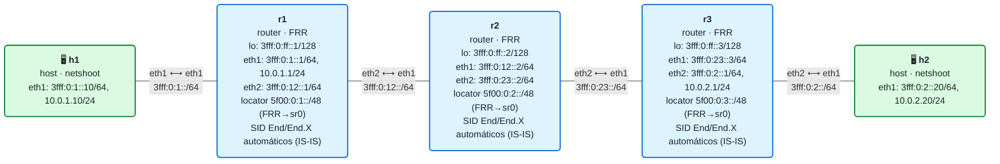

# 11 · Práctica: IS-IS con SRv6 (plano de control)

Antes de empezar, lee la [teoría del módulo](README.md).

## Topología

<!-- topologia:inicio -->

<!-- topologia:fin -->

> El fichero editable para draw.io está en [`lab/topologia.drawio`](lab/topologia.drawio).

- Misma topología de siempre, pero **sin instalar SIDs a mano**: cada router lleva la config SRv6 de FRR (locator + activación en IS-IS) y una interfaz dummy `sr0`.
- Al arrancar, IS-IS anuncia los locators y FRR instala los SIDs `End` (del locator) y `End.X` (por adyacencia). Tú los vas a **inspeccionar**.
- El **servicio** (entrega de tráfico de cliente) todavía no existe: lo montarás a mano al final para ver que el transporte de FRR funciona. En el módulo 12 lo hará BGP.

## Parte A · Ejercicios en papel

Hazlos sin ordenador. Las soluciones están en [soluciones.md](soluciones.md).

**A1.** ¿Qué es un **locator** y qué tres partes lo componen con `block-len 32 node-len 16 func-bits 16`? ¿Para qué sirve el espacio de `func-bits`?

**A2.** Con SRv6 en IS-IS, ¿qué dos tipos de SID asigna el router automáticamente, y qué representa cada uno? Asocia cada uno a un behavior (`End` / `End.X`).

**A3.** ¿Cuántos `End.X` esperas en r2 y por qué? ¿Y en r1? (Fíjate en las adyacencias IS-IS de cada uno en la topología.)

**A4.** ¿Por qué FRR instala el locator en `sr0` con `seg6local` y no como dirección en `lo`? Relaciónalo con el problema que resolviste a mano en el módulo 10.

**A5.** IS-IS con SRv6 da el **transporte**, pero no el **servicio**. ¿Qué tipo de SID falta para entregar tráfico de cliente a una VPN, y quién lo aporta (módulo 12)?

## Parte B · Laboratorio

### B0. Levantar el laboratorio

```bash
$ cd 11-isis-srv6/lab
$ sudo containerlab deploy -t lab.clab.yml
$ ./verificar.sh
```

> Nota: cada router crea su `sr0` y recarga FRR al arrancar; dale unos segundos a IS-IS para converger antes de inspeccionar.

### B1. El locator local y sus SIDs

```bash
$ docker exec clab-m11-r1 vtysh -c "show segment-routing srv6 locator"
$ docker exec clab-m11-r1 vtysh -c "show segment-routing srv6 locator MAIN detail"
```

1. ¿Qué prefijo tiene el locator `MAIN` de r1? ¿Y su `block-len` / `node-len` / `func-bits`?
2. ¿Qué SIDs aparecen ya asignados dentro del locator?

### B2. Los SIDs que FRR instaló en el kernel (sin que tú los pusieras)

```bash
$ docker exec clab-m11-r1 ip -6 route show | grep seg6local
$ docker exec clab-m11-r2 ip -6 route show | grep seg6local
$ docker exec clab-m11-r1 vtysh -c "show ipv6 route" | grep -A1 sr0
```

1. ¿Sobre qué interfaz están instalados los SIDs? (Pista: no es `lo`.)
2. Identifica el `End` del locator y los `End.X`. ¿Cuántos `End.X` hay en r2? ¿Coincide con tu respuesta de A3?
3. Compara con los módulos 08-10: ¿quién escribió estas rutas esta vez?

### B3. Lo que IS-IS anuncia: los locators de los demás

```bash
$ docker exec clab-m11-r1 vtysh -c "show isis segment-routing srv6 node"
$ docker exec clab-m11-r1 ip -6 route show 5f00:0:3::/48
```

1. ¿Ve r1 los locators de r2 y r3? 
2. La ruta hacia `5f00:0:3::/48` en r1, ¿por dónde sale y con qué protocolo la aprendió? (Debe ser por IS-IS, hacia r2.)
3. ¿Por qué es importante que todos conozcan el locator de r3? (Pista: para poder enviar tráfico a cualquier SID de r3.)

### B4. Reachability básica (transporte IPv6)

```bash
$ docker exec clab-m11-r1 ping -c2 3fff:0:ff::3        # loopback de r3
$ docker exec clab-m11-h1 ping -c2 3fff:0:2::20        # h1 → h2 por IPv6 (IGP)
```

1. ¿Funcionan? Este es el transporte IPv6 normal (IGP), igual que en el módulo 05. Todavía **no** es SRv6 de extremo a extremo para el cliente.

### B5. Montar un servicio a mano sobre el transporte de FRR

Ahora comprobarás que el transporte automático de FRR **entrega tráfico real**. Vas a añadir un SID de **servicio** `End.DX4` en r3 (a mano, como en el módulo 08) y encapsular el IPv4 de h1 hacia él. El transporte hasta r3 lo resuelve el locator que **FRR ya anuncia**.

```bash
# r3: SID de servicio que desencapsula IPv4 y lo entrega a h2 (dentro del locator de r3)
$ docker exec clab-m11-r3 ip -6 route add 5f00:0:3:dc04::/128 \
    encap seg6local action End.DX4 nh4 10.0.2.20 dev eth2
# r1: encapsula el IPv4 de h1 hacia ese SID de servicio
$ docker exec clab-m11-r1 ip sr tunsrc set 3fff:0:ff::1
$ docker exec clab-m11-r1 ip route add 10.0.2.0/24 \
    encap seg6 mode encap.red segs 5f00:0:3:dc04:: dev eth2
# Y la vuelta (r1 servicio, r3 encap)
$ docker exec clab-m11-r1 ip -6 route add 5f00:0:1:dc04::/128 \
    encap seg6local action End.DX4 nh4 10.0.1.10 dev eth1
$ docker exec clab-m11-r3 ip sr tunsrc set 3fff:0:ff::3
$ docker exec clab-m11-r3 ip route add 10.0.1.0/24 \
    encap seg6 mode encap.red segs 5f00:0:1:dc04:: dev eth1

$ docker exec clab-m11-h1 ping -c2 10.0.2.20
```

1. ¿Funciona el ping IPv4 sobre SRv6? El transporte hasta `5f00:0:3:dc04::` ¿quién lo resolvió, tú o FRR? (Pista: ¿pusiste alguna ruta hacia el locator de r3?)
2. ¿Por qué solo hizo falta **un** SID en el encap (el de servicio) y no SIDs de tránsito? (Pista: el núcleo enruta el paquete IPv6 exterior hacia el locator de r3 por el IGP.)
3. Esto es, en esencia, una L3VPN SRv6 con el servicio **a mano**. ¿Qué parte automatizará BGP en el módulo 12?

### B6. Forzar un camino explícito con un End.X (sabor a TE)

Los `End.X` de FRR permiten elegir el enlace. Lee el `End.X` de r2 hacia r3 y úsalo para forzar el camino:

```bash
# Averigua el End.X de r2 hacia su adyacencia con r3 (apunta la dirección del SID)
$ docker exec clab-m11-r2 ip -6 route show | grep End.X
$ docker exec clab-m11-r2 vtysh -c "show isis segment-routing srv6 node" 
```

Cambia el encap de r1 para pasar explícitamente por ese End.X antes del servicio (sustituye `<EndX-r2-hacia-r3>`):

```bash
$ docker exec clab-m11-r1 ip route replace 10.0.2.0/24 \
    encap seg6 mode encap.red segs <EndX-r2-hacia-r3>,5f00:0:3:dc04:: dev eth2
$ docker exec clab-m11-h1 ping -c2 10.0.2.20
```

1. ¿Sigue funcionando? Ahora el camino r2→r3 va **forzado** por el End.X, no por decisión del IGP.
2. En esta topología lineal no cambia el camino (solo hay uno). ¿En qué caso sí se notaría? (Pista: si r2 tuviera dos caminos hacia r3.)
3. Deja el encap como estaba:

   ```bash
   $ docker exec clab-m11-r1 ip route replace 10.0.2.0/24 \
       encap seg6 mode encap.red segs 5f00:0:3:dc04:: dev eth2
   ```

### B7. Limpieza

```bash
$ sudo containerlab destroy -t lab.clab.yml --cleanup
```

## Reto: leer la base de datos de IS-IS

El transporte SRv6 se anuncia dentro de los LSP de IS-IS. Explóralo:

```bash
$ docker exec clab-m11-r1 vtysh -c "show isis database detail" | grep -iA3 srv6
```

1. ¿Qué información SRv6 lleva un LSP? ¿Ves el locator y las capacidades SRv6 del nodo?
2. ¿Por qué tiene sentido que el **IGP** (que ya conoce la topología) sea quien distribuya los locators y SIDs de transporte, en vez de un protocolo aparte?
3. Compara mentalmente con SR-MPLS: allí el IGP distribuye *etiquetas* (SIDs) de un espacio global; aquí distribuye *locators* IPv6. ¿Qué ventaja tiene que el SID sea una dirección IPv6 enrutable normal?
