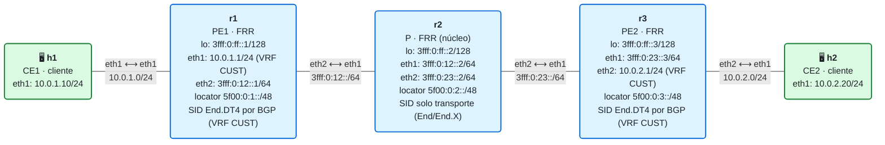
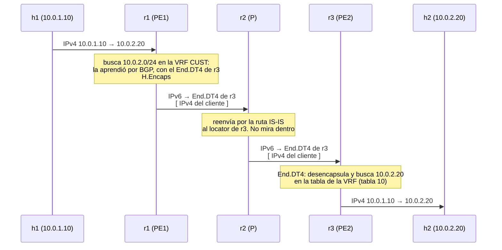

# 12 · L3VPN IPv4 sobre SRv6 con BGP (End.DT4)

> **Objetivo**: montar una **L3VPN** de verdad. El servicio que en el módulo 11 pusiste a mano (un `End.DX4`) ahora lo **automatiza BGP**: defines una **VRF** de cliente en cada PE y BGP se encarga de asignar el SID `End.DT4`, anunciarlo y programar el encapsulado. Es el caso de uso estrella de SRv6 en operadores.
>
> **Por qué importa para SRv6**: una L3VPN es "cada cliente, su propia red privada sobre una infraestructura compartida". SRv6 la resuelve con elegancia: el núcleo solo necesita el **transporte** (locators, módulo 11); el **servicio** (a qué VPN pertenece cada paquete) va codificado en un **SID de servicio** (`End.DT4`) que el PE de destino usa para entregar el tráfico en la VRF correcta. BGP distribuye ese SID. Juntando los módulos 11 y 12 tienes lo que un ISP vende como "MPLS L3VPN", pero sobre IPv6 puro.

## El laboratorio de este módulo

<!-- topologia:inicio -->

<!-- topologia:fin -->

- **r1** y **r3** son **PE** (*Provider Edge*): tienen la **VRF `CUST`** (tabla 10) con la interfaz del cliente dentro.
- **r2** es **P** (*Provider core*): solo transporta SRv6; **no sabe nada de la VPN**.
- **h1** y **h2** son los **CE** (*Customer Edge*) del mismo cliente; su IPv4 privado (`10.0.1.0/24` y `10.0.2.0/24`) viaja por la VPN.

Y aquí está lo bueno: **no instalarás ningún SID a mano**. BGP crea el `End.DT4`, lo anuncia y programa el encapsulado. Tú defines la VRF y la política; el resto es automático.

## 1. Qué es una L3VPN (y sus siglas)

Una **L3VPN** conecta sitios de un cliente a través de la red de un operador, de forma que para el cliente es como si fueran una sola red privada, aislada de los demás. El vocabulario (heredado de MPLS, [RFC 4364](https://www.rfc-editor.org/rfc/rfc4364)):

- **CE** (*Customer Edge*): el equipo del cliente (aquí, h1 y h2).
- **PE** (*Provider Edge*): el router del operador donde se conecta el cliente (r1 y r3). Aquí vive la VRF.
- **P** (*Provider*): routers del núcleo que solo transportan (r2). No conocen las VPN.
- **VRF** (*Virtual Routing and Forwarding*): una **tabla de rutas aislada** por cliente dentro del PE. Lo viste en el reto del módulo 08: el `End.DT4` entrega en la tabla de una VRF.

La clave del aislamiento: dos clientes pueden usar las **mismas** direcciones privadas (los dos `10.0.0.0/8`) sin chocar, porque cada uno vive en su propia VRF.

## 2. Las piezas de BGP: RD y RT

Si dos clientes usan `10.0.0.0/8`, ¿cómo distingue BGP una ruta de otra? Con dos construcciones:

- **RD** (*Route Distinguisher*): un número que se **antepone** al prefijo para hacerlo **único** al viajar por BGP. `10.0.2.0/24` del cliente A se convierte en `65000:101:10.0.2.0/24`, distinto del de otro cliente. El RD solo sirve para desambiguar; no decide quién importa qué.
- **RT** (*Route Target*): una **etiqueta** que dice **en qué VRFs entra** la ruta. El PE exporta sus rutas con un RT (`rt vpn both 65000:101`) y cada PE importa las que lleven los RT que le interesan. El RT es lo que **construye la topología** de la VPN (quién habla con quién).

En FRR, en la instancia BGP de la VRF:

```
router bgp 65000 vrf CUST
 address-family ipv4 unicast
  redistribute connected          # mete la red del cliente (10.0.1.0/24) en la VPN
  sid vpn export auto             # BGP asigna un SID End.DT4 para esta VRF
  rd vpn export 10.0.0.1:101      # hace únicas las rutas de este PE
  rt vpn both 65000:101           # exporta e importa con este Route Target
  export vpn
  import vpn
 exit-address-family
```

## 3. El SID de servicio: End.DT4

El corazón de SRv6 en la L3VPN es el SID **`End.DT4`** (lo conociste en el módulo 08): **desencapsula y busca el destino IPv4 interior en la tabla de una VRF**. Cada PE asigna uno **por VRF**, dentro de su locator. Cuando BGP anuncia `10.0.2.0/24` desde r3, el anuncio lleva pegado "…y para entregarlo, encapsula hacia este `End.DT4` mío".

Recuerda del módulo 08: **`End.DT4` necesita una VRF real** (no vale la tabla main). Aquí eso deja de ser un estorbo y pasa a ser el fundamento: la VRF **es** la VPN. FRR instala el SID así (lo verás en la práctica):

```
5f00:0:3:...::  encap seg6local action End.DT4 vrftable 10 dev ...
```

> **Detalle del kernel: `strict_mode`.** Para que Linux acepte instalar un `End.DT4` ligado a una VRF hay que activar `net.vrf.strict_mode=1`. Además, ese valor **se resetea cada vez que se crea una VRF nueva**, así que se pone **después** de crear la VRF. Es un detalle de Linux que, si falta, hace que el SID `End.DT4` no se instale. El orden también importa respecto a FRR: si BGP intenta instalar el SID antes de que la VRF y `strict_mode` estén listos, el kernel lo rechaza y el SID se queda sin instalar. Por eso el laboratorio crea la VRF y activa `strict_mode` **antes de arrancar FRR** (en el `cmd` de cada PE, dentro de `lab.clab.yml`), y solo después mete la interfaz del CE en la VRF. Como red de seguridad, si al cabo de unos segundos el `End.DT4` no está en el kernel, el laboratorio reaplica la asignación del SID (`no sid vpn export auto` / `sid vpn export auto`) **sin reiniciar FRR** —reiniciarlo rompería IS-IS, como vimos en el módulo 11—. En un router real, todo esto lo hace el sistema al arrancar, en el orden correcto.

## 4. BGP lleva el servicio; IS-IS lleva el transporte

Fíjate en el **reparto de papeles**, que es lo elegante de SRv6:

| Plano | Protocolo | Qué distribuye | Alcance |
|-------|-----------|----------------|---------|
| **Transporte** | IS-IS (módulo 11) | locators + SIDs `End`/`End.X` | todos los routers (PE y P) |
| **Servicio** | BGP (este módulo) | prefijos de cliente + SID `End.DT4` | solo los PE |

- El **P (r2) solo participa en el transporte**: enruta el paquete IPv6 exterior hacia el locator del PE de destino y ya. **No tiene BGP, ni VRF, ni sabe que existe una VPN.** Añadir clientes no le afecta en absoluto. Esta separación es lo que hace a SRv6 escalar: el núcleo es simple y estable; toda la inteligencia de servicio vive en los PE.
- Los **PE hablan iBGP** entre sus loopbacks (a través del núcleo) para intercambiar las rutas VPN. Como el núcleo es IPv6 y las rutas son IPv4, se usa la familia **IPv4 VPN** con *next-hop* IPv6 (capacidad *extended-nexthop*, [RFC 8950](https://www.rfc-editor.org/rfc/rfc8950)).

```
router bgp 65000
 neighbor 3fff:0:ff::3 remote-as 65000           # iBGP al loopback del otro PE
 neighbor 3fff:0:ff::3 update-source lo
 neighbor 3fff:0:ff::3 capability extended-nexthop
 segment-routing srv6
  locator MAIN                                    # BGP saca los SIDs de este locator
 address-family ipv4 vpn
  neighbor 3fff:0:ff::3 activate                  # intercambia rutas IPv4-VPN
```

## 5. El viaje de un paquete, de h1 a h2



El IPv4 privado del cliente **nunca se enruta como IPv4 en el núcleo**: viaja dentro de SRv6, y solo los PE (que tienen la VRF) lo entienden. Eso es una L3VPN: infraestructura compartida, redes privadas aisladas.

## 6. Multicliente: por qué esto escala

Para añadir un segundo cliente, solo tocas los **PE** donde ese cliente se conecta: creas otra VRF (`CUST2`, tabla 20), con su `End.DT4` y su RT (`65000:102`). El cliente 2 puede usar las **mismas** IPs privadas que el 1 sin colisión, porque cada VRF es una tabla aparte y cada uno lleva su propio SID de servicio. **r2 (el núcleo) no cambia ni una línea.** Esa es, en una frase, la razón de ser de las L3VPN sobre SRv6.

## 7. Inspeccionar la VPN

```bash
# ¿Está la sesión iBGP de VPN establecida?
vtysh -c "show bgp ipv4 vpn summary"
# Las rutas VPN aprendidas (con su RD, RT y SID End.DT4)
vtysh -c "show bgp ipv4 vpn"
# La tabla de la VRF del cliente (lo que ve el cliente)
vtysh -c "show ip route vrf CUST"
# El SID End.DT4 instalado en el kernel
ip -6 route show | grep 'End.DT4'
```

## 8. Resumen

- Una **L3VPN** da a cada cliente una red privada aislada sobre una infraestructura compartida. Vocabulario: **CE** (cliente), **PE** (borde del operador, con la VRF), **P** (núcleo, solo transporte).
- La **VRF** es la tabla de rutas aislada por cliente; permite que dos clientes usen las mismas IPs privadas sin chocar.
- **BGP** distribuye las rutas del cliente con un **RD** (las hace únicas) y un **RT** (decide en qué VRFs entran), y les pega el SID de servicio.
- El SID de servicio es **`End.DT4`**: desencapsula y busca en la tabla de la VRF. BGP lo asigna (`sid vpn export`), lo anuncia y programa el encapsulado. Necesita una VRF real y `net.vrf.strict_mode=1`.
- Reparto de planos: **IS-IS** da el **transporte** (todos los routers); **BGP** da el **servicio** (solo los PE). El **P no sabe nada de la VPN** → el núcleo escala.
- Resultado: una L3VPN SRv6 completa, equivalente a la "MPLS L3VPN" clásica pero sobre IPv6 puro.

## Siguiente paso

Haz la [práctica](practica.md): verás la sesión BGP de VPN, las rutas del cliente con su SID End.DT4, cómo el P ignora la VPN, y seguirás un paquete por SRv6 de h1 a h2. En el módulo 13 extenderás esto a **IPv6 y dual-stack** (`End.DT6` / `End.DT46`).

## Para saber más

- [RFC 4364 · BGP/MPLS IP VPNs](https://www.rfc-editor.org/rfc/rfc4364) — el modelo CE/PE/P, RD y RT (nacido en MPLS, reutilizado en SRv6)
- [RFC 9252 · BGP Overlay Services over SRv6](https://www.rfc-editor.org/rfc/rfc9252.html) — L3VPN (y EVPN) sobre SRv6
- [RFC 8986 · SRv6 Network Programming](https://www.rfc-editor.org/rfc/rfc8986) — el behavior `End.DT4`
- [FRR · BGP (SRv6 L3VPN)](https://docs.frrouting.org/en/latest/bgp.html) y [SRv6 en FRRouting](https://srv6.md/implementations/frrouting/)
