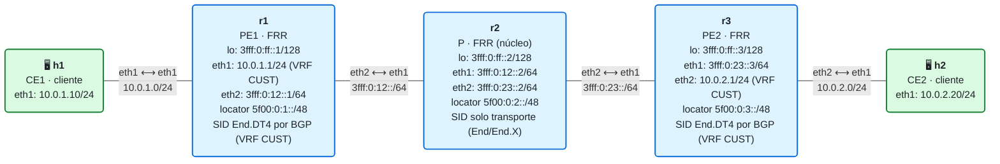

# 12 · Práctica: L3VPN IPv4 sobre SRv6 con BGP (End.DT4)

Antes de empezar, lee la [teoría del módulo](README.md).

## Topología

<!-- topologia:inicio -->

<!-- topologia:fin -->

> El fichero editable para draw.io está en [`lab/topologia.drawio`](lab/topologia.drawio).

- **r1** y **r3** son **PE** (con VRF `CUST`, tabla 10); **r2** es **P** (solo transporte).
- **h1** (10.0.1.10) y **h2** (10.0.2.20) son los **CE** del mismo cliente.
- BGP (iBGP entre loopbacks, familia IPv4 VPN) anuncia las redes del cliente con su SID **End.DT4**; IS-IS+SRv6 da el transporte. **No hay ningún SID puesto a mano.**

## Parte A · Ejercicios en papel

Hazlos sin ordenador. Las soluciones están en [soluciones.md](soluciones.md).

**A1.** Define en una frase: **CE**, **PE**, **P** y **VRF**. ¿Cuáles de nuestros nodos son cada cosa?

**A2.** ¿Para qué sirve el **RD** y para qué el **RT**? ¿Cuál decide en qué VRFs entra una ruta, y cuál solo la hace única?

**A3.** ¿Qué behavior SRv6 hace de SID de servicio en una L3VPN IPv4 y qué hace exactamente? ¿Por qué necesita una VRF (recuerda el módulo 08)?

**A4.** r2 (el P) ¿tiene BGP? ¿tiene VRF? ¿sabe que existe la VPN? ¿Por qué es esto bueno para la escalabilidad?

**A5.** Si añades un segundo cliente que usa **las mismas** IPs privadas (10.0.1.0/24, 10.0.2.0/24) que el primero, ¿por qué no chocan? ¿Qué nodos tocarías y cuáles no?

## Parte B · Laboratorio

### B0. Levantar el laboratorio

```bash
$ cd 12-l3vpn-bgp/lab
$ sudo containerlab deploy -t lab.clab.yml
$ ./verificar.sh
```

> Dale tiempo: IS-IS debe converger, luego BGP establecer la sesión y aprender las rutas VPN. El verificador espera hasta 90 s.

Prueba la VPN de cliente:

```bash
$ docker exec clab-m12-h1 ping -c2 10.0.2.20
```

### B1. La sesión BGP de VPN

```bash
$ docker exec clab-m12-r1 vtysh -c "show bgp ipv4 vpn summary"
```

1. ¿Está establecida (`Established`) la sesión iBGP con el otro PE (loopback `3fff:0:ff::3`)? 
2. Fíjate: la sesión es sobre una dirección **IPv6** (los loopbacks) pero transporta rutas **IPv4**. ¿Qué capacidad lo permite (pista: *extended-nexthop*)?

### B2. Las rutas VPN y su SID End.DT4

```bash
$ docker exec clab-m12-r1 vtysh -c "show bgp ipv4 vpn"
$ docker exec clab-m12-r1 vtysh -c "show bgp ipv4 vpn 10.0.2.0/24"
```

1. ¿Ves la red de h2 (`10.0.2.0/24`) aprendida del otro PE? ¿Con qué **RD** y qué **RT**?
2. Busca el **SID** (`End.DT4`) asociado a esa ruta y su *next-hop*. ¿A qué locator pertenece ese SID (al de r3)?

### B3. El End.DT4 instalado por BGP (sin que tú lo pusieras)

```bash
$ docker exec clab-m12-r3 ip -6 route show | grep -i 'End.DT4'
$ docker exec clab-m12-r3 vtysh -c "show segment-routing srv6 locator MAIN detail"
```

1. ¿Qué SID `End.DT4` ha asignado r3 para su VRF `CUST`? ¿Sobre qué tabla actúa (`vrftable 10`)?
2. ¿Quién creó esta entrada: tú con `ip -6 route add`, o BGP? Compáralo con el módulo 11 (donde el `End.DX4` lo pusiste a mano).

### B4. La tabla del cliente (la VRF)

```bash
$ docker exec clab-m12-r1 vtysh -c "show ip route vrf CUST"
$ docker exec clab-m12-r1 ip route show vrf CUST
```

1. ¿Qué rutas hay en la VRF `CUST` de r1? ¿Ves la red local (10.0.1.0/24) y la remota (10.0.2.0/24)?
2. La ruta a `10.0.2.0/24`, ¿cómo se entrega? (Debe apuntar a un encap SRv6 hacia el End.DT4 de r3.)

### B5. El P no sabe nada de la VPN

```bash
$ docker exec clab-m12-r2 vtysh -c "show bgp summary" 2>&1 | head -3
$ docker exec clab-m12-r2 ip route show vrf CUST 2>&1
$ docker exec clab-m12-r2 ip -6 route show | grep -i 'End.DT4'
```

1. ¿Tiene r2 sesiones BGP? ¿Tiene la VRF `CUST`? ¿Tiene algún `End.DT4`?
2. Entonces, ¿cómo es posible que el tráfico de la VPN cruce r2? (Pista: r2 solo ve un paquete IPv6 con destino el locator de r3.)
3. ¿Qué implica esto para añadir clientes nuevos? ¿Habría que tocar r2?

### B6. Seguir el paquete por el núcleo

Captura en el núcleo (r2) mientras h1 hace ping a h2:

```bash
$ docker run --rm -it --net container:clab-m12-r2 nicolaka/netshoot:v0.13 \
    tcpdump -ni eth1 -nn 'ip6' &
$ docker exec clab-m12-h1 ping -c2 10.0.2.20
```

1. ¿Qué destino IPv6 lleva el paquete que cruza r2? (Debe ser un SID dentro del locator de r3, el `End.DT4`.)
2. ¿Qué hay **dentro**? ¿El IPv4 privado del cliente? ¿Lo "entiende" r2?
3. En el otro extremo, ¿quién desencapsula y entrega a h2?

### B7. Limpieza

```bash
$ sudo containerlab destroy -t lab.clab.yml --cleanup
```

## Reto: un segundo cliente con IPs solapadas

Demuestra el aislamiento de VRF. Añade a mano una segunda VRF en r1 y r3 para un cliente 2 que use **las mismas** IPs:

```bash
# En r1 y r3: crear VRF CUST2 (tabla 20) — en una red real esto va en frr.conf
docker exec clab-m12-r1 ip link add CUST2 type vrf table 20
docker exec clab-m12-r1 ip link set CUST2 up
docker exec clab-m12-r1 sysctl -w net.vrf.strict_mode=1
# (y en frr.conf: router bgp 65000 vrf CUST2 con rt vpn both 65000:102, su propio End.DT4)
```

1. Razona (sin montarlo entero): si el cliente 2 usa también `10.0.2.0/24`, ¿por qué no colisiona con el cliente 1 en el núcleo ni en los PE?
2. ¿Qué dos cosas distinguen las rutas de CUST2 de las de CUST en BGP? (Pista: una las hace únicas, otra decide dónde entran.)
3. ¿Cambiaría algo en r2? ¿Por qué eso es exactamente lo que buscas en una red de operador?

> Nota: montar el segundo cliente completo (con su frr.conf, redistribución y pruebas) es un buen ejercicio libre. La idea del reto es que entiendas **por qué** escala: el servicio vive solo en los PE, uno por VRF, y el núcleo es ajeno a todo.
