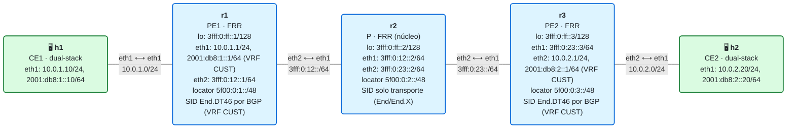
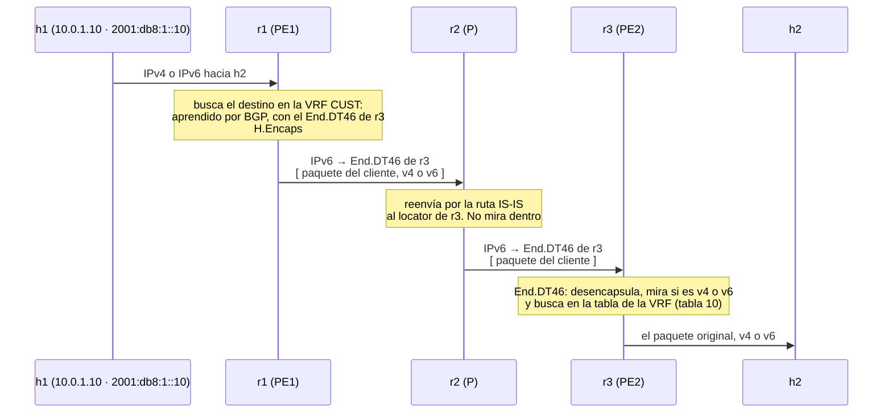

# 13 · L3VPN IPv6 y dual-stack (End.DT6 / End.DT46)

> **Objetivo**: llevar la L3VPN del módulo 12 a **dual-stack**: transportar también **IPv6** de cliente, y hacerlo con un **único SID de servicio `End.DT46`** que sirve para IPv4 e IPv6 a la vez. Verás la diferencia entre asignar un SID **por familia** (`End.DT4` + `End.DT6`) y uno **por VRF** (`End.DT46`).
>
> **Por qué importa para SRv6**: el mundo real es dual-stack. Un cliente VPN quiere llevar su IPv4 privado **y** su IPv6, sobre la misma infraestructura. SRv6 lo resuelve con una elegancia que MPLS no tiene: como el SID es una dirección IPv6 con un comportamiento, un **solo** SID (`End.DT46`) puede desencapsular y decidir, según el paquete interior, si lo entrega como IPv4 o como IPv6. Un SID, una VRF, las dos familias.

## El laboratorio de este módulo

<!-- topologia:inicio -->

<!-- topologia:fin -->

Es el laboratorio del módulo 12, **ahora dual-stack**:

- **h1** y **h2** (los CE) tienen **IPv4 e IPv6** de cliente (`10.0.1.0/24` + `2001:db8:1::/64`, y `10.0.2.0/24` + `2001:db8:2::/64`).
- La VRF `CUST` de cada PE transporta **las dos familias**.
- BGP asigna **un único `End.DT46`** por VRF (`sid vpn per-vrf export`), que entrega tanto IPv4 como IPv6.

## 1. Repaso: dónde estábamos

En el módulo 12 montaste una L3VPN **IPv4**: VRF por cliente, BGP con RD/RT, y un SID `End.DT4` que desencapsula y busca el IPv4 interior en la tabla de la VRF. Todo eso sigue igual. Lo único que cambia aquí es **añadir la familia IPv6** a la misma VPN.

## 2. Dos formas de asignar el SID de servicio

Cuando la VRF lleva IPv4 **e** IPv6, hay dos estrategias para el SID:

### a) Un SID por familia: End.DT4 + End.DT6

Asignas el SID **dentro de cada familia** (`sid vpn export` bajo `address-family ipv4 unicast` y otro bajo `ipv6 unicast`). Resultado: **dos** SIDs:

- **`End.DT4`**: desencapsula y busca el **IPv4** interior en la VRF.
- **`End.DT6`**: desencapsula y busca el **IPv6** interior en la VRF.

Cada anuncio BGP (una red IPv4 o una IPv6) lleva su SID correspondiente.

### b) Un SID por VRF: End.DT46

Asignas **un solo SID para toda la VRF** (`sid vpn per-vrf export`). Resultado: **un** SID:

- **`End.DT46`**: desencapsula y busca en la tabla de la VRF **según la versión del paquete interior** (si es IPv4, busca como IPv4; si es IPv6, como IPv6). El `46` significa "sirve para las dos".

Es la opción más compacta: un único SID de servicio por cliente, para ambas familias. Es la que usa este laboratorio por defecto:

```
router bgp 65000 vrf CUST
 sid vpn per-vrf export auto      # <- un único End.DT46 para toda la VRF
 address-family ipv4 unicast
  redistribute connected
  ...
 address-family ipv6 unicast
  redistribute connected
  ...
```

En el kernel lo verás así (fíjate en `End.DT46` y en que actúa sobre la tabla de la VRF):

```
5f00:0:3:...::  encap seg6local action End.DT46 vrftable 10 dev CUST
```

## 3. ¿End.DT6 o End.DT46? Cuándo cada uno

| | End.DT4 / End.DT6 (por familia) | End.DT46 (por VRF) |
|---|---|---|
| SIDs por VRF | dos (uno v4, uno v6) | **uno** |
| Cómo decide la entrega | el SID ya dice la familia | mira la versión del paquete interior |
| Consumo del espacio de funciones | más (dos funciones por VRF) | menos (una) |
| Cuándo | si quieres tratar v4 y v6 por separado (políticas, SIDs distintos) | dual-stack "normal": más simple y compacto |

En la práctica, **End.DT46 es lo habitual** para un cliente dual-stack corriente. Los SID separados se usan cuando necesitas distinguir el tratamiento de cada familia. En este módulo verás el `End.DT46` funcionando por defecto y, en la práctica, cambiarás a SIDs por familia para ver los `End.DT4`/`End.DT6` por separado.

## 4. IPv6 de cliente sobre un núcleo que también es IPv6

Un matiz conceptual bonito de este módulo: el **IPv6 del cliente** viaja **encapsulado dentro del IPv6 del núcleo**. No se mezclan:

- El **IPv6 exterior** (el del núcleo, `3fff:…` y los locators `5f00:…`) es el transporte: lo enrutan todos los routers por IS-IS.
- El **IPv6 interior** (el del cliente, `2001:db8:…`) es la carga: solo lo ven los PE, dentro de la VRF.

r2 (el P) reenvía un paquete IPv6 (exterior) sin saber que dentro viaja **otro** IPv6 (el del cliente). Es IPv6-en-IPv6, con un SID `End.DT46` marcando a qué VPN pertenece. La misma mecánica que con IPv4, porque para SRv6 el paquete interior es carga opaca sea cual sea su versión.

## 5. El viaje de un paquete (IPv4 o IPv6, da igual)



El **mismo SID** `End.DT46` sirvió para las dos familias: la decisión de "esto es IPv4" o "esto es IPv6" la toma r3 al desencapsular, mirando el paquete interior.

## 6. Resumen

- La L3VPN dual-stack transporta **IPv4 e IPv6** de cliente sobre la misma VRF y el mismo núcleo SRv6.
- Dos formas de asignar el SID de servicio:
  - **por familia** (`sid vpn export` en cada AF) → **`End.DT4`** + **`End.DT6`** (dos SIDs).
  - **por VRF** (`sid vpn per-vrf export`) → **`End.DT46`** (un solo SID para ambas).
- **`End.DT46`** desencapsula y decide la familia **según el paquete interior**; es lo habitual para dual-stack por su simplicidad.
- El **IPv6 del cliente** viaja **dentro del IPv6 del núcleo**: transporte e interior son dos capas IPv6 independientes; el P solo ve la exterior.
- Toda la arquitectura del módulo 12 (CE/PE/P, RD/RT, VRF, `strict_mode`) sigue igual: solo se añade la familia IPv6.

## Siguiente paso

Haz la [práctica](practica.md): comprobarás el `End.DT46` único, harás ping de cliente en IPv4 **y** IPv6 por la misma VPN, y cambiarás a SIDs por familia para ver `End.DT4` y `End.DT6` por separado. Con esto cierras el núcleo de los servicios L3VPN; en el módulo 14 llega la **ingeniería de tráfico** con SRv6.

## Para saber más

- [RFC 9252 · BGP Overlay Services over SRv6](https://www.rfc-editor.org/rfc/rfc9252.html) — L3VPN dual-stack sobre SRv6
- [RFC 8986 · SRv6 Network Programming](https://www.rfc-editor.org/rfc/rfc8986) — los behaviors `End.DT6` y `End.DT46`
- [SRv6 en FRRouting](https://srv6.md/implementations/frrouting/) — configuración de L3VPN dual-stack
