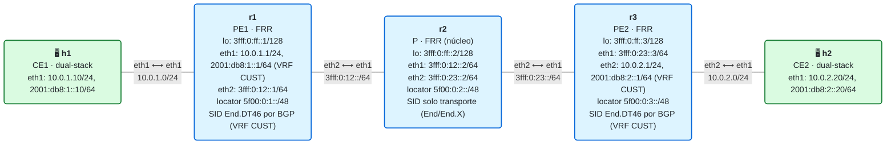

# 13 · Práctica: L3VPN IPv6 y dual-stack (End.DT6 / End.DT46)

Antes de empezar, lee la [teoría del módulo](README.md).

## Topología

<!-- topologia:inicio -->

<!-- topologia:fin -->

> El fichero editable para draw.io está en [`lab/topologia.drawio`](lab/topologia.drawio).

- Como el módulo 12, pero **dual-stack**: h1 y h2 tienen IPv4 **e** IPv6 de cliente.
- La VRF `CUST` lleva las dos familias; BGP asigna un **único `End.DT46`** (`sid vpn per-vrf export`).
- Direcciones de cliente: sitio de h1 `10.0.1.0/24` + `2001:db8:1::/64`; sitio de h2 `10.0.2.0/24` + `2001:db8:2::/64`.

## Parte A · Ejercicios en papel

Hazlos sin ordenador. Las soluciones están en [soluciones.md](soluciones.md).

**A1.** ¿Qué dos estrategias hay para asignar el SID de servicio en una VRF dual-stack? ¿Qué behavior(s) produce cada una?

**A2.** ¿Qué hace exactamente un `End.DT46` cuando le llega un paquete? ¿Cómo decide si entregar como IPv4 o como IPv6?

**A3.** El IPv6 **del cliente** (`2001:db8:2::20`) viaja por el núcleo. ¿Dentro de qué viaja? ¿Lo enruta r2 como IPv6 del cliente, o ve otra cosa?

**A4.** ¿Cuántos SIDs de servicio tendría la VRF con `sid vpn per-vrf export`? ¿Y con `sid vpn export` en cada familia? 

**A5.** ¿Qué cosas del módulo 12 (CE/PE/P, RD, RT, VRF, strict_mode) cambian al pasar a dual-stack, y cuáles se mantienen igual?

## Parte B · Laboratorio

### B0. Levantar el laboratorio

```bash
$ cd 13-l3vpn-dualstack/lab
$ sudo containerlab deploy -t lab.clab.yml
$ ./verificar.sh
```

Prueba la VPN en **las dos familias**:

```bash
$ docker exec clab-m13-h1 ping -c2 10.0.2.20          # IPv4 de cliente
$ docker exec clab-m13-h1 ping -c2 2001:db8:2::20      # IPv6 de cliente
```

### B1. El SID único: End.DT46

```bash
$ docker exec clab-m13-r3 ip -6 route show | grep -i 'seg6local' | grep -i 'DT'
$ docker exec clab-m13-r3 vtysh -c "show bgp segment-routing srv6"
```

1. ¿Cuántos SIDs de servicio hay en r3: uno (`End.DT46`) o dos (`End.DT4` + `End.DT6`)?
2. ¿Sobre qué tabla actúa (`vrftable 10`)? ¿En qué interfaz está instalado?

### B2. Las rutas VPN, en las dos familias

```bash
$ docker exec clab-m13-r1 vtysh -c "show bgp ipv4 vpn"
$ docker exec clab-m13-r1 vtysh -c "show bgp ipv6 vpn"
```

1. ¿Ves la red IPv4 de h2 (`10.0.2.0/24`) y la IPv6 (`2001:db8:2::/64`) aprendidas del otro PE?
2. ¿Qué SID llevan asociado? ¿Es el **mismo** `End.DT46` para las dos, o uno distinto por familia?

### B3. La tabla del cliente (VRF dual-stack)

```bash
$ docker exec clab-m13-r1 vtysh -c "show ip route vrf CUST"
$ docker exec clab-m13-r1 vtysh -c "show ipv6 route vrf CUST"
```

1. ¿Qué rutas hay en cada familia dentro de la VRF? ¿Ves las locales y las remotas?
2. La ruta IPv6 a `2001:db8:2::/64`, ¿se entrega por un encap SRv6 hacia el End.DT46 de r3?

### B4. IPv6 de cliente dentro de IPv6 de núcleo

Captura en el núcleo (r2) mientras h1 hace ping IPv6 a h2:

```bash
$ docker run --rm -it --net container:clab-m13-r2 nicolaka/netshoot:v0.13 \
    tcpdump -ni eth1 -nn 'ip6' &
$ docker exec clab-m13-h1 ping -c2 2001:db8:2::20
```

1. ¿Qué **destino IPv6 exterior** lleva el paquete que cruza r2? (Debe ser el `End.DT46` de r3, en `5f00:0:3::/48`.)
2. Dentro hay **otro** paquete IPv6 (el del cliente, `2001:db8:1::10 → 2001:db8:2::20`). ¿Distingue r2 el IPv6 del cliente del IPv6 del núcleo? ¿Qué ve él?
3. ¿Quién, y con qué behavior, saca el IPv6 del cliente y lo entrega a h2?

### B5. Cambiar a SIDs por familia (End.DT4 + End.DT6)

Vas a ver la otra estrategia. Sustituye el SID por-VRF por SIDs **por familia** en r3 (y r1):

```bash
# En r1 y r3: quitar el per-vrf y poner un sid por familia
for n in r1 r3; do
  docker exec clab-m13-$n vtysh -c "configure terminal" \
    -c "router bgp 65000 vrf CUST" \
    -c "no sid vpn per-vrf export auto" \
    -c "address-family ipv4 unicast" -c "sid vpn export auto" -c "exit-address-family" \
    -c "address-family ipv6 unicast" -c "sid vpn export auto" -c "exit-address-family"
done
sleep 4
docker exec clab-m13-r3 ip -6 route show | grep -i 'seg6local' | grep -iE 'DT4|DT6'
```

1. ¿Cuántos SIDs de servicio hay ahora en r3? ¿Ves un `End.DT4` y un `End.DT6` separados?
2. Comprueba que el ping dual-stack sigue funcionando:

   ```bash
   docker exec clab-m13-h1 ping -c2 10.0.2.20
   docker exec clab-m13-h1 ping -c2 2001:db8:2::20
   ```
3. ¿Qué ventaja tendría tener SIDs separados? ¿Y qué ventaja el End.DT46 único? (Repasa la tabla de la teoría.)
4. Vuelve al End.DT46 por-VRF:

   ```bash
   for n in r1 r3; do
     docker exec clab-m13-$n vtysh -c "configure terminal" \
       -c "router bgp 65000 vrf CUST" \
       -c "address-family ipv4 unicast" -c "no sid vpn export auto" -c "exit-address-family" \
       -c "address-family ipv6 unicast" -c "no sid vpn export auto" -c "exit-address-family" \
       -c "sid vpn per-vrf export auto"
   done
   ```

### B6. Limpieza

```bash
$ sudo containerlab destroy -t lab.clab.yml --cleanup
```

## Reto: una ruta, dos familias en el mismo paquete de señalización

1. Mira una ruta VPN en detalle y localiza, en el mismo anuncio, el SID SRv6 y el RT:

   ```bash
   docker exec clab-m13-r1 vtysh -c "show bgp ipv6 vpn 2001:db8:2::/64"
   ```
   ¿Qué *Remote SID* lleva? ¿Coincide con el End.DT46 que viste en r3?
2. Razona: si añadieras una tercera familia de servicio (digamos EVPN/L2), ¿seguiría bastando un núcleo que solo transporta IPv6? ¿Por qué el modelo "transporte IGP + servicio BGP" aguanta tan bien añadir servicios nuevos?
3. ¿Por qué tiene sentido que el *next-hop* de las rutas IPv4-VPN e IPv6-VPN sea, en ambos casos, un loopback **IPv6** del PE?
