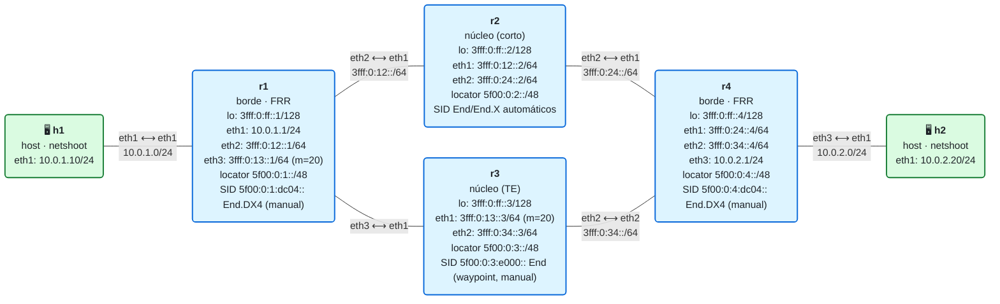

# 14 · Ingeniería de tráfico con SRv6

> **Objetivo**: forzar que el tráfico siga un camino que **no** es el más corto, usando una **lista de segmentos explícita**. Entenderás la arquitectura de **SR Policy** (color, endpoint, candidate paths, binding SID, steering) y verás TE SRv6 en acción en el plano de datos.
>
> **Por qué importa para SRv6**: el IGP siempre elige el camino más corto. Pero a veces quieres otra cosa: evitar un enlace congestionado, cumplir una latencia, separar tráfico por cliente o servicio. La **ingeniería de tráfico** (TE) permite decidir el camino tú. Y aquí SRv6 brilla: como el camino se codifica en una **lista de SIDs dentro del propio paquete**, no hace falta estado por-flujo en los routers del núcleo (al contrario que RSVP-TE en MPLS). El headend "dibuja" el camino; el núcleo solo ejecuta.

> **Nota de alcance (importante).** La **automatización** de SR Policy sobre SRv6 (steering por color, *on-demand* ODN, PCE) **no está soportada en FRR**: su demonio `pathd` solo hace SR Policy para **SR-MPLS**, no para SRv6. Por eso, en este laboratorio, la TE SRv6 se monta **a mano en el plano de datos** (una lista de segmentos explícita con `iproute2`), que es exactamente lo que una SR Policy instalaría por ti en una plataforma que sí lo soporte (Cisco IOS-XR, Juniper, Nokia…). La teoría cubre el modelo completo; el laboratorio, la parte practicable con FRR+Linux.

## El laboratorio de este módulo

<!-- topologia:inicio -->

<!-- topologia:fin -->

Topología en **diamante**: hay **dos caminos** de r1 a r4.

- **Camino corto** (coste 20): r1 → **r2** → r4. Es el que elige el IGP.
- **Camino largo** (coste 30): r1 → **r3** → r4. El enlace r1–r3 tiene métrica 20.

Por defecto, el laboratorio **fuerza el camino largo (por r3)** con una lista de segmentos, para que veas la TE funcionando desde el primer momento. En la práctica compararás con el camino corto.

## 1. El problema: el IGP solo sabe de "lo más corto"

IS-IS calcula el camino de menor coste a cada destino. Es lo que quieres el 95 % del tiempo. Pero no sabe de:

- **congestión**: el camino corto puede estar saturado.
- **latencia / SLA**: un cliente premium puede necesitar la ruta de menor retardo, que no es la de menos saltos.
- **separación de tráfico**: llevar unos servicios por una ruta y otros por otra.
- **evitar un nodo/enlace**: por mantenimiento o política.

Para todo eso necesitas **elegir el camino tú**. Eso es la ingeniería de tráfico.

## 2. La lista de segmentos: dibujar el camino en el paquete

Ya tienes la herramienta desde el módulo 07: la **lista de segmentos** de SRv6. Para forzar un camino, el headend mete en el paquete los SIDs de los waypoints por los que quieres pasar.

En este laboratorio, para ir de r1 a r4 **por r3** (no por r2), la lista es:

```
segs = [ 5f00:0:3:e000:: ,  5f00:0:4:dc04:: ]
          └─ End de r3 ─┘    └─ End.DX4 de r4 (entrega) ─┘
```

1. El paquete sale de r1 con destino **el SID de r3** (`5f00:0:3:e000::`). El IGP lo lleva a r3 (aunque r4 esté "más cerca" por r2, el paquete va **a r3** porque ese es su destino actual).
2. r3 ejecuta su `End`: pasa al siguiente SID (`5f00:0:4:dc04::`) y reenvía a r4.
3. r4 ejecuta `End.DX4`: desencapsula y entrega el IPv4 a h2.

Resultado: el tráfico ha ido **r1 → r3 → r4**, el camino largo, porque **tú** lo pusiste en el paquete. Sin la lista, iría por r2 (el corto). Esa es, en una frase, la TE con SRv6.

La diferencia con MPLS RSVP-TE: allí cada router del camino guarda estado del túnel. Aquí, el camino va **en el paquete**; r2, r3, r4 no guardan nada por-flujo. SRv6 hace TE **sin estado** en el núcleo.

## 3. SR Policy: la forma "de producto" de hacer esto

Montar listas de segmentos a mano no escala. En una red real se usa el modelo **SR Policy** ([RFC 9256](https://www.rfc-editor.org/rfc/rfc9256.html)), que empaqueta todo esto. Una **SR Policy** se identifica por:

- **endpoint**: a dónde va (el destino, p. ej. r4).
- **color**: un número que representa una **intención** (p. ej. color 100 = "baja latencia", color 200 = "evita r2").

Y contiene:

- **candidate paths**: uno o varios caminos candidatos, con una **preferencia** (gana el de preferencia más alta que esté operativo). Cada candidate path puede ser:
  - **explícito**: una lista de segmentos que das tú (como la de arriba).
  - **dinámico**: calculado por un **PCE** (un controlador) según una métrica (latencia, TE, etc.).
- **binding SID (BSID)**: un SID que **representa a toda la política**. Mandar un paquete al BSID es "mete esto en esta SR Policy". Permite encadenar políticas y ocultar la lista interna.

### Steering: cómo entra el tráfico en la política

El **steering** decide qué tráfico usa la política. Las formas típicas:

- **por color + next-hop de BGP**: una ruta BGP llega "coloreada" (con una *Color Extended Community*); si su next-hop coincide con el endpoint de una SR Policy de ese color, el tráfico entra en la política. Es el método más usado (*automated steering*).
- **ODN** (*On-Demand Next-hop*): el headend **crea la política bajo demanda** cuando aparece una ruta de cierto color, pidiéndole al PCE un camino que cumpla la intención. Ni siquiera defines la política a mano: nace sola.
- **estático**: diriges un prefijo concreto a la política (lo más parecido a lo que hacemos a mano aquí).

Así, en una plataforma con SR Policy SRv6, en vez de un `ip route ... segs ...`, configurarías algo como (sintaxis tipo IOS-XR, **no** FRR):

```
segment-routing traffic-eng
 policy POR-R3
  color 200 end-point ipv6 3fff:0:ff::4
  candidate-paths
   preference 100
    explicit segment-list VIA-R3
 segment-list VIA-R3
  index 10 srv6 sid 5f00:0:3:e000::
  index 20 srv6 sid 5f00:0:4:dc04::
```

La idea es idéntica a la lista que montas a mano; solo cambia que la plataforma la gestiona como un objeto "política" con color, preferencia y steering automático.

## 4. Por qué FRR aquí se queda corto (y no pasa nada)

El demonio de FRR para SR Policy es `pathd`, y su `segment-list` solo admite **etiquetas MPLS** (`index 10 mpls label 16001`) o resolución por NAI (IPv4): **no admite SIDs SRv6**. Es decir, FRR sabe hacer SR-TE para **SR-MPLS**, pero **no** tiene (a día de hoy) SR Policy para SRv6.

Consecuencia práctica:

- El **plano de control de transporte** (locators, End/End.X) sí lo da FRR (módulo 11): es la materia prima.
- La **política de TE SRv6** (elegir el camino) la montas **a mano** en el plano de datos, que es justo lo que hace este laboratorio. Es totalmente válido para aprender el **mecanismo**; lo que no tienes con FRR es la **automatización** (color, ODN, PCE).
- Si tu objetivo es TE automatizada sobre SRv6, la plataforma es un router que lo soporte (IOS-XR, Junos, SR OS…) o un controlador SR; con FRR, la TE automatizada disponible es sobre **SR-MPLS**.

Esto es coherente con cómo está el ecosistema: el plano de datos SRv6 en Linux/FRR está maduro; la parte de políticas SRv6-TE en FRR aún no.

## 5. Resumen

- El **IGP** elige el camino más corto; la **TE** sirve para elegir otro (congestión, latencia, separación, evitar nodos).
- Con SRv6, el camino se codifica en una **lista de segmentos dentro del paquete**: el headend lo "dibuja" y el núcleo solo ejecuta, **sin estado por-flujo** (ventaja frente a RSVP-TE de MPLS).
- La forma de producto es la **SR Policy** (RFC 9256): `color` + `endpoint`, con `candidate paths` (explícitos o dinámicos vía PCE), un **binding SID** que la representa, y **steering** (por color/BGP, ODN, o estático).
- **FRR no soporta SR Policy para SRv6** (solo SR-MPLS en `pathd`). Por eso aquí la TE SRv6 se hace a mano con una lista de segmentos (`iproute2`), que es el mecanismo que una SR Policy automatizaría en otras plataformas.

## Siguiente paso

Haz la [práctica](practica.md): verás el camino corto (por r2) y el largo (por r3), forzarás uno y otro con listas de segmentos, y comprobarás con capturas por dónde va el tráfico. En el módulo 15 veremos **resiliencia** (TI-LFA): usar estas mismas listas de segmentos para precalcular un camino de respaldo ante fallos.

## Para saber más

- [RFC 9256 · Segment Routing Policy Architecture](https://www.rfc-editor.org/rfc/rfc9256.html) — color, endpoint, candidate paths, binding SID, steering
- [RFC 8986 · SRv6 Network Programming](https://www.rfc-editor.org/rfc/rfc8986) — los behaviors `End`/`End.X` que forman el camino
- [FRR · PATH (pathd)](https://docs.frrouting.org/en/latest/pathd.html) — SR Policy en FRR (SR-MPLS)
- [SRv6.md · SR Policy](https://srv6.md/topics/sr-policy/) — ODN, color steering y binding SID
