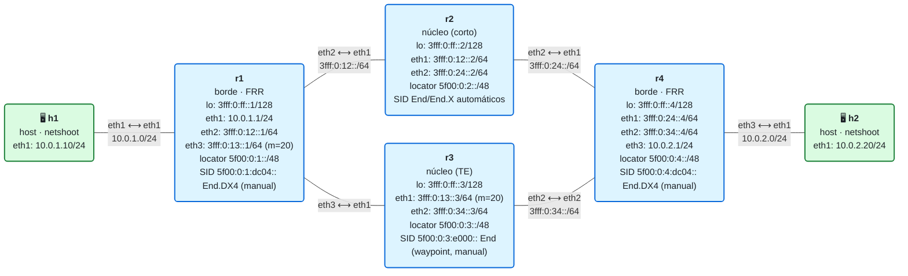

# 14 · Práctica: ingeniería de tráfico con SRv6

Antes de empezar, lee la [teoría del módulo](README.md).

## Topología

<!-- topologia:inicio -->

<!-- topologia:fin -->

> El fichero editable para draw.io está en [`lab/topologia.drawio`](lab/topologia.drawio).

- **Diamante**: dos caminos de r1 a r4. **Corto** por r2 (coste 20), **largo** por r3 (coste 30, enlace r1–r3 a métrica 20).
- IS-IS+SRv6 (FRR) da el transporte (locators, End/End.X). El servicio de cliente se entrega con un `End.DX4` manual en r1/r4.
- Por defecto, r1 y r4 **fuerzan el camino largo (por r3)** con una lista de segmentos explícita: `[5f00:0:3:e000::, <End.DX4 del PE remoto>]`.

## Parte A · Ejercicios en papel

Hazlos sin ordenador. Las soluciones están en [soluciones.md](soluciones.md).

**A1.** ¿Por qué el IGP, por sí solo, no basta para hacer ingeniería de tráfico? Da dos motivos reales para querer un camino que no sea el más corto.

**A2.** Para ir de r1 a r4 por r3 (no por r2), ¿qué lista de segmentos usarías? Explica qué hace cada SID.

**A3.** ¿Qué ventaja tiene la TE con SRv6 frente a RSVP-TE de MPLS en cuanto a **estado** en los routers del núcleo?

**A4.** Define: **color**, **endpoint**, **candidate path** y **binding SID** de una SR Policy.

**A5.** ¿Qué parte de la TE SRv6 **sí** hace FRR y cuál **no**? Si necesitaras TE SRv6 automatizada (color/ODN/PCE), ¿qué plataforma usarías?

## Parte B · Laboratorio

### B0. Levantar el laboratorio

```bash
$ cd 14-te-srv6/lab
$ sudo containerlab deploy -t lab.clab.yml
$ ./verificar.sh
```

Comprueba la conectividad de cliente:

```bash
$ docker exec clab-m14-h1 ping -c2 10.0.2.20
```

### B1. Los dos caminos, según el IGP

Mira cómo ve r1 el camino **más corto** hacia r4 (su loopback y su locator):

```bash
$ docker exec clab-m14-r1 vtysh -c "show ipv6 route 3fff:0:ff::4/128"
$ docker exec clab-m14-r1 vtysh -c "show ipv6 route 5f00:0:4::/48"
```

1. ¿Por qué interfaz sale el camino más corto a r4: por r2 (`eth2`) o por r3 (`eth3`)? ¿Qué coste tiene?
2. ¿Por qué el camino por r3 es más caro? (Pista: la métrica del enlace r1–r3.)

### B2. ¿Por dónde va el tráfico de cliente? (está forzado por r3)

Captura **a la vez** en el camino corto (r2) y en el largo (r3) mientras h1 hace ping a h2:

```bash
# Camino corto (r2) — no debería ver nada
$ docker run --rm -it --net container:clab-m14-r2 nicolaka/netshoot:v0.13 \
    tcpdump -ni eth1 -nn 'ip6' &
# Camino largo (r3) — debería ver el tráfico SRv6
$ docker run --rm -it --net container:clab-m14-r3 nicolaka/netshoot:v0.13 \
    tcpdump -ni eth1 -nn 'ip6' &
$ docker exec clab-m14-h1 ping -c3 10.0.2.20
```

1. ¿Por cuál de los dos pasa el tráfico, r2 o r3? ¿Coincide con el camino más corto del IGP?
2. Mira la ruta que lo fuerza: `docker exec clab-m14-r1 ip route show 10.0.2.0/24`. ¿Qué lista de segmentos lleva? ¿Reconoces el waypoint de r3?

### B3. Quitar la TE: volver al camino corto

Cambia el encap de r1 para ir **directo a r4** (sin el waypoint de r3), y observa que el tráfico se mueve al camino corto (por r2):

```bash
$ docker exec clab-m14-r1 ip route replace 10.0.2.0/24 \
    encap seg6 mode encap.red segs 5f00:0:4:dc04::
# Repite la captura de B2 y el ping
$ docker exec clab-m14-h1 ping -c3 10.0.2.20
```

1. ¿Por dónde va ahora el tráfico? ¿Por r2 (corto) o por r3 (largo)?
2. Con un solo SID (`5f00:0:4:dc04::`), ¿quién decide el camino hasta r4: tú o el IGP?
3. Vuelve a forzar por r3:

   ```bash
   $ docker exec clab-m14-r1 ip route replace 10.0.2.0/24 \
       encap seg6 mode encap.red segs 5f00:0:3:e000::,5f00:0:4:dc04::
   ```

### B4. Usar los SIDs que instaló FRR (no los manuales)

El waypoint `5f00:0:3:e000::` lo pusimos a mano con un valor cómodo. Pero FRR ya instaló SIDs `End`/`End.X` en r3. Mira cuáles y fuerza el camino con uno **de FRR**:

```bash
$ docker exec clab-m14-r3 ip -6 route show | grep -i seg6local
```

1. Localiza el **End del nodo** de r3 que instaló FRR (una `/48`… en realidad el End del locator) o un **End.X** hacia r4. Apunta su dirección.
2. (Opcional) Sustituye en la lista de r1 el waypoint manual por el `End.X` de r3 **hacia r4** y comprueba que el camino sigue siendo r1→r3→r4:

   ```bash
   $ docker exec clab-m14-r1 ip route replace 10.0.2.0/24 \
       encap seg6 mode encap.red segs <EndX-de-r3-hacia-r4>,5f00:0:4:dc04::
   $ docker exec clab-m14-h1 ping -c2 10.0.2.20
   ```
3. ¿Qué diferencia conceptual hay entre usar el `End` del nodo r3 (deja que el IGP decida r3→r4) y un `End.X` de r3 hacia r4 (fuerza el enlace r3→r4)?

### B5. (Teoría aplicada) Cómo sería con SR Policy

No lo puedes montar en FRR (solo SR-MPLS), pero razónalo:

1. Escribe, en pseudo-config, la SR Policy que haría lo mismo que tu lista: color 200, endpoint r4, candidate path explícito con la lista `[5f00:0:3:e000::, 5f00:0:4:dc04::]`.
2. ¿Cómo entraría el tráfico de h2 en esa política (steering)? Menciona el método por color + BGP.
3. ¿Qué aportaría el **binding SID** de esa política?

### B6. Limpieza

```bash
$ sudo containerlab destroy -t lab.clab.yml --cleanup
```

## Reto: una política "evita r2"

1. Imagina que r2 entra en mantenimiento y quieres que **ningún** tráfico de cliente pase por él, aunque sea el camino corto. ¿Qué lista de segmentos garantiza evitar r2 en la ida (r1→r4)? ¿Y en la vuelta (r4→r1)?
2. Ya está hecho en el laboratorio por defecto. Verifícalo: con r2 "fuera", ¿seguiría funcionando el ping? Pruébalo parando r2:

   ```bash
   $ docker stop clab-m14-r2
   $ docker exec clab-m14-h1 ping -c2 10.0.2.20
   $ docker start clab-m14-r2
   ```
3. ¿Por qué esto NO es todavía "resiliencia automática"? (Pista: tú fijaste el camino; si cae **r3**, nadie recalcula. Eso es el módulo 15: TI-LFA.)
