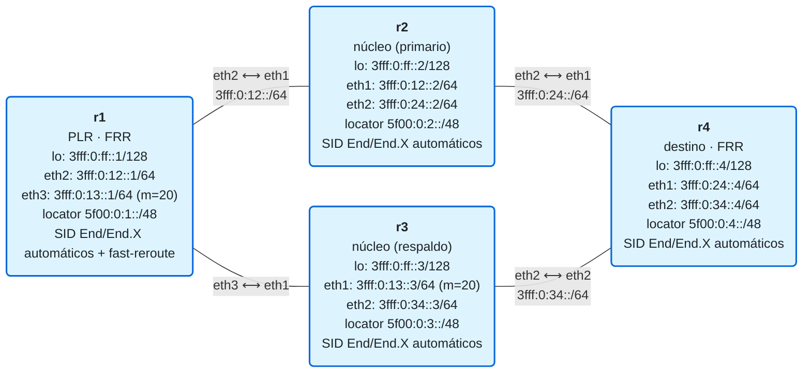

# 15 · Resiliencia: TI-LFA

> **Objetivo**: entender **TI-LFA** (*Topology-Independent Loop-Free Alternate*), la protección ante fallos de Segment Routing: cada router **precalcula** un camino de respaldo —expresado como una lista de SIDs— y, si cae un enlace o nodo, conmuta a él en **milisegundos**, sin esperar a que el IGP reconverja.
>
> **Por qué importa para SRv6**: cuando un enlace cae, el IGP tarda en recalcular (cientos de ms a segundos); durante ese tiempo, el tráfico se pierde. TI-LFA elimina esa pérdida: el respaldo ya está **instalado antes** del fallo. Y lo hace con la misma herramienta de SRv6 que ya conoces —una lista de segmentos— para "empujar" el tráfico por el camino post-convergencia, garantizando **cobertura en cualquier red con doble conexión** (algo que la protección clásica, LFA, no garantiza).

> **Nota de alcance (lo comprobamos en el laboratorio).** FRR calcula el **fast-reroute de IS-IS** e instala respaldos. En este diamante, con **LFA clásico** (`isis fast-reroute lfa`) FRR protege el transporte IPv6/SRv6 al **100%** (hay un alternativo sin bucle, r3). Pero con **`ti-lfa`** la cobertura SRv6 sale **0%**: el TI-LFA de FRR está orientado al **plano de datos MPLS** (RFC 8667, "experimental"), y la **TI-LFA SRv6 completa** —la *repair list* como lista de SIDs en el plano de datos SRv6— es hoy función de plataformas como Cisco IOS-XR. Por eso el laboratorio **protege con LFA clásico** (que sí funciona y es fast-reroute real) y la teoría explica **TI-LFA** como la evolución que garantiza cobertura donde LFA no llega.

## El laboratorio de este módulo

<!-- topologia:inicio -->

<!-- topologia:fin -->

Diamante: de r1 a r4 hay dos caminos. El **primario** es por r2 (coste 20); el **respaldo**, por r3 (coste 30). Con `isis fast-reroute ti-lfa` activado, r1 precalcula el respaldo por r3. En la práctica **romperás el enlace r1–r2** y verás que r1 sigue alcanzando a r4 **por r3**.

## 1. El problema: la reconvergencia tarda

Cuando cae un enlace, el proceso normal es: detectar el fallo → avisar por el IGP (nuevos LSP) → cada router recalcula SPF → instalar las nuevas rutas. Eso lleva desde **decenas de ms hasta segundos**, y durante ese tiempo el tráfico que iba por el enlace caído **se pierde** (agujero negro).

Para servicios sensibles (voz, vídeo, trading, 5G) eso es inaceptable. La solución: tener el **camino de respaldo ya calculado e instalado**, para conmutar en cuanto se detecta el fallo (típicamente < 50 ms), sin esperar al IGP. Eso es **fast-reroute (FRR)**.

## 2. LFA clásico y su problema de cobertura

La primera idea de fast-reroute fue **LFA** (*Loop-Free Alternate*, [RFC 5286](https://www.rfc-editor.org/rfc/rfc5286)): usar como respaldo a un **vecino alternativo** cuyo camino más corto al destino **no vuelva** por ti (si volviera, se formaría un bucle).

El problema: **no siempre existe** ese vecino. En muchas topologías, todos los vecinos alternativos enrutan de vuelta por el PLR (el router que repara). La cobertura de LFA en redes reales va del 67 % al 99 % según la topología — es decir, **no está garantizada**.

## 3. TI-LFA: usar segmentos para no depender del vecino

**TI-LFA** ([RFC 9855](https://www.rfc-editor.org/rfc/rfc9855)) resuelve el problema de cobertura usando **Segment Routing**: en vez de depender de que exista un vecino "limpio", **construye el camino de respaldo con una lista de SIDs** que fuerza al tráfico por la ruta **post-convergencia** (la que el IGP usará *después* de reconverger). Así:

- Funciona en **cualquier red con doble conexión** (cobertura garantizada).
- El respaldo coincide con la ruta final → no hay micro-bucles ni cambios de camino al reconverger.

### P-space, Q-space y nodo PQ

Para construir la lista, TI-LFA razona con dos conjuntos (desde el PLR, protegiendo un recurso):

- **P-space**: routers que el PLR alcanza por sus caminos más cortos **sin pasar** por el recurso protegido. (El *extended P-space* añade los alcanzables a través de otros vecinos del PLR.)
- **Q-space**: routers cuyo camino más corto **al destino** no pasa por el recurso protegido.
- **Nodo PQ**: un router que está en **ambos** espacios. Si existe, **un solo segmento hacia él** es toda la reparación.

La **repair list** (lista de reparación) tiene la forma general `<Node-SID(P), ...camino explícito P→Q...>`. En SRv6, serían los **uN/End** y **uA/End.X** de esos nodos. Si hay un nodo PQ, la lista se reduce a **un segmento**.

### Protección de enlace vs de nodo

El algoritmo es el mismo; cambia qué se quita de la topología antes de calcular el respaldo:

- **Protección de enlace** (por defecto): se quita solo el **enlace** que falla. El respaldo puede pasar aún por el vecino.
- **Protección de nodo**: se quita el **vecino entero** y todos sus enlaces (por si el que falla es el nodo). Puede requerir un SID más, y nunca usa ese vecino. Se activa explícitamente (`node-protection`).
- **SRLG**: quita también los enlaces que comparten un grupo de riesgo con el protegido.

## 4. El ejemplo de este laboratorio

En el diamante, r1 (el **PLR**) protege su enlace hacia r2 (el camino primario a r4):

- Sin fallo: r1 → r2 → r4 (coste 20).
- TI-LFA precalcula el respaldo: la ruta post-convergencia es r1 → r3 → r4. Como r3 es un **vecino directo** cuyo camino a r4 **no vuelve** por r1, aquí basta con reenviar por r3 (un caso sencillo, cubierto incluso por LFA clásico). En topologías más enrevesadas haría falta la repair list completa con SIDs.
- Al caer r1–r2, r1 conmuta al respaldo **ya instalado** → el tráfico sigue por r3 sin esperar al IGP.

> Este diamante es deliberadamente simple para ver la conmutación con claridad. La "magia" de TI-LFA (la repair list con SIDs) se nota en topologías donde LFA clásico **no** tiene cobertura; el mecanismo es el mismo, solo que la lista de segmentos es más larga.

En FRR, se activa por interfaz. En este laboratorio usamos **LFA clásico**, que es el que protege el transporte SRv6 en FRR (el `ti-lfa` de FRR es para SR-MPLS y da 0% de cobertura para SRv6, como comprobarás):

```
interface eth2
 ipv6 router isis CORE
 isis network point-to-point
 isis fast-reroute lfa level-2
```

Y se inspecciona:

```bash
vtysh -c "show isis fast-reroute summary"      # cobertura: cuántos prefijos protegidos
vtysh -c "show isis route level-2 backup"       # las rutas con su nexthop de respaldo
```

## 5. TI-LFA y el resto del curso

Fíjate en la elegancia del conjunto:

- El **transporte** (locators, módulo 11) es lo que TI-LFA protege. Al proteger las rutas a los locators, **todos** los servicios que viajan sobre ellos —las L3VPN de los módulos 12/13, la TE del 14— quedan protegidos **automáticamente**. No hay que configurar resiliencia por-servicio: se protege el transporte y el resto hereda.
- TI-LFA reutiliza la **lista de segmentos** del módulo 07/14: la misma herramienta que usas para TE sirve para construir el camino de respaldo. TE y resiliencia son, en el fondo, "dibujar un camino con SIDs".

## 6. Resumen

- La **reconvergencia** del IGP tarda (decenas de ms a segundos) y provoca pérdida de tráfico; el **fast-reroute** conmuta a un respaldo **precalculado** en < 50 ms.
- **LFA clásico** usa un vecino alternativo "limpio", pero **no siempre existe** (cobertura no garantizada).
- **TI-LFA** usa una **lista de SIDs** (repair list) para forzar la ruta **post-convergencia**, con **cobertura garantizada** en redes con doble conexión. Se apoya en **P-space / Q-space / nodo PQ**.
- Protege **enlace** (por defecto) o **nodo** (`node-protection`); con SRLG, grupos de riesgo.
- En FRR: `isis fast-reroute ti-lfa` por interfaz. FRR calcula el fast-reroute IS-IS; la *repair list* en el plano de datos **SRv6** es función de plataforma (no de FRR, ni siquiera en la 10.7). Proteger el **transporte** protege de paso **todos** los servicios que van encima.

## Siguiente paso

Haz la [práctica](practica.md): activarás TI-LFA, verás los respaldos que calcula FRR y **romperás el enlace primario** para comprobar que r1 sigue alcanzando a r4 por el respaldo. En el [módulo 16](../16-flex-algo/README.md), el último del **Bloque III**, verás **Flex-Algo**: cómo el IGP calcula varios "caminos más cortos" a la vez, y cómo TI-LFA calcula el respaldo dentro de cada uno.

## Para saber más

- [RFC 9855 · Topology Independent Loop-Free Alternate (TI-LFA)](https://www.rfc-editor.org/rfc/rfc9855.html)
- [RFC 5286 · Basic Specification for IP Fast Reroute: LFA](https://www.rfc-editor.org/rfc/rfc5286)
- [FRR · ISIS (fast-reroute / TI-LFA)](https://docs.frrouting.org/en/latest/isisd.html)
- [SRv6.md · TI-LFA](https://srv6.md/topics/ti-lfa/)
