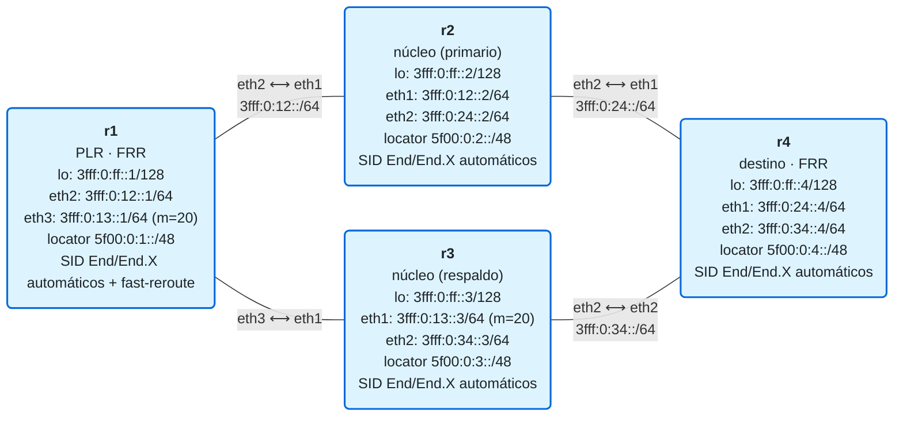

# 15 · Práctica: resiliencia con TI-LFA

Antes de empezar, lee la [teoría del módulo](README.md).

## Topología

<!-- topologia:inicio -->

<!-- topologia:fin -->

> El fichero editable para draw.io está en [`lab/topologia.drawio`](lab/topologia.drawio).

- Diamante: de r1 a r4, **primario** por r2 (coste 20), **respaldo** por r3 (coste 30, enlace r1–r3 a métrica 20).
- IS-IS+SRv6 con `isis fast-reroute ti-lfa level-2` en las interfaces de núcleo: r1 (el PLR) precalcula el respaldo por r3.

## Parte A · Ejercicios en papel

Hazlos sin ordenador. Las soluciones están en [soluciones.md](soluciones.md).

**A1.** ¿Por qué la reconvergencia del IGP no basta para servicios sensibles? ¿Qué aporta el fast-reroute?

**A2.** ¿Cuál es la limitación de LFA clásico? ¿Qué problema resuelve TI-LFA respecto a la **cobertura**?

**A3.** Define **P-space**, **Q-space** y **nodo PQ**. Si existe un nodo PQ, ¿de cuántos segmentos es la repair list?

**A4.** ¿Qué diferencia hay entre protección de **enlace** y de **nodo**? ¿Qué se quita de la topología en cada caso al calcular el respaldo?

**A5.** ¿Por qué proteger el **transporte** (las rutas a los locators) protege también, "gratis", las L3VPN de los módulos 12/13?

## Parte B · Laboratorio

### B0. Levantar el laboratorio

```bash
$ cd 15-tilfa/lab
$ sudo containerlab deploy -t lab.clab.yml
$ ./verificar.sh
```

### B1. El camino primario y el respaldo que calcula FRR

```bash
$ docker exec clab-m15-r1 vtysh -c "show isis fast-reroute summary"
$ docker exec clab-m15-r1 vtysh -c "show isis route level-2 backup"
$ docker exec clab-m15-r1 ip -6 route show 3fff:0:ff::4/128
```

1. En `fast-reroute summary`, ¿cuántos prefijos tienen protección? ¿Hay cobertura?
2. En `show isis route ... backup`, para llegar a r4 (`3fff:0:ff::4`), ¿cuál es el nexthop **primario** y cuál el de **respaldo**? ¿Coinciden con "por r2" y "por r3"?

### B2. El camino primario, en vivo

Captura en el primario (r2) y en el respaldo (r3) mientras r1 hace ping al loopback de r4:

```bash
$ docker run --rm -it --net container:clab-m15-r2 nicolaka/netshoot:v0.13 \
    tcpdump -ni eth1 -nn 'icmp6 and ip6 host 3fff:0:ff::4' &
$ docker run --rm -it --net container:clab-m15-r3 nicolaka/netshoot:v0.13 \
    tcpdump -ni eth1 -nn 'icmp6 and ip6 host 3fff:0:ff::4' &
$ docker exec clab-m15-r1 ping -c3 3fff:0:ff::4
```

1. Sin fallo, ¿por cuál de los dos pasa el tráfico, r2 o r3? ¿Es el camino más corto?

### B3. La conmutación: romper el enlace primario

Lanza un ping **continuo** de r1 a r4 y, a mitad, tira el enlace r1–r2:

```bash
# Terminal 1 — ping continuo
$ docker exec clab-m15-r1 ping -i 0.2 3fff:0:ff::4
# Terminal 2 — a los pocos segundos, tira el enlace primario (interfaz de r1 hacia r2)
$ docker exec clab-m15-r1 ip link set eth2 down
```

1. ¿Se recupera el ping? ¿Cuántos paquetes se pierden (aprox.)?
2. Vuelve a capturar como en B2 (ahora solo r3 debería ver el tráfico). ¿Por dónde va ahora?
3. Repara el enlace y comprueba que vuelve al primario:

   ```bash
   $ docker exec clab-m15-r1 ip link set eth2 up
   ```

> Nota sobre la medida: en este laboratorio verás que la conectividad **se recupera**. Distinguir si fueron "< 50 ms por fast-reroute" o "1–2 s por reconvergencia del IGP" requiere medir la pérdida con precisión (p. ej. `ping -i 0.1` y contar los fallidos). En hardware real, TI-LFA da la conmutación sub-50 ms; en este entorno, lo importante es ver que el **respaldo precalculado** existe y que el tráfico sobrevive al fallo.

### B4. LFA clásico vs TI-LFA en FRR (la nota honesta, en vivo)

Cambia r1 de LFA clásico a **TI-LFA** y mira qué pasa con la cobertura SRv6:

```bash
$ docker exec clab-m15-r1 vtysh -c "configure terminal" \
    -c "interface eth2" -c "no isis fast-reroute lfa level-2" -c "isis fast-reroute ti-lfa level-2" -c "exit" \
    -c "interface eth3" -c "no isis fast-reroute lfa level-2" -c "isis fast-reroute ti-lfa level-2"
$ docker exec clab-m15-r1 vtysh -c "show isis fast-reroute summary"
```

1. ¿Qué cobertura da ahora la fila **"Topology Independent LFA"** para IPv6? (Pista: **0%**.) ¿Y la fila "Classic LFA"? ¿Por qué TI-LFA no protege el transporte SRv6 en FRR? (El TI-LFA de FRR programa el plano **SR-MPLS**, no SRv6.)
2. Vuelve a **LFA clásico** (que sí protege):

   ```bash
   $ docker exec clab-m15-r1 vtysh -c "configure terminal" \
       -c "interface eth2" -c "no isis fast-reroute ti-lfa level-2" -c "isis fast-reroute lfa level-2" -c "exit" \
       -c "interface eth3" -c "no isis fast-reroute ti-lfa level-2" -c "isis fast-reroute lfa level-2"
   ```
3. Conclusión: en FRR, para proteger el transporte **SRv6** hoy se usa **LFA clásico** (donde exista un alternativo sin bucle); la **TI-LFA SRv6 completa** (repair list con SIDs) es función de plataforma. El mecanismo de TI-LFA (teoría) es el mismo; lo que falta es su implementación en el plano de datos SRv6 de FRR.

### B5. Limpieza

```bash
$ sudo containerlab destroy -t lab.clab.yml --cleanup
```

## Reto: ¿dónde brilla de verdad TI-LFA?

1. En este diamante, el respaldo por r3 es un **vecino limpio**: LFA clásico ya lo cubriría. Dibuja (en papel) una topología en **anillo de 5 nodos** y razona por qué, para proteger un enlace, el vecino alternativo **volvería** por el PLR (bucle) → LFA no cubre, y TI-LFA sí con una repair list.
2. En esa topología en anillo, ¿cómo sería la repair list (conceptual) para llegar al destino evitando el enlace caído? Identifica un posible **nodo PQ**.
3. ¿Por qué el hecho de que TI-LFA siga la ruta **post-convergencia** evita micro-bucles cuando el IGP termina de reconverger? (Pista: el respaldo y la ruta final coinciden.)
