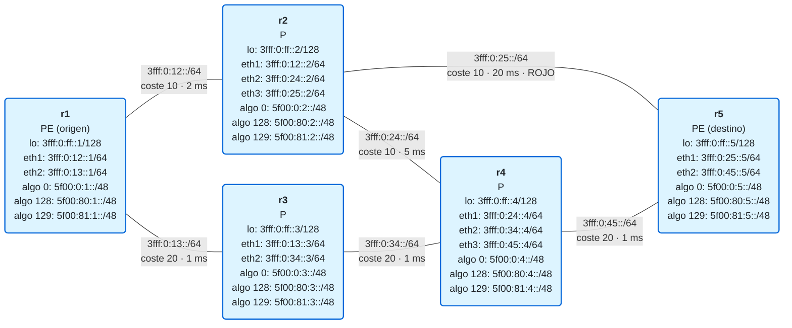

# 16 · Flex-Algo: varios "caminos más cortos" sobre la misma red

> **Objetivo**: entender **Flex-Algo** (*IGP Flexible Algorithm*, [RFC 9350](https://www.rfc-editor.org/rfc/rfc9350)): cómo el IGP puede calcular, sobre la misma red física, **varios caminos más cortos a la vez**, cada uno con su propia métrica (coste IGP, retardo, métrica TE) y sus propias restricciones (evitar ciertos enlaces), y por qué en SRv6 basta con **un locator por algoritmo** para que el tráfico siga cada uno de ellos.
>
> **Por qué importa para SRv6**: en el módulo 14 forzaste un camino con una **lista de segmentos** en el headend. Funciona, pero cada camino es una política que alguien (o un controlador) tiene que mantener. Flex-Algo resuelve muchos de esos casos **sin listas de segmentos y sin controlador**: el propio IGP calcula el camino de baja latencia, o el que evita un enlace, y lo instala en toda la red. Con SRv6 queda especialmente limpio: el algoritmo va implícito en la **dirección de destino**, así que el paquete ni siquiera necesita SRH. Es la base de lo que la industria llama ***network slicing*** "ligero".

> **Este módulo no tiene laboratorio.** FRR implementa Flex-Algo **solo para SR-MPLS**: en su código, IS-IS no elige ninguna definición de Flex-Algo si el algoritmo no tiene activado el plano de datos SR-MPLS, y el soporte de SRv6 aparece como trabajo futuro. Tampoco hay forma de asociar un locator SRv6 a un algoritmo en la configuración. Lo hemos comprobado en la rama principal de FRR (octubre de 2026), incluida la 10.7.1 que usa el curso. Como el curso evita MPLS, este módulo es **teoría con un ejemplo resuelto en papel**, y en lugar de práctica tiene [ejercicios](ejercicios.md) con [soluciones](soluciones.md). En la [sección 10](#10-estado-en-frr-y-dónde-se-practica) verás cómo se configura en una plataforma que sí lo soporta.

## El ejemplo de este módulo

Todo el módulo usa esta red. No es un laboratorio: es la red sobre la que razonarás en la teoría y en los ejercicios. Cada enlace lleva su **coste IGP**, su **retardo** y, si la tiene, su **afinidad** (un "color" administrativo del enlace).



Una historia para ponerle cara: el enlace r2–r5 es **barato pero lento** (20 ms, un circuito largo alquilado a un tercero), y el operador lo marca con la afinidad **ROJO**. El camino r1–r3–r4–r5 es caro en coste IGP, pero es **fibra propia de baja latencia**. Hay tres algoritmos:

| Algoritmo | Qué pide | Locators |
|:-:|---|---|
| **0** | El camino más corto de siempre, por coste IGP (el de los módulos 05 y 11) | `5f00:0:N::/48` |
| **128** | El camino de **menor retardo** | `5f00:80:N::/48` |
| **129** | El camino más corto por coste IGP, pero **sin pasar por enlaces ROJO** | `5f00:81:N::/48` |

> **Sobre el direccionamiento.** Cada algoritmo tiene su propio **bloque de SIDs**: `5f00:0::/32` para el 0, `5f00:80::/32` para el 128 y `5f00:81::/32` para el 129 (`0x80` = 128 y `0x81` = 129 en hexadecimal, un truco para que se lea a simple vista). Dentro de cada bloque, el nodo va en el tercer grupo, como en el resto del curso. No es obligatorio hacerlo así, pero es habitual: cada bloque se puede sumarizar y filtrar por separado.

## 1. El problema: un solo "camino más corto" para todo el mundo

En el módulo 05 viste que IS-IS ejecuta **un** SPF con **una** métrica y obtiene **un** camino más corto hacia cada destino. Todo el tráfico lo comparte. En nuestra red, ese camino de r1 a r5 es **r1 → r2 → r5** (coste 20).

Pero ese camino tiene **22 ms** de retardo, y hay clientes a los que eso no les vale: la voz, el vídeo interactivo o un servicio financiero preferirían el camino de **3 ms** por r3 y r4, aunque cueste más en métrica IGP. Y hay otros a los que, por contrato, no se les puede llevar por un circuito de terceros (el enlace ROJO).

Con lo que sabes hasta ahora, la solución es la del módulo 14: una **lista de segmentos** en el headend que fuerce el camino. Funciona, pero tiene dos costes:

- **Cada camino es una política** que hay que definir y mantener en cada headend, o pedirle a un controlador (PCE).
- **Si la red cambia** (cae un enlace, se añade un router), la lista puede quedarse obsoleta, y hay que recalcularla fuera del IGP.

Flex-Algo propone otra cosa: que **el propio IGP** calcule esos caminos alternativos, igual que ya calcula el más corto.

## 2. La idea: varias topologías lógicas sobre la misma red

La idea de Flex-Algo cabe en una frase: **en vez de un SPF, cada router ejecuta varios**, uno por algoritmo. Cada SPF:

1. **Poda** la topología: quita los enlaces que no cumplen las restricciones del algoritmo (por ejemplo, los ROJO) y los routers que no participan en él.
2. **Calcula** el camino más corto sobre lo que queda, usando la **métrica** del algoritmo (coste IGP, retardo o métrica TE).

Cada algoritmo es como una **topología lógica** superpuesta a la física, con su propio árbol de caminos más cortos. Nuestro ejemplo, resuelto:

| Algoritmo | Topología tras podar | Métrica | Camino r1 → r5 | Coste del camino |
|:-:|---|---|---|---|
| 0 | Todos los enlaces | IGP | r1 → r2 → r5 | 20 (22 ms) |
| 128 | Todos los enlaces | retardo | r1 → r3 → r4 → r5 | 3 ms |
| 129 | Todos **menos** r2–r5 (ROJO) | IGP | r1 → r2 → r4 → r5 | 40 |

Tres caminos distintos hacia el mismo router, calculados por el mismo IGP, **sin ninguna lista de segmentos**. Y cuando la red cambie, cada algoritmo reconverge solo, como siempre ha hecho IS-IS.

> **El algoritmo 0 no desaparece.** Es el SPF clásico, y sigue ahí para todo el tráfico que no pida otra cosa. Los algoritmos flexibles se **añaden** a él. (El algoritmo 1, *Strict SPF*, también está definido en Segment Routing; los números **128 a 255** son los que se reservan para Flex-Algo.)

## 3. La definición: FAD

Para que todos los routers calculen lo mismo, tienen que estar de acuerdo en **qué significa** cada algoritmo. Eso se llama **FAD** (*Flexible Algorithm Definition*), y viaja dentro de IS-IS, en la capacidad de router (*Router Capability TLV*). Una FAD dice:

- **Número de algoritmo**: de 128 a 255. El número **no tiene significado propio**: el 128 no es "baja latencia" por naturaleza. Significa lo que diga su FAD.
- **Tipo de métrica**:
  - **coste IGP**: la métrica de siempre.
  - **retardo mínimo de enlace**: anunciado por IS-IS con las extensiones de TE ([RFC 8570](https://www.rfc-editor.org/rfc/rfc8570)). El router lo puede medir de forma dinámica o se puede configurar.
  - **métrica TE**: un segundo coste administrativo, independiente del IGP.
  - El [RFC 9843](https://www.rfc-editor.org/rfc/rfc9843) añade más: métricas basadas en **ancho de banda** y restricciones como "no uses enlaces de menos de X Gb/s" o "no superes Y ms de retardo por enlace".
- **Tipo de cálculo**: hoy, siempre **SPF**.
- **Restricciones**, sobre las **afinidades** de los enlaces (también llamadas *administrative groups*, [RFC 7308](https://www.rfc-editor.org/rfc/rfc7308)):
  - **exclude-any**: poda los enlaces que tengan **alguna** de estas afinidades. Es la más usada ("nunca por ROJO").
  - **include-any**: usa solo enlaces que tengan **alguna** de estas afinidades.
  - **include-all**: usa solo enlaces que tengan **todas** estas afinidades.
  - **exclude SRLG**: poda los enlaces de ciertos grupos de riesgo compartido (los SRLG que viste en el módulo 15).

Las afinidades y el retardo de cada enlace los anuncia el router que lo tiene, como **atributos de enlace** en IS-IS ([RFC 8919](https://www.rfc-editor.org/rfc/rfc8919)). Así, cada router conoce la "foto" completa: la topología, los atributos de cada enlace y las definiciones de cada algoritmo.

### Quién manda: la elección de la FAD

No hace falta que todos los routers anuncien la FAD; basta con unos pocos, normalmente dos por redundancia. Pero si **dos routers anuncian definiciones distintas** para el mismo número, hay que elegir una. La regla es determinista, para que todos elijan **la misma**:

1. Gana la de **prioridad** más alta.
2. A igual prioridad, gana la del router con el **System ID** más alto.

La definición elegida es la que usan **todos**, incluido el router cuya FAD perdió. Es un error de operación clásico: un router mal configurado con prioridad alta "secuestra" el significado del algoritmo para toda la red (lo verás en los ejercicios).

## 4. La participación: quién entra en cada algoritmo

Que exista una FAD no basta. Cada router decide **si participa** en cada algoritmo, y lo anuncia en IS-IS. En el SPF de un algoritmo, **los routers que no participan se podan**, igual que los enlaces que no cumplen las restricciones.

Esto tiene dos consecuencias importantes:

- **Puedes limitar un algoritmo a una parte de la red.** Por ejemplo, que el algoritmo 128 solo use los routers con fibra de baja latencia.
- **Un algoritmo puede quedarse sin camino.** Si los routers que participan no forman un camino conexo hasta el destino, el destino es **inalcanzable en ese algoritmo**, aunque en el algoritmo 0 se llegue perfectamente. Y **no hay vuelta atrás automática** al algoritmo 0: el tráfico que pedía el algoritmo 128 no se desvía en silencio por el camino lento. Es una decisión de diseño: si un cliente ha comprado "baja latencia", es mejor que se note que no la hay a que se le dé otra cosa sin avisar.

Además, un router que **no entiende** algo de la FAD elegida (por ejemplo, un tipo de métrica que no soporta) **deja de participar** en ese algoritmo. Así se evita que calcule caminos distintos a los de los demás y forme bucles.

## 5. Flex-Algo con SRv6: un locator por algoritmo

Aquí es donde SRv6 brilla. ¿Cómo sabe un router de tránsito qué algoritmo usar para reenviar un paquete? En SR-MPLS hace falta una etiqueta distinta por algoritmo. En SRv6 es más sencillo: **cada router anuncia un locator distinto por algoritmo**, y el locator lleva el algoritmo asociado en el propio TLV de IS-IS ([RFC 9352](https://www.rfc-editor.org/rfc/rfc9352)).

En nuestra red, r5 anuncia tres locators:

| Locator de r5 | Algoritmo | Cada router lo instala siguiendo… |
|---|:-:|---|
| `5f00:0:5::/48` | 0 | el SPF clásico por coste IGP |
| `5f00:80:5::/48` | 128 | el SPF de menor retardo |
| `5f00:81:5::/48` | 129 | el SPF por coste IGP sin enlaces ROJO |

Cada router calcula la ruta hacia **cada locator** con el SPF **de su algoritmo**, y la instala en su tabla como una ruta IPv6 más. Por ejemplo, en r1:

```
5f00:0:5::/48   → por r2   (algoritmo 0)
5f00:80:5::/48  → por r3   (algoritmo 128)
5f00:81:5::/48  → por r2   (algoritmo 129)
```

Fíjate en lo que implica:

- **El algoritmo va en la dirección de destino.** Un paquete con destino `5f00:80:5::…` sigue el camino de baja latencia en **cada salto**, simplemente porque cada router tiene instalada la ruta a `5f00:80:5::/48` según el algoritmo 128. Es *longest-prefix match* del módulo 04, sin más.
- **No hace falta SRH.** Un solo SID en el destino IPv6 (y, por tanto, solo los 40 bytes de la cabecera exterior) basta para que el paquete siga un camino que no es el más corto. Compáralo con el módulo 14, donde el camino iba en una lista de segmentos dentro de la SRH.
- **El SID de r2 cambia según el algoritmo.** En r2, `5f00:80:2::` (End del algoritmo 128) y `5f00:0:2::` (End del algoritmo 0) son el mismo router, pero los paquetes que llegan a ellos lo hacen por caminos calculados de forma distinta. Si en una lista de segmentos usas SIDs del algoritmo 128, cada tramo entre segmentos también sigue el algoritmo 128.

> **¿Y los routers de tránsito?** Un router que no participa en el algoritmo se poda del SPF de ese algoritmo, así que el tráfico del algoritmo nunca pasará por él. Uno que sí participa solo tiene que **reenviar por la ruta al locator**: no ejecuta ningún behavior SRv6 si el paquete no va dirigido a uno de sus SIDs.

## 6. El ejemplo resuelto, paso a paso

Vamos a hacer, a mano, lo que haría r1 para el algoritmo **129** (coste IGP, *exclude-any* ROJO) hacia r5:

1. **Poda de enlaces.** El enlace r2–r5 tiene la afinidad ROJO: fuera. Quedan r1–r2, r2–r4, r1–r3, r3–r4 y r4–r5.
2. **Poda de nodos.** Todos participan en el 129: no se quita ninguno.
3. **SPF por coste IGP** sobre lo que queda:
   - r1 → r2 → r4 → r5 = 10 + 10 + 20 = **40**
   - r1 → r3 → r4 → r5 = 20 + 20 + 20 = 60
4. **Resultado**: la ruta a `5f00:81:5::/48` sale de r1 **por r2**. En r2 se repite el cálculo (desde r2) y sale **por r4**, no por el enlace directo a r5, que está podado. En r4 sale por r5.

Y para el algoritmo **128** (retardo, sin restricciones):

- r1 → r2 → r5 = 2 + 20 = 22 ms
- r1 → r2 → r4 → r5 = 2 + 5 + 1 = 8 ms
- r1 → r3 → r4 → r5 = 1 + 1 + 1 = **3 ms** ← gana

Tres SPF, tres árboles, tres caminos. Cada router hace los mismos cálculos con la misma información, así que todos llegan a la misma conclusión y los caminos son coherentes de punta a punta, sin bucles.

## 7. Los servicios sobre Flex-Algo

Hasta aquí, Flex-Algo da **transporte**: rutas a los locators de cada algoritmo. ¿Cómo hace un cliente para usar el de baja latencia?

Recuerda el módulo 12: en una L3VPN, el PE de destino asigna un **SID de servicio** (`End.DT4`) **dentro de su locator**, y BGP lo anuncia junto con las rutas del cliente. Pues bien: **basta con que ese SID salga del locator del algoritmo adecuado**.

Supón un cliente con una VRF **VOZ** que ha contratado baja latencia. En r5:

- La VRF VOZ asigna su `End.DT4` del locator **`5f00:80:5::/48`** (algoritmo 128), por ejemplo `5f00:80:5:<función>::`.
- BGP lo anuncia a r1 como siempre.
- r1 encapsula el tráfico de la VRF VOZ hacia ese SID. Como el destino exterior está en `5f00:80:5::/48`, **el paquete sigue el camino de 3 ms** en todos los saltos.

Mientras tanto, otra VRF del mismo PE, con su SID en `5f00:0:5::/48`, sigue usando el camino más corto de siempre. **Sin listas de segmentos, sin SR Policy, sin controlador**: la elección del camino es la elección del locator. Es uno de los argumentos más fuertes a favor de SRv6 frente a SR-MPLS.

### Relación con SR Policy y el color (módulo 14)

En el módulo 14 viste que una ruta BGP puede llevar un **color** (una intención) y que el headend la mete en una SR Policy de ese color. Flex-Algo encaja con ese modelo de dos maneras:

- **Asociando un color a un algoritmo**: en las plataformas que lo soportan, el headend puede resolver las rutas de cierto color (por ejemplo, color 100 = "baja latencia") por el algoritmo 128, sin necesidad de una lista de segmentos explícita.
- **Como restricción de una SR Policy dinámica**: una política puede pedir que su camino se construya con SIDs de un algoritmo concreto.

En SRv6, la forma más sencilla, la de asignar el SID de servicio desde el locator del algoritmo, ni siquiera necesita color: el servicio queda atado al algoritmo desde el PE de destino.

> **Cuidado con la falta de camino.** Como viste en la sección 4, si el locator `5f00:80:5::/48` deja de ser alcanzable (porque los routers del algoritmo 128 quedan desconectados), r1 no tiene ruta al SID de la VRF VOZ, y esas rutas del cliente dejan de ser válidas. El tráfico **no** pasa al algoritmo 0. En el diseño hay que asegurar que cada algoritmo tiene caminos redundantes dentro de su propia topología.

## 8. Flex-Algo y TI-LFA

En el módulo 15 viste que TI-LFA precalcula un camino de respaldo. Con Flex-Algo hay un matiz importante: **el respaldo de un algoritmo se calcula dentro de ese mismo algoritmo**, respetando su métrica y sus restricciones. Si el algoritmo 129 excluye los enlaces ROJO, su camino de respaldo **tampoco** puede usarlos, aunque sea solo durante unos milisegundos. Si no fuera así, una caída de enlace rompería la promesa del algoritmo justo cuando más importa.

En SRv6, eso significa que la lista de reparación se construye con **SIDs del mismo algoritmo** (por ejemplo, del bloque `5f00:81::/32` para el 129).

## 9. Flex-Algo y el *network slicing*

En el sector se habla mucho de ***network slicing***: dividir una red en "porciones" lógicas, cada una con sus propias garantías, para distintos clientes o servicios (muy ligado al transporte 5G). Flex-Algo es la forma más común de hacer **slicing ligero** (*soft slicing*):

- Cada slice es un algoritmo, con su métrica y sus restricciones.
- Cada slice tiene sus locators y, por tanto, sus SIDs de servicio.
- Los caminos de cada slice están **separados lógicamente**: el slice "sin terceros" nunca toca un enlace ROJO.

Lo que Flex-Algo **no** hace es **reservar recursos**: dos slices que comparten un enlace compiten por su ancho de banda. Para un aislamiento más fuerte (*hard slicing*) hacen falta otros mecanismos, como QoS por slice o particiones de recursos de red. La industria y el IETF trabajan en ello, incluido llevar un identificador de slice en el propio paquete, pero todavía es terreno en evolución y con soluciones propias de cada fabricante. Lo veremos como caso de uso en los escenarios del anexo.

## 10. Estado en FRR, y dónde se practica

Como decíamos al principio, en FRR:

- **IS-IS sí implementa Flex-Algo**, con definiciones (`flex-algo 128`), afinidades y prioridades. Pero **solo con el plano de datos SR-MPLS**, con métrica IGP y SPF. Si eliges retardo o métrica TE, la definición se anuncia, pero el algoritmo se desactiva localmente.
- **Para SRv6 no hay soporte**: los locators no se pueden asociar a un algoritmo (todos son del algoritmo 0), e IS-IS no elige FAD sin SR-MPLS.

Por eso aquí no hay laboratorio. Si quieres practicar Flex-Algo con SRv6, necesitas una plataforma que lo soporte: los principales fabricantes de routers de operador (Cisco IOS-XR, Juniper Junos, Nokia SR OS, Huawei VRP…) lo implementan. Como referencia, así se vería el algoritmo 129 de nuestro ejemplo en una sintaxis **tipo IOS-XR** (no FRR, y simplificada):

```
router isis CORE
 affinity-map ROJO bit-position 1
 flex-algo 128
  metric-type delay
  advertise-definition
 flex-algo 129
  affinity exclude-any ROJO
  advertise-definition
 interface eth3
  affinity flex-algo ROJO          ! el enlace r2–r5
 address-family ipv6 unicast
  segment-routing srv6
   locator ALG0
   locator ALG128
   locator ALG129

segment-routing srv6
 locators
  locator ALG0
   prefix 5f00:0:2::/48
  locator ALG128
   prefix 5f00:80:2::/48
   algorithm 128
  locator ALG129
   prefix 5f00:81:2::/48
   algorithm 129
```

Lo esencial está en las tres piezas que ya conoces: **definir** el algoritmo (FAD), **marcar** los enlaces (afinidades) y **atar un locator** a cada algoritmo. Cuando FRR lo soporte con SRv6, este módulo tendrá su laboratorio.

## 11. Resumen

- **Flex-Algo** permite que el IGP calcule **varios caminos más cortos a la vez** sobre la misma red: uno por algoritmo (128–255), además del clásico algoritmo 0.
- Cada algoritmo se describe con una **FAD**: **tipo de métrica** (IGP, retardo, TE) y **restricciones** sobre afinidades (*exclude-any*, *include-any*, *include-all*) y SRLG. Si hay varias, gana la de **mayor prioridad** y, a igualdad, la del **System ID más alto**.
- En el SPF de cada algoritmo se **podan** los enlaces que no cumplen las restricciones y los routers que **no participan**. Si no queda camino, el destino es inalcanzable en ese algoritmo, **sin vuelta atrás** al algoritmo 0.
- En **SRv6**, cada router anuncia **un locator por algoritmo**. El algoritmo va implícito en la **dirección de destino**: el paquete sigue el camino del algoritmo **sin SRH**.
- Un **servicio** (L3VPN) usa un algoritmo simplemente asignando su SID desde el locator de ese algoritmo. Es la forma más sencilla de TE en SRv6 y la base del ***network slicing*** ligero.
- **TI-LFA** calcula el respaldo dentro del mismo algoritmo, respetando sus restricciones.
- **FRR solo soporta Flex-Algo con SR-MPLS**, así que este módulo es teórico.

## Siguiente paso

Haz los [ejercicios](ejercicios.md) sobre la red de ejemplo: calcularás caminos por algoritmo, verás qué pasa cuando un router deja de participar o cae un enlace, y resolverás un conflicto entre definiciones. Con esto cierras el **Bloque III**. En el **Bloque IV** llega la operación: OAM y troubleshooting ([módulo 17](../17-oam/README.md)) y MTU, seguridad y filtrado (módulo 18).

## Para saber más

- [RFC 9350 · IGP Flexible Algorithm](https://www.rfc-editor.org/rfc/rfc9350) — FAD, participación, elección y cálculo por algoritmo
- [RFC 9352 · IS-IS Extensions to Support SRv6](https://www.rfc-editor.org/rfc/rfc9352) — el TLV de locator, con su campo de algoritmo
- [RFC 9843 · IGP Flex-Algorithms: Bandwidth, Delay, Metrics and Constraints](https://www.rfc-editor.org/rfc/rfc9843) — métricas de ancho de banda y restricciones adicionales
- [RFC 8570 · IS-IS Traffic Engineering Metric Extensions](https://www.rfc-editor.org/rfc/rfc8570) — anuncio del retardo de enlace
- [RFC 8919 · IS-IS Application-Specific Link Attributes](https://www.rfc-editor.org/rfc/rfc8919) — afinidades y atributos de enlace por aplicación
- [RFC 7308 · Extended Administrative Groups](https://www.rfc-editor.org/rfc/rfc7308) — las afinidades
- [FRR · ISIS (Flex-Algo)](https://docs.frrouting.org/en/latest/isisd.html) — lo que FRR implementa hoy (SR-MPLS)
- [SRv6.md · Flex-Algorithm](https://srv6.md/topics/flex-algorithm/) · [SRv6.md · Network slicing](https://srv6.md/use-cases/network-slicing/)
