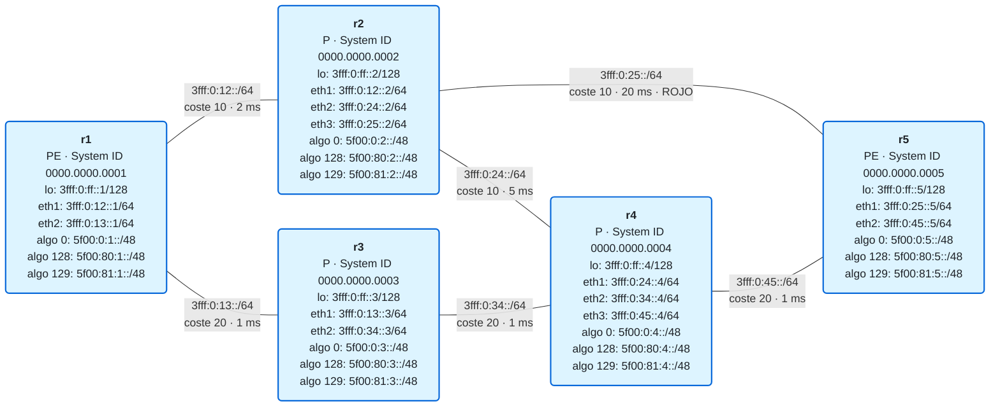

# 16 · Ejercicios de Flex-Algo

Este módulo no tiene laboratorio (FRR no soporta Flex-Algo con SRv6), así que los ejercicios se hacen **en papel**, sobre la red de ejemplo de la teoría. Hazlos sin mirar; las soluciones están en [soluciones.md](soluciones.md).

## La red

| Algoritmo | Métrica | Restricción | Locators |
|:-:|---|---|---|
| 0 | coste IGP | ninguna | `5f00:0:N::/48` |
| 128 | retardo | ninguna | `5f00:80:N::/48` |
| 129 | coste IGP | *exclude-any* ROJO | `5f00:81:N::/48` |

Salvo que el ejercicio diga otra cosa, todos los routers participan en todos los algoritmos y todos los enlaces están activos. Los costes y retardos son iguales en los dos sentidos.

## Ejercicios

**1.** Un compañero dice: "el algoritmo 128 es el de baja latencia". ¿Es correcto? ¿Qué determina lo que significa un algoritmo?

**2.** Calcula el camino de **r1 a r4** en el algoritmo 0 y en el algoritmo 128. Para cada uno, da el coste IGP y el retardo total.

**3.** Escribe las rutas que instala **r2** para `5f00:0:5::/48` y para `5f00:81:5::/48`: ¿por qué interfaz sale cada una, y con qué coste? ¿Por qué son distintas, si el destino es el mismo router?

**4.** Un paquete de r1 lleva como destino exterior `5f00:80:5:1::`. Indica, salto a salto, por qué routers pasa y qué ruta usa cada router para reenviarlo. ¿Lleva SRH?

**5.** **r3 deja de participar** en el algoritmo 128 (sigue en el 0 y en el 129). ¿Cuál es ahora el camino del algoritmo 128 de r1 a r5, y su retardo? ¿Cambia algo en los algoritmos 0 y 129?

**6.** **r4 deja de participar** en el algoritmo 129.

1. ¿Qué camino del algoritmo 129 queda de r1 a r5?
2. La VRF **SEGURA** de r5 asigna su SID `End.DT4` del locator `5f00:81:5::/48`. ¿Qué pasa con el tráfico de esa VRF desde r1? ¿Se va por el camino del algoritmo 0?
3. ¿Qué cambiarías en el diseño para que esto no ocurra ante el fallo de un único router?

**7.** **Cae el enlace r3–r4.** Calcula el nuevo camino de r1 a r5 en los algoritmos 0, 128 y 129.

**8.** Se define un algoritmo **130**: métrica de **retardo** y *exclude-any* **ROJO**.

1. ¿Cuál es su camino de r1 a r5 con todos los enlaces activos? ¿Coincide con el de algún otro algoritmo?
2. Ahora **cae el enlace r4–r5**. Calcula el camino de r1 a r5 en los algoritmos 128 y 130. ¿Por qué se comportan distinto?

**9.** Dos routers anuncian una FAD para el algoritmo 128:

- r1: prioridad **100**, métrica de **retardo**.
- r5: prioridad **200**, métrica de **coste IGP**.

1. ¿Qué definición usa la red? ¿Cuál es entonces el camino del algoritmo 128 de r1 a r5?
2. ¿Y si las dos FAD tuvieran la misma prioridad?
3. ¿Qué lección de operación sacas?

**10.** La VRF VOZ usa el algoritmo 128. Para comparar con el módulo 14: si en lugar de Flex-Algo hubieras forzado el mismo camino con una lista explícita de 2 SIDs en la SRH (encapsulado `H.Encaps` normal), ¿cuántos bytes de cabecera SRv6 añadiría cada paquete? ¿Y con Flex-Algo?

**11.** En el algoritmo 129, r1 protege su enlace con r2 con TI-LFA. Si cae el enlace **r1–r2**, ¿cuál es el camino post-convergencia del algoritmo 129 hacia r5? ¿Podría el respaldo usar el enlace r2–r5 "solo un momento"? Razona la respuesta. ¿De qué bloque saldrían los SIDs de la lista de reparación?

**12.** Marca si son verdaderas o falsas, y corrige las falsas:

1. Flex-Algo sustituye al SPF clásico: un router con Flex-Algo ya no calcula el algoritmo 0.
2. Con SRv6, cada router anuncia un locator distinto por cada algoritmo en el que participa.
3. Si no hay camino en un algoritmo, el tráfico usa automáticamente el algoritmo 0.
4. Flex-Algo reserva ancho de banda para cada slice.
5. Un paquete puede seguir un camino del algoritmo 128 sin llevar SRH.
6. Todos los routers de la red tienen que anunciar la FAD para que el algoritmo funcione.

**Reto de diseño.** Un nuevo cliente quiere **baja latencia** y, además, que su tráfico **no pase por enlaces de terceros**. Propón el algoritmo (número, métrica y restricciones), el bloque de locators siguiendo la convención del módulo, y cómo atarías su VRF a ese algoritmo en el PE de destino.
