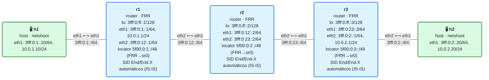

# 17 · MTU, seguridad y filtrado de SRv6 en el borde

> **Objetivo**: cerrar el curso con los dos temas que separan un laboratorio de una red en producción: **dimensionar la MTU** para absorber la sobrecarga de SRv6, y **proteger el dominio SRv6 filtrando en el borde** para que nadie de fuera inyecte tráfico contra tus SIDs.
>
> **Por qué importa para SRv6**: SRv6 añade bytes a cada paquete (ya lo mediste en los módulos 02 y 09) y codifica instrucciones en direcciones IPv6 **enrutables**. Esas dos propiedades, tan potentes, son también sus dos riesgos operativos: si la MTU no da, el tráfico grande se rompe; y si el borde no filtra, un atacante externo podría mandar paquetes a tus SIDs y "programar" tu red. Saber gestionarlo es lo que hace a SRv6 desplegable con seguridad.

## El laboratorio de este módulo

<!-- topologia:inicio -->

<!-- topologia:fin -->

La red SRv6 de siempre (IS-IS+SRv6 + servicio `End.DX4`), con dos añadidos: la **MTU del núcleo puesta a 1500** (para ver el problema de la sobrecarga) y un **filtro en el borde** en cada PE que bloquea el tráfico del cliente hacia los SIDs internos (`5f00::/16`).

## 1. La sobrecarga de SRv6 y la MTU

Recuerda lo que añade SRv6 a cada paquete (módulos 02 y 09):

- **Cabecera IPv6 exterior**: 40 bytes.
- **SRH** (si hay lista de segmentos): 8 bytes + 16 por SID.

Con un servicio típico (un solo SID, encap reducido) son **40 bytes**; con una lista de TE, bastante más. Esos bytes se suman al paquete del cliente. Si el cliente manda un paquete cercano a la MTU, al encapsularlo **supera la MTU del núcleo** y hay un problema.

En este laboratorio el núcleo tiene **MTU 1500**. Un paquete de cliente de ~1468 bytes, al encapsularse (+40), se va a ~1508 > 1500, y **no cabe** en el núcleo. Y aquí viene lo importante de IPv6: **los routers en tránsito NO fragmentan** (en IPv6 solo fragmenta el origen). El paquete exterior lo origina el PE, así que:

- La **fragmentación no te salva**: ni los nodos del núcleo fragmentan el paquete exterior, ni conviene depender de que lo haga el PE (penaliza el rendimiento y muchos escenarios ni lo permiten). En la práctica verás que el paquete grande **falla igual** aunque el cliente no ponga el bit DF.
- Con **no fragmentar** (`ping -M do`, o el bit DF / un flujo TCP normal), el router que no puede reenviarlo genera un **ICMPv6 Packet Too Big** hacia el origen del paquete exterior; ese es el mecanismo de **PMTUD** (Path MTU Discovery). Si el ICMP se pierde (firewalls que bloquean ICMPv6 — ¡error clásico!), el flujo se queda "colgado": es el temido *PMTUD blackhole*.

La conclusión operativa es clara: **no se arregla con fragmentación, se arregla con MTU**.

### La solución: MTU grande en el núcleo

La práctica estándar en redes SRv6 (y SR-MPLS, y cualquier túnel) es usar **jumbo frames en el núcleo**: MTU de 9000+ bytes en todos los enlaces del core. Así, el paquete del cliente (hasta 1500) más la sobrecarga de SRv6 **caben de sobra**, y el cliente nunca nota que su tráfico viaja encapsulado. Es exactamente lo que harás en la práctica: subir la MTU del núcleo y ver que el paquete grande pasa.

```bash
# Subir la MTU del núcleo (en cada enlace de core, los dos extremos)
ip link set eth2 mtu 9000
```

> Regla de oro: **MTU del núcleo ≥ MTU del cliente + sobrecarga máxima de SRv6**. Dimensiona para el peor caso (la lista de segmentos más larga que vayas a usar).

## 2. El modelo de seguridad de SRv6: confianza en el dominio, filtrado en el borde

Aquí está el punto de seguridad más importante de SRv6, y nace de su mayor virtud: **un SID es una dirección IPv6 enrutable**. Eso significa que, en principio, **cualquiera que pueda enviar un paquete a esa dirección puede activar su behavior**. Si un atacante externo manda un paquete a `5f00:0:3:dc04::` (tu `End.DX4`), podría intentar inyectar tráfico en una VPN; a un `End.X`, forzar un camino; etc.

El modelo, definido en el [RFC 8754 §5](https://www.rfc-editor.org/rfc/rfc8754#section-5) y [RFC 8986](https://www.rfc-editor.org/rfc/rfc8986), es el de un **SR domain de confianza**:

- Dentro del dominio SRv6 (tus routers), los SIDs se usan libremente: es territorio controlado.
- **El borde del dominio DEBE filtrar**: ningún paquete que entre desde fuera (clientes, Internet) puede llevar como destino —ni dentro de una SRH— un SID interno del operador.

En la práctica, esto se implementa con una **ACL en el borde** (en cada PE, en la interfaz de cara al cliente) que **descarta** todo paquete entrante cuyo destino caiga en el **bloque de SIDs del operador** (aquí `5f00::/16`). Es un *anti-spoofing* del espacio de SIDs:

```bash
# En el PE: descartar tráfico del cliente (origen en su prefijo) hacia los SIDs internos
ip -6 rule add from 3fff:0:1::/64 to 5f00::/16 blackhole priority 100
```

> **Un detalle fino que descubrimos montando el lab**: la regla se acota por **origen del cliente** (`from 3fff:0:1::/64`), **no** por interfaz de entrada (`iif eth1`). ¿Por qué? Porque el **propio PE encapsula** el tráfico de cliente hacia un SID (`5f00:0:3:dc04::`): ese paquete exterior, al ser reenviado, conserva `iif = eth1`, así que un filtro por `iif eth1 to 5f00::/16` **también descartaría el tráfico legítimo encapsulado**. El encap del PE sale con **tunsrc** (`3fff:0:ff::1`), no con el origen del cliente, así que filtrar por origen bloquea la inyección del cliente sin romper el servicio.
>
> En este laboratorio usamos `ip -6 rule ... blackhole` porque funciona solo con `iproute2` (disponible en la imagen de FRR). En una red real se usa una **ACL de firewall** (ip6tables/nftables o una ACL del router), normalmente **inbound en la interfaz de cliente** (que solo ve el paquete original, antes del encap) y combinada con **uRPF**; se filtra el **bloque entero** de SIDs del operador en **todas** las interfaces externas. El concepto es el mismo: **el borde filtra el bloque de SIDs**.

### Otras buenas prácticas de seguridad SRv6

- **Elegir bien el bloque de SIDs**: usar un prefijo IPv6 **no anunciado** a Internet (como `5f00::/16`, reservado para esto por el [RFC 9602](https://www.rfc-editor.org/rfc/rfc9602)), para que desde fuera ni siquiera sea enrutable hacia ti.
- **No depender solo de "no es enrutable"**: aun así, filtra en el borde (defensa en profundidad).
- **uSID / HMAC**: la SRH admite una TLV de **HMAC** ([RFC 8754 §2.1.2](https://www.rfc-editor.org/rfc/rfc8754)) para autenticar la lista de segmentos, útil cuando el camino cruza fronteras de confianza.
- **Filtrar también la SRH**, no solo el destino: un paquete podría venir con un destino "inocente" pero una SRH con SIDs internos; las ACL del borde deben contemplarlo (en plataformas de operador hay opciones específicas para esto).

## 3. Lo que verás en la práctica

- **MTU**: un `ping -M do` grande de h1 a h2 **falla** (el paquete + SRv6 no cabe en el núcleo de 1500); un paquete pequeño pasa; al **subir la MTU** del núcleo, el grande también pasa.
- **Seguridad**: h1 intenta mandar un paquete a un SID interno (`5f00:0:3::`) y el **borde lo bloquea**; el servicio legítimo (IPv4 de cliente) sigue funcionando porque no va dirigido a `5f00::/16`.

## 4. Resumen

- SRv6 añade **40 bytes** (IPv6 exterior) + la SRH (8 + 16 por SID) a cada paquete. Si el cliente llena su MTU, al encapsular **se supera la MTU del núcleo**.
- Con no-fragmentar/DF el flujo se rompe (y se "cuelga" si el ICMPv6 Packet Too Big se filtra: *PMTUD blackhole*). La solución estándar: **MTU grande (jumbo) en el núcleo** ≥ MTU del cliente + sobrecarga máxima de SRv6.
- Como **un SID es una dirección IPv6 enrutable**, quien le envíe un paquete puede activar su behavior. El modelo de SRv6 es un **SR domain de confianza con filtrado obligatorio en el borde**.
- El borde **descarta** todo tráfico entrante desde fuera hacia el **bloque de SIDs** del operador (`5f00::/16`): *anti-spoofing* de SIDs. Se complementa con un bloque no anunciado a Internet, HMAC en la SRH y filtrado de la propia SRH.

## Fin del recorrido principal

¡Enhorabuena! Con este módulo cierras los cuatro bloques principales: has recorrido SRv6 **desde una dirección IPv6 hasta una L3VPN multicliente con ingeniería de tráfico, resiliencia y operación segura**. En el camino montaste, a mano y con FRR, todo el repertorio de behaviors, viste cómo el plano de control (IS-IS y BGP) lo automatiza, y aprendiste a diagnosticar y a proteger el dominio.

Desde aquí, algunas direcciones para seguir: **uSID en profundidad** y despliegues de operador (donde la TE y la TI-LFA SRv6 completas viven en plataformas como IOS-XR), **EVPN sobre SRv6** (servicios de capa 2), e **integración con controladores/PCE** para SR Policy. Pero la base —la de verdad, la que se toca— ya la tienes.

Y el curso sigue creciendo: el **Bloque V · SRv6 avanzado** empieza con el [módulo 18](../18-flex-algo/README.md), **Flex-Algo**, que te enseña a tener varios "caminos más cortos" sobre la misma red con un locator por algoritmo.

## Para saber más

- [RFC 8754 · IPv6 Segment Routing Header (SRH)](https://www.rfc-editor.org/rfc/rfc8754) — §5 seguridad, §2.1.2 HMAC
- [RFC 8986 · SRv6 Network Programming](https://www.rfc-editor.org/rfc/rfc8986) — consideraciones de seguridad del dominio
- [RFC 9602 · SRv6 SID block (5f00::/16)](https://www.rfc-editor.org/rfc/rfc9602)
- [RFC 8201 · Path MTU Discovery para IPv6](https://www.rfc-editor.org/rfc/rfc8201)
