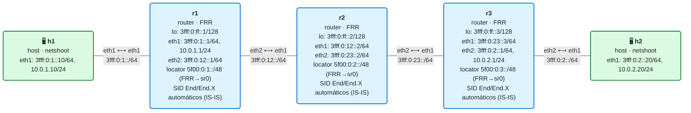

# 17 · Práctica: MTU, seguridad y filtrado

Antes de empezar, lee la [teoría del módulo](README.md).

## Topología

<!-- topologia:inicio -->

<!-- topologia:fin -->

> El fichero editable para draw.io está en [`lab/topologia.drawio`](lab/topologia.drawio).

- Red SRv6 que funciona (IS-IS+SRv6 + servicio `End.DX4`), con el **núcleo a MTU 1500** y un **filtro de borde** en cada PE (bloquea tráfico de cliente hacia `5f00::/16`).

## Parte A · Ejercicios en papel

Hazlos sin ordenador. Las soluciones están en [soluciones.md](soluciones.md).

**A1.** ¿Cuántos bytes añade SRv6 a un paquete con encap reducido y un solo SID? ¿Y con una lista de 3 SIDs?

**A2.** Con MTU de núcleo 1500 y encap de 40 bytes, ¿cuál es el tamaño máximo de paquete de cliente que cabe sin fragmentar? ¿Qué pasa con uno mayor si lleva el bit DF?

**A3.** ¿Qué es un *PMTUD blackhole* y qué error de configuración muy común lo provoca?

**A4.** ¿Por qué el hecho de que un SID sea una dirección IPv6 enrutable es un riesgo de seguridad? ¿Cuál es el modelo de confianza de SRv6?

**A5.** ¿Qué debe filtrar el borde del dominio SRv6 y en qué interfaces? ¿Por qué conviene además usar un bloque de SIDs no anunciado a Internet?

## Parte B · Laboratorio

### B0. Levantar el laboratorio

```bash
$ cd 17-mtu-seguridad/lab
$ sudo containerlab deploy -t lab.clab.yml
$ ./verificar.sh
```

### B1. La sobrecarga de SRv6 contra la MTU

```bash
# Paquete pequeño: cabe
$ docker exec clab-m17-h1 ping -c2 -M do -s 1400 10.0.2.20
# Paquete grande con "no fragmentar": NO cabe (1440+28+40 > 1500)
$ docker exec clab-m17-h1 ping -c2 -M do -s 1440 10.0.2.20
# El mismo grande, permitiendo fragmentar: ¿te salva la fragmentación?
$ docker exec clab-m17-h1 ping -c2 -s 1440 10.0.2.20
```

1. El pequeño pasa y el grande con `-M do` falla. Explícalo con los números (paquete de cliente + 40 de encap vs MTU 1500).
2. El grande **sin** `-M do` (fragmentable) **también falla**. ¿Por qué la fragmentación no te salva aquí? (Pista: en IPv6 los routers en tránsito no fragmentan; el paquete exterior ya no cabe.) La lección: esto **no se arregla fragmentando, se arregla con la MTU** (B2).

### B2. La solución: MTU grande en el núcleo

Sube la MTU en los dos enlaces del núcleo (los dos extremos de cada enlace) y repite:

```bash
$ docker exec clab-m17-r1 ip link set eth2 mtu 9000
$ docker exec clab-m17-r2 ip link set eth1 mtu 9000
$ docker exec clab-m17-r2 ip link set eth2 mtu 9000
$ docker exec clab-m17-r3 ip link set eth1 mtu 9000
# Ahora el paquete grande con DF sí pasa
$ docker exec clab-m17-h1 ping -c2 -M do -s 1440 10.0.2.20
```

1. ¿Funciona ahora el `ping -M do -s 1440`? ¿Por qué?
2. ¿Cuál es la regla de oro para dimensionar la MTU del núcleo en una red SRv6?
3. (Opcional) Vuelve a 1500 y comprueba que vuelve a fallar:

   ```bash
   $ for n in r1:eth2 r2:eth1 r2:eth2 r3:eth1; do
       docker exec clab-m17-${n%:*} ip link set ${n#*:} mtu 1500; done
   ```

### B3. Seguridad: el borde filtra los SIDs internos

Intenta, desde el cliente (h1), inyectar un paquete hacia un SID interno del operador:

```bash
$ docker exec clab-m17-h1 ping -c2 5f00:0:3::        # un SID interno
$ docker exec clab-m17-h1 ping -c2 10.0.2.20          # el servicio legítimo
```

1. ¿Llega el ping de h1 al SID interno `5f00:0:3::`? ¿Por qué no? Mira la regla del borde:

   ```bash
   $ docker exec clab-m17-r1 ip -6 rule show | grep 5f00
   ```
2. ¿Sigue funcionando el servicio legítimo (`10.0.2.20`)? ¿Por qué el filtro no lo afecta?

### B4. Ver el agujero cuando NO se filtra

Quita el filtro del borde en r1 y comprueba que, sin él, el cliente **sí** alcanza los SIDs internos (el agujero de seguridad):

```bash
$ docker exec clab-m17-r1 ip -6 rule del from 3fff:0:1::/64 to 5f00::/16 blackhole priority 100
$ docker exec clab-m17-h1 ping -c2 5f00:0:3::         # ahora llega al núcleo
```

1. ¿Cambia el resultado? ¿Qué podría hacer un atacante que pudiera mandar paquetes a tus `End.DX4` / `End.DT4`?
2. Vuelve a poner el filtro:

   ```bash
   $ docker exec clab-m17-r1 ip -6 rule add from 3fff:0:1::/64 to 5f00::/16 blackhole priority 100
   ```
3. ¿Por qué, además del filtro, ayuda que `5f00::/16` **no se anuncie** a Internet?

### B5. Limpieza

```bash
$ sudo containerlab destroy -t lab.clab.yml --cleanup
```

## Reto: una ACL de borde completa

1. La regla del laboratorio filtra por **destino** en `5f00::/16`. Pero un paquete podría entrar con un destino "inocente" y una **SRH** que lleve SIDs internos. ¿Por qué eso también es peligroso y qué tendría que mirar una ACL completa?
2. Escribe (conceptualmente) la política de borde de un operador: ¿en qué interfaces la aplicarías, qué bloque filtrarías, y qué harías además con la MTU de esos enlaces?
3. Repasa todo el curso: enumera los **tres** principios que hacen a SRv6 a la vez potente y manejable (pista: el SID es una dirección; el camino va en el paquete; el borde filtra y el núcleo confía). 
