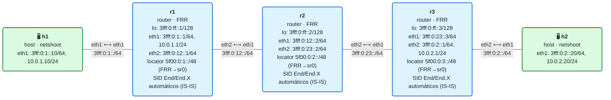

# 17 · OAM y troubleshooting

> **Objetivo**: saber **operar y diagnosticar** una red SRv6. Cómo se comportan `ping` y `traceroute` a través de SRv6, cómo **capturar y leer** una SRH, qué comandos `show` miran el estado, y un **catálogo de fallos típicos** con su síntoma y su arreglo (muchos los fuimos encontrando a lo largo del curso).
>
> **Por qué importa para SRv6**: una red no se acaba cuando "hace ping". Hay que saber ver por dónde va un paquete, confirmar que un SID hace lo que debe, y diagnosticar rápido cuando algo falla. SRv6 tiene una ventaja operativa enorme: como todo son **direcciones IPv6**, las herramientas de siempre (`ping`, `traceroute`, `tcpdump`) funcionan sin nada especial. Y tiene OAM propio ([RFC 9259](https://www.rfc-editor.org/rfc/rfc9259)) para telemetría fina.

## El laboratorio de este módulo

<!-- topologia:inicio -->

<!-- topologia:fin -->

Una red SRv6 que **funciona** (la del módulo 11: IS-IS+SRv6 con locators y SIDs automáticos) más un **servicio manual** `End.DX4` que lleva el IPv4 de h1 a h2 sobre SRv6. Sobre ella practicarás las herramientas de OAM y el diagnóstico.

## 1. `ping` en un mundo SRv6

Como un SID **es una dirección IPv6**, `ping` funciona tal cual. Tres usos distintos ([RFC 9259](https://www.rfc-editor.org/rfc/rfc9259) §4):

- **Ping normal** (a un loopback): comprueba alcanzabilidad por el camino más corto, como siempre.
- **Ping a un SID**: pones el SID como destino. Funciona para SIDs de tipo **End** y para direcciones normales (loopbacks): el nodo procesa la cabecera superior (el ICMP) y responde. **Ojo con los SIDs de desencapsulado** (`End.DX4`, `End.DT4/DT6/DT46`): un ping "pelado" a ellos **no** responde, porque su behavior espera un paquete **encapsulado** (con un paquete de cliente dentro), no un echo suelto. Para confirmar que un SID de decap está programado, **inspecciona** (`ip -6 route show <SID>`) en vez de pingarlo. Y recuerda: incluso cuando responde, el ping solo confirma que el SID **está instalado**, no que su behavior haga lo correcto (pingar un `End.X` no prueba que salga por la interfaz esperada; para eso, úsalo como SID de tránsito en una lista).
- **Ping con lista de segmentos**: fuerzas el camino (como en TE) y compruebas ese camino concreto.

## 2. `traceroute` a través de SRv6

`traceroute` también funciona sin cambios: cada salto que agota el *hop-limit* devuelve un **ICMPv6 Time Exceeded**, y con ellos se dibuja el camino. Puntos clave:

- **No hay diferencia** en el procesamiento del sondeo entre un nodo SRv6 y uno que no lo es: los nodos intermedios **aparecen** como saltos.
- La dirección origen del *Time Exceeded* es la **interfaz por la que entró** el sondeo, así que puedes comprobar si el paquete llegó por el enlace esperado (útil para verificar un `End.X`).
- El *Time Exceeded* **cita** parte del paquete que lo provocó, incluida la **SRH**, así que un traceroute "consciente de SR" puede mostrarte la lista de segmentos en cada salto.
- **Ojo con el encapsulado**: cuando el tráfico va **encapsulado** (H.Encaps), los nodos del núcleo ven el paquete **exterior**; el *hop-limit* que decrementa es el exterior. Un traceroute del cliente puede, por eso, "ver" los saltos del núcleo o no, según cómo se copie el hop-limit al encapsular. Es un detalle que conviene tener presente al interpretar la salida.

## 3. Capturar y leer una SRH

La herramienta estrella del diagnóstico SRv6 es `tcpdump`. Dos filtros que ya has usado:

- **Hay SRH**: `ip6[6]==43` (el *Next Header* de la IPv6 exterior vale 43 = Routing Header).
- **IPv4 encapsulado sin SRH**: `ip6[6]==4`; **IPv6 interior sin SRH**: `ip6[6]==41`.

Con `-vv`, tcpdump **decodifica** la SRH: verás `srcrt` / `rt6`, el `segleft`, el `last-entry` y la lista `[0]…[n]` de SIDs. Leer esa cabecera es lo que te dice, sin lugar a dudas, qué camino lleva el paquete y en qué punto del mismo está.

```bash
# En el núcleo (r2), ver la SRH del tráfico de cliente:
docker run --rm -it --net container:clab-m17-r2 nicolaka/netshoot:v0.13 \
    tcpdump -ni eth1 -vv 'ip6[6]==43 or ip6[6]==4'
```

## 4. OAM propio de SRv6 (RFC 9259)

Para operación avanzada, SRv6 define mecanismos propios:

- **El flag O (OAM) de la SRH**: un bit que marca el paquete para que **cada endpoint** recoja telemetría. Al procesarlo, el nodo hace una **copia** del paquete, le pone una marca de tiempo lo antes posible y la envía a un proceso OAM local (para exportarla, p. ej. por IPFIX/PSAMP), sin alterar el paquete original. Debe limitarse la tasa (riesgo de DoS) y, ojo, con **PSP** la SRH desaparece en el penúltimo nodo, así que el último no puede pedir telemetría.
- **Behaviors de OAM** ([RFC 8986](https://www.rfc-editor.org/rfc/rfc8986)): `End.OTP` (*OAM Timestamp and Punt*) y relacionados, pensados para "pinchar" el tráfico hacia el proceso OAM.

> En Linux/FRR estas funciones de OAM avanzado (flag O, End.OTP) **no están disponibles** de forma general; son de plataformas de operador. Por eso, en el laboratorio, el OAM que practicas es el "universal": `ping`, `traceroute` y captura/decodificación de la SRH, que cubren el 90 % del diagnóstico diario.

## 5. Comandos `show` para diagnosticar

El orden mental: **¿transporte? → ¿SID? → ¿servicio?**

```bash
# Transporte (IGP): ¿aprendo el locator del otro extremo?
vtysh -c "show ipv6 route isis"
vtysh -c "show isis segment-routing srv6 node"
# SIDs instalados en el plano de datos
ip -6 route show | grep seg6local
vtysh -c "show segment-routing srv6 locator MAIN detail"
# Servicio (si hay BGP L3VPN, módulos 12/13)
vtysh -c "show bgp ipv4 vpn"       # y 'ipv6 vpn'
vtysh -c "show ip route vrf CUST"
# Encaminamiento de un destino concreto
ip -6 route get <SID-o-destino>
ip route get <IPv4-de-cliente>
```

## 6. Catálogo de fallos típicos de SRv6 (y su arreglo)

Estos son los tropiezos reales que da SRv6 en Linux/FRR. Teníalos a mano:

| Síntoma | Causa probable | Cómo confirmarlo | Arreglo |
|---------|----------------|------------------|---------|
| El SID no procesa; el paquete se descarta al entrar | `seg6_enabled` desactivado en la interfaz de entrada | `sysctl net.ipv6.conf.<if>.seg6_enabled` | Poner `=1` en la interfaz (y `all`/`default`) |
| No hay ruta al SID de destino | El locator del otro nodo no se anuncia/aprende | `ip -6 route show <locator>` / `show isis ... srv6 node` | Revisar IS-IS y la config de locator |
| El contenedor uSID "se entrega local" y falla | La base del locator es una dirección local (anycast en tabla `local`) | `ip -6 route get <base>` dice `local`/`anycast` | No poner el locator en `lo`; usar sr0 (lo hace FRR) o quitar la anycast |
| `End.DT4`/`DT46` no se instala | Falta `net.vrf.strict_mode=1`, o se puso antes de crear la VRF | `sysctl net.vrf.strict_mode`; mirar si el SID está en el kernel | Poner strict_mode tras crear la VRF y reaplicar el SID |
| La ruta de encap no se instala | Falta `dev` en `ip route add ... encap seg6 …` | La ruta no aparece en `ip route show` | Añadir `dev <interfaz-de-salida>` |
| Tras tocar la config, IS-IS pierde vecinos | Se reinició FRR dentro del contenedor | `show isis neighbor` vacío | No reiniciar FRR; dejar que zebra reaccione a los cambios |
| MTU: pings grandes fallan, los pequeños van | La sobrecarga de SRv6 supera la MTU del núcleo | `ping -M do -s <grande>` falla | Subir la MTU del núcleo (módulo 18) |

## 7. Resumen

- En SRv6, `ping` y `traceroute` funcionan **sin cambios** porque los SID son direcciones IPv6: es una gran ventaja operativa.
- **Ping a un SID** confirma que está programado; para probar su *behavior*, úsalo como SID de tránsito. **Traceroute** muestra los saltos y, con herramientas conscientes de SR, la SRH en cada uno.
- `tcpdump` (`ip6[6]==43` para SRH, `-vv` para decodificar) es la herramienta clave para ver el camino real.
- SRv6 tiene **OAM propio** (flag O, `End.OTP`, RFC 9259) para telemetría; en Linux/FRR se usa el OAM universal (ping/traceroute/captura).
- Diagnostica en orden **transporte → SID → servicio**, con los `show` de IS-IS, del plano de datos (`seg6local`) y de BGP.
- Ten a mano el **catálogo de fallos**: casi todos son `seg6_enabled`, locator no anunciado, anycast local, `strict_mode`, `dev` en el encap, reinicio de FRR y MTU.

## Siguiente paso

Haz la [práctica](practica.md): pingarás y trazarás el camino, capturarás y leerás la SRH, usarás los `show`, y **provocarás** un par de fallos del catálogo para diagnosticarlos y arreglarlos. En el módulo 18, que cierra el Bloque IV, veremos **MTU, seguridad y filtrado** de SRv6 en el borde.

## Para saber más

- [RFC 9259 · OAM in SRv6 Networks](https://www.rfc-editor.org/rfc/rfc9259) — ping/traceroute, flag O, telemetría
- [RFC 8986 · SRv6 Network Programming](https://www.rfc-editor.org/rfc/rfc8986) — behaviors de OAM (`End.OTP`)
- `man tcpdump`, `man ip-route` (sección seg6/seg6local)
