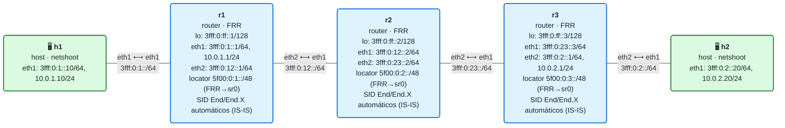

# 17 · Práctica: OAM y troubleshooting

Antes de empezar, lee la [teoría del módulo](README.md).

## Topología

<!-- topologia:inicio -->

<!-- topologia:fin -->

> El fichero editable para draw.io está en [`lab/topologia.drawio`](lab/topologia.drawio).

- Red SRv6 que funciona (IS-IS+SRv6, locators y SIDs automáticos) + servicio manual `End.DX4` que lleva el IPv4 de h1 a h2 sobre SRv6.
- Sobre ella practicas ping, traceroute, captura/lectura de la SRH, comandos `show`, y diagnóstico de fallos provocados.

## Parte A · Ejercicios en papel

Hazlos sin ordenador. Las soluciones están en [soluciones.md](soluciones.md).

**A1.** ¿Por qué `ping` y `traceroute` funcionan en SRv6 sin herramientas especiales? ¿Qué ventaja operativa supone?

**A2.** Hacer `ping` a un SID responde. ¿Qué confirma eso exactamente, y qué **no** confirma?

**A3.** ¿Qué filtro de `tcpdump` usas para ver paquetes **con SRH**? ¿Y para ver un IPv4 encapsulado **sin** SRH? (Pista: el campo *Next Header*.)

**A4.** ¿Qué hace el **flag O** de la SRH cuando un endpoint lo procesa? ¿Está disponible en Linux/FRR?

**A5.** Enumera tres fallos típicos de SRv6 en Linux/FRR y, para cada uno, un comando que lo confirme.

## Parte B · Laboratorio

### B0. Levantar el laboratorio

```bash
$ cd 17-oam/lab
$ sudo containerlab deploy -t lab.clab.yml
$ ./verificar.sh
```

### B1. Ping: tres formas

```bash
# 1) Ping de cliente (IPv4 sobre SRv6)
$ docker exec clab-m17-h1 ping -c2 10.0.2.20
# 2) Ping al loopback de r3 (alcanzabilidad normal)
$ docker exec clab-m17-r1 ping -c2 3fff:0:ff::3
# 3) Ping a un SID de DECAP (End.DX4 de r3)
$ docker exec clab-m17-r1 ping -c2 5f00:0:3:dc04::
# 4) Ping a un SID que NO existe
$ docker exec clab-m17-r1 ping -c2 5f00:0:3:ffff::
```

1. El loopback de r3 responde (alcanzabilidad normal). En cambio, el ping al `End.DX4` (`5f00:0:3:dc04::`) **no** responde. ¿Por qué? (Pista: `End.DX4` es *desencapsular + cross-connect*; espera un paquete encapsulado con un IPv4 dentro, no un echo suelto.) ¿Cómo confirmarías entonces que ese SID está instalado? (Con `ip -6 route show 5f00:0:3:dc04::`.)
2. ¿Qué pasa con el SID inexistente (`5f00:0:3:ffff::`)? ¿Por qué? (Cae en el locator de r3, llega a r3, pero no hay SID instalado → se descarta.)
3. Moraleja: el ping confirma alcanzabilidad y SIDs de tipo **End**/direcciones; los SIDs de **decap** se verifican **inspeccionando**, no pingando.

### B2. Traceroute: ver el camino

```bash
$ docker exec clab-m17-h1 traceroute -n 10.0.2.20
$ docker exec clab-m17-r1 traceroute -n 3fff:0:ff::3        # al loopback de r3
```

1. ¿Qué saltos aparecen en el traceroute entre los routers? 
2. Compara el traceroute del cliente (`h1 → 10.0.2.20`) con el del transporte (`r1 → loopback de r3`). ¿Por qué el del cliente puede "ver" menos saltos? (Pista: el tráfico va encapsulado; piensa en el hop-limit exterior vs interior.)

### B3. Capturar y leer la SRH

```bash
$ docker run --rm -it --net container:clab-m17-r2 nicolaka/netshoot:v0.13 \
    tcpdump -ni eth1 -vv 'ip6[6]==43 or ip6[6]==4' &
$ docker exec clab-m17-h1 ping -c2 10.0.2.20
```

1. ¿Qué *Next Header* tiene el paquete de cliente en el núcleo: 43 (SRH) o 4 (IPv4 directo)? (Con un solo SID de servicio y encap reducido, ¿esperas SRH?)
2. En la cabecera exterior, ¿cuál es el destino? ¿Reconoces el `End.DX4` de r3?
3. ¿Qué hay dentro? ¿El IPv4 del cliente?

### B4. Los comandos show: transporte → SID → servicio

```bash
# Transporte
$ docker exec clab-m17-r1 vtysh -c "show isis segment-routing srv6 node"
$ docker exec clab-m17-r1 ip -6 route show 5f00:0:3::/48
# SIDs en el plano de datos
$ docker exec clab-m17-r3 ip -6 route show | grep seg6local
# Encaminamiento de un destino de cliente
$ docker exec clab-m17-r1 ip route get 10.0.2.20
```

1. ¿Aprende r1 el locator de r3 por IS-IS? ¿Por qué interfaz?
2. En r3, ¿qué SIDs hay (los automáticos End/End.X y el manual End.DX4)?
3. `ip route get 10.0.2.20` en r1, ¿muestra el encap SRv6 hacia el SID de r3?

### B5. Diagnóstico de un fallo provocado (1): seg6_enabled

Rompe a propósito el `seg6_enabled` del núcleo en r2 y observa el efecto:

```bash
$ docker exec clab-m17-r2 sysctl -w net.ipv6.conf.eth1.seg6_enabled=0
$ docker exec clab-m17-h1 ping -c2 10.0.2.20      # ¿sigue yendo?
```

1. ¿Falla el ping? (En esta topología, con un solo SID de servicio, r2 solo **reenvía** el IPv6 exterior y quizá no procese SRH; prueba también a forzar un SID de tránsito en r2 para notarlo.) 
2. Arréglalo y confirma:

   ```bash
   $ docker exec clab-m17-r2 sysctl -w net.ipv6.conf.eth1.seg6_enabled=1
   $ docker exec clab-m17-h1 ping -c2 10.0.2.20
   ```

### B6. Diagnóstico de un fallo provocado (2): servicio caído

Borra el SID de servicio de r3 y diagnostícalo con el método transporte→SID→servicio:

```bash
$ docker exec clab-m17-r3 ip -6 route del 5f00:0:3:dc04::/128
$ docker exec clab-m17-h1 ping -c2 10.0.2.20        # falla
# Diagnóstico:
$ docker exec clab-m17-r1 ip route get 10.0.2.20     # el encap sigue, apunta al SID...
$ docker exec clab-m17-r3 ip -6 route show 5f00:0:3:dc04::/128   # ...pero en r3 ya no existe
```

1. ¿En qué paso del método (transporte / SID / servicio) está el fallo?
2. ¿Qué comando te lo señala sin ambigüedad?
3. Restaura el servicio:

   ```bash
   $ docker exec clab-m17-r3 ip -6 route add 5f00:0:3:dc04::/128 \
       encap seg6local action End.DX4 nh4 10.0.2.20 dev eth2
   $ docker exec clab-m17-h1 ping -c2 10.0.2.20
   ```

### B7. Limpieza

```bash
$ sudo containerlab destroy -t lab.clab.yml --cleanup
```

## Reto: construir tu propio "SR-aware traceroute"

1. Haz un traceroute forzando un camino explícito con una lista de segmentos (como en el módulo 14) y captura en cada tramo para ver la SRH. ¿Puedes reconstruir, salto a salto, qué SID estaba activo?
2. Repasa el **catálogo de fallos** de la teoría y, para cada uno, escribe el **comando de una línea** con el que lo detectarías en caliente. Tenlo como tu "chuleta" de troubleshooting SRv6.
3. ¿Por qué, en una red SRv6, buena parte del diagnóstico se reduce a "¿es una dirección IPv6 enrutable y está el SID instalado?"? Relaciónalo con que el SID **es** una dirección.
