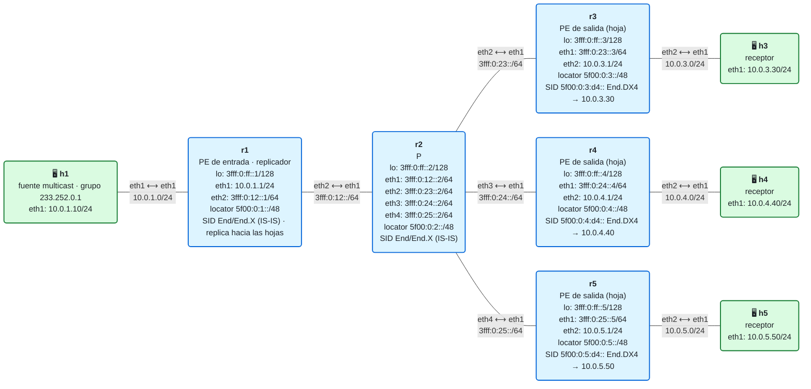
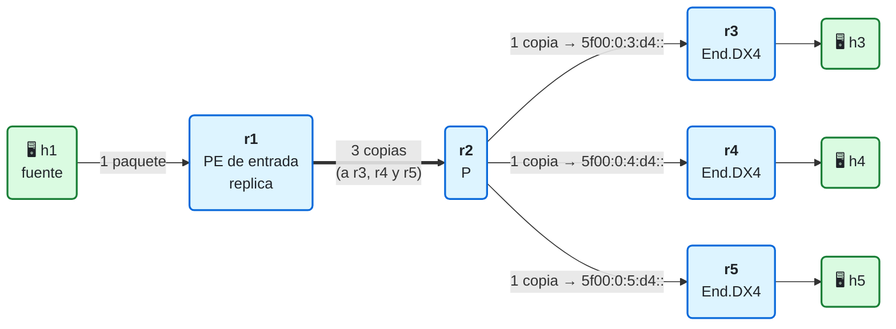
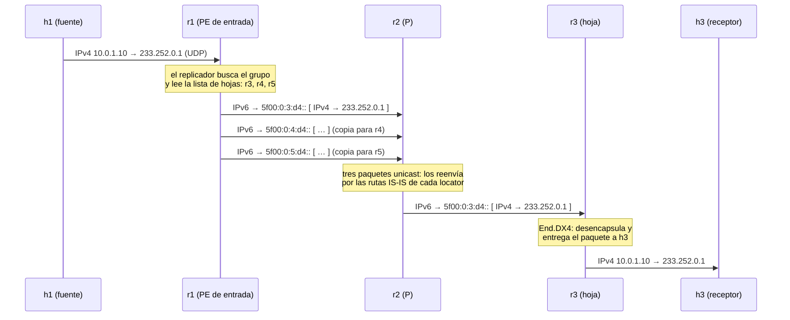

# 19 · Multicast en una red SRv6: el problema y la replicación en el ingreso

> **Objetivo**: entender por qué el multicast choca con la idea central de Segment Routing (un núcleo sin estado) y montar la respuesta más sencilla: la **replicación en el ingreso** (*ingress replication*). El PE de entrada envía una copia del tráfico, por SRv6 unicast, a cada PE con receptores.
>
> **Por qué importa para SRv6**: casi todos los servicios de un operador tienen algo de multicast: televisión IP, mercados financieros, el tráfico BUM de una VPN de capa 2 (EVPN, escenario [E3](../anexo-escenarios/E3-evpn/README.md))… Antes de ver las soluciones elegantes (el árbol con *replication segments* del módulo 20 y BIER del 21), hay que entender el problema y la solución que funciona en cualquier red SRv6, aunque cueste ancho de banda.

## El laboratorio de este módulo

<!-- topologia:inicio -->

<!-- topologia:fin -->

> El fichero editable para draw.io está en [`lab/topologia.drawio`](lab/topologia.drawio).

- **h1** es la **fuente**: envía datagramas UDP al grupo `233.252.0.1` (un grupo del bloque de documentación, [RFC 6676](https://www.rfc-editor.org/rfc/rfc6676)).
- **r1** es el PE de entrada. No tiene enrutamiento multicast: un **replicador** (`lab/replicacion/replicador.py`) hace de PE y envía una copia a cada **hoja**.
- **r3, r4 y r5** son las hojas: los PE de salida con receptores. Cada una tiene un SID `End.DX4` que desencapsula la copia y la entrega a su receptor (h3, h4, h5).
- **r2** es un P: solo reenvía IPv6. El transporte es el del módulo 11: IS-IS con SRv6.

## 1. Multicast en dos minutos

Con **unicast**, un paquete va a un destino. Con **multicast**, una fuente envía **un** paquete a un **grupo**, y la red lo hace llegar a todos los que se han unido a ese grupo, copiándolo donde el camino se separa.

| Pieza | Qué es |
|---|---|
| **Grupo** | Una dirección de destino que no es de nadie: `224.0.0.0/4` en IPv4 y `ff00::/8` en IPv6. Quien quiere el tráfico **se une** al grupo |
| **IGMP / MLD** | El protocolo con el que un receptor le dice a su router "quiero el grupo G" (IGMP en IPv4, MLD en IPv6, que es parte de ICMPv6) |
| **(S, G)** | Un flujo concreto: la fuente S enviando al grupo G. Con **SSM** (*Source-Specific Multicast*, [RFC 4607](https://www.rfc-editor.org/rfc/rfc4607)), el receptor pide directamente un (S, G) |
| **Árbol de distribución** | El conjunto de enlaces por los que baja el tráfico, de la fuente a los receptores. Lo construye **PIM** ([RFC 7761](https://www.rfc-editor.org/rfc/rfc7761)) salto a salto, desde los receptores hacia la fuente |
| **Punto de replicación** | Cada router del árbol donde el camino se separa: recibe una copia y envía varias |

El árbol es eficiente: **por cada enlace pasa una sola copia** de cada paquete, haya los receptores que haya detrás. Pero tiene un precio: **cada router del árbol guarda estado** por cada (S, G): por qué interfaz llega (la comprobación RPF) y por cuáles tiene que salir.

## 2. El choque con Segment Routing

La gran promesa de SR (módulo 06) es que **el núcleo no guarda estado por flujo**: el camino va escrito en el paquete y los P solo ejecutan instrucciones. El multicast clásico es exactamente lo contrario:

| | Unicast con SR | Multicast con PIM |
|---|---|---|
| Quién decide el camino | El PE de entrada, en la lista de segmentos | Los receptores, uniéndose al árbol salto a salto |
| Estado en los P | Ninguno por flujo: solo las rutas del IGP | Una entrada por cada (S, G) que pasa por él |
| Protocolos en el núcleo | IS-IS (y BGP solo en los PE) | IS-IS **y** PIM en todos los routers |
| Si hay 10 000 canales de TV | Nada cambia en el núcleo | 10 000 entradas en cada router del árbol |

Hay que **copiar** el paquete en algún sitio, y quien copia tiene que saber a quién. La pregunta es **dónde se guarda ese estado**. Hay tres respuestas, y son los tres módulos de este bloque:

| Solución | Dónde se replica | Estado en el núcleo | Eficiencia | Módulo |
|---|---|---|---|---|
| **Replicación en el ingreso** | Solo en el PE de entrada | **Ninguno** | Baja: una copia por hoja desde el primer enlace | **19 (este)** |
| ***Replication segments* / Tree-SID** | En los nodos del árbol, que tienen un SID de replicación | Por árbol, en los nodos de replicación | Alta: un árbol | 20 |
| **BIER** | En cualquier router, según una cabecera con un bit por hoja | **Ninguno** por flujo | Alta: copia solo donde el camino se separa | 21 |

## 3. La replicación en el ingreso

La idea es la más sencilla posible: **el multicast se convierte en varios unicast**. El PE de entrada recibe un paquete del grupo y envía una copia a cada PE de salida con receptores (las **hojas**), con SRv6 unicast normal. Cada hoja desencapsula su copia y la entrega a sus receptores como un paquete multicast normal.



Lo que gana y lo que paga:

- ✅ **El núcleo no se entera.** r2 ve tres paquetes IPv6 unicast, cada uno hacia un SID distinto. No ejecuta PIM ni guarda ningún estado de multicast. Funciona sobre cualquier red SRv6, sin cambiar nada en los P.
- ✅ **Cada copia es un paquete SRv6 normal**, así que se le puede aplicar todo lo de los módulos anteriores: ingeniería de tráfico, protección, uSID…
- ❌ **El enlace de salida del PE de entrada lleva una copia por hoja.** Con 3 hojas, el enlace r1–r2 transporta el triple. Con 100 hojas y un canal de TV de 8 Mb/s, salen de r1 **800 Mb/s** del mismo canal. Un árbol enviaría 8 Mb/s por cada enlace.
- ❌ **El PE de entrada trabaja más**: tiene que generar todas las copias.

Por eso la replicación en el ingreso es la elección habitual cuando hay **pocas hojas o poco tráfico**: el tráfico BUM de una EVPN, el multicast de una VPN pequeña, o mientras la red no soporta nada mejor. Para la televisión de todo un país, no.

### Quién le dice al PE cuáles son las hojas

En el laboratorio, la lista de hojas es un fichero (`lab/replicacion/hojas.txt`) que editas tú. En una red real, la mantiene **BGP**:

- En una **VPN multicast** (*MVPN*, [RFC 6513](https://www.rfc-editor.org/rfc/rfc6513) y [RFC 6514](https://www.rfc-editor.org/rfc/rfc6514)), cada PE de salida que tiene receptores para un (S, G) lo anuncia con una ruta BGP (*Leaf A-D*). El PE de entrada reúne esas rutas y sabe a quién replicar. El túnel de replicación en el ingreso está definido en el [RFC 7988](https://www.rfc-editor.org/rfc/rfc7988).
- En **EVPN** ([RFC 7432](https://www.rfc-editor.org/rfc/rfc7432)), cada PE anuncia una ruta de **tipo 3** (*Inclusive Multicast Ethernet Tag*) por cada instancia de servicio: "envíame el tráfico BUM aquí". Con SRv6, ese "aquí" es su SID `End.DT2M` (escenario [E3](../anexo-escenarios/E3-evpn/README.md)).

En los dos casos, lo que viaja en la ruta es lo mismo que hay en `hojas.txt`: **quién** quiere el tráfico y **en qué SID** lo quiere recibir.

## 4. El viaje de un paquete



Fíjate en que el paquete interior **sigue siendo multicast** (destino `233.252.0.1`) durante todo el viaje: solo el envoltorio IPv6 es unicast. h3 lo acepta porque se ha unido al grupo.

## 5. Cómo está montado el laboratorio (y por qué así)

**El PE de entrada.** Lo natural sería que el kernel de r1 hiciera la replicación con su enrutamiento multicast. Pero el enrutamiento multicast de Linux copia paquetes **hacia interfaces**, y el encapsulado SRv6 no es una interfaz: es un atributo de una **ruta**. No hay forma de decirle al kernel "copia este grupo hacia estos tres SIDs". Por eso el laboratorio usa un script, `replicador.py`, que corre dentro de r1. Es corto y está comentado para que lo leas:

1. Escucha en `eth1` (la sede de la fuente) los paquetes IPv4 dirigidos a los grupos que conoce.
2. Les resta 1 al TTL, como haría un router.
3. Por cada hoja de `hojas.txt`, envía una copia por un socket IPv6 "en bruto" con protocolo 4 (IPv4). El kernel le pone delante una cabecera IPv6 hacia el SID de la hoja, con *Next Header* 4. **Con un solo SID, eso es exactamente `H.Encaps.Red`** (módulo 09): IPv6 exterior, sin SRH.

**Las hojas.** Cada una tiene un `End.DX4` (módulo 08) creado a mano, que desencapsula y entrega el paquete IPv4 a su receptor:

```
ip -6 route add 5f00:0:3:d4::/128 encap seg6local action End.DX4 nh4 10.0.3.30 dev sr0
```

`End.DX4` envía el paquete al **siguiente salto** indicado (h3), sin buscar el destino en ninguna tabla. Es una simplificación: un PE de verdad entregaría el paquete a su propio enrutamiento multicast, que lo enviaría a todos los receptores de esa sede. Aquí cada sede tiene un solo receptor.

**Los receptores.** Cada uno ejecuta `socat`, que se une al grupo `233.252.0.1` (con IGMP) y guarda lo que recibe en `/tmp/recibido.txt`.

## 6. Lo que FRR y Linux no hacen

| Pieza | En un router comercial | ¿En FRR 10.7.1 / Linux? | En este laboratorio |
|---|---|---|---|
| Multicast clásico: **PIM e IGMP/MLD** | Sí | ✅ FRR tiene `pimd` y `pim6d` | No se usa: el núcleo SRv6 no ejecuta PIM |
| **BGP MVPN** (las hojas por BGP) | Sí | ❌ FRR no lo implementa | La lista de hojas es un fichero |
| **EVPN tipo 3 con SRv6** (BUM por replicación en el ingreso) | Sí | ❌ FRR solo hace EVPN con VXLAN (escenario E3) | — |
| **Replicar hacia encapsulados SRv6** en el plano de datos | Sí, en hardware | ❌ El enrutamiento multicast de Linux solo copia hacia interfaces | `replicador.py` en r1 |
| `End.Replicate` (*replication segments*, [RFC 9524](https://www.rfc-editor.org/rfc/rfc9524)) | En algunas plataformas | ❌ No está en el kernel de Linux | Módulo 20, en teoría y con un simulador |

## 7. Inspeccionar

```bash
# El registro del replicador: cuántas copias hace y hacia quién
docker exec clab-m19-r1 tail -f /tmp/replicador.log

# Enviar un datagrama al grupo desde la fuente
docker exec clab-m19-h1 bash -c "echo hola | socat -u - UDP4-DATAGRAM:233.252.0.1:5000,ip-multicast-ttl=8"

# Lo que ha recibido cada receptor
docker exec clab-m19-h3 cat /tmp/recibido.txt

# Los SIDs de las hojas
docker exec clab-m19-r3 ip -6 route show | grep End.DX4

# Las copias en el cable, entre r1 y r2 (Next Header 4: IPv4 dentro de IPv6)
docker run --rm -it --net container:clab-m19-r2 nicolaka/netshoot:v0.13 tcpdump -ni eth1 'ip6 and ip6[6] == 4'
```

## 8. Resumen

- El multicast necesita **copiar** paquetes, y quien copia necesita **estado**: saber a quién. Con PIM, ese estado está en cada router del árbol, y eso choca con la idea de un núcleo SR sin estado.
- La **replicación en el ingreso** deja todo el estado en el PE de entrada: envía una copia unicast SRv6 a cada hoja, hacia el SID donde la hoja quiere recibir. El núcleo no se entera.
- Su precio es el **ancho de banda**: el primer enlace lleva una copia por hoja. Sirve para pocas hojas o poco tráfico (BUM de EVPN, MVPN pequeñas).
- La lista de hojas la mantiene **BGP** en producción (rutas MVPN *Leaf A-D* o EVPN de tipo 3). Aquí es un fichero que puedes editar en caliente.
- Ni FRR ni Linux replican hacia SRv6 en el plano de datos: el laboratorio lo hace con un script, y las hojas usan `End.DX4`.

## Siguiente paso

➡️ **[20 · *Replication segments* y Tree-SID](../20-replication-segments/README.md)**: cómo poner puntos de replicación **dentro** de la red sin volver a PIM, con un SID que significa "copia este paquete hacia estos vecinos".

## Para saber más

- [RFC 4607 · Source-Specific Multicast for IP](https://www.rfc-editor.org/rfc/rfc4607)
- [RFC 7761 · Protocol Independent Multicast - Sparse Mode (PIM-SM)](https://www.rfc-editor.org/rfc/rfc7761)
- [RFC 6513 · Multicast in MPLS/BGP IP VPNs](https://www.rfc-editor.org/rfc/rfc6513) y [RFC 6514 · BGP Encodings and Procedures for Multicast in MPLS/BGP IP VPNs](https://www.rfc-editor.org/rfc/rfc6514)
- [RFC 7988 · Ingress Replication Tunnels in Multicast VPN](https://www.rfc-editor.org/rfc/rfc7988)
- [RFC 9524 · Segment Routing Replication for Multipoint Service Delivery](https://www.rfc-editor.org/rfc/rfc9524) — lo que viene en el módulo 20
- [RFC 6676 · Multicast Addresses for Documentation](https://www.rfc-editor.org/rfc/rfc6676) — el bloque `233.252.0.0/24`
