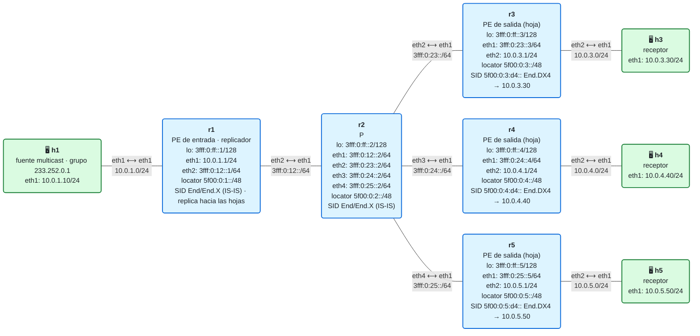

# 19 · Práctica: replicación en el ingreso

Antes de empezar, lee la [teoría del módulo](README.md). Los contenedores se llaman `clab-m19-…`. Los comandos con `./` se ejecutan desde la carpeta `lab/`.

## Topología

<!-- topologia:inicio -->

<!-- topologia:fin -->

## Parte A · Ejercicios en papel

**A1.** Una red tiene un PE de entrada con un enlace de 10 Gb/s hacia el núcleo, y quiere distribuir 40 canales de TV de 8 Mb/s cada uno a 30 PE de salida, todos con receptores de todos los canales. ¿Cuánto tráfico saldría por ese enlace con replicación en el ingreso? ¿Y con un árbol multicast? ¿Cabe?

**A2.** Con replicación en el ingreso, ¿cuántas entradas de estado multicast tiene un P del núcleo para esos 40 canales? ¿Y con PIM, si todos los canales pasan por él?

**A3.** El paquete que llega a h3 tiene como destino `233.252.0.1`, pero entre r2 y r3 viajó dentro de un IPv6 con destino `5f00:0:3:d4::`. ¿Qué parte del camino es multicast y cuál es unicast?

**A4.** En una EVPN con 20 PE, ¿qué anuncia cada PE para recibir el tráfico BUM (difusión, unicast desconocido y multicast) con replicación en el ingreso? ¿Qué SID pondría en ese anuncio con SRv6?

## Parte B · Levantar y verificar

```
$ cd 19-replicacion-ingreso/lab
$ sudo containerlab deploy -t lab.clab.yml
$ ./verificar.sh
```

## Parte C · Observar la replicación

**C1.** Abre el registro del replicador en una terminal y, en otra, envía un datagrama al grupo:

```
$ docker exec clab-m19-r1 tail -f /tmp/replicador.log
$ docker exec clab-m19-h1 bash -c "echo hola | socat -u - UDP4-DATAGRAM:233.252.0.1:5000,ip-multicast-ttl=8"
```

¿Cuántas copias hace? ¿Hacia quién? Comprueba qué han recibido h3, h4 y h5 (`cat /tmp/recibido.txt`).

**C2.** Captura en r2, en el enlace que viene de r1, mientras repites el envío:

```
$ docker run --rm -it --net container:clab-m19-r2 nicolaka/netshoot:v0.13 tcpdump -ni eth1 -v 'ip6 and ip6[6] == 4'
```

¿Cuántos paquetes ves por cada datagrama de h1? ¿Qué cambia entre ellos? ¿Llevan SRH?

**C3.** Ahora captura en r3, en el enlace que viene de r2. ¿Cuántos paquetes ves? ¿Y entre r3 y h3 (`eth2` de r3)? ¿Qué destino tiene el paquete ahí?

**C4.** Mira el SID de r3 y su siguiente salto:

```
$ docker exec clab-m19-r3 ip -6 route show 5f00:0:3:d4::
```

¿Busca r3 el destino `233.252.0.1` en alguna tabla? ¿Qué pasaría si en la sede de r3 hubiera dos receptores?

**C5.** Lee `lab/replicacion/replicador.py`. ¿Dónde se resta el TTL? ¿Dónde se pone la cabecera IPv6? ¿Por qué no hace falta escribirla en el script?

## Parte D · Cambiar las hojas

**D1.** El receptor de r5 se ha ido. Quita r5 de la lista: en `lab/replicacion/hojas.txt`, pon un `#` delante de su línea. Envía otro datagrama. ¿Qué dice el registro del replicador? ¿Recibe algo h5?

**D2.** Vuelve a poner r5. ¿Hace falta reiniciar el replicador? En una red real, ¿quién haría este cambio, y con qué mensaje?

**D3.** Añade una hoja que no existe: `r6 5f00:0:6:d4::`. Envía un datagrama. ¿Qué pasa con esa copia? ¿Afecta a las demás? Quita la línea.

## Parte E · El precio en ancho de banda

**E1.** Mide los bytes que salen de r1 hacia r2 y los que salen de r2 hacia r3 mientras h1 envía 200 datagramas de 1000 bytes:

```
$ for r in "r1 eth2" "r2 eth2"; do set -- $r; docker exec clab-m19-$1 cat /sys/class/net/$2/statistics/tx_bytes; done
$ docker exec clab-m19-h1 bash -c 'for i in $(seq 200); do head -c 1000 /dev/zero | socat -u - UDP4-DATAGRAM:233.252.0.1:5000,ip-multicast-ttl=8; done'
$ for r in "r1 eth2" "r2 eth2"; do set -- $r; docker exec clab-m19-$1 cat /sys/class/net/$2/statistics/tx_bytes; done
```

Calcula la diferencia en cada enlace. ¿Qué proporción hay entre los dos? ¿Cuántos bytes añade SRv6 a cada copia?

**E2.** Repite E1 con solo una hoja en `hojas.txt`. ¿Qué cambia en el enlace r1–r2?

## Parte F · Rómpelo y arréglalo

**F1.** Cambia en `hojas.txt` el SID de r4 por `5f00:0:4:d5::` (una letra distinta). Envía un datagrama. ¿Lo recibe h4? ¿Qué dice el registro del replicador? ¿Hasta dónde llega la copia? Captura en r4 (`eth1`) para comprobarlo.

**F2.** Busca el error con lo que tiene r4: `ip -6 route show | grep seg6local`. Arréglalo y comprueba con `./verificar.sh` que todo vuelve a estar en verde.

## Al terminar

```
$ sudo containerlab destroy -t lab.clab.yml --cleanup
```

Compara tus respuestas con las [soluciones](soluciones.md).
