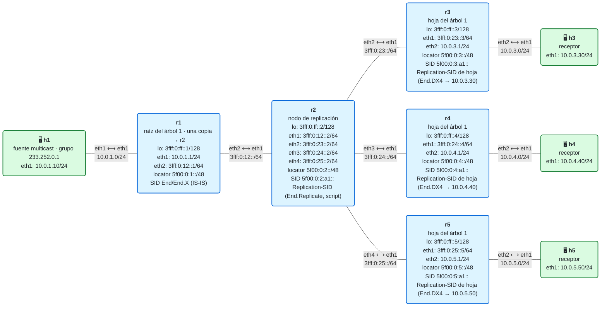
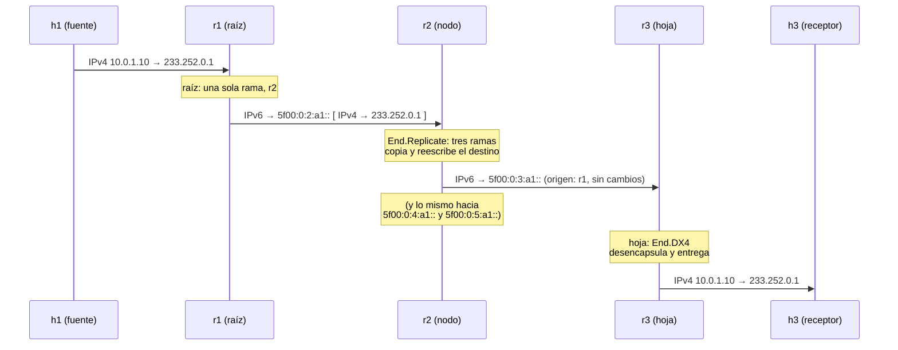
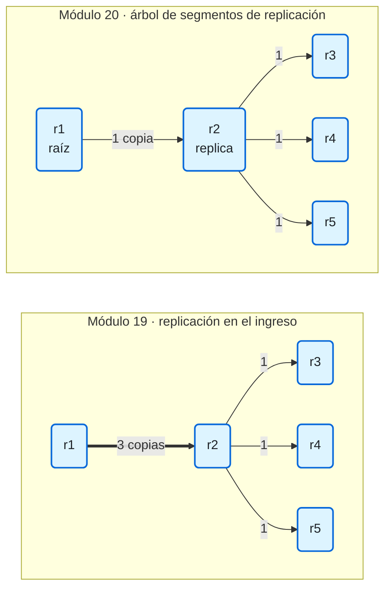

# 20 · Segmentos de replicación (RFC 9524): un árbol multicast sobre SRv6

> **Objetivo**: poner los puntos de replicación **dentro** de la red, sin volver a PIM. Un **segmento de replicación** es un SID que significa "copia este paquete hacia estos nodos". Encadenando segmentos de replicación se construye un **árbol**, y el tráfico multicast baja por él con una sola copia por enlace.
>
> **Por qué importa para SRv6**: la replicación en el ingreso del módulo 19 no guarda estado en el núcleo, pero gasta ancho de banda. Los segmentos de replicación hacen el cambio contrario: un poco de estado (por **árbol**, no por flujo) en los nodos donde el camino se bifurca, a cambio de la eficiencia de un árbol. Es la base de las *SR P2MP Policies*, el multicast que ofrecen los fabricantes sobre SR.

## El laboratorio de este módulo

<!-- topologia:inicio -->

<!-- topologia:fin -->

> El fichero editable para draw.io está en [`lab/topologia.drawio`](lab/topologia.drawio).

Es la misma red que la del módulo 19, con el mismo grupo (`233.252.0.1`) y los mismos receptores. Lo que cambia es **quién copia**:

| Nodo | Papel en el árbol | Replication-SID | Qué hace |
|---|---|---|---|
| r1 | **Raíz** | — | Envía **una** copia hacia el Replication-SID de r2 |
| r2 | **Nodo de replicación** | `5f00:0:2:a1::` | Copia hacia r3, r4 y r5, reescribiendo la dirección de destino |
| r3, r4, r5 | **Hojas** | `5f00:0:N:a1::` | Desencapsulan y entregan al receptor |

(`a1` por "árbol 1": en este laboratorio, la función de cada Replication-SID identifica el árbol.)

## 1. Un SID que significa "copia"

El [RFC 9524](https://www.rfc-editor.org/rfc/rfc9524) define el **segmento de replicación** (*Replication segment*): un segmento **local** de un nodo que copia los paquetes que le llegan hacia un conjunto de **nodos siguientes** (*downstream nodes*).

| Pieza | Qué es |
|---|---|
| **Replication-ID** | El identificador del segmento en ese nodo. Junto con el nodo, `<Replication-ID, nodo>` identifica un segmento de replicación |
| **Replication-SID** | El SID con el que se llega a él. En SRv6, una dirección del locator del nodo, con el behavior **`End.Replicate`** |
| **Estado de replicación** | La lista de **ramas** del segmento: para cada una, el nodo siguiente y **su** Replication-SID |
| **Raíz** | Donde entra el tráfico al árbol (el PE de entrada) |
| **Hoja** | Donde sale (un PE de salida). Su lista de ramas está vacía, y **entrega** el paquete en local |
| **Nodo *bud*** | Un nodo que es a la vez hoja y nodo de replicación: entrega una copia en local y envía otras más abajo |

En el laboratorio, el estado de replicación de cada nodo está en un fichero, `lab/replicacion/estado/rN.txt`. El de r2:

```
sid 5f00:0:2:a1::
rama r3 5f00:0:3:a1::
rama r4 5f00:0:4:a1::
rama r5 5f00:0:5:a1::
```

## 2. `End.Replicate`, paso a paso

Cuando a un nodo le llega un paquete IPv6 cuyo destino es uno de sus Replication-SID, el RFC 9524 le pide esto:

1. Busca el segmento de replicación por la parte de **función** del SID. Si no existe, descarta el paquete.
2. Si el *Hop Limit* es **1 o menos**, lo descarta, y **sin** enviar un ICMPv6 *Time Exceeded* (por eso no se puede hacer `traceroute` a través de un árbol).
3. Resta 1 al *Hop Limit*.
4. **Por cada rama**: hace una copia y **reescribe la dirección de destino** con el Replication-SID de esa rama. Todo lo demás de la cabecera exterior se queda igual, también el origen. Si el nodo siguiente no es vecino, puede encapsular la copia con una lista de segmentos para llegar hasta él (sección 4).
5. Si el nodo es **hoja** (o *bud*), además **entrega** el paquete en local: quita la cabecera IPv6 exterior y procesa lo que hay dentro, sea IPv4 (*Next Header* 4), IPv6 (41) o una trama Ethernet (143).

Fíjate en que la lista de destinos **no viaja en el paquete**: está en el estado de cada nodo. El paquete solo lleva el SID del siguiente punto de replicación. Es la gran diferencia con BIER (módulo 21), que sí lleva en el paquete la lista de destinos.



## 3. Un árbol son segmentos cosidos

Un segmento de replicación es una pieza local. Un **árbol** se construye **cosiendo** segmentos: la raíz tiene una rama hacia un nodo de replicación, que tiene ramas hacia otros, hasta llegar a las hojas. Cada segmento solo conoce a sus vecinos de abajo.



**¿Quién cose el árbol?** El RFC 9524 deja esa parte a otros documentos. El más extendido es el de las **SR P2MP Policies** ([draft-ietf-pim-sr-p2mp-policy](https://datatracker.ietf.org/doc/draft-ietf-pim-sr-p2mp-policy/)):

- La política dice la **raíz**, las **hojas** y las **restricciones** del árbol (por ejemplo, mínimo retardo o evitar ciertos enlaces), como una SR Policy unicast (módulo 14).
- Un **controlador** (PCE) calcula el árbol con la topología que conoce (por BGP-LS, como en el escenario E7) y **programa** el segmento de replicación de cada nodo, por PCEP o por BGP.
- Al SID que identifica el árbol en cada nodo se le suele llamar **Tree-SID**. En SR-MPLS es habitual usar la misma etiqueta en todos los nodos del árbol; en SRv6, cada nodo tiene su propio Replication-SID dentro de su locator.

**Árboles compartidos.** Un árbol no es de un flujo: es de un conjunto de hojas. Muchos (S, G), o el tráfico de varias VPN, pueden ir por el mismo árbol si van a las mismas hojas. Así, el estado en el núcleo crece con el número de **árboles**, no con el de flujos. Si el árbol es compartido, la hoja necesita saber a qué servicio pertenece cada paquete. Ese **contexto** puede ir en el propio Replication-SID (un árbol por servicio) o en un SID de servicio que viaje detrás. El RFC deja la forma de señalizarlo a otros documentos.

## 4. Ramas que no son vecinas

En el laboratorio, todas las ramas de r2 son vecinas directas. Pero un nodo de replicación puede tener una rama hacia un nodo lejano, sin que los nodos intermedios sepan nada del árbol. En ese caso, la copia se encapsula (con `H.Encaps.Red`) con una **lista de segmentos** que lleva hasta el nodo siguiente, y dentro va el paquete con el Replication-SID de ese nodo como destino. El penúltimo segmento usa el flavor **USD** (módulo 09) para quitar el envoltorio y entregar el paquete interior.

Esto permite que **solo** los nodos donde el árbol se bifurca tengan estado: el resto del camino es SRv6 unicast normal. Y permite elegir el camino de cada rama con ingeniería de tráfico.

## 5. Replicación en el ingreso frente a árbol

| | Módulo 19 · en el ingreso | Módulo 20 · árbol de segmentos de replicación |
|---|---|---|
| Copias en el primer enlace | Una por hoja | **Una** |
| Estado en el núcleo | Ninguno | Un segmento de replicación **por árbol** en cada nodo que bifurca |
| Quién conoce las hojas | El PE de entrada | El controlador, que reparte el estado entre los nodos del árbol |
| Si cae un nodo de replicación | Nada: no hay ninguno | Se cae todo lo que cuelga de él, hasta que el controlador recalcula el árbol (o hasta que entre en juego su protección) |
| Cuándo conviene | Pocas hojas o poco tráfico | Mucho tráfico hacia muchas hojas: televisión, distribución de contenidos |

## 6. Cómo está montado el laboratorio (y por qué así)

Linux no implementa `End.Replicate`. El laboratorio lo emula con `lab/replicacion/replicacion.py`, el mismo script en los dos papeles:

- **En r1 (raíz)**: igual que el replicador del módulo 19. Captura el multicast de la sede y, por cada rama (aquí, una), envía el paquete encapsulado en IPv6 hacia el Replication-SID de la rama.
- **En r2 (nodo)**: captura con un socket `AF_PACKET` los paquetes IPv6 dirigidos a su Replication-SID. Por cada rama, resta 1 al *Hop Limit*, **reescribe los 16 bytes de la dirección de destino** y envía la copia con un socket IPv6 en bruto que deja la cabecera tal cual (`IPPROTO_RAW`). Es el paso 4 de la sección 2, literal.

El kernel de r2 no sabe qué hacer con `5f00:0:2:a1::`. Una ruta `blackhole` lo descarta **en silencio**, sin errores ICMPv6 hacia r1. El script lo ve antes, porque `AF_PACKET` recibe los paquetes antes de que el kernel los enrute.

**Las hojas no necesitan script.** Su parte de `End.Replicate` es "desencapsula y entrega lo que hay dentro", y eso lo hace el kernel con un `End.DX4` en su Replication-SID:

```
ip -6 route add 5f00:0:3:a1::/128 encap seg6local action End.DX4 nh4 10.0.3.30 dev sr0
```

## 7. Lo que FRR y Linux no hacen

| Pieza | En un router comercial | ¿En FRR 10.7.1 / Linux? | En este laboratorio |
|---|---|---|---|
| `End.Replicate` (RFC 9524) | En algunas plataformas | ❌ No está en el kernel de Linux | `replicacion.py` en r2 |
| Parte de hoja de `End.Replicate` (desencapsular y entregar) | Sí | ✅ Equivale a `End.DX4`/`End.DT4` | `End.DX4` en r3, r4 y r5 |
| **SR P2MP Policy** y su cálculo por un PCE | Sí | ❌ `pathd` no tiene políticas P2MP | El árbol está escrito a mano en `estado/` |
| Programar los nodos del árbol por PCEP o BGP | Sí | ❌ | Ficheros de estado |
| Protección de un nodo de replicación | Sí, en algunas plataformas | ❌ | Ninguna (la parte F de la práctica lo muestra) |

## 8. Inspeccionar

```bash
# El registro de cada segmento de replicación
docker exec clab-m20-r1 tail -f /tmp/replicacion.log
docker exec clab-m20-r2 tail -f /tmp/replicacion.log

# Enviar un datagrama al grupo
docker exec clab-m20-h1 bash -c "echo hola | socat -u - UDP4-DATAGRAM:233.252.0.1:5000,ip-multicast-ttl=8"

# Lo que llega a r2 (una copia) y lo que sale hacia r3 (destino reescrito)
docker run --rm -it --net container:clab-m20-r2 nicolaka/netshoot:v0.13 tcpdump -ni eth1 -v 'ip6 and ip6[6] == 4'
docker run --rm -it --net container:clab-m20-r3 nicolaka/netshoot:v0.13 tcpdump -ni eth1 -v 'ip6 and ip6[6] == 4'

# El Replication-SID de r2 en su kernel (blackhole) y el de una hoja (End.DX4)
docker exec clab-m20-r2 ip -6 route show 5f00:0:2:a1::
docker exec clab-m20-r3 ip -6 route show 5f00:0:3:a1::
```

## 9. Resumen

- Un **segmento de replicación** es un SID local que significa "copia este paquete hacia estas ramas". En SRv6, su behavior es **`End.Replicate`**.
- `End.Replicate` copia el paquete por cada rama y **reescribe la dirección de destino** con el Replication-SID de la rama. La lista de destinos no viaja en el paquete: está en el estado de cada nodo.
- Un **árbol** son segmentos de replicación cosidos desde la raíz hasta las hojas. Lo calcula y lo programa un controlador (SR P2MP Policy).
- Frente a la replicación en el ingreso, gasta **una copia por enlace**, a cambio de **estado por árbol** en los nodos que bifurcan.
- Linux no tiene `End.Replicate`: el laboratorio lo emula con un script en r2. Las hojas usan `End.DX4`, que hace la parte de entregar.

## Siguiente paso

➡️ **[21 · BIER](../21-bier/README.md)**: un árbol **sin estado por árbol**. El paquete lleva un mapa de bits con una posición por hoja, y cada router copia solo donde el camino se separa.

## Para saber más

- [RFC 9524 · Segment Routing Replication for Multipoint Service Delivery](https://www.rfc-editor.org/rfc/rfc9524) — el segmento de replicación y `End.Replicate`
- [draft-ietf-pim-sr-p2mp-policy · Segment Routing Point-to-Multipoint Policy](https://datatracker.ietf.org/doc/draft-ietf-pim-sr-p2mp-policy/) — cómo se calcula y se programa un árbol
- [RFC 9256 · Segment Routing Policy Architecture](https://www.rfc-editor.org/rfc/rfc9256) — la SR Policy unicast, en la que se inspira la P2MP
- [RFC 8986 · SRv6 Network Programming](https://www.rfc-editor.org/rfc/rfc8986) — los behaviors y el flavor USD
