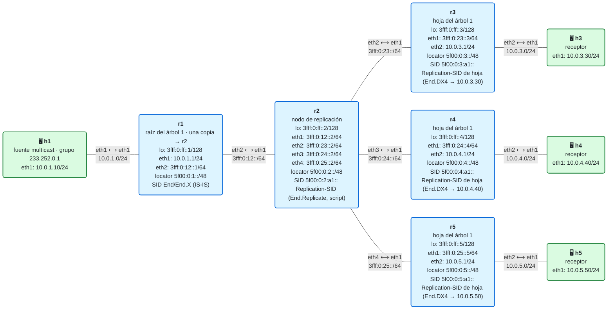

# 20 · Práctica: segmentos de replicación

Antes de empezar, lee la [teoría del módulo](README.md). Los contenedores se llaman `clab-m20-…`. Los comandos con `./` se ejecutan desde la carpeta `lab/`.

## Topología

<!-- topologia:inicio -->

<!-- topologia:fin -->

## Parte A · Ejercicios en papel

**A1.** Una raíz R tiene que llegar a 8 hojas, H1 a H8. Debajo de R hay dos nodos de replicación, A y B; A lleva a H1–H4 y B a H5–H8. Escribe el estado de replicación (las ramas) de R, A y B. ¿Cuántas copias salen de R? ¿Cuántas saldrían con replicación en el ingreso?

**A2.** Supón que B, además de replicar hacia H5–H8, tiene receptores propios en una sede. ¿Qué tipo de nodo es? ¿Qué hace con cada paquete?

**A3.** ¿Por qué `End.Replicate` no envía un ICMPv6 *Time Exceeded* cuando descarta un paquete por el *Hop Limit*? (Pista: piensa en cuántos paquetes hay en el árbol y hacia dónde iría cada error.)

**A4.** Tres canales de TV van a las mismas 8 hojas de A1. ¿Cuántos árboles necesitas como mínimo? ¿Qué problema tiene la hoja para saber de qué canal es cada paquete, y cómo se resuelve?

## Parte B · Levantar y verificar

```
$ cd 20-replication-segments/lab
$ sudo containerlab deploy -t lab.clab.yml
$ ./verificar.sh
```

## Parte C · Ver el árbol funcionar

**C1.** Abre los registros de r1 y r2 y envía un datagrama al grupo:

```
$ docker exec clab-m20-r1 tail -f /tmp/replicacion.log
$ docker exec clab-m20-r2 tail -f /tmp/replicacion.log
$ docker exec clab-m20-h1 bash -c "echo hola | socat -u - UDP4-DATAGRAM:233.252.0.1:5000,ip-multicast-ttl=8"
```

¿Cuántas copias hace cada uno? Compáralo con el módulo 19.

**C2.** Captura con `-v` en r2 (`eth1`, lo que llega de r1) y en r3 (`eth1`, lo que llega de r2). Para cada captura, apunta la dirección de origen, la de destino y el *Hop Limit* (`hlim`) de la cabecera IPv6 exterior. ¿Qué ha cambiado entre una y otra? ¿Qué no ha cambiado?

**C3.** Mira qué tiene el kernel de r2 para su Replication-SID, y qué tiene r3 para el suyo:

```
$ docker exec clab-m20-r2 ip -6 route show 5f00:0:2:a1::
$ docker exec clab-m20-r3 ip -6 route show 5f00:0:3:a1::
```

¿Por qué uno es un `blackhole` y el otro un `End.DX4`? ¿Qué parte de `End.Replicate` hace cada uno?

**C4.** Lee la función `nodo()` de `lab/replicacion/replicacion.py`. Localiza los pasos 2, 3 y 4 de la sección 2 de la teoría.

## Parte D · Cambiar el árbol

**D1.** Quita la rama de r5 del estado de r2 (`lab/replicacion/estado/r2.txt`, pon un `#` delante). Envía un datagrama. ¿Quién deja de recibir? ¿Se ha enterado r1?

**D2.** Ahora haz que r1 llegue a r5 **directamente**, sin pasar por la replicación de r2: añade `rama r5 5f00:0:5:a1::` al estado de r1. Envía un datagrama y mira los registros. ¿Cuántas copias salen de r1? ¿Por qué enlaces pasa la copia de r5? ¿Qué tipo de replicación es esto?

**D3.** Deja el estado de r1 y r2 como estaba.

## Parte E · El ancho de banda

**E1.** Repite la medida de la parte E del módulo 19: los bytes que salen de r1 hacia r2 (`r1 eth2`) y de r2 hacia r3 (`r2 eth2`) mientras h1 envía 200 datagramas de 1000 bytes. ¿Qué proporción hay ahora entre los dos enlaces?

## Parte F · Rómpelo y arréglalo

**F1.** "Cuelga" el nodo de replicación: para el script de r2.

```
$ docker exec clab-m20-r2 pkill -f replicacion.py
```

Envía un datagrama. ¿Quién lo recibe? ¿Sigue r1 enviando su copia? Captura en r2 `eth1`: ¿llega la copia a r2? ¿Qué hace el kernel de r2 con ella?

**F2.** ¿Qué diferencia hay con lo que pasaría si en el módulo 19 se cayera r2? ¿Y si se cayera r1?

**F3.** Vuelve a arrancar el segmento de replicación de r2 y comprueba con `./verificar.sh` que todo vuelve a estar en verde:

```
$ docker exec -d clab-m20-r2 bash -c 'python3 -u /replicacion/replicacion.py r2 >> /tmp/replicacion.log 2>&1'
```

## Al terminar

```
$ sudo containerlab destroy -t lab.clab.yml --cleanup
```

Compara tus respuestas con las [soluciones](soluciones.md).
