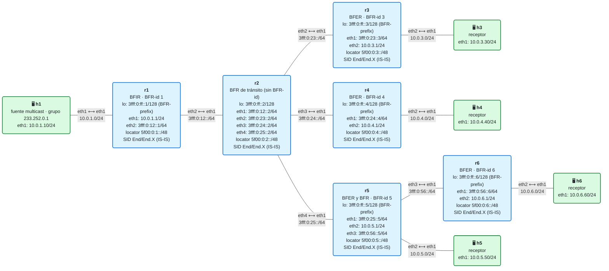
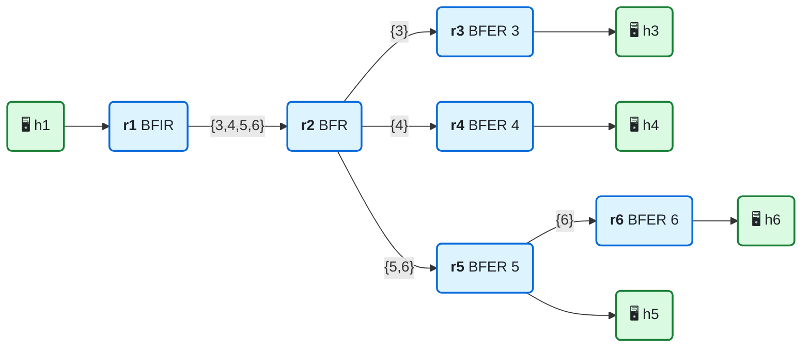
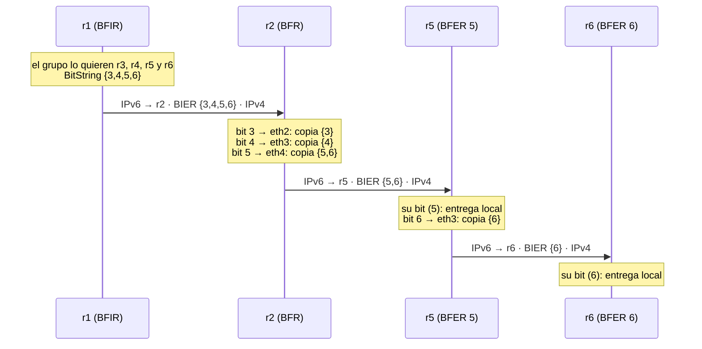
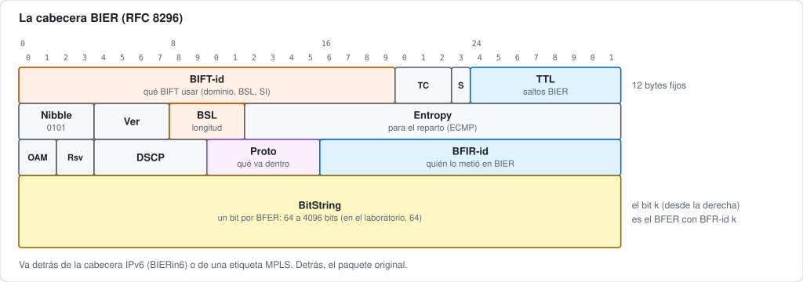

# 21 · BIER: multicast sin estado por árbol

> **Objetivo**: entender **BIER** (*Bit Index Explicit Replication*), la forma de hacer multicast en la que **el paquete lleva la lista de destinos**, como un mapa de bits con una posición por PE de salida. Ningún router guarda estado por grupo ni por árbol: cada uno copia el paquete solo donde los caminos se separan, usando una tabla que sale directamente del IGP.
>
> **Por qué importa para SRv6**: BIER lleva al multicast la misma idea que SR lleva al unicast: **el estado va en el paquete, no en la red**. Con el módulo 19 (sin estado, pero ineficiente) y el 20 (eficiente, pero con estado por árbol), BIER completa el cuadro: eficiente **y** sin estado por flujo. Es el último módulo del Bloque V.

## El laboratorio de este módulo

<!-- topologia:inicio -->

<!-- topologia:fin -->

> El fichero editable para draw.io está en [`lab/topologia.drawio`](lab/topologia.drawio).

Es la red de los módulos 19 y 20 con **un nivel más**: r6 cuelga de r5. Así hay un PE de salida (r5) que, además de entregar, reenvía hacia otro (r6).

| Router | Papel BIER | BFR-id (su bit) |
|---|---|:-:|
| r1 | **BFIR**: mete el multicast en BIER | 1 |
| r2 | **BFR** de tránsito | — |
| r3, r4, r6 | **BFER**: sacan el multicast de BIER y lo entregan | 3, 4, 6 |
| r5 | **BFER** y BFR de tránsito hacia r6 | 5 |

Ni Linux ni FRR tienen BIER, así que cada router ejecuta un pequeño router BIER en Python, `lab/bier/bier.py` (sección 8).

## 1. La idea: un bit por destino

En el módulo 20, la lista de destinos estaba **repartida por la red**: cada nodo de replicación sabía a qué ramas copiar. En BIER, la lista viaja **en el paquete**:

- Cada PE de salida del dominio tiene un número, su **BFR-id**: r3 es el 3, r4 el 4…
- El paquete lleva un **BitString**: un mapa de bits donde el bit *k* encendido significa "esto tiene que llegar al BFER *k*".
- El PE de entrada enciende los bits de los PE que quieren el tráfico. Los demás routers **no saben nada del grupo**: miran el BitString y lo reenvían.

Para que llegue a r3, r4, r5 y r6, r1 envía un único paquete con los bits {3, 4, 5, 6}: el BitString `…0011 1100` (0x3c).

## 2. El vocabulario de BIER

BIER está definido en el [RFC 8279](https://www.rfc-editor.org/rfc/rfc8279) (arquitectura) y el [RFC 8296](https://www.rfc-editor.org/rfc/rfc8296) (cabecera).

| Término | Qué es |
|---|---|
| **BFR** (*Bit-Forwarding Router*) | Cualquier router que reenvía paquetes BIER |
| **BFIR** (*… Ingress Router*) | Donde el tráfico entra en BIER: el PE de entrada |
| **BFER** (*… Egress Router*) | Donde sale: un PE de salida |
| **BFR-id** | El número de un BFER (o BFIR) dentro del dominio. Es la posición de su bit |
| **BFR-prefix** | Una dirección enrutable de cada BFR (normalmente, su loopback). Es lo que se busca en el IGP para saber cómo llegar a él |
| **BitString** | El mapa de bits del paquete. Su longitud (**BSL**) va de 64 a 4096 bits; lo habitual es 256 |
| **SI** (*Set Identifier*) | Si hay más BFER que bits, se agrupan en conjuntos. Cada paquete lleva el BitString de un solo conjunto, así que con dos conjuntos el BFIR envía dos paquetes |
| **BIRT** (*Bit Index Routing Table*) | Para cada BFER: su BFR-prefix y el vecino por el que se llega a él, según el IGP |
| **BIFT** (*Bit Index Forwarding Table*) | La BIRT agrupada por vecino: para cada vecino, la **F-BM** (*Forwarding Bit Mask*), con los bits de todos los BFER que se alcanzan por él |

## 3. La BIFT sale del IGP

Un BFR no necesita ningún protocolo de multicast: su BIFT se construye con lo que ya sabe el IGP. Para cada BFER, mira por qué vecino llega a su BFR-prefix. Los BFER que comparten vecino comparten entrada. La BIFT de r2:

| Vecino | Por | F-BM | Por qué |
|---|---|---|---|
| r3 | `eth2` | {3} | El camino más corto a r3 |
| r4 | `eth3` | {4} | El camino más corto a r4 |
| r5 | `eth4` | **{5, 6}** | A r5 y **también a r6**, que está detrás de r5 |

La BIFT solo cambia si cambia la **topología**, nunca porque alguien se una a un grupo o lo deje. En una red real, los BFR-id se anuncian en el propio IGP (extensiones de IS-IS del [RFC 8401](https://www.rfc-editor.org/rfc/rfc8401)). En el laboratorio están en `lab/bier/dominio.txt`.

## 4. El reenvío, paso a paso

El algoritmo del RFC 8279 (sección 6.5), para un paquete con un BitString:

1. Si el bit del propio router está encendido, se queda **una copia** para entregarla en local y **apaga** su bit.
2. Mientras queden bits encendidos:
   1. Toma el bit más bajo y busca la entrada de la BIFT que lo contiene.
   2. Envía una copia al vecino de esa entrada, con el BitString **`BitString AND F-BM`**: solo los bits de los BFER que hay detrás de ese vecino.
   3. **Apaga** en su BitString todos esos bits (`BitString AND NOT F-BM`), porque ya van en esa copia.

El paso 2.3 garantiza que a cada vecino le llega **una sola copia**, y que **ningún BFER recibe dos**. El 2.2 hace que cada copia lleve solo los bits que le tocan, así que el BitString se va "vaciando" según baja el paquete:



El mismo recorrido, paquete a paquete:



## 5. La cabecera BIER

El [RFC 8296](https://www.rfc-editor.org/rfc/rfc8296) define una sola cabecera, que sirve tanto detrás de una etiqueta MPLS como directamente sobre otras capas:



- **BIFT-id**: qué BIFT usar. Cada combinación de sub-dominio, BSL y SI tiene la suya.
- **TTL**: los saltos BIER que le quedan. Lo resta cada BFR.
- **Proto**: qué hay detrás del BitString: IPv4 (4), IPv6 (6), Ethernet (3)…
- **BFIR-id**: el BFR-id de quien metió el paquete en BIER. El BFER lo usa para saber de dónde viene y, por ejemplo, a qué VPN pertenece.
- **BitString**: los destinos.

## 6. BIER sobre IPv6

BIER es independiente de la red de debajo. Sobre IPv6 hay dos propuestas, y ninguna es todavía un RFC:

| | BIERin6 | BIERv6 |
|---|---|---|
| Documento | [draft-ietf-bier-bierin6](https://datatracker.ietf.org/doc/draft-ietf-bier-bierin6/), del grupo de trabajo BIER del IETF | [draft-xie-bier-ipv6-encapsulation](https://datatracker.ietf.org/doc/draft-xie-bier-ipv6-encapsulation/), individual (caducado en 2021, pero implementado por algunos fabricantes) |
| Dónde va la cabecera BIER | Justo detrás de la IPv6, con un **Next Header "BIER"** (aún sin número asignado) | En una opción de la cabecera de extensión ***Destination Options*** |
| A quién va cada salto | A la dirección **link-local** del vecino, con *Hop Limit* 1 (o a su BFR-prefix, si no es vecino) | Al **`End.BIER`** del siguiente BFR: un SID de su locator SRv6 |
| Relación con SRv6 | Ninguna obligatoria; puede llevar un SID de servicio SRv6 detrás | Usa un SID SRv6 (`End.BIER`) como destino de cada salto |

El laboratorio sigue **BIERin6**: IPv6 hacia la link-local del vecino, *Hop Limit* 1, y la cabecera BIER justo detrás. Como el Next Header de BIER aún no tiene número, usa el **253**, reservado para experimentos ([RFC 3692](https://www.rfc-editor.org/rfc/rfc3692)).

## 7. Los tres enfoques del Bloque V, juntos

| | 19 · En el ingreso | 20 · Segmentos de replicación | 21 · BIER |
|---|---|---|---|
| Copias por enlace | Una por hoja en el primer enlace | Una | Una |
| Qué lleva el paquete | El SID de una hoja | El SID del siguiente nodo de replicación | **La lista de destinos** (BitString) |
| Estado en el núcleo | Ninguno | Por árbol, en los nodos que bifurcan | **Ninguno** por grupo ni por árbol: solo la BIFT, que sale del IGP |
| Si un receptor se va | Cambia el PE de entrada | Cambia el árbol (el controlador) | Cambia **solo el BitString** en el BFIR |
| Si cambia la topología | El IGP reencamina cada copia | El controlador recalcula el árbol | La BIFT se recalcula sola con el IGP |
| Límite | El ancho de banda | El estado y el controlador | El tamaño del BitString: más BFER que bits obliga a usar varios conjuntos (SI) y a enviar varias copias |
| Qué necesita en los P | Nada | `End.Replicate` | BIER en **todos** los routers del camino (o túneles entre BFR) |

Este último punto es el gran obstáculo de BIER: hace falta que los routers sepan reenviarlo, normalmente en hardware. Por eso se despliega poco a poco, y por eso existen propuestas como BIER-TE ([RFC 9262](https://www.rfc-editor.org/rfc/rfc9262)), en la que los bits representan enlaces en lugar de destinos, para hacer ingeniería de tráfico.

Para dar servicios, BIER se combina con un **overlay** que le dice al BFIR qué BFER quieren cada flujo: MVPN ([RFC 8556](https://www.rfc-editor.org/rfc/rfc8556)) o EVPN, igual que en el módulo 19.

## 8. Cómo está montado el laboratorio (y por qué así)

Cada router ejecuta `lab/bier/bier.py`, unas 200 líneas comentadas, con las tres partes de un BFR:

1. **Su BIFT, con el IGP.** Cada 5 segundos, para cada BFER de `dominio.txt`, pregunta al kernel (`ip -6 route get <BFR-prefix>`) por qué vecino y por qué interfaz se llega. Agrupa por vecino y calcula las F-BM. La BIFT queda en `/tmp/bift.txt`.
2. **El reenvío.** Recibe los paquetes con Next Header 253 por un socket IPv6 en bruto y aplica el algoritmo de la sección 4. Cada copia sale hacia la link-local del vecino, con *Hop Limit* 1.
3. **El papel de BFIR** (solo r1). Captura el multicast que llega de h1 y lo encapsula con los bits de los BFER que, según `entrada-r1.txt`, quieren el grupo.

Cuando un BFER encuentra su bit, entrega el paquete IPv4 a su receptor con un socket IPv4 en bruto, como hacía el `End.DX4` de los módulos 19 y 20. Cada router escribe en `/tmp/bier.log` lo que hace con cada paquete.

Fíjate en que **r2 no aparece en `dominio.txt`**: los BFR de tránsito no necesitan BFR-id. Solo hace falta para los que entran o salen del dominio.

## 9. Lo que FRR y Linux no hacen

| Pieza | En un router comercial | ¿En FRR 10.7.1 / Linux? | En este laboratorio |
|---|---|---|---|
| Reenvío BIER (RFC 8279) | Sí, en hardware | ❌ | `bier.py` en cada router |
| BFR-id anunciados por IS-IS (RFC 8401) | Sí | ❌ | `dominio.txt` |
| BIERin6 o BIERv6 | En algunas plataformas (BIERv6, sobre todo) | ❌ | Estilo BIERin6, con Next Header 253 |
| MVPN o EVPN sobre BIER (el overlay) | Sí | ❌ | `entrada-r1.txt` |
| BIER-TE (RFC 9262) | En pocas plataformas | ❌ | Solo teoría |

Si quieres ir más allá, BIER se ha implementado en **P4**, el lenguaje para programar el plano de datos de un switch (por ejemplo, el trabajo *P4-Based Implementation of BIER and BIER-FRR* de la Universidad de Tubinga). Montarlo con el software de referencia de P4 (`bmv2`) es un buen ejercicio, pero queda fuera de este curso.

## 10. Inspeccionar

```bash
# La BIFT de cada router (calculada con las rutas de IS-IS)
docker exec clab-m21-r2 cat /tmp/bift.txt
docker exec clab-m21-r2 ip -6 route get 3fff:0:ff::6      # ¿por dónde se llega a r6?

# Lo que hace cada router con cada paquete
docker exec clab-m21-r2 tail -f /tmp/bier.log

# Enviar un datagrama al grupo
docker exec clab-m21-h1 bash -c "echo hola | socat -u - UDP4-DATAGRAM:233.252.0.1:5000,ip-multicast-ttl=8"

# Un paquete BIER en el cable, en hexadecimal (el BitString va en los bytes 52 a 59)
docker run --rm -it --net container:clab-m21-r5 nicolaka/netshoot:v0.13 tcpdump -ni eth1 -x 'ip6 proto 253'
```

## 11. Resumen

- En BIER, el paquete lleva **la lista de destinos**: un **BitString** con un bit por BFER.
- Cada BFR tiene una **BIFT** que sale del IGP: por cada vecino, la **F-BM** con los bits de los BFER que hay detrás.
- Reenviar es copiar por cada vecino necesario con `BitString AND F-BM` y apagar esos bits. Cada enlace lleva una sola copia y ningún BFER recibe dos.
- **Ningún router guarda estado por grupo ni por árbol.** Que un receptor se vaya solo cambia el BitString en el BFIR.
- Sobre IPv6 hay dos propuestas, **BIERin6** y **BIERv6**, aún en borrador. Ni FRR ni Linux implementan BIER: el laboratorio lo hace con un script por router.

## Siguiente paso

Con este módulo terminas el Bloque V y el temario principal del curso. Para ver todo junto en casos de uso completos, sigue con el **[anexo de escenarios](../anexo-escenarios/README.md)**.

## Para saber más

- [RFC 8279 · Multicast Using Bit Index Explicit Replication (BIER)](https://www.rfc-editor.org/rfc/rfc8279) — la arquitectura y el algoritmo de reenvío
- [RFC 8296 · Encapsulation for BIER in MPLS and Non-MPLS Networks](https://www.rfc-editor.org/rfc/rfc8296) — la cabecera
- [RFC 8401 · BIER Support via IS-IS](https://www.rfc-editor.org/rfc/rfc8401)
- [RFC 8556 · Multicast VPN Using BIER](https://www.rfc-editor.org/rfc/rfc8556)
- [RFC 9262 · Tree Engineering for BIER (BIER-TE)](https://www.rfc-editor.org/rfc/rfc9262)
- [draft-ietf-bier-bierin6 · Supporting BIER in IPv6 Networks](https://datatracker.ietf.org/doc/draft-ietf-bier-bierin6/)
- [draft-xie-bier-ipv6-encapsulation · BIERv6](https://datatracker.ietf.org/doc/draft-xie-bier-ipv6-encapsulation/)
