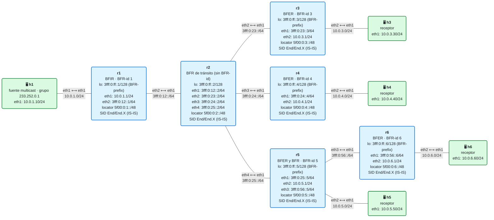

# 21 · Práctica: BIER

Antes de empezar, lee la [teoría del módulo](README.md). Los contenedores se llaman `clab-m21-…`. Los comandos con `./` se ejecutan desde la carpeta `lab/`.

## Topología

<!-- topologia:inicio -->

<!-- topologia:fin -->

## Parte A · Ejercicios en papel

**A1.** Escribe en binario y en hexadecimal el BitString de un paquete para los BFER 3 y 6. ¿Y para los BFER 1, 2 y 64, con un BitString de 64 bits?

**A2.** Escribe la BIFT de r5 (vecinos, interfaces y F-BM) y la de r1. Ten en cuenta que en el dominio también está r1, con BFR-id 1.

**A3.** A r2 le llega un paquete con el BitString {4, 6}. Aplica el algoritmo de la sección 4: ¿cuántas copias envía, por dónde y con qué BitString cada una?

**A4.** Una red tiene 1000 PE de salida y usa un BitString de 256 bits. ¿Cuántos conjuntos (SI) hacen falta? Si un grupo tiene un receptor en cada uno de los 1000 PE, ¿cuántos paquetes envía el BFIR por cada paquete del grupo? ¿Y si los receptores están todos en los PE 1 a 200?

**A5.** En el módulo 20, si un receptor de r4 se iba, ¿qué había que cambiar? ¿Y aquí?

## Parte B · Levantar y verificar

```
$ cd 21-bier/lab
$ sudo containerlab deploy -t lab.clab.yml
$ ./verificar.sh
```

## Parte C · La BIFT

**C1.** Mira la BIFT de r1, r2 y r5 (`cat /tmp/bift.txt`) y compárala con lo que escribiste en A2.

**C2.** Comprueba de dónde sale la entrada {5, 6} de r2:

```
$ docker exec clab-m21-r2 ip -6 route get 3fff:0:ff::5
$ docker exec clab-m21-r2 ip -6 route get 3fff:0:ff::6
```

¿Qué tienen en común las dos rutas?

**C3.** ¿Por qué no hay ninguna entrada para r2 en ninguna BIFT? ¿Qué pasaría si quisieras poner un receptor detrás de r2?

## Parte D · El BitString en el cable

**D1.** Abre el registro de r2 y de r5 y envía un datagrama:

```
$ docker exec clab-m21-r2 tail -f /tmp/bier.log
$ docker exec clab-m21-h1 bash -c "echo hola | socat -u - UDP4-DATAGRAM:233.252.0.1:5000,ip-multicast-ttl=8"
```

Compara lo que hace cada uno con tu respuesta a A3 y con la sección 4 de la teoría.

**D2.** Captura en r5 (`eth1`) con `-x` mientras envías otro datagrama. Localiza en el volcado hexadecimal:
- el Next Header de la cabecera IPv6 (byte 6);
- el *Hop Limit* (byte 7) y las direcciones de origen y destino: ¿qué tipo de direcciones son?;
- el TTL BIER (byte 43), el campo Proto y el BFIR-id;
- el BitString (bytes 52 a 59).

**D3.** Haz lo mismo en r6 (`eth1`). ¿Qué ha cambiado en el BitString? ¿Y en el TTL BIER?

## Parte E · Cambiar los receptores

**E1.** El receptor de r4 se va. En `lab/bier/entrada-r1.txt`, quita `r4` de la línea del grupo. Envía un datagrama. ¿Qué BitString pone r1? Captura en r2 `eth1` para comprobarlo.

**E2.** Mira la BIFT de r2 antes y después del cambio. ¿Ha cambiado algo? ¿Y en el módulo 20, cuando quitaste una rama?

**E3.** Ahora quita también `r5`, pero deja `r6`. ¿Qué hace r5 con el paquete? ¿Lo entrega a h5? Míralo en su registro. Deja el fichero como estaba.

## Parte F · Rómpelo y arréglalo

**F1.** Para el router BIER de r5:

```
$ docker exec clab-m21-r5 pkill -f bier.py
```

Envía un datagrama. ¿Quién lo recibe y quién no? ¿Ha cambiado algo en las BIFT de r1 y r2? ¿Por qué el IGP no lo arregla?

**F2.** ¿Qué pasaría si, en vez de parar el script, se cayera el enlace r2–r5? (Pista: piensa en qué ve IS-IS y en cuándo se recalcula la BIFT de r2.)

**F3.** Vuelve a arrancar el router BIER de r5 y comprueba con `./verificar.sh` que todo vuelve a estar en verde:

```
$ docker exec -d clab-m21-r5 bash -c 'python3 -u /bier/bier.py r5 >> /tmp/bier.log 2>&1'
```

## Al terminar

```
$ sudo containerlab destroy -t lab.clab.yml --cleanup
```

Compara tus respuestas con las [soluciones](soluciones.md).
