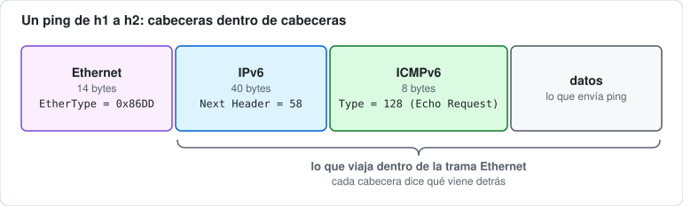
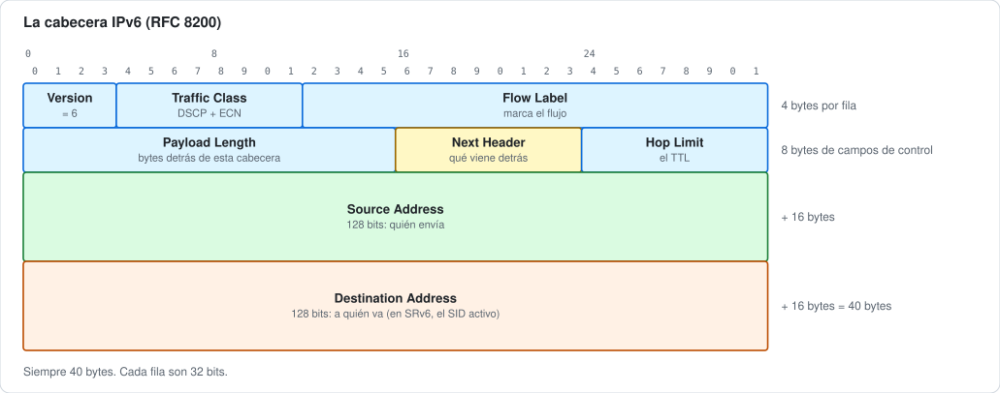
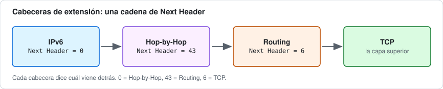
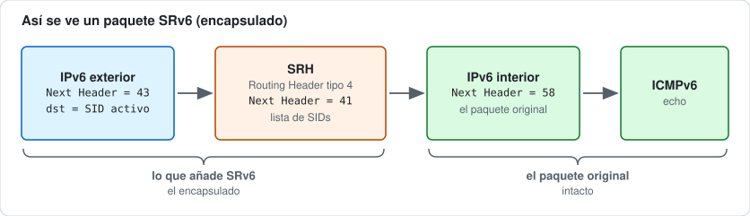
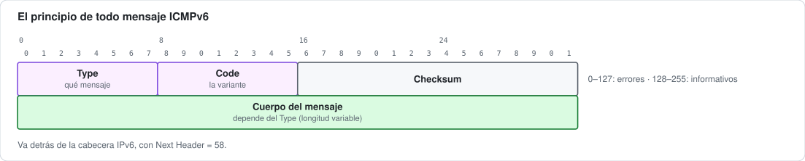
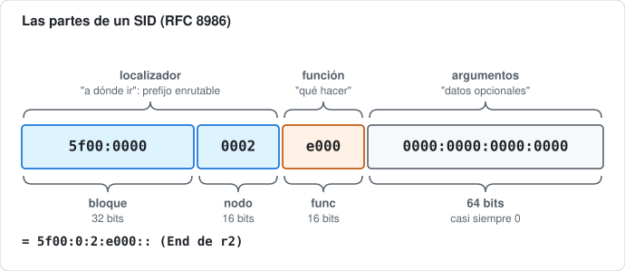
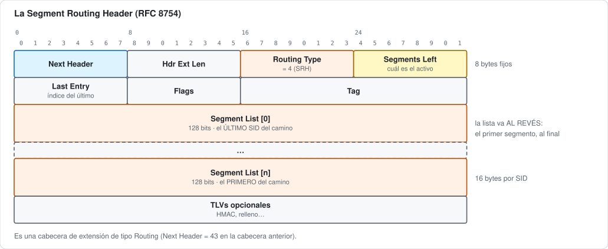
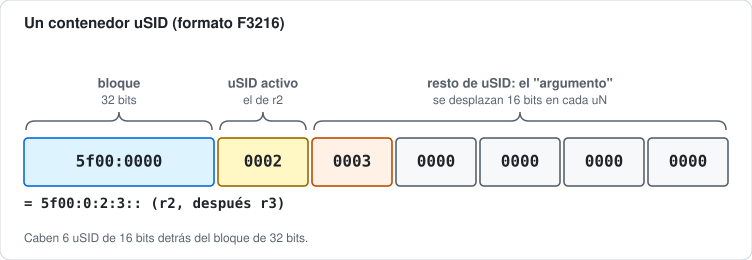
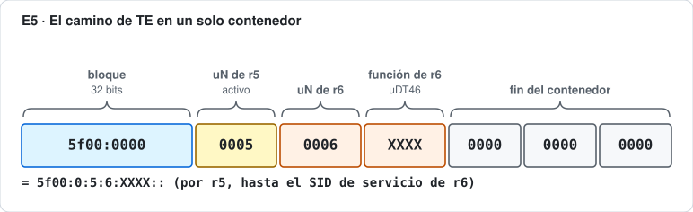

# 🗺️ Índice de esquemas, diagramas y topologías

Todo lo que se puede **ver** en el curso, en un solo sitio: cada entrada enlaza a la sección donde se explica.

- [Figuras](#figuras): formatos de cabeceras, paquetes y direcciones (SVG).
- [Diagramas](#diagramas): el viaje de un paquete, estados y grafos (Mermaid).
- [Topologías de los laboratorios](#topologías-de-los-laboratorios): el esquema de cada laboratorio, con su fichero de draw.io.

> Este índice lo genera `python3 herramientas/indice-esquemas.py`. Las figuras SVG salen de `herramientas/esquemas.py`, y los esquemas de topología, de `herramientas/topologia.py`. Si añades un diagrama, vuelve a ejecutar el script.

## Figuras

| | Figura | Dónde |
|---|---|---|
|  | **Un ping de h1 a h2: Ethernet, IPv6, ICMPv6 y datos** | [02 · La cabecera IPv6 y las cabeceras de extensión](02-cabecera-ipv6/README.md#1-un-paquete-son-cabeceras-dentro-de-cabeceras) 1. Un paquete son cabeceras dentro de cabeceras |
|  | **La cabecera IPv6 campo a campo, 32 bits por fila** | [02 · La cabecera IPv6 y las cabeceras de extensión](02-cabecera-ipv6/README.md#2-la-cabecera-ipv6-campo-a-campo) 2. La cabecera IPv6, campo a campo |
|  | **Cadena de cabeceras de extensión: IPv6, Hop-by-Hop, Routing y TCP** | [02 · La cabecera IPv6 y las cabeceras de extensión](02-cabecera-ipv6/README.md#3-las-cabeceras-de-extensión) 3. Las cabeceras de extensión |
|  | **Un paquete SRv6: IPv6 exterior, SRH, IPv6 interior e ICMPv6** | [02 · La cabecera IPv6 y las cabeceras de extensión](02-cabecera-ipv6/README.md#6-así-se-ve-un-paquete-srv6) 6. Así se ve un paquete SRv6 |
|  | **Cabecera ICMPv6: Type, Code, Checksum y cuerpo** | [03 · ICMPv6 y Neighbor Discovery](03-icmpv6-nd/README.md#formato-de-un-mensaje-icmpv6) Formato de un mensaje ICMPv6 |
|  | **El NET de IS-IS: AFI, área, System ID y NSEL** | [05 · IS-IS para IPv6](05-isis/README.md#direcciones-de-is-is-el-net) Direcciones de IS-IS: el NET |
|  | **Las partes de un SID: bloque, nodo, función y argumentos** | [07 · El SID y la Segment Routing Header](07-sid-srh/README.md#1-el-sid-una-dirección-que-es-una-instrucción) 1. El SID: una dirección que es una instrucción |
|  | **La Segment Routing Header campo a campo** | [07 · El SID y la Segment Routing Header](07-sid-srh/README.md#3-la-segment-routing-header-srh) 3. La Segment Routing Header (SRH) |
|  | **Sobrecarga de SRv6: IPv6 exterior, SRH y paquete original** | [09 · Reducción de cabeceras: H.Encaps.Red y los flavors PSP/USP/USD](09-reduccion-cabeceras/README.md#1-el-problema-srv6-engorda-cada-paquete) 1. El problema: SRv6 engorda cada paquete |
|  | **Un contenedor uSID: bloque, uSID activo y resto de uSID** | [10 · uSID: SIDs comprimidos (NEXT-C-SID)](10-usid/README.md#2-la-idea-varios-micro-sid-dentro-de-una-dirección) 2. La idea: varios micro-SID dentro de una dirección |
|  | **El contenedor de TE de E5: bloque, uN de r5, uN de r6 y función de r6** | [E5 · Compresión uSID y migración desde SIDs clásicos](anexo-escenarios/E5-usid-migracion/README.md#parte-1-el-camino-entero-en-un-contenedor) Parte 1: el camino entero en un contenedor |

## Diagramas

| Diagrama | Tipo | Dónde |
|---|---|---|
| [Descubrimiento de la MTU del camino y fragmentación en el origen](02-cabecera-ipv6/README.md#5-fragmentación-y-mtu-del-camino) | secuencia | 02 · La cabecera IPv6 y las cabeceras de extensión · 5. Fragmentación y MTU del camino |
| [Resolución de direcciones con Neighbor Solicitation y Neighbor Advertisement](03-icmpv6-nd/README.md#el-intercambio-completo) | secuencia | 03 · ICMPv6 y Neighbor Discovery · El intercambio completo |
| [Estados de una entrada de la caché de vecinos (RFC 4861)](03-icmpv6-nd/README.md#4-la-caché-de-vecinos-y-sus-estados) | estados | 03 · ICMPv6 y Neighbor Discovery · 4. La caché de vecinos y sus estados |
| [SPF en un triángulo: el enlace directo gana](05-isis/README.md#7-spf-el-cálculo-del-camino-más-corto) | grafo | 05 · IS-IS para IPv6 · 7. SPF: el cálculo del camino más corto |
| [MPLS clásico frente a Segment Routing: dónde vive el estado](06-mpls-a-sr/README.md#4-la-idea-de-segment-routing) | grafo | 06 · De MPLS a Segment Routing: el porqué · 4. La idea de Segment Routing |
| [El laboratorio del módulo 08: IPv4 sobre un núcleo IPv6 con H.Encaps, End y End.DX4](08-network-programming/README.md#5-el-ejemplo-del-laboratorio-ipv4-sobre-un-núcleo-ipv6) | secuencia | 08 · Network programming con iproute2 · 5. El ejemplo del laboratorio: IPv4 sobre un núcleo IPv6 |
| [Sin PSP: la SRH gastada viaja hasta el último salto](09-reduccion-cabeceras/README.md#psp--el-penúltimo-quita-la-srh) | secuencia | 09 · Reducción de cabeceras: H.Encaps.Red y los flavors PSP/USP/USD · PSP — el penúltimo quita la SRH |
| [Con PSP: el penúltimo salto quita la SRH](09-reduccion-cabeceras/README.md#psp--el-penúltimo-quita-la-srh) | secuencia | 09 · Reducción de cabeceras: H.Encaps.Red y los flavors PSP/USP/USD · PSP — el penúltimo quita la SRH |
| [uN: cada router consume su uSID y desplaza el resto](10-usid/README.md#3-un-consumir-y-desplazar) | secuencia | 10 · uSID: SIDs comprimidos (NEXT-C-SID) · 3. uN: "consumir y desplazar" |
| [El viaje de un paquete de la L3VPN IPv4, de h1 a h2](12-l3vpn-bgp/README.md#5-el-viaje-de-un-paquete-de-h1-a-h2) | secuencia | 12 · L3VPN IPv4 sobre SRv6 con BGP (End.DT4) · 5. El viaje de un paquete, de h1 a h2 |
| [El viaje de un paquete de la L3VPN dual-stack (IPv4 o IPv6, da igual)](13-l3vpn-dualstack/README.md#5-el-viaje-de-un-paquete-ipv4-o-ipv6-da-igual) | secuencia | 13 · L3VPN IPv6 y dual-stack (End.DT6 / End.DT46) · 5. El viaje de un paquete (IPv4 o IPv6, da igual) |
| [La red del ejemplo de Flex-Algo](16-flex-algo/README.md#el-ejemplo-de-este-módulo) | grafo | 16 · Flex-Algo: varios "caminos más cortos" sobre la misma red · El ejemplo de este módulo |
| [La red de los ejercicios de Flex-Algo](16-flex-algo/ejercicios.md#la-red) | grafo | 16 · Flex-Algo: varios "caminos más cortos" sobre la misma red · La red |
| [Replicación en el ingreso: una copia por hoja desde el PE de entrada](19-replicacion-ingreso/README.md#3-la-replicación-en-el-ingreso) | grafo | 19 · Multicast en una red SRv6: el problema y la replicación en el ingreso · 3. La replicación en el ingreso |
| [El viaje de un paquete multicast con replicación en el ingreso](19-replicacion-ingreso/README.md#4-el-viaje-de-un-paquete) | secuencia | 19 · Multicast en una red SRv6: el problema y la replicación en el ingreso · 4. El viaje de un paquete |
| [Un paquete multicast bajando por el árbol de segmentos de replicación](20-replication-segments/README.md#2-endreplicate-paso-a-paso) | secuencia | 20 · Segmentos de replicación (RFC 9524): un árbol multicast sobre SRv6 · 2. `End.Replicate`, paso a paso |
| [Copias por enlace: replicación en el ingreso (módulo 19) frente a un árbol (módulo 20)](20-replication-segments/README.md#3-un-árbol-son-segmentos-cosidos) | grafo | 20 · Segmentos de replicación (RFC 9524): un árbol multicast sobre SRv6 · 3. Un árbol son segmentos cosidos |
| [Viaje de un ping de h1 al servidor web](anexo-escenarios/E0-internet/README.md#3-la-solución-con-srv6) | secuencia | E0 · Internet sobre SRv6 · 3. La solución con SRv6 |
| [Sesiones iBGP con el route reflector](anexo-escenarios/E1-multisede/README.md#3-la-solución-con-srv6) | grafo | E1 · Cliente multisede: L3VPN con route reflector y UCMP · 3. La solución con SRv6 |
| [Opción C: el paquete de punta a punta](anexo-escenarios/E2-inter-as/README.md#opción-c-un-túnel-srv6-de-punta-a-punta) | secuencia | E2 · Dos operadores: L3VPN entre sistemas autónomos (Inter-AS) · Opción C: un túnel SRv6 de punta a punta |
| [Recorrido de un paquete por el proxy SR y el firewall](anexo-escenarios/E6-sfc/README.md#el-proxy-de-r4-pieza-a-pieza) | grafo | E6 · Service chaining: el tráfico del cliente pasa por un firewall · El proxy de r4, pieza a pieza |
| [Cómo el controlador lee la red y programa los PE](anexo-escenarios/E7-controlador/README.md#3-la-solución) | grafo | E7 · Ingeniería de tráfico con un controlador: BGP-LS y un script en Python · 3. La solución |

## Topologías de los laboratorios

| Módulo o escenario | Laboratorio | Esquema | draw.io |
|---|---|---|---|
| 01 · La dirección IPv6 | `lab` | [ver](01-direccion-ipv6/README.md#el-laboratorio-de-este-módulo) | [editar](01-direccion-ipv6/lab/topologia.drawio) |
| 02 · La cabecera IPv6 y las cabeceras de extensión | `lab` | [ver](02-cabecera-ipv6/README.md#el-laboratorio-de-este-módulo) | [editar](02-cabecera-ipv6/lab/topologia.drawio) |
| 03 · ICMPv6 y Neighbor Discovery | `lab` | [ver](03-icmpv6-nd/README.md#el-laboratorio-de-este-módulo) | [editar](03-icmpv6-nd/lab/topologia.drawio) |
| 04 · Enrutamiento IPv6: rutas estáticas y longest-prefix match | `lab` | [ver](04-enrutamiento/README.md#el-laboratorio-de-este-módulo) | [editar](04-enrutamiento/lab/topologia.drawio) |
| 05 · IS-IS para IPv6 | `lab` | [ver](05-isis/README.md#el-laboratorio-de-este-módulo) | [editar](05-isis/lab/topologia.drawio) |
| 07 · El SID y la Segment Routing Header | `lab` | [ver](07-sid-srh/README.md#el-laboratorio-de-este-módulo) | [editar](07-sid-srh/lab/topologia.drawio) |
| 08 · Network programming con iproute2 | `lab` | [ver](08-network-programming/README.md#el-laboratorio-de-este-módulo) | [editar](08-network-programming/lab/topologia.drawio) |
| 09 · Reducción de cabeceras: H.Encaps.Red y los flavors PSP/USP/USD | `lab` | [ver](09-reduccion-cabeceras/README.md#el-laboratorio-de-este-módulo) | [editar](09-reduccion-cabeceras/lab/topologia.drawio) |
| 10 · uSID: SIDs comprimidos (NEXT-C-SID) | `lab` | [ver](10-usid/README.md#el-laboratorio-de-este-módulo) | [editar](10-usid/lab/topologia.drawio) |
| 11 · IS-IS con SRv6: el plano de control | `lab` | [ver](11-isis-srv6/README.md#el-laboratorio-de-este-módulo) | [editar](11-isis-srv6/lab/topologia.drawio) |
| 12 · L3VPN IPv4 sobre SRv6 con BGP (End.DT4) | `lab` | [ver](12-l3vpn-bgp/README.md#el-laboratorio-de-este-módulo) | [editar](12-l3vpn-bgp/lab/topologia.drawio) |
| 13 · L3VPN IPv6 y dual-stack (End.DT6 / End.DT46) | `lab` | [ver](13-l3vpn-dualstack/README.md#el-laboratorio-de-este-módulo) | [editar](13-l3vpn-dualstack/lab/topologia.drawio) |
| 14 · Ingeniería de tráfico con SRv6 | `lab` | [ver](14-te-srv6/README.md#el-laboratorio-de-este-módulo) | [editar](14-te-srv6/lab/topologia.drawio) |
| 15 · Resiliencia: TI-LFA | `lab` | [ver](15-tilfa/README.md#el-laboratorio-de-este-módulo) | [editar](15-tilfa/lab/topologia.drawio) |
| 17 · OAM y troubleshooting | `lab` | [ver](17-oam/README.md#el-laboratorio-de-este-módulo) | [editar](17-oam/lab/topologia.drawio) |
| 18 · MTU, seguridad y filtrado de SRv6 en el borde | `lab` | [ver](18-mtu-seguridad/README.md#el-laboratorio-de-este-módulo) | [editar](18-mtu-seguridad/lab/topologia.drawio) |
| 19 · Multicast en una red SRv6: el problema y la replicación en el ingreso | `lab` | [ver](19-replicacion-ingreso/README.md#el-laboratorio-de-este-módulo) | [editar](19-replicacion-ingreso/lab/topologia.drawio) |
| 20 · Segmentos de replicación (RFC 9524): un árbol multicast sobre SRv6 | `lab` | [ver](20-replication-segments/README.md#el-laboratorio-de-este-módulo) | [editar](20-replication-segments/lab/topologia.drawio) |
| Base · Topología base de los escenarios | `lab` | [ver](anexo-escenarios/topologia-base/README.md#topología-base-de-los-escenarios) | [editar](anexo-escenarios/topologia-base/lab/topologia.drawio) |
| E0 · Internet sobre SRv6 | `lab-vrf` | [ver](anexo-escenarios/E0-internet/README.md#5-parte-1--internet-en-una-vrf) | [editar](anexo-escenarios/E0-internet/lab-vrf/topologia.drawio) |
| E0 · Internet sobre SRv6 | `lab-global` | [ver](anexo-escenarios/E0-internet/README.md#6-parte-2--internet-en-la-tabla-global) | [editar](anexo-escenarios/E0-internet/lab-global/topologia.drawio) |
| E1 · Cliente multisede: L3VPN con route reflector y UCMP | `lab` | [ver](anexo-escenarios/E1-multisede/README.md#el-escenario) | [editar](anexo-escenarios/E1-multisede/lab/topologia.drawio) |
| E2 · Dos operadores: L3VPN entre sistemas autónomos (Inter-AS) | `lab-opcion-a` | [ver](anexo-escenarios/E2-inter-as/README.md#opción-a-vrf-contra-vrf) | [editar](anexo-escenarios/E2-inter-as/lab-opcion-a/topologia.drawio) |
| E2 · Dos operadores: L3VPN entre sistemas autónomos (Inter-AS) | `lab-opcion-c` | [ver](anexo-escenarios/E2-inter-as/README.md#opción-c-un-túnel-srv6-de-punta-a-punta) | [editar](anexo-escenarios/E2-inter-as/lab-opcion-c/topologia.drawio) |
| E3 · EVPN sobre SRv6: servicios de capa 2 y capa 3 | `lab` | [ver](anexo-escenarios/E3-evpn/README.md#el-escenario) | [editar](anexo-escenarios/E3-evpn/lab/topologia.drawio) |
| E4 · Network slicing: dos rebanadas con SLA distinto sobre el mismo núcleo | `lab` | [ver](anexo-escenarios/E4-slicing/README.md#el-escenario) | [editar](anexo-escenarios/E4-slicing/lab/topologia.drawio) |
| E5 · Compresión uSID y migración desde SIDs clásicos | `lab-usid` | [ver](anexo-escenarios/E5-usid-migracion/README.md#parte-1-toda-la-red-con-usid) | [editar](anexo-escenarios/E5-usid-migracion/lab-usid/topologia.drawio) |
| E5 · Compresión uSID y migración desde SIDs clásicos | `lab-migracion` | [ver](anexo-escenarios/E5-usid-migracion/README.md#parte-2-una-red-a-medio-migrar) | [editar](anexo-escenarios/E5-usid-migracion/lab-migracion/topologia.drawio) |
| E6 · Service chaining: el tráfico del cliente pasa por un firewall | `lab` | [ver](anexo-escenarios/E6-sfc/README.md#el-escenario) | [editar](anexo-escenarios/E6-sfc/lab/topologia.drawio) |
| E7 · Ingeniería de tráfico con un controlador: BGP-LS y un script en Python | `lab` | [ver](anexo-escenarios/E7-controlador/README.md#el-escenario) | [editar](anexo-escenarios/E7-controlador/lab/topologia.drawio) |
