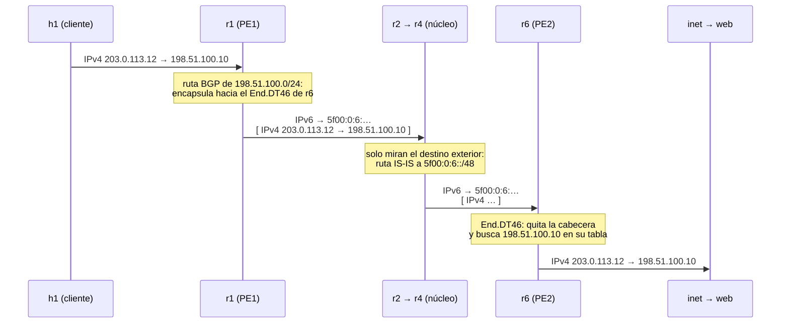

# E0 · Internet sobre SRv6

> **El caso en una frase**: un operador da acceso a Internet, IPv4 e IPv6, a un cliente, y quiere que los routers de su núcleo **no tengan que conocer la tabla de Internet**.
>
> **Requisitos previos**: módulos [11](../../11-isis-srv6/README.md) (IS-IS con SRv6), [12](../../12-l3vpn-bgp/README.md) y [13](../../13-l3vpn-dualstack/README.md) (L3VPN), [14](../../14-te-srv6/README.md) (ingeniería de tráfico) y [17](../../17-oam/README.md) (troubleshooting) · Probado con containerlab 0.82.0 sobre OrbStack, FRR 10.7.1 y netshoot v0.13 (parte 1: 20/20 comprobaciones; parte 2: 24/24) · Estado: ✅

## El escenario

Parte de la [topología base](../topologia-base/README.md) y le añade, en el enganche previsto de r6 (`eth5`), un router **upstream** que hace de Internet (`inet`, AS 64496) y, detrás de él, un **servidor web**. El cliente es h1, conectado a r1, que en este escenario tiene **direcciones públicas** en lugar de las privadas de la base. El resto de la base (VLAN 100, sede BLUE-2) está cableado pero no se usa.

El escenario se resuelve de dos formas, cada una con su laboratorio:

| Parte | Dónde vive Internet en los PE | Laboratorio | Requiere |
|---|---|---|---|
| **1** | En una **VRF** `INTERNET`, como una L3VPN más | [`lab-vrf/`](lab-vrf) | Lo visto en los módulos 12 y 13 |
| **2** | En la **tabla global** | [`lab-global/`](lab-global) | FRR ≥ 10.6 (`sid export`); con un único SID para IPv4 e IPv6, FRR ≥ 10.7 |

Haz la [práctica](practica.md) después de leer este planteamiento.

## 1. El caso de uso

Un operador, **AS 64500**, tiene la red de la topología base. Uno de sus clientes es una empresa que le compra **acceso a Internet**: el operador le ha asignado el bloque `203.0.113.0/24` y el `3fff:203:0:113::/64`, y el cliente se conecta a **r1**.

El operador recibe Internet de un proveedor de tránsito, el **AS 64496**, conectado a **r6**. Por esa sesión eBGP le llega la tabla de Internet: hoy, del orden de **un millón de rutas IPv4** y **más de doscientas mil IPv6**. En el laboratorio, el upstream anuncia solo dos redes (`198.51.100.0/24` y `3fff:198:51:100::/64`, donde está el servidor web), pero el razonamiento es el mismo que con la tabla completa.

El operador quiere:

- Que su cliente llegue a Internet por IPv4 e IPv6, y que Internet le llegue a él.
- Que los **routers del núcleo** (r2–r5) **no** tengan que cargar con la tabla de Internet. Un router que guarda un millón de rutas necesita mucha memoria y una tabla de reenvío grande; si el núcleo solo tiene que conocer unas pocas decenas de rutas internas, puede ser más sencillo y barato, y converge antes.
- Y que, si un día quiere sacar parte del tráfico por otro camino del núcleo, pueda hacerlo.

## 2. Criterios de éxito

Cada criterio es una comprobación de `verificar.sh` (en las dos partes, salvo el 7):

- [ ] **1.** El operador recibe Internet por r6: sesiones eBGP con el upstream (IPv4 e IPv6) y sesión iBGP entre r1 y r6.
- [ ] **2.** Cada PE (r1 y r6) tiene instalado su **SID de servicio**.
- [ ] **3.** r1 llega a las redes de Internet **encapsulando en SRv6** hacia un SID de r6.
- [ ] **4.** Internet (el upstream) conoce el bloque del cliente, en IPv4 e IPv6.
- [ ] **5.** **Núcleo sin BGP**: ningún P tiene BGP configurado ni conoce rutas de Internet.
- [ ] **6.** El cliente llega al servidor web, y el servidor al cliente, por IPv4 e IPv6, y el tráfico cruza el núcleo encapsulado.
- [ ] **7.** (Solo parte 2) El tráfico hacia una red concreta de Internet se puede **forzar por otro camino** del núcleo.

## 3. La solución con SRv6

La idea se llama **núcleo sin BGP** (*BGP-free core*), y es la misma que hace funcionar una L3VPN (módulo 12):

1. **Solo los PE hablan BGP.** r6 aprende Internet del upstream por eBGP y se lo pasa a r1 por iBGP. r1 le pasa a r6 el bloque del cliente.
2. **Cada PE pega a sus rutas un SID de servicio.** Cuando r6 anuncia `198.51.100.0/24` a r1, lo acompaña de un SID suyo, un `End.DT46`: *"para llegar a esta red, encapsula hacia este SID y yo me encargo"*. r1 hace lo mismo con el bloque del cliente.
3. **El PE de entrada encapsula.** Un paquete de h1 hacia el servidor web llega a r1, que lo mete dentro de una cabecera IPv6 con destino el SID de r6.
4. **El núcleo solo ve el locator.** r2 y r4 reenvían ese paquete como cualquier otro paquete IPv6, por su ruta IS-IS hacia `5f00:0:6::/48`, el locator de r6. No saben nada de Internet.
5. **El PE de salida desencapsula.** r6 recibe un paquete dirigido a su `End.DT46`: le quita la cabecera exterior, busca el destino original (`198.51.100.10`) en su tabla y lo entrega al upstream.

El viaje de un ping de h1 al servidor web:



La vuelta es simétrica: r6 encapsula hacia el `End.DT46` de r1.

> **Lo mismo que hacía MPLS.** Un núcleo sin BGP no es nuevo: los operadores lo hacen desde hace décadas con MPLS, donde el PE de entrada pone una etiqueta LDP hacia el PE de salida (módulo 06). SRv6 consigue lo mismo sin LDP ni etiquetas: el "túnel" es una dirección IPv6, y el núcleo solo necesita IS-IS.

### Dos sitios donde poner Internet

En el PE, Internet puede vivir en dos sitios, y por eso el escenario tiene dos partes:

- **Parte 1 · En una VRF** (`INTERNET`). Internet se trata como el servicio de un cliente más, con la maquinaria de los módulos 12 y 13: VRF, RD, RT, rutas VPNv4/VPNv6 y un SID `End.DT46` por PE (`sid vpn per-vrf export`). Funciona con cualquier versión de FRR con L3VPN sobre SRv6.
- **Parte 2 · En la tabla global.** Sin VRF: las rutas de Internet están en la tabla principal de los PE, y BGP les pega el SID directamente, en las familias normales IPv4/IPv6 *unicast* (`sid export`). Es la novedad de FRR 10.6 y 10.7, y lo que define el [RFC 9252](https://www.rfc-editor.org/rfc/rfc9252) como "servicio de Internet sobre SRv6".

## 4. Decisiones de diseño

| Decisión | Por qué | Alternativa descartada |
|---|---|---|
| Un único SID **`End.DT46`** por PE para IPv4 e IPv6 | Un solo SID por PE sirve a las dos familias (como en el módulo 13): menos SIDs que gestionar | Un `End.DT4` y un `End.DT6` por PE: funciona igual, pero son dos SIDs por PE |
| **iBGP directo** entre r1 y r6 | Con dos PE basta una sesión. Ninguna de las dos depende de los P | *Route reflectors*: necesarios con muchos PE (los veremos en E1) |
| **`next-hop-self`** en r6 hacia r1 | Las rutas de Internet llegan con el upstream como siguiente salto (`192.0.2.1`), que r1 no conoce. Con `next-hop-self`, el siguiente salto es r6 | Anunciar el enlace con el upstream en IS-IS: metería redes externas en el IGP |
| El cliente usa **direcciones públicas** | Es lo que hace un cliente de acceso a Internet con su propio bloque; así la vuelta funciona sin trucos | NAT en el borde del cliente: realista, pero esconde lo que queremos ver |
| Sesiones eBGP **separadas** para IPv4 e IPv6 con el upstream | Es la práctica habitual entre operadores: cada familia por su sesión | Una sola sesión IPv6 llevando las dos familias (*extended next-hop*) |
| `no bgp ebgp-requires-policy` | Solo para simplificar el laboratorio | **En producción, nunca**: ver la sección 9 |
| **Parte 1** frente a **parte 2** | VRF: aísla Internet de la red de gestión del operador y reutiliza la L3VPN. Tabla global: más sencillo, y es como lo hace la mayoría de operadores | — (se hacen las dos) |

## 5. Parte 1 · Internet en una VRF

```mermaid
graph LR
    h1("🖥️ <b>h1</b><br/>cliente de acceso a Internet<br/>eth1: 203.0.113.12/24, 3fff:203:0:113::12/64")
    h11("🖥️ <b>h11</b><br/>PC11 · VLAN 100 (no se usa en E0)<br/>eth1: 192.168.100.11/24, 3fff:168:100::11/64")
    sw1("<b>sw1</b><br/>switch · VLAN 100 (no se usa en E0)")
    r1("<b>r1</b><br/>PE1 · FRR · BGP<br/>lo: 3fff:0:ff::1/128<br/>eth1: 3fff:0:12::1/64 (m=10)<br/>eth2: 3fff:0:13::1/64 (m=15)<br/>eth3: 203.0.113.1/24, 3fff:203:0:113::1/64 (VRF INTERNET)<br/>locator 5f00:0:1::/48<br/>SID End.DT46 por BGP (VRF INTERNET)")
    r2("<b>r2</b><br/>P · FRR (sin BGP)<br/>lo: 3fff:0:ff::2/128<br/>eth1: 3fff:0:12::2/64 (m=10)<br/>eth2: 3fff:0:23::2/64 (m=10)<br/>eth3: 3fff:0:24::2/64 (m=10)<br/>eth4: 3fff:0:25::2/64 (m=25)<br/>locator 5f00:0:2::/48<br/>SID End/End.X automáticos")
    r3("<b>r3</b><br/>P · FRR (sin BGP)<br/>lo: 3fff:0:ff::3/128<br/>eth1: 3fff:0:13::3/64 (m=15)<br/>eth2: 3fff:0:23::3/64 (m=10)<br/>eth3: 3fff:0:35::3/64 (m=10)<br/>eth4: 3fff:0:34::3/64 (m=25)<br/>locator 5f00:0:3::/48<br/>SID End/End.X automáticos")
    r4("<b>r4</b><br/>P · FRR (sin BGP)<br/>lo: 3fff:0:ff::4/128<br/>eth1: 3fff:0:24::4/64 (m=10)<br/>eth2: 3fff:0:45::4/64 (m=15)<br/>eth3: 3fff:0:46::4/64 (m=10)<br/>eth4: 3fff:0:34::4/64 (m=25)<br/>locator 5f00:0:4::/48<br/>SID End/End.X automáticos")
    r5("<b>r5</b><br/>P · FRR (sin BGP)<br/>lo: 3fff:0:ff::5/128<br/>eth1: 3fff:0:35::5/64 (m=10)<br/>eth2: 3fff:0:45::5/64 (m=15)<br/>eth3: 3fff:0:56::5/64 (m=10)<br/>eth4: 3fff:0:25::5/64 (m=25)<br/>locator 5f00:0:5::/48<br/>SID End/End.X automáticos")
    r6("<b>r6</b><br/>PE2 · FRR · BGP (borde con Internet)<br/>lo: 3fff:0:ff::6/128<br/>eth1: 3fff:0:46::6/64 (m=10)<br/>eth2: 3fff:0:56::6/64 (m=10)<br/>eth5: 192.0.2.2/30, 3fff:192:0:2::2/64 (VRF INTERNET)<br/>locator 5f00:0:6::/48<br/>SID End.DT46 por BGP (VRF INTERNET)")
    inet("<b>inet</b><br/>upstream · AS 64496 · FRR<br/>eth1: 192.0.2.1/30, 3fff:192:0:2::1/64<br/>eth2: 198.51.100.1/24, 3fff:198:51:100::1/64")
    sw2("<b>sw2</b><br/>switch · VLAN 100 (no se usa en E0)")
    web("🖥️ <b>web</b><br/>servidor web en Internet<br/>eth1: 198.51.100.10/24, 3fff:198:51:100::10/64")
    h12("🖥️ <b>h12</b><br/>PC12 · VLAN 100 (no se usa en E0)<br/>eth1: 192.168.100.12/24, 3fff:168:100::12/64")
    h2("🖥️ <b>h2</b><br/>PC2 · sede BLUE-2 (no se usa en E0)<br/>eth1: 192.168.20.12/24, 3fff:168:20::12/64")

    r1 -- "eth1 ⟷ eth1<br/>3fff:0:12::/64 · m=10" --- r2
    r1 -- "eth2 ⟷ eth1<br/>3fff:0:13::/64 · m=15" --- r3
    r2 -- "eth2 ⟷ eth2<br/>3fff:0:23::/64 · m=10" --- r3
    r2 -- "eth3 ⟷ eth1<br/>3fff:0:24::/64 · m=10" --- r4
    r2 -- "eth4 ⟷ eth4<br/>3fff:0:25::/64 · m=25" --- r5
    r3 -- "eth3 ⟷ eth1<br/>3fff:0:35::/64 · m=10" --- r5
    r3 -- "eth4 ⟷ eth4<br/>3fff:0:34::/64 · m=25" --- r4
    r4 -- "eth2 ⟷ eth2<br/>3fff:0:45::/64 · m=15" --- r5
    r4 -- "eth3 ⟷ eth1<br/>3fff:0:46::/64 · m=10" --- r6
    r5 -- "eth3 ⟷ eth2<br/>3fff:0:56::/64 · m=10" --- r6
    h1 -- "eth1 ⟷ eth3<br/>203.0.113.0/24" --- r1
    sw1 -- "eth1 ⟷ eth4" --- r1
    h11 -- "eth1 ⟷ eth2<br/>192.168.100.0/24" --- sw1
    r6 -- "eth3 ⟷ eth1<br/>192.168.20.0/24" --- h2
    r6 -- "eth4 ⟷ eth1" --- sw2
    sw2 -- "eth2 ⟷ eth1<br/>192.168.100.0/24" --- h12
    r6 -- "eth5 ⟷ eth1<br/>192.0.2.0/30" --- inet
    inet -- "eth2 ⟷ eth1<br/>198.51.100.0/24" --- web

    classDef router fill:#ddf4ff,stroke:#0969da,stroke-width:2px,color:#1f2328
    classDef host fill:#dafbe1,stroke:#1a7f37,stroke-width:2px,color:#1f2328
    classDef switch fill:#f6f8fa,stroke:#57606a,stroke-width:2px,color:#1f2328
    class r1,r2,r3,r4,r5,r6,inet router
    class h1,h11,h2,h12,web host
    class sw1,sw2 switch
```

<!-- topologia:inicio lab-vrf -->

<!-- topologia:fin lab-vrf -->

Es la L3VPN del módulo 13 con otro nombre: la VRF se llama `INTERNET` y uno de sus "sitios" es el upstream. Lo esencial, en r6:

```
router bgp 64500 vrf INTERNET
 no bgp default ipv4-unicast
 sid vpn per-vrf export auto              ! un End.DT46 para la VRF
 neighbor 192.0.2.1 remote-as 64496       ! upstream, IPv4
 neighbor 3fff:192:0:2::1 remote-as 64496 ! upstream, IPv6
 address-family ipv4 unicast
  neighbor 192.0.2.1 activate
  rd vpn export 64500:6
  rt vpn both 64500:100
  export vpn
  import vpn
 ...
```

Las rutas que r6 aprende del upstream dentro de la VRF se exportan como VPNv4/VPNv6 con su `End.DT46`, y r1 las importa en su VRF `INTERNET`, donde está la interfaz del cliente. En sentido contrario, la red del cliente llega a la VRF de r6 y de ahí al upstream.

Igual que en los módulos 12 y 13, en cada PE la VRF y `net.vrf.strict_mode` se crean **antes de arrancar FRR** (en el `cmd` del `lab.clab.yml`), para que BGP pueda instalar el `End.DT46` a la primera.

## 6. Parte 2 · Internet en la tabla global

```mermaid
graph LR
    h1("🖥️ <b>h1</b><br/>cliente de acceso a Internet<br/>eth1: 203.0.113.12/24, 3fff:203:0:113::12/64")
    h11("🖥️ <b>h11</b><br/>PC11 · VLAN 100 (no se usa en E0)<br/>eth1: 192.168.100.11/24, 3fff:168:100::11/64")
    sw1("<b>sw1</b><br/>switch · VLAN 100 (no se usa en E0)")
    r1("<b>r1</b><br/>PE1 · FRR · BGP<br/>lo: 3fff:0:ff::1/128<br/>eth1: 3fff:0:12::1/64 (m=10)<br/>eth2: 3fff:0:13::1/64 (m=15)<br/>eth3: 203.0.113.1/24, 3fff:203:0:113::1/64<br/>locator 5f00:0:1::/48<br/>SID End.DT46 por BGP (tabla global)")
    r2("<b>r2</b><br/>P · FRR (sin BGP)<br/>lo: 3fff:0:ff::2/128<br/>eth1: 3fff:0:12::2/64 (m=10)<br/>eth2: 3fff:0:23::2/64 (m=10)<br/>eth3: 3fff:0:24::2/64 (m=10)<br/>eth4: 3fff:0:25::2/64 (m=25)<br/>locator 5f00:0:2::/48<br/>SID End/End.X automáticos")
    r3("<b>r3</b><br/>P · FRR (sin BGP)<br/>lo: 3fff:0:ff::3/128<br/>eth1: 3fff:0:13::3/64 (m=15)<br/>eth2: 3fff:0:23::3/64 (m=10)<br/>eth3: 3fff:0:35::3/64 (m=10)<br/>eth4: 3fff:0:34::3/64 (m=25)<br/>locator 5f00:0:3::/48<br/>SID End/End.X automáticos")
    r4("<b>r4</b><br/>P · FRR (sin BGP)<br/>lo: 3fff:0:ff::4/128<br/>eth1: 3fff:0:24::4/64 (m=10)<br/>eth2: 3fff:0:45::4/64 (m=15)<br/>eth3: 3fff:0:46::4/64 (m=10)<br/>eth4: 3fff:0:34::4/64 (m=25)<br/>locator 5f00:0:4::/48<br/>SID End/End.X automáticos")
    r5("<b>r5</b><br/>P · FRR (sin BGP)<br/>lo: 3fff:0:ff::5/128<br/>eth1: 3fff:0:35::5/64 (m=10)<br/>eth2: 3fff:0:45::5/64 (m=15)<br/>eth3: 3fff:0:56::5/64 (m=10)<br/>eth4: 3fff:0:25::5/64 (m=25)<br/>locator 5f00:0:5::/48<br/>SID End/End.X automáticos")
    r6("<b>r6</b><br/>PE2 · FRR · BGP (borde con Internet)<br/>lo: 3fff:0:ff::6/128<br/>eth1: 3fff:0:46::6/64 (m=10)<br/>eth2: 3fff:0:56::6/64 (m=10)<br/>eth5: 192.0.2.2/30, 3fff:192:0:2::2/64<br/>locator 5f00:0:6::/48<br/>SID End.DT46 por BGP (tabla global)")
    inet("<b>inet</b><br/>upstream · AS 64496 · FRR<br/>eth1: 192.0.2.1/30, 3fff:192:0:2::1/64<br/>eth2: 198.51.100.1/24, 3fff:198:51:100::1/64")
    sw2("<b>sw2</b><br/>switch · VLAN 100 (no se usa en E0)")
    web("🖥️ <b>web</b><br/>servidor web en Internet<br/>eth1: 198.51.100.10/24, 3fff:198:51:100::10/64")
    h12("🖥️ <b>h12</b><br/>PC12 · VLAN 100 (no se usa en E0)<br/>eth1: 192.168.100.12/24, 3fff:168:100::12/64")
    h2("🖥️ <b>h2</b><br/>PC2 · sede BLUE-2 (no se usa en E0)<br/>eth1: 192.168.20.12/24, 3fff:168:20::12/64")

    r1 -- "eth1 ⟷ eth1<br/>3fff:0:12::/64 · m=10" --- r2
    r1 -- "eth2 ⟷ eth1<br/>3fff:0:13::/64 · m=15" --- r3
    r2 -- "eth2 ⟷ eth2<br/>3fff:0:23::/64 · m=10" --- r3
    r2 -- "eth3 ⟷ eth1<br/>3fff:0:24::/64 · m=10" --- r4
    r2 -- "eth4 ⟷ eth4<br/>3fff:0:25::/64 · m=25" --- r5
    r3 -- "eth3 ⟷ eth1<br/>3fff:0:35::/64 · m=10" --- r5
    r3 -- "eth4 ⟷ eth4<br/>3fff:0:34::/64 · m=25" --- r4
    r4 -- "eth2 ⟷ eth2<br/>3fff:0:45::/64 · m=15" --- r5
    r4 -- "eth3 ⟷ eth1<br/>3fff:0:46::/64 · m=10" --- r6
    r5 -- "eth3 ⟷ eth2<br/>3fff:0:56::/64 · m=10" --- r6
    h1 -- "eth1 ⟷ eth3<br/>203.0.113.0/24" --- r1
    sw1 -- "eth1 ⟷ eth4" --- r1
    h11 -- "eth1 ⟷ eth2<br/>192.168.100.0/24" --- sw1
    r6 -- "eth3 ⟷ eth1<br/>192.168.20.0/24" --- h2
    r6 -- "eth4 ⟷ eth1" --- sw2
    sw2 -- "eth2 ⟷ eth1<br/>192.168.100.0/24" --- h12
    r6 -- "eth5 ⟷ eth1<br/>192.0.2.0/30" --- inet
    inet -- "eth2 ⟷ eth1<br/>198.51.100.0/24" --- web

    classDef router fill:#ddf4ff,stroke:#0969da,stroke-width:2px,color:#1f2328
    classDef host fill:#dafbe1,stroke:#1a7f37,stroke-width:2px,color:#1f2328
    classDef switch fill:#f6f8fa,stroke:#57606a,stroke-width:2px,color:#1f2328
    class r1,r2,r3,r4,r5,r6,inet router
    class h1,h11,h2,h12,web host
    class sw1,sw2 switch
```

<!-- topologia:inicio lab-global -->

<!-- topologia:fin lab-global -->

Sin VRF: las interfaces hacia el cliente y hacia el upstream están en la tabla global, y BGP trabaja en las familias normales. Lo esencial, en r6:

```
router bgp 64500
 neighbor 3fff:0:ff::1 remote-as 64500          ! iBGP con r1
 neighbor 192.0.2.1 remote-as 64496             ! upstream, IPv4
 neighbor 3fff:192:0:2::1 remote-as 64496       ! upstream, IPv6
 segment-routing srv6
  locator MAIN
 address-family ipv4 unicast
  neighbor 192.0.2.1 activate
  neighbor 3fff:0:ff::1 activate
  neighbor 3fff:0:ff::1 next-hop-self
  neighbor 3fff:0:ff::1 encapsulation-srv6      ! a r1, rutas con SID SRv6
  sid export auto behavior dt46                 ! SID End.DT46 de la tabla global
 address-family ipv6 unicast
  ... (lo mismo para IPv6)
```

Dos comandos nuevos respecto a la parte 1:

- **`sid export auto behavior dt46`** pide un SID para la tabla global y lo pega a las rutas que este PE anuncia. Sin `behavior dt46`, FRR asignaría un `End.DT4` en la familia IPv4 y un `End.DT6` en la IPv6. Al ponerlo en las dos familias, comparten un único `End.DT46`.
- **`neighbor … encapsulation-srv6`** activa el envío del SID a ese vecino, en esa familia. Al upstream no se le pone: él recibe las rutas normales, sin SID.

> **Detalle de Linux: la VRF `vrfdefault`.** En el kernel, los behaviors `End.DT4` y `End.DT46` entregan el paquete en la tabla de **una VRF**. Para que entreguen en la tabla principal (la 254), cada PE tiene un dispositivo VRF llamado `vrfdefault` ligado a esa tabla, sin ninguna interfaz dentro. Como en la parte 1, se crea con `strict_mode` antes de arrancar FRR. Es el mismo truco que usa FRR en sus propias pruebas de esta función.

**¿Qué cambia respecto a la parte 1?** El camino de los paquetes y lo que ven los P son idénticos: la diferencia está solo en los PE. No hay RD ni RT, las rutas de Internet aparecen en la tabla principal (`ip route`, sin `vrf`) y el propio router PE puede usarlas para su tráfico, lo que con la VRF no ocurre.

## 7. Con ingeniería de tráfico

En la topología base, el camino de r1 a r6 es **r1 → r2 → r4 → r6** (coste 30). Supón que el operador quiere sacar el tráfico hacia `198.51.100.0/24` (por ejemplo, el de un servicio de vídeo) por el camino de abajo, **r1 → r3 → r5 → r6**, para descargar el de arriba.

En el módulo 14 lo hicimos con `iproute2`. FRR 10.7 permite hacerlo con una **ruta estática con lista de segmentos**, en `staticd`. En la parte 2, en r1:

```
ip route 198.51.100.0/24 3fff:0:13::3 eth2 segments 5f00:0:5::/<SID End.DT46 de r6>
```

- **`3fff:0:13::3 eth2`**: el siguiente salto de la ruta (r3). Ojo: **no es lo que decide el camino**. Al encapsular, el kernel de Linux vuelve a enrutar el paquete por su destino exterior, que es el primer segmento. Aquí coinciden, porque el camino más corto hacia r5 sale por r3. Con solo el SID de r6 en la lista, el paquete iría por r2 aunque la ruta diga r3. El escenario [E7](../E7-controlador/README.md) lo muestra con capturas.
- **`5f00:0:5::`**: el `End` de r5. El paquete va primero hasta r5, y de r1 a r5 el camino más corto pasa por r3 (coste 25).
- **El SID de r6**: el mismo `End.DT46` que anuncia BGP. Lo lees en la ruta BGP de r1 (`ip route show 198.51.100.0/24`), porque se asigna automáticamente.

Una ruta estática tiene distancia administrativa **1**, y una ruta iBGP **200**: la estática gana y sustituye a la de BGP mientras exista. Si la quitas, vuelve la de BGP. Fíjate en dos cosas:

- Solo cambia la **ida**. La vuelta, del servidor al cliente, sigue por r6 → r4 → r2 → r1: el tráfico es **asimétrico**, lo cual es normal en Internet.
- Esta ruta es **estática**: si cae un enlace de r3 o r5, no se recalcula. En producción, esto lo hace una **SR Policy** con protección, o un controlador (módulo 14). Aquí ves el mecanismo.

## 8. Lo que verás en el cable

Si capturas en r2 (`eth1`, el enlace que llega de r1) mientras h1 hace ping al servidor web, cada paquete tiene esta forma:

| Capa | Campo | Valor |
|---|---|---|
| IPv6 exterior | Origen | una dirección de r1 |
| IPv6 exterior | Destino | el `End.DT46` de r6: `5f00:0:6:…` |
| IPv6 exterior | Siguiente cabecera | 43: SRH con **un** segmento, el mismo SID de destino |
| Paquete original | IPv4 | `203.0.113.12 → 198.51.100.10`, ICMP *echo request*, **intacto** |

El SRH con un solo segmento no aporta nada aquí: está porque FRR encapsula por defecto con `H.Encaps`. Con `encap-behavior H_Encaps_Red` (módulo 09), bajo `segment-routing srv6` en BGP, desaparecería y el paquete sería 24 bytes más pequeño.

Con la ruta TE de la sección 7, la captura en r3 muestra el destino **`5f00:0:5::`** (el `End` de r5) y un SRH con **dos** segmentos. Cuando el paquete sale de r5, el destino ya es el SID de r6.

## 9. En producción

- **Filtrado de rutas con el upstream y con los clientes.** En el laboratorio se usa `no bgp ebgp-requires-policy` para simplificar. En una red real, cada sesión eBGP lleva filtros de entrada y salida: con el cliente, solo aceptar su bloque; con el upstream, rechazar bogons y rutas propias, y validar el origen con **RPKI** (ROV). Son las prácticas de [MANRS](https://manrs.org) para operadores.
- **Filtrado de SIDs en el borde.** r6 está conectado a Internet: debe **descartar todo paquete entrante dirigido al bloque de SIDs** `5f00::/16`, o cualquiera en Internet podría ejecutar los behaviors de sus PE. Es el modelo de seguridad del [módulo 18](../../18-mtu-seguridad/README.md), y aquí ya no es teórico.
- **MTU.** La encapsulación añade 40 bytes (más el SRH). El núcleo necesita MTU mayor que la del cliente, o el tráfico de Internet de 1500 bytes no cabrá (módulo 18).
- **Tabla completa.** Con un millón de rutas, el PE de borde necesita memoria y una tabla de reenvío acorde. Los P, no: ahí está la ganancia del diseño.
- **Varios PE.** Con muchos PE no se hace iBGP en malla completa: se usan *route reflectors* (E1).
- **Qué no hace FRR.** La ruta TE de la sección 7 es estática. Las políticas automáticas (SR Policy con color, ODN, PCE) no existen en FRR para SRv6 (módulo 14).

## 10. Resumen

- **Núcleo sin BGP**: solo los PE hablan BGP y conocen Internet; los P solo conocen, por IS-IS, los locators de los PE.
- Cada PE pega a sus rutas un **SID de servicio** (`End.DT46`, uno para IPv4 e IPv6). El PE de entrada **encapsula** hacia el SID del PE de salida, que **desencapsula** y busca en su tabla.
- **Parte 1**: Internet en una **VRF**, con la maquinaria de L3VPN (`sid vpn per-vrf export`, RD, RT).
- **Parte 2**: Internet en la **tabla global**, con `sid export … behavior dt46` y `neighbor … encapsulation-srv6` (FRR ≥ 10.7). En Linux, el `End.DT46` de la tabla global necesita una VRF `vrfdefault` ligada a la tabla 254.
- Con una **ruta estática con segmentos** (`segments` en `staticd`) se fuerza otro camino del núcleo para una red concreta, sin tocar BGP.
- En producción: filtros eBGP y RPKI (MANRS), filtrado de SIDs en el borde y MTU del núcleo.

## Para saber más

- [RFC 9252 · BGP Overlay Services Based on SRv6](https://www.rfc-editor.org/rfc/rfc9252) — servicios de Internet (tabla global) y VPN sobre SRv6
- [RFC 8986 · SRv6 Network Programming](https://www.rfc-editor.org/rfc/rfc8986) — `End.DT4`, `End.DT6` y `End.DT46`
- [RFC 8950 · IPv4 NLRI con next-hop IPv6](https://www.rfc-editor.org/rfc/rfc8950) — las rutas IPv4 que viajan por la sesión iBGP IPv6
- [FRR · BGP-Based L3 Service over SRv6](https://docs.frrouting.org/en/latest/bgp.html#bgp-l3-service-over-srv6) — `sid export`, `encapsulation-srv6`, `sid vpn per-vrf export`
- [FRR · STATIC](https://docs.frrouting.org/en/latest/static.html) — rutas estáticas con `segments`
- [MANRS para operadores de red](https://manrs.org/netops/) — filtrado, anti-spoofing y RPKI
- Direcciones y ASN de documentación: [RFC 5737](https://www.rfc-editor.org/rfc/rfc5737) (IPv4), [RFC 9637](https://www.rfc-editor.org/rfc/rfc9637) (IPv6) y [RFC 5398](https://www.rfc-editor.org/rfc/rfc5398) (ASN)
