# E0 · Práctica: Internet sobre SRv6

Antes de empezar, lee el [planteamiento del escenario](README.md). La práctica tiene dos laboratorios: haz la parte 1 entera, destrúyela y pasa a la parte 2.

Los comandos con `$` se ejecutan en tu máquina, desde la carpeta del laboratorio. Los contenedores se llaman `clab-esc-e0-vrf-…` en la parte 1 y `clab-esc-e0-global-…` en la parte 2.

## Parte A · Ejercicios en papel

**A1.** En el viaje de un ping de h1 al servidor web, ¿qué routers miran la dirección `198.51.100.10`, y cuáles no la ven nunca?

**A2.** r6 aprende `198.51.100.0/24` del upstream con siguiente salto `192.0.2.1`. ¿Qué pasaría en r1 si r6 no usara `next-hop-self`?

**A3.** El operador conecta un segundo cliente a r1. ¿Hace falta tocar algo en r2, r3, r4 o r5?

**A4.** En la parte 2, ¿por qué el upstream no recibe ningún SID?

## Parte B · Parte 1: Internet en una VRF

```mermaid
graph LR
    h1("🖥️ <b>h1</b><br/>cliente de acceso a Internet<br/>eth1: 203.0.113.12/24, 3fff:203:0:113::12/64")
    h11("🖥️ <b>h11</b><br/>PC11 · VLAN 100 (no se usa en E0)<br/>eth1: 192.168.100.11/24, 3fff:168:100::11/64")
    sw1("<b>sw1</b><br/>switch · VLAN 100 (no se usa en E0)")
    r1("<b>r1</b><br/>PE1 · FRR · BGP<br/>lo: 3fff:0:ff::1/128<br/>eth1: 3fff:0:12::1/64 (m=10)<br/>eth2: 3fff:0:13::1/64 (m=15)<br/>eth3: 203.0.113.1/24, 3fff:203:0:113::1/64 (VRF INTERNET)<br/>locator 5f00:0:1::/48<br/>SID End.DT46 por BGP (VRF INTERNET)")
    r2("<b>r2</b><br/>P · FRR (sin BGP)<br/>lo: 3fff:0:ff::2/128<br/>eth1: 3fff:0:12::2/64 (m=10)<br/>eth2: 3fff:0:23::2/64 (m=10)<br/>eth3: 3fff:0:24::2/64 (m=10)<br/>eth4: 3fff:0:25::2/64 (m=25)<br/>locator 5f00:0:2::/48<br/>SID End/End.X automáticos")
    r3("<b>r3</b><br/>P · FRR (sin BGP)<br/>lo: 3fff:0:ff::3/128<br/>eth1: 3fff:0:13::3/64 (m=15)<br/>eth2: 3fff:0:23::3/64 (m=10)<br/>eth3: 3fff:0:35::3/64 (m=10)<br/>eth4: 3fff:0:34::3/64 (m=25)<br/>locator 5f00:0:3::/48<br/>SID End/End.X automáticos")
    r4("<b>r4</b><br/>P · FRR (sin BGP)<br/>lo: 3fff:0:ff::4/128<br/>eth1: 3fff:0:24::4/64 (m=10)<br/>eth2: 3fff:0:45::4/64 (m=15)<br/>eth3: 3fff:0:46::4/64 (m=10)<br/>eth4: 3fff:0:34::4/64 (m=25)<br/>locator 5f00:0:4::/48<br/>SID End/End.X automáticos")
    r5("<b>r5</b><br/>P · FRR (sin BGP)<br/>lo: 3fff:0:ff::5/128<br/>eth1: 3fff:0:35::5/64 (m=10)<br/>eth2: 3fff:0:45::5/64 (m=15)<br/>eth3: 3fff:0:56::5/64 (m=10)<br/>eth4: 3fff:0:25::5/64 (m=25)<br/>locator 5f00:0:5::/48<br/>SID End/End.X automáticos")
    r6("<b>r6</b><br/>PE2 · FRR · BGP (borde con Internet)<br/>lo: 3fff:0:ff::6/128<br/>eth1: 3fff:0:46::6/64 (m=10)<br/>eth2: 3fff:0:56::6/64 (m=10)<br/>eth5: 192.0.2.2/30, 3fff:192:0:2::2/64 (VRF INTERNET)<br/>locator 5f00:0:6::/48<br/>SID End.DT46 por BGP (VRF INTERNET)")
    inet("<b>inet</b><br/>upstream · AS 64496 · FRR<br/>eth1: 192.0.2.1/30, 3fff:192:0:2::1/64<br/>eth2: 198.51.100.1/24, 3fff:198:51:100::1/64")
    sw2("<b>sw2</b><br/>switch · VLAN 100 (no se usa en E0)")
    web("🖥️ <b>web</b><br/>servidor web en Internet<br/>eth1: 198.51.100.10/24, 3fff:198:51:100::10/64")
    h12("🖥️ <b>h12</b><br/>PC12 · VLAN 100 (no se usa en E0)<br/>eth1: 192.168.100.12/24, 3fff:168:100::12/64")
    h2("🖥️ <b>h2</b><br/>PC2 · sede BLUE-2 (no se usa en E0)<br/>eth1: 192.168.20.12/24, 3fff:168:20::12/64")

    r1 -- "eth1 ⟷ eth1<br/>3fff:0:12::/64 · m=10" --- r2
    r1 -- "eth2 ⟷ eth1<br/>3fff:0:13::/64 · m=15" --- r3
    r2 -- "eth2 ⟷ eth2<br/>3fff:0:23::/64 · m=10" --- r3
    r2 -- "eth3 ⟷ eth1<br/>3fff:0:24::/64 · m=10" --- r4
    r2 -- "eth4 ⟷ eth4<br/>3fff:0:25::/64 · m=25" --- r5
    r3 -- "eth3 ⟷ eth1<br/>3fff:0:35::/64 · m=10" --- r5
    r3 -- "eth4 ⟷ eth4<br/>3fff:0:34::/64 · m=25" --- r4
    r4 -- "eth2 ⟷ eth2<br/>3fff:0:45::/64 · m=15" --- r5
    r4 -- "eth3 ⟷ eth1<br/>3fff:0:46::/64 · m=10" --- r6
    r5 -- "eth3 ⟷ eth2<br/>3fff:0:56::/64 · m=10" --- r6
    h1 -- "eth1 ⟷ eth3<br/>203.0.113.0/24" --- r1
    sw1 -- "eth1 ⟷ eth4" --- r1
    h11 -- "eth1 ⟷ eth2<br/>192.168.100.0/24" --- sw1
    r6 -- "eth3 ⟷ eth1<br/>192.168.20.0/24" --- h2
    r6 -- "eth4 ⟷ eth1" --- sw2
    sw2 -- "eth2 ⟷ eth1<br/>192.168.100.0/24" --- h12
    r6 -- "eth5 ⟷ eth1<br/>192.0.2.0/30" --- inet
    inet -- "eth2 ⟷ eth1<br/>198.51.100.0/24" --- web

    classDef router fill:#ddf4ff,stroke:#0969da,stroke-width:2px,color:#1f2328
    classDef host fill:#dafbe1,stroke:#1a7f37,stroke-width:2px,color:#1f2328
    classDef switch fill:#f6f8fa,stroke:#57606a,stroke-width:2px,color:#1f2328
    class r1,r2,r3,r4,r5,r6,inet router
    class h1,h11,h2,h12,web host
    class sw1,sw2 switch
```

<!-- topologia:inicio lab-vrf -->

<!-- topologia:fin lab-vrf -->

> El fichero editable para draw.io está en [`lab-vrf/topologia.drawio`](lab-vrf/topologia.drawio).

```
$ cd anexo-escenarios/E0-internet/lab-vrf
$ sudo containerlab deploy -t lab.clab.yml
$ ./verificar.sh
```

Espera a que `verificar.sh` salga en verde. Después:

**B1.** Mira las rutas de Internet en r1:

```
$ docker exec clab-esc-e0-vrf-r1 vtysh -c "show ip route vrf INTERNET"
$ docker exec clab-esc-e0-vrf-r1 ip route show vrf INTERNET
```

¿Por dónde sale la ruta a `198.51.100.0/24`, y hacia qué SID encapsula? ¿De qué router es ese SID?

**B2.** Busca esa misma ruta en la tabla principal de r1 (`ip route show 198.51.100.0/24`, sin `vrf`). ¿La encuentras? ¿Qué significa para el tráfico que genera el propio r1?

**B3.** Comprueba que el núcleo no sabe nada de Internet:

```
$ docker exec clab-esc-e0-vrf-r2 ip route show 198.51.100.0/24
$ docker exec clab-esc-e0-vrf-r2 ip -6 route show 5f00:0:6::/48
```

¿Qué ruta usa r2 para reenviar el tráfico del cliente?

**B4.** Mira el SID de r6 y su behavior:

```
$ docker exec clab-esc-e0-vrf-r6 ip -6 route show | grep End.DT46
$ docker exec clab-esc-e0-vrf-r6 vtysh -c "show bgp segment-routing srv6"
```

¿En qué tabla entrega el paquete desencapsulado?

**B5.** Desde h1, haz un `traceroute` al servidor web (`traceroute -n 198.51.100.10`). ¿Cuántos saltos ves? ¿Aparecen r2 y r4? ¿Por qué?

Al terminar la parte 1:

```
$ sudo containerlab destroy -t lab.clab.yml --cleanup
```

## Parte C · Parte 2: Internet en la tabla global

```mermaid
graph LR
    h1("🖥️ <b>h1</b><br/>cliente de acceso a Internet<br/>eth1: 203.0.113.12/24, 3fff:203:0:113::12/64")
    h11("🖥️ <b>h11</b><br/>PC11 · VLAN 100 (no se usa en E0)<br/>eth1: 192.168.100.11/24, 3fff:168:100::11/64")
    sw1("<b>sw1</b><br/>switch · VLAN 100 (no se usa en E0)")
    r1("<b>r1</b><br/>PE1 · FRR · BGP<br/>lo: 3fff:0:ff::1/128<br/>eth1: 3fff:0:12::1/64 (m=10)<br/>eth2: 3fff:0:13::1/64 (m=15)<br/>eth3: 203.0.113.1/24, 3fff:203:0:113::1/64<br/>locator 5f00:0:1::/48<br/>SID End.DT46 por BGP (tabla global)")
    r2("<b>r2</b><br/>P · FRR (sin BGP)<br/>lo: 3fff:0:ff::2/128<br/>eth1: 3fff:0:12::2/64 (m=10)<br/>eth2: 3fff:0:23::2/64 (m=10)<br/>eth3: 3fff:0:24::2/64 (m=10)<br/>eth4: 3fff:0:25::2/64 (m=25)<br/>locator 5f00:0:2::/48<br/>SID End/End.X automáticos")
    r3("<b>r3</b><br/>P · FRR (sin BGP)<br/>lo: 3fff:0:ff::3/128<br/>eth1: 3fff:0:13::3/64 (m=15)<br/>eth2: 3fff:0:23::3/64 (m=10)<br/>eth3: 3fff:0:35::3/64 (m=10)<br/>eth4: 3fff:0:34::3/64 (m=25)<br/>locator 5f00:0:3::/48<br/>SID End/End.X automáticos")
    r4("<b>r4</b><br/>P · FRR (sin BGP)<br/>lo: 3fff:0:ff::4/128<br/>eth1: 3fff:0:24::4/64 (m=10)<br/>eth2: 3fff:0:45::4/64 (m=15)<br/>eth3: 3fff:0:46::4/64 (m=10)<br/>eth4: 3fff:0:34::4/64 (m=25)<br/>locator 5f00:0:4::/48<br/>SID End/End.X automáticos")
    r5("<b>r5</b><br/>P · FRR (sin BGP)<br/>lo: 3fff:0:ff::5/128<br/>eth1: 3fff:0:35::5/64 (m=10)<br/>eth2: 3fff:0:45::5/64 (m=15)<br/>eth3: 3fff:0:56::5/64 (m=10)<br/>eth4: 3fff:0:25::5/64 (m=25)<br/>locator 5f00:0:5::/48<br/>SID End/End.X automáticos")
    r6("<b>r6</b><br/>PE2 · FRR · BGP (borde con Internet)<br/>lo: 3fff:0:ff::6/128<br/>eth1: 3fff:0:46::6/64 (m=10)<br/>eth2: 3fff:0:56::6/64 (m=10)<br/>eth5: 192.0.2.2/30, 3fff:192:0:2::2/64<br/>locator 5f00:0:6::/48<br/>SID End.DT46 por BGP (tabla global)")
    inet("<b>inet</b><br/>upstream · AS 64496 · FRR<br/>eth1: 192.0.2.1/30, 3fff:192:0:2::1/64<br/>eth2: 198.51.100.1/24, 3fff:198:51:100::1/64")
    sw2("<b>sw2</b><br/>switch · VLAN 100 (no se usa en E0)")
    web("🖥️ <b>web</b><br/>servidor web en Internet<br/>eth1: 198.51.100.10/24, 3fff:198:51:100::10/64")
    h12("🖥️ <b>h12</b><br/>PC12 · VLAN 100 (no se usa en E0)<br/>eth1: 192.168.100.12/24, 3fff:168:100::12/64")
    h2("🖥️ <b>h2</b><br/>PC2 · sede BLUE-2 (no se usa en E0)<br/>eth1: 192.168.20.12/24, 3fff:168:20::12/64")

    r1 -- "eth1 ⟷ eth1<br/>3fff:0:12::/64 · m=10" --- r2
    r1 -- "eth2 ⟷ eth1<br/>3fff:0:13::/64 · m=15" --- r3
    r2 -- "eth2 ⟷ eth2<br/>3fff:0:23::/64 · m=10" --- r3
    r2 -- "eth3 ⟷ eth1<br/>3fff:0:24::/64 · m=10" --- r4
    r2 -- "eth4 ⟷ eth4<br/>3fff:0:25::/64 · m=25" --- r5
    r3 -- "eth3 ⟷ eth1<br/>3fff:0:35::/64 · m=10" --- r5
    r3 -- "eth4 ⟷ eth4<br/>3fff:0:34::/64 · m=25" --- r4
    r4 -- "eth2 ⟷ eth2<br/>3fff:0:45::/64 · m=15" --- r5
    r4 -- "eth3 ⟷ eth1<br/>3fff:0:46::/64 · m=10" --- r6
    r5 -- "eth3 ⟷ eth2<br/>3fff:0:56::/64 · m=10" --- r6
    h1 -- "eth1 ⟷ eth3<br/>203.0.113.0/24" --- r1
    sw1 -- "eth1 ⟷ eth4" --- r1
    h11 -- "eth1 ⟷ eth2<br/>192.168.100.0/24" --- sw1
    r6 -- "eth3 ⟷ eth1<br/>192.168.20.0/24" --- h2
    r6 -- "eth4 ⟷ eth1" --- sw2
    sw2 -- "eth2 ⟷ eth1<br/>192.168.100.0/24" --- h12
    r6 -- "eth5 ⟷ eth1<br/>192.0.2.0/30" --- inet
    inet -- "eth2 ⟷ eth1<br/>198.51.100.0/24" --- web

    classDef router fill:#ddf4ff,stroke:#0969da,stroke-width:2px,color:#1f2328
    classDef host fill:#dafbe1,stroke:#1a7f37,stroke-width:2px,color:#1f2328
    classDef switch fill:#f6f8fa,stroke:#57606a,stroke-width:2px,color:#1f2328
    class r1,r2,r3,r4,r5,r6,inet router
    class h1,h11,h2,h12,web host
    class sw1,sw2 switch
```

<!-- topologia:inicio lab-global -->

<!-- topologia:fin lab-global -->

> El fichero editable para draw.io está en [`lab-global/topologia.drawio`](lab-global/topologia.drawio).

```
$ cd ../lab-global
$ sudo containerlab deploy -t lab.clab.yml
$ ./verificar.sh
```

**C1.** Repite B1 sin VRF:

```
$ docker exec clab-esc-e0-global-r1 vtysh -c "show ip route 198.51.100.0/24"
$ docker exec clab-esc-e0-global-r1 ip route show 198.51.100.0/24
```

Compara con la parte 1: ¿qué ha cambiado en la ruta y qué es igual?

**C2.** Mira la ruta BGP con detalle y busca el SID que la acompaña:

```
$ docker exec clab-esc-e0-global-r1 vtysh -c "show bgp ipv4 unicast 198.51.100.0/24"
```

**C3.** Mira los SIDs de r6:

```
$ docker exec clab-esc-e0-global-r6 ip -6 route show | grep seg6local
$ docker exec clab-esc-e0-global-r6 ip link show vrfdefault
$ docker exec clab-esc-e0-global-r6 ip -d link show vrfdefault | grep table
```

¿Cuántos SIDs de servicio tiene r6? ¿Para qué sirve `vrfdefault` si no tiene ninguna interfaz dentro?

**C4.** Mira lo que recibe el upstream:

```
$ docker exec clab-esc-e0-global-inet vtysh -c "show bgp ipv4 unicast 203.0.113.0/24"
```

¿Lleva algún atributo SRv6? ¿Por qué?

## Parte D · Ingeniería de tráfico (en el laboratorio de la parte 2)

**D1.** Apunta el SID `End.DT46` de r6 que aparece en la ruta de r1 (lo viste en C1). Captura en r3 en una terminal:

```
$ docker run --rm -it --net container:clab-esc-e0-global-r3 nicolaka/netshoot:v0.13 \
    tcpdump -ni eth1 -nn 'ip6 and dst net 5f00::/16'
```

Y en otra, haz ping del cliente al servidor web: `docker exec clab-esc-e0-global-h1 ping -c3 198.51.100.10`. ¿Ves algo en r3?

**D2.** Añade la ruta TE en r1, sustituyendo `SID` por el que apuntaste:

```
$ docker exec -it clab-esc-e0-global-r1 vtysh
r1# configure terminal
r1(config)# ip route 198.51.100.0/24 3fff:0:13::3 eth2 segments 5f00:0:5::/SID
r1(config)# end
r1# show ip route 198.51.100.0/24
```

¿Qué ruta queda seleccionada, la estática o la de BGP? ¿Por qué?

**D3.** Repite el ping con la captura de D1 en marcha. ¿Qué destino tienen los paquetes que ves en r3? ¿Cuántos segmentos lleva el SRH?

**D4.** Captura ahora en r4 (`eth1`, el enlace que llega de r2) mientras haces el ping. ¿Ves la ida? ¿Y la vuelta? Explica lo que ves.

**D5.** Quita la ruta estática (`no ip route …` con los mismos parámetros) y comprueba que la ruta de BGP vuelve a estar seleccionada.

## Parte E · Rómpelo y arréglalo (en el laboratorio de la parte 2)

**E1.** En r6, quita el SID de la familia IPv4:

```
$ docker exec -it clab-esc-e0-global-r6 vtysh
r6# configure terminal
r6(config)# router bgp 64500
r6(config-router)# address-family ipv4 unicast
r6(config-router-af)# no sid export auto behavior dt46
r6(config-router-af)# end
```

Espera unos segundos y prueba desde h1 un ping IPv4 y otro IPv6 al servidor web. ¿Qué funciona y qué no?

**E2.** Diagnostica el problema como si no supieras qué has roto. Usa lo que aprendiste en el módulo 17. Pistas: `show bgp ipv4 unicast` en r1, `show bgp segment-routing srv6` en r6 e `ip -6 route show | grep seg6local` en r6.

**E3.** Arréglalo y comprueba con `./verificar.sh` que todo vuelve a estar en verde.

## Al terminar

```
$ sudo containerlab destroy -t lab.clab.yml --cleanup
```

Compara tus respuestas con las [soluciones](soluciones.md).
