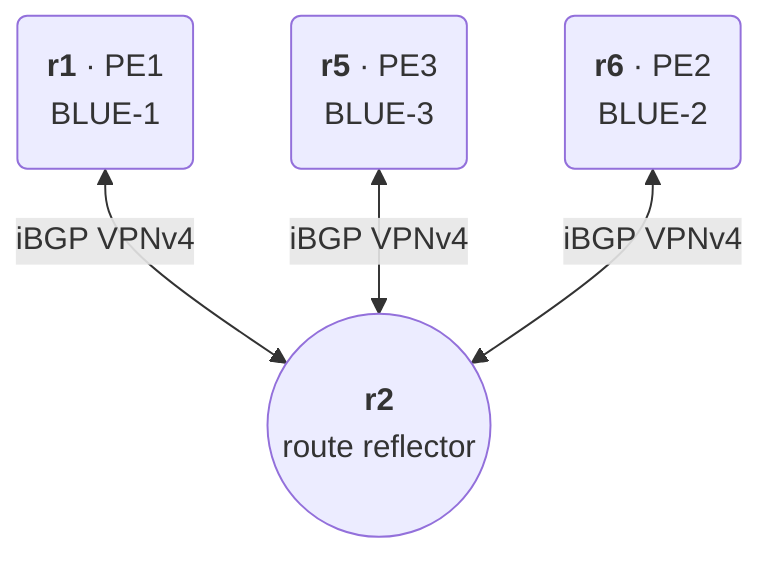

# E1 · Cliente multisede: L3VPN con route reflector y UCMP

> **El caso en una frase**: una empresa con tres sedes contrata una red privada al operador, que la monta como L3VPN sobre SRv6, sin malla completa de BGP y repartiendo el tráfico de la sede más cargada entre dos caminos del núcleo.
>
> **Requisitos previos**: módulos [11](../../11-isis-srv6/README.md) (IS-IS con SRv6), [12](../../12-l3vpn-bgp/README.md) (L3VPN IPv4), [14](../../14-te-srv6/README.md) (ingeniería de tráfico, SR Policy y color) y el escenario [E0](../E0-internet/README.md) · Probado con containerlab 0.82.0 sobre OrbStack, FRR 10.7.1 y netshoot v0.13 (26/26 comprobaciones) · Estado: ✅

## El escenario

```mermaid
graph LR
    h1("🖥️ <b>h1</b><br/>PC1 · sede BLUE-1<br/>eth1: 192.168.10.12/24")
    h11("🖥️ <b>h11</b><br/>PC11 · VLAN 100 (no se usa en E1)<br/>eth1: 192.168.100.11/24, 3fff:168:100::11/64")
    sw1("<b>sw1</b><br/>switch · VLAN 100 (no se usa en E1)")
    r1("<b>r1</b><br/>PE1 · BLUE-1<br/>lo: 3fff:0:ff::1/128<br/>eth1: 3fff:0:12::1/64 (m=10)<br/>eth2: 3fff:0:13::1/64 (m=15)<br/>eth3: 192.168.10.1/24 (VRF BLUE)<br/>locator 5f00:0:1::/48<br/>SID End.DT4 por BGP (VRF BLUE)")
    r2("<b>r2</b><br/>P · route reflector (BGP sin VRF)<br/>lo: 3fff:0:ff::2/128<br/>eth1: 3fff:0:12::2/64 (m=10)<br/>eth2: 3fff:0:23::2/64 (m=10)<br/>eth3: 3fff:0:24::2/64 (m=10)<br/>eth4: 3fff:0:25::2/64 (m=25)<br/>locator 5f00:0:2::/48<br/>SID End/End.X automáticos")
    r3("<b>r3</b><br/>P · FRR (sin BGP)<br/>lo: 3fff:0:ff::3/128<br/>eth1: 3fff:0:13::3/64 (m=15)<br/>eth2: 3fff:0:23::3/64 (m=10)<br/>eth3: 3fff:0:35::3/64 (m=10)<br/>eth4: 3fff:0:34::3/64 (m=25)<br/>locator 5f00:0:3::/48<br/>SID End/End.X automáticos")
    r4("<b>r4</b><br/>P · FRR (sin BGP)<br/>lo: 3fff:0:ff::4/128<br/>eth1: 3fff:0:24::4/64 (m=10)<br/>eth2: 3fff:0:45::4/64 (m=15)<br/>eth3: 3fff:0:46::4/64 (m=10)<br/>eth4: 3fff:0:34::4/64 (m=25)<br/>locator 5f00:0:4::/48<br/>SID End/End.X automáticos")
    r5("<b>r5</b><br/>P + PE3 · BLUE-3<br/>lo: 3fff:0:ff::5/128<br/>eth1: 3fff:0:35::5/64 (m=10)<br/>eth2: 3fff:0:45::5/64 (m=15)<br/>eth3: 3fff:0:56::5/64 (m=10)<br/>eth4: 3fff:0:25::5/64 (m=25)<br/>eth5: 192.168.30.1/24 (VRF BLUE)<br/>locator 5f00:0:5::/48<br/>SID End.DT4 por BGP (VRF BLUE)")
    r6("<b>r6</b><br/>PE2 · BLUE-2<br/>lo: 3fff:0:ff::6/128<br/>eth1: 3fff:0:46::6/64 (m=10)<br/>eth2: 3fff:0:56::6/64 (m=10)<br/>eth3: 192.168.20.1/24 (VRF BLUE)<br/>locator 5f00:0:6::/48<br/>SID End.DT4 por BGP (VRF BLUE)")
    h3("🖥️ <b>h3</b><br/>PC3 · sede BLUE-3 (nueva)<br/>eth1: 192.168.30.12/24")
    sw2("<b>sw2</b><br/>switch · VLAN 100 (no se usa en E1)")
    h2("🖥️ <b>h2</b><br/>PC2 · sede BLUE-2<br/>eth1: 192.168.20.12/24")
    h12("🖥️ <b>h12</b><br/>PC12 · VLAN 100 (no se usa en E1)<br/>eth1: 192.168.100.12/24, 3fff:168:100::12/64")

    r1 -- "eth1 ⟷ eth1<br/>3fff:0:12::/64 · m=10" --- r2
    r1 -- "eth2 ⟷ eth1<br/>3fff:0:13::/64 · m=15" --- r3
    r2 -- "eth2 ⟷ eth2<br/>3fff:0:23::/64 · m=10" --- r3
    r2 -- "eth3 ⟷ eth1<br/>3fff:0:24::/64 · m=10" --- r4
    r2 -- "eth4 ⟷ eth4<br/>3fff:0:25::/64 · m=25" --- r5
    r3 -- "eth3 ⟷ eth1<br/>3fff:0:35::/64 · m=10" --- r5
    r3 -- "eth4 ⟷ eth4<br/>3fff:0:34::/64 · m=25" --- r4
    r4 -- "eth2 ⟷ eth2<br/>3fff:0:45::/64 · m=15" --- r5
    r4 -- "eth3 ⟷ eth1<br/>3fff:0:46::/64 · m=10" --- r6
    r5 -- "eth3 ⟷ eth2<br/>3fff:0:56::/64 · m=10" --- r6
    h1 -- "eth1 ⟷ eth3<br/>192.168.10.0/24" --- r1
    sw1 -- "eth1 ⟷ eth4" --- r1
    h11 -- "eth1 ⟷ eth2<br/>192.168.100.0/24" --- sw1
    r6 -- "eth3 ⟷ eth1<br/>192.168.20.0/24" --- h2
    r6 -- "eth4 ⟷ eth1" --- sw2
    sw2 -- "eth2 ⟷ eth1<br/>192.168.100.0/24" --- h12
    r5 -- "eth5 ⟷ eth1<br/>192.168.30.0/24" --- h3

    classDef router fill:#ddf4ff,stroke:#0969da,stroke-width:2px,color:#1f2328
    classDef host fill:#dafbe1,stroke:#1a7f37,stroke-width:2px,color:#1f2328
    classDef switch fill:#f6f8fa,stroke:#57606a,stroke-width:2px,color:#1f2328
    class r1,r2,r3,r4,r5,r6 router
    class h1,h11,h2,h12,h3 host
    class sw1,sw2 switch
```

<!-- topologia:inicio -->

<!-- topologia:fin -->

Parte de la [topología base](../topologia-base/README.md) y añade una **tercera sede**, BLUE-3 (h3), en el enganche previsto de r5 (`eth5`). Con eso, r5 pasa a ser a la vez P (para el tráfico que lo cruza) y PE (para BLUE-3). La VLAN 100 está cableada pero no se usa. Haz la [práctica](practica.md) después de leer este planteamiento.

## 1. El caso de uso

La empresa BLUE tiene tres sedes y quiere unirlas con una red privada, sin montar túneles por Internet:

| Sede | Red | Conectada a |
|---|---|---|
| BLUE-1 (oficina central) | `192.168.10.0/24` | r1 |
| BLUE-2 (centro de datos) | `192.168.20.0/24` | r6 |
| BLUE-3 (nueva delegación) | `192.168.30.0/24` | r5 |

El operador, AS 64500, le vende una **L3VPN** (módulo 12). Pero tiene dos preocupaciones más:

- **Escala del BGP.** Hoy tiene tres PE; mañana tendrá cincuenta. Con iBGP en malla completa, cada PE necesita una sesión con todos los demás: 3 PE son 3 sesiones, pero 50 PE son 1.225. Quiere un diseño que crezca.
- **El tráfico hacia el centro de datos.** BLUE-1 manda mucho tráfico a BLUE-2, y el camino más corto, r1 → r2 → r4 → r6, se satura en las horas punta. El operador quiere **repartir** ese tráfico entre el camino de arriba y el de abajo (r1 → r3 → r5 → r6), pero no a partes iguales: el de abajo tiene menos capacidad libre, así que quiere un reparto **3:1**.

## 2. Criterios de éxito

Cada criterio es un bloque de `verificar.sh`:

- [ ] **1.** Cada PE (r1, r5, r6) tiene **una sola** sesión iBGP, con el route reflector (r2), y r2 tiene tres.
- [ ] **2.** Cada PE tiene su SID de servicio (`End.DT4` de la VRF BLUE).
- [ ] **3.** Cada sede conoce las otras dos, con encapsulado SRv6 hacia el PE correcto, y las rutas llegan **reflejadas** por r2.
- [ ] **4.** El route reflector está **fuera del camino de los datos**: no tiene la VRF, ni SIDs de servicio, ni rutas de BLUE en su kernel.
- [ ] **5.** Las tres sedes se ven entre sí.
- [ ] **6.** (TE) r1 reparte el tráfico hacia BLUE-2 por **dos caminos**, y el de peso 3 lleva más tráfico que el de peso 1.

## 3. La solución con SRv6

**La L3VPN es la del módulo 12**, con tres PE en lugar de dos: cada PE tiene la VRF BLUE con la interfaz de su sede, un SID `End.DT4` para la VRF y las rutas de la sede exportadas como VPNv4 con el RT `64500:10`. Cada PE importa las de los demás.

**Lo nuevo es cómo viajan las rutas VPN.** En vez de una malla de sesiones entre PE, cada PE habla solo con **r2**, que hace de **route reflector** (RR):



Cuando r6 anuncia `192.168.20.0/24` a r2, r2 **lo refleja** a r1 y a r5 sin cambiar nada importante: el siguiente salto sigue siendo r6 y el SID sigue siendo el `End.DT4` de r6. Por eso **los datos no pasan por r2**: r1 encapsula directamente hacia el SID de r6, y el paquete viaja por el camino más corto hacia el locator de r6, pase o no por r2. Para no crear bucles, r2 añade a la ruta dos atributos: el **originador** (r6) y la **lista de clústeres** (r2).

> **Un P como route reflector.** En la topología base, r2 es un P. Aquí además ejecuta BGP, pero **solo como plano de control**: no tiene VRF, ni SIDs de servicio, ni instala las rutas de BLUE en su kernel. Es un diseño habitual (*RR fuera de banda*), aunque en redes grandes el RR suele ser un equipo dedicado, a veces ni siquiera un router (un servidor con FRR o similar).

> **¿Y el color?** El plan inicial era que r6 exportara las rutas de BLUE-2 con la comunidad extendida **Color** 100 (módulo 14), con `set extcommunity color 100` en un *route-map* de exportación a VPN. En nuestras pruebas con FRR 10.7.1, el *route-map* se carga pero **sin la cláusula `set`**, y las rutas llegan a los demás PE solo con su RT. Mientras lo investigamos, el laboratorio no usa el color: lo verás en la teoría de la sección 6 y en el módulo 14.

**El reparto 3:1.** En r1, dos rutas estáticas con segmentos (como en E0) sustituyen a la de BGP para `192.168.20.0/24`:

| Camino | Primer salto | Segmentos | Peso |
|---|---|---|:-:|
| Arriba: r1 → r2 → r4 → r6 | r2 (`3fff:0:12::2`, `eth1`) | `End` de r4, `End.DT4` de r6 | 3 |
| Abajo: r1 → r3 → r5 → r6 | r3 (`3fff:0:13::3`, `eth2`) | `End` de r5, `End.DT4` de r6 | 1 |

Las dos rutas forman una ruta **multicamino con pesos** (*UCMP*, *Unequal-Cost Multi-Path*): de cada cuatro flujos, unos tres van por arriba y uno por abajo.

## 4. Decisiones de diseño

| Decisión | Por qué | Alternativa descartada |
|---|---|---|
| **Route reflector** en r2 | Con N PE hacen falta N sesiones en lugar de N·(N−1)/2. Añadir un PE solo exige configurar ese PE y el RR | Malla completa de iBGP: funciona con 3 PE, pero no escala |
| Un solo RR | Es un laboratorio. El RR solo afecta al plano de control: si cae, el tráfico sigue fluyendo con las rutas ya instaladas, pero no se aprenden cambios | **En producción, siempre dos RR**, con el mismo `cluster-id` o con distintos |
| RR en un **P** (r2) | Muestra que el RR no tiene por qué estar en el camino de los datos | RR dedicado fuera del núcleo: lo habitual en redes grandes |
| **`End.DT4`** por PE (`sid vpn export auto`) | Es una L3VPN solo IPv4, como el ejemplo que inspira el escenario | `End.DT46` por VRF: para dual-stack (módulo 13) |
| UCMP con **rutas estáticas con segmentos** en r1 | Es lo que FRR permite hoy: `staticd` admite `weight` y `segments` en la misma ruta | SR Policy con varias listas de segmentos con peso: es la forma de producto, pero FRR no tiene SR Policy para SRv6 (módulo 14) |
| Reparto por **flujo** (hash L4) | `net.ipv4.fib_multipath_hash_policy=1` en r1: cada conexión TCP o UDP va siempre por el mismo camino, sin desordenar paquetes | Hash L3 (por defecto): con un solo origen y un solo destino, todo iría por el mismo camino |
| Caminos fijados con el `End` de r4 o de r5 | Cada camino queda fijo aunque cambien las métricas del IGP | Solo el SID de r6 en el camino de arriba: seguiría el camino más corto, que hoy es el mismo |

## 5. Primero, por el camino más corto

Con la configuración del laboratorio, sin estáticas, todo funciona por el camino más corto de IS-IS. Lo esencial de un PE, r6:

```
router bgp 64500
 neighbor 3fff:0:ff::2 remote-as 64500          ! una sola sesión: con el RR
 neighbor 3fff:0:ff::2 update-source lo
 neighbor 3fff:0:ff::2 capability extended-nexthop
 segment-routing srv6
  locator MAIN
 address-family ipv4 vpn
  neighbor 3fff:0:ff::2 activate
!
router bgp 64500 vrf BLUE
 address-family ipv4 unicast
  redistribute connected
  sid vpn export auto
  rd vpn export 64500:6
  rt vpn both 64500:10
  export vpn
  import vpn
```

Y el RR, r2:

```
router bgp 64500
 bgp cluster-id 10.255.0.2
 neighbor 3fff:0:ff::1 remote-as 64500          ! (y lo mismo para ::5 y ::6)
 address-family ipv4 vpn
  neighbor 3fff:0:ff::1 activate
  neighbor 3fff:0:ff::1 route-reflector-client
```

El RR no necesita VRF ni SRv6 en BGP: refleja las rutas VPNv4 con todos sus atributos, incluido el SID. FRR conserva por defecto las rutas VPN aunque no las importe en ninguna VRF (`bgp retain route-target all`), y eso es justo lo que un RR necesita.

## 6. Después, con ingeniería de tráfico: UCMP 3:1

En r1, dentro de la VRF BLUE (sustituye `SID` por el `End.DT4` de r6, que ves en la ruta BGP de r1):

```
vrf BLUE
 ip route 192.168.20.0/24 3fff:0:12::2 eth1 nexthop-vrf default weight 3 segments 5f00:0:4::/SID
 ip route 192.168.20.0/24 3fff:0:13::3 eth2 nexthop-vrf default weight 1 segments 5f00:0:5::/SID
exit-vrf
```

- **`nexthop-vrf default`**: la ruta está en la VRF BLUE, pero el siguiente salto (r2 o r3) está en la tabla global, que es por donde viaja el paquete ya encapsulado.
- **`weight 3` / `weight 1`**: los pesos del reparto. zebra instala una sola ruta con dos caminos y **normaliza** los pesos a la escala del kernel: en `show ip route` verás `weight 255` y `weight 85`, que es la misma proporción 3:1.
- **`segments`**: cada camino lleva su lista. El paquete pasa primero por r4 o por r5, y después va a r6.

Para comprobar el reparto no sirve un ping: todos sus paquetes son un mismo flujo y van por el mismo camino. `verificar.sh` lanza 32 conexiones TCP con `iperf3` y compara los bytes que salen de r1 por cada interfaz.

> **El color, en teoría.** En un router con SR Policy, r6 exportaría las rutas de BLUE-2 con la comunidad Color 100, y ese color activaría solo una política con color 100 y destino r6 (*automated steering*, módulo 14), y esa política tendría las dos listas de segmentos con sus pesos. FRR no tiene SR Policy para SRv6, así que aquí **tú haces de SR Policy**: decides qué tráfico reparte y configuras las estáticas. En el escenario E7 (BGP-LS), un pequeño controlador hará este trabajo.

## 7. Lo que verás en el cable

- **Sin TE**: una captura en r2 (`eth1`, desde r1) del tráfico de BLUE-1 a BLUE-2 muestra la cabecera IPv6 exterior con destino el `End.DT4` de r6 (`5f00:0:6:…`) y un SRH de **un** segmento. Dentro, el paquete IPv4 original (`192.168.10.12 → 192.168.20.12`). Es la L3VPN del módulo 12.
- **Con UCMP**: en r2 verás paquetes con destino **`5f00:0:4::`** (el `End` de r4) y en r3 con destino **`5f00:0:5::`** (el de r5), los dos con un SRH de **dos** segmentos. Cada conexión TCP aparece solo en uno de los dos.
- **En r2, el RR**: aunque refleje las rutas, el tráfico de BLUE-1 a BLUE-3 (r1 → r3 → r5) **no** pasa por él. El plano de control y el de datos van por sitios distintos.

## 8. Rómpelo y arréglalo

En r6, quita el RT de exportación de la VRF BLUE (`no rt vpn both 64500:10`). Desde fuera parece una avería del núcleo: BLUE-2 deja de ver a las otras sedes. Pero el transporte está intacto: IS-IS, los locators y el `End.DT4` de r6 siguen en su sitio. El problema está en el plano de control: las rutas de BLUE-2 salen de r6 sin el RT que los demás PE importan, y r6 tampoco importa las suyas. Diagnosticarlo te obliga a separar el plano de control (sesiones y rutas BGP) del plano de datos (SIDs y encapsulado), que es la lección del módulo 17. La práctica lo plantea paso a paso.

## 9. En producción

- **Dos route reflectors como mínimo**, en sitios distintos de la red. Con uno solo, perderlo congela el plano de control de todos los servicios.
- **RR fuera del camino de los datos**, y a menudo fuera de los routers: un RR para cientos de PE necesita memoria y CPU, no capacidad de reenvío.
- **UCMP de verdad** se hace con **SR Policy** (varias listas de segmentos con peso) o con la comunidad de **ancho de banda de enlace** en BGP, y lo calcula un controlador según la capacidad libre. Las estáticas de este escenario no reaccionan a caídas de enlaces: si cae r3–r5, el camino de abajo deja de funcionar, y un cuarto de los flujos se pierden hasta que alguien quite la estática.
- **El color** solo tiene sentido si toda la red lo interpreta igual: se define un catálogo de colores (100 = baja latencia, 200 = evita tal enlace…) y se aplica en el borde.

## 10. Resumen

- La L3VPN con tres PE es la del módulo 12: VRF, `End.DT4` por PE, RD y RT.
- Con un **route reflector**, cada PE tiene **una** sesión iBGP. El RR refleja las rutas sin cambiar el siguiente salto ni el SID, así que **no está en el camino de los datos**.
- Con **dos rutas estáticas con segmentos y pesos** en la VRF (`nexthop-vrf default`, `weight`, `segments`), r1 reparte el tráfico 3:1 entre dos caminos (**UCMP**). El reparto es por flujo (hash L4).
- Lo que aquí haces a mano (qué tráfico, por qué caminos, con qué pesos) es lo que automatiza una SR Policy, guiada por la comunidad **Color**, en otras plataformas.

## Para saber más

- [RFC 4456 · BGP Route Reflection](https://www.rfc-editor.org/rfc/rfc4456) — route reflectors, originador y lista de clústeres
- [RFC 9252 · BGP Overlay Services Based on SRv6](https://www.rfc-editor.org/rfc/rfc9252) — L3VPN sobre SRv6
- [RFC 9256 · Segment Routing Policy Architecture](https://www.rfc-editor.org/rfc/rfc9256) — color, *automated steering* y listas de segmentos con peso
- [RFC 9012 · BGP Tunnel Encapsulation Attribute](https://www.rfc-editor.org/rfc/rfc9012) — define la comunidad extendida Color
- [FRR · STATIC](https://docs.frrouting.org/en/latest/static.html) — `weight`, `segments` y `nexthop-vrf`
