# E1 · Práctica: cliente multisede

Antes de empezar, lee el [planteamiento del escenario](README.md). Los contenedores se llaman `clab-esc-e1-…`.

## Topología

```mermaid
graph LR
    h1("🖥️ <b>h1</b><br/>PC1 · sede BLUE-1<br/>eth1: 192.168.10.12/24")
    h11("🖥️ <b>h11</b><br/>PC11 · VLAN 100 (no se usa en E1)<br/>eth1: 192.168.100.11/24, 3fff:168:100::11/64")
    sw1("<b>sw1</b><br/>switch · VLAN 100 (no se usa en E1)")
    r1("<b>r1</b><br/>PE1 · BLUE-1<br/>lo: 3fff:0:ff::1/128<br/>eth1: 3fff:0:12::1/64 (m=10)<br/>eth2: 3fff:0:13::1/64 (m=15)<br/>eth3: 192.168.10.1/24 (VRF BLUE)<br/>locator 5f00:0:1::/48<br/>SID End.DT4 por BGP (VRF BLUE)")
    r2("<b>r2</b><br/>P · route reflector (BGP sin VRF)<br/>lo: 3fff:0:ff::2/128<br/>eth1: 3fff:0:12::2/64 (m=10)<br/>eth2: 3fff:0:23::2/64 (m=10)<br/>eth3: 3fff:0:24::2/64 (m=10)<br/>eth4: 3fff:0:25::2/64 (m=25)<br/>locator 5f00:0:2::/48<br/>SID End/End.X automáticos")
    r3("<b>r3</b><br/>P · FRR (sin BGP)<br/>lo: 3fff:0:ff::3/128<br/>eth1: 3fff:0:13::3/64 (m=15)<br/>eth2: 3fff:0:23::3/64 (m=10)<br/>eth3: 3fff:0:35::3/64 (m=10)<br/>eth4: 3fff:0:34::3/64 (m=25)<br/>locator 5f00:0:3::/48<br/>SID End/End.X automáticos")
    r4("<b>r4</b><br/>P · FRR (sin BGP)<br/>lo: 3fff:0:ff::4/128<br/>eth1: 3fff:0:24::4/64 (m=10)<br/>eth2: 3fff:0:45::4/64 (m=15)<br/>eth3: 3fff:0:46::4/64 (m=10)<br/>eth4: 3fff:0:34::4/64 (m=25)<br/>locator 5f00:0:4::/48<br/>SID End/End.X automáticos")
    r5("<b>r5</b><br/>P + PE3 · BLUE-3<br/>lo: 3fff:0:ff::5/128<br/>eth1: 3fff:0:35::5/64 (m=10)<br/>eth2: 3fff:0:45::5/64 (m=15)<br/>eth3: 3fff:0:56::5/64 (m=10)<br/>eth4: 3fff:0:25::5/64 (m=25)<br/>eth5: 192.168.30.1/24 (VRF BLUE)<br/>locator 5f00:0:5::/48<br/>SID End.DT4 por BGP (VRF BLUE)")
    r6("<b>r6</b><br/>PE2 · BLUE-2<br/>lo: 3fff:0:ff::6/128<br/>eth1: 3fff:0:46::6/64 (m=10)<br/>eth2: 3fff:0:56::6/64 (m=10)<br/>eth3: 192.168.20.1/24 (VRF BLUE)<br/>locator 5f00:0:6::/48<br/>SID End.DT4 por BGP (VRF BLUE)")
    h3("🖥️ <b>h3</b><br/>PC3 · sede BLUE-3 (nueva)<br/>eth1: 192.168.30.12/24")
    sw2("<b>sw2</b><br/>switch · VLAN 100 (no se usa en E1)")
    h2("🖥️ <b>h2</b><br/>PC2 · sede BLUE-2<br/>eth1: 192.168.20.12/24")
    h12("🖥️ <b>h12</b><br/>PC12 · VLAN 100 (no se usa en E1)<br/>eth1: 192.168.100.12/24, 3fff:168:100::12/64")

    r1 -- "eth1 ⟷ eth1<br/>3fff:0:12::/64 · m=10" --- r2
    r1 -- "eth2 ⟷ eth1<br/>3fff:0:13::/64 · m=15" --- r3
    r2 -- "eth2 ⟷ eth2<br/>3fff:0:23::/64 · m=10" --- r3
    r2 -- "eth3 ⟷ eth1<br/>3fff:0:24::/64 · m=10" --- r4
    r2 -- "eth4 ⟷ eth4<br/>3fff:0:25::/64 · m=25" --- r5
    r3 -- "eth3 ⟷ eth1<br/>3fff:0:35::/64 · m=10" --- r5
    r3 -- "eth4 ⟷ eth4<br/>3fff:0:34::/64 · m=25" --- r4
    r4 -- "eth2 ⟷ eth2<br/>3fff:0:45::/64 · m=15" --- r5
    r4 -- "eth3 ⟷ eth1<br/>3fff:0:46::/64 · m=10" --- r6
    r5 -- "eth3 ⟷ eth2<br/>3fff:0:56::/64 · m=10" --- r6
    h1 -- "eth1 ⟷ eth3<br/>192.168.10.0/24" --- r1
    sw1 -- "eth1 ⟷ eth4" --- r1
    h11 -- "eth1 ⟷ eth2<br/>192.168.100.0/24" --- sw1
    r6 -- "eth3 ⟷ eth1<br/>192.168.20.0/24" --- h2
    r6 -- "eth4 ⟷ eth1" --- sw2
    sw2 -- "eth2 ⟷ eth1<br/>192.168.100.0/24" --- h12
    r5 -- "eth5 ⟷ eth1<br/>192.168.30.0/24" --- h3

    classDef router fill:#ddf4ff,stroke:#0969da,stroke-width:2px,color:#1f2328
    classDef host fill:#dafbe1,stroke:#1a7f37,stroke-width:2px,color:#1f2328
    classDef switch fill:#f6f8fa,stroke:#57606a,stroke-width:2px,color:#1f2328
    class r1,r2,r3,r4,r5,r6 router
    class h1,h11,h2,h12,h3 host
    class sw1,sw2 switch
```

<!-- topologia:inicio -->

<!-- topologia:fin -->

> El fichero editable para draw.io está en [`lab/topologia.drawio`](lab/topologia.drawio).

## Parte A · Ejercicios en papel

**A1.** El operador pasa de 3 a 10 PE. ¿Cuántas sesiones iBGP necesita con malla completa? ¿Y con un route reflector? ¿Y con dos?

**A2.** r2 refleja a r1 la ruta de BLUE-2 que le envió r6. ¿Qué siguiente salto y qué SID lleva la ruta cuando llega a r1? ¿Por qué eso hace que los datos no pasen por r2?

**A3.** El tráfico de BLUE-1 a BLUE-3 va por r1 → r3 → r5. ¿Pasa por r2? ¿Qué pasaría con ese tráfico si r2 se apagara durante unos segundos (sin cambiar nada más)?

**A4.** Con pesos 3 y 1, y 32 conexiones TCP, ¿cuántas esperas que vayan por cada camino? ¿Por qué el reparto real no será exactamente ese?

## Parte B · Levantar y verificar

```
$ cd anexo-escenarios/E1-multisede/lab
$ sudo containerlab deploy -t lab.clab.yml
$ ./verificar.sh
```

`verificar.sh` monta y desmonta él mismo las rutas UCMP para comprobar el criterio 7. Al terminar, el laboratorio queda con la configuración de partida (sin estáticas).

## Parte C · El route reflector

**C1.** Mira las sesiones de r1 y de r2:

```
$ docker exec clab-esc-e1-r1 vtysh -c "show bgp ipv4 vpn summary"
$ docker exec clab-esc-e1-r2 vtysh -c "show bgp ipv4 vpn summary"
```

¿Con quién habla r1? ¿Cuántos prefijos le llegan, y de quién?

**C2.** Mira el detalle de la ruta de BLUE-2 en r1:

```
$ docker exec clab-esc-e1-r1 vtysh -c "show bgp vrf BLUE ipv4 unicast 192.168.20.0/24"
```

Localiza el originador, la lista de clústeres, el siguiente salto, el SID y el color.

**C3.** Comprueba que r2 no está en el camino de los datos:

```
$ docker exec clab-esc-e1-r2 vtysh -c "show bgp ipv4 vpn"
$ docker exec clab-esc-e1-r2 ip route show 192.168.20.0/24
$ docker exec clab-esc-e1-r2 ip -6 route show | grep End.DT
```

¿Conoce r2 las rutas de BLUE? ¿Las tiene en su kernel? ¿Por qué?

**C4.** Haz `traceroute -n 192.168.30.12` desde h1 y captura en r2 a la vez. ¿Ves el tráfico de BLUE-1 a BLUE-3 en r2?

## Parte D · UCMP

**D1.** Apunta el SID `End.DT4` de r6 para BLUE (en la ruta de r1: `ip route show vrf BLUE 192.168.20.0/24`).

**D2.** Configura las dos rutas estáticas en r1, sustituyendo `SID`:

```
$ docker exec -it clab-esc-e1-r1 vtysh
r1# configure terminal
r1(config)# vrf BLUE
r1(config-vrf)# ip route 192.168.20.0/24 3fff:0:12::2 eth1 nexthop-vrf default weight 3 segments 5f00:0:4::/SID
r1(config-vrf)# ip route 192.168.20.0/24 3fff:0:13::3 eth2 nexthop-vrf default weight 1 segments 5f00:0:5::/SID
r1(config-vrf)# end
r1# show ip route vrf BLUE 192.168.20.0/24
```

¿Cuántos caminos tiene ahora la ruta? ¿Qué ha pasado con la de BGP?

**D3.** Mide el reparto. Anota los bytes enviados por r1 en cada interfaz, lanza el tráfico y vuelve a mirarlos:

```
$ docker exec clab-esc-e1-r1 sh -c 'cat /sys/class/net/eth1/statistics/tx_bytes /sys/class/net/eth2/statistics/tx_bytes'
$ docker exec clab-esc-e1-h1 iperf3 -c 192.168.20.12 -P 32 -t 5 -M 1300
$ docker exec clab-esc-e1-r1 sh -c 'cat /sys/class/net/eth1/statistics/tx_bytes /sys/class/net/eth2/statistics/tx_bytes'
```

Calcula la proporción entre las dos diferencias. ¿Se parece a 3:1?

**D4.** Repite D3 con **un solo** flujo (`-P 1`). ¿Qué pasa con el reparto? ¿Por qué?

**D5.** Prueba a cambiar `net.ipv4.fib_multipath_hash_policy` de r1 a `0` (hash solo por direcciones IP) y repite D3 con 32 flujos. ¿Qué cambia? Vuelve a ponerlo a `1` al terminar.

```
$ docker exec clab-esc-e1-r1 sysctl -w net.ipv4.fib_multipath_hash_policy=0
```

**D6.** Quita las dos estáticas (`no ip route …` con los mismos parámetros, dentro de `vrf BLUE`) y comprueba que vuelve la ruta de BGP.

## Parte E · Rómpelo y arréglalo

**E1.** En r6, quita el RT de la VRF BLUE:

```
$ docker exec -it clab-esc-e1-r6 vtysh
r6# configure terminal
r6(config)# router bgp 64500 vrf BLUE
r6(config-router)# address-family ipv4 unicast
r6(config-router-af)# no rt vpn both 64500:10
r6(config-router-af)# end
```

Desde h1, haz ping a h2 y a h3. ¿Qué funciona y qué no?

**E2.** Diagnostica como si no supieras qué has roto. Empieza por el plano de datos (¿llegan los locators? ¿está el `End.DT4` de r6?) y sigue por el de control (¿qué rutas tiene r1 en la VRF BLUE? ¿qué recibe r2 de r6? ¿qué comunidades llevan?).

**E3.** Arréglalo y comprueba con `./verificar.sh` que todo vuelve a estar en verde.

## Al terminar

```
$ sudo containerlab destroy -t lab.clab.yml --cleanup
```

Compara tus respuestas con las [soluciones](soluciones.md).
