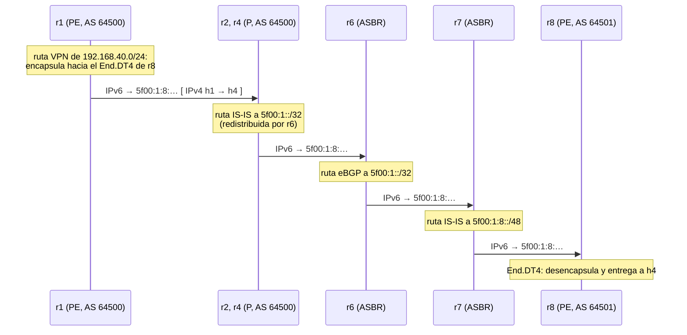

# E2 · Dos operadores: L3VPN entre sistemas autónomos (Inter-AS)

> **El caso en una frase**: una empresa tiene sedes conectadas a dos operadores distintos, y los dos operadores se ponen de acuerdo para unirlas en una misma red privada.
>
> **Requisitos previos**: módulos [10](../../10-usid/README.md) (bloques y locators), [12](../../12-l3vpn-bgp/README.md) (L3VPN), [18](../../18-mtu-seguridad/README.md) (seguridad en el borde) y los escenarios [E0](../E0-internet/README.md) y [E1](../E1-multisede/README.md) · Probado con containerlab 0.82.0 sobre OrbStack, FRR 10.7.1 y netshoot v0.13 (opción A: 16/16 comprobaciones; opción C: 22/22) · Estado: ✅

## El escenario

Parte de la [topología base](../topologia-base/README.md), que aquí es el **AS 64500**, y le añade un **segundo operador**, el **AS 64501**, en el enganche previsto de r6 (`eth6`): dos routers, **r7** (su ASBR) y **r8** (su PE), con la sede **BLUE-4** (h4) conectada a r8. La VLAN 100 y la sede BLUE-2 están cableadas pero no se usan.

El escenario se resuelve de dos formas, cada una con su laboratorio:

| Opción | Qué se intercambian los dos operadores | Laboratorio |
|---|---|---|
| **A** · VRF contra VRF | Las rutas del cliente, en IPv4, como si cada uno fuera cliente del otro | [`lab-opcion-a/`](lab-opcion-a) |
| **C** · con SRv6 | Solo el **bloque de SIDs** y el de loopbacks de cada AS. Los PE hablan VPNv4 entre ellos | [`lab-opcion-c/`](lab-opcion-c) |

Haz la [práctica](practica.md) después de leer este planteamiento.

## 1. El caso de uso

La empresa BLUE tiene su oficina central (BLUE-1, `192.168.10.0/24`) conectada al operador **AS 64500**, en r1. Acaba de abrir una sede (BLUE-4, `192.168.40.0/24`) en una región donde ese operador no llega, y allí la conecta el operador **AS 64501**, en r8.

La empresa quiere **una sola red privada**, como si todo fuera de un mismo operador. Los dos operadores tienen un enlace directo entre sus redes (r6–r7) y aceptan colaborar, pero cada uno quiere:

- **Mantener su red bajo su control**: su IGP, sus SIDs y sus políticas.
- **Exponer al otro lo mínimo** imprescindible.
- Que el diseño **escale** si mañana comparten cien clientes, y no solo uno.

## 2. Criterios de éxito

**Opción A** (`lab-opcion-a/verificar.sh`):

- [ ] **1.** Cada operador tiene su propia L3VPN: su iBGP VPNv4 y un SID de servicio en cada PE y ASBR.
- [ ] **2.** Los ASBR se conectan como cliente y proveedor: una sesión eBGP IPv4 **dentro de la VRF**, sin SRv6.
- [ ] **3.** El SRv6 de cada AS **termina en su frontera**: por el enlace r6–r7 pasa IPv4 sin encapsular, y ningún AS conoce los SIDs del otro.
- [ ] **4.** BLUE-1 y BLUE-4 se ven.

**Opción C** (`lab-opcion-c/verificar.sh`):

- [ ] **1.** Los ASBR intercambian **solo** el bloque de SIDs y el de loopbacks de cada AS, y no tienen VRF ni SIDs de servicio.
- [ ] **2.** Cada IGP aprende el otro AS con **una ruta por bloque**.
- [ ] **3.** Los PE de los dos AS (r1 y r8) hablan VPNv4 **directamente**, por eBGP multisalto.
- [ ] **4.** Un **solo túnel SRv6 de punta a punta**: r1 encapsula hacia el SID de r8, y eso es lo que cruza el enlace entre operadores.
- [ ] **5.** BLUE-1 y BLUE-4 se ven.
- [ ] **6.** (TE) r1 puede llevar el tráfico de BLUE-4 por otro camino de su propio AS, con una lista de segmentos que mezcla SIDs de los dos AS.

## 3. Las tres opciones clásicas

El problema de unir una VPN entre dos AS es antiguo: el [RFC 4364](https://www.rfc-editor.org/rfc/rfc4364#section-10) (la L3VPN con MPLS) describe tres formas de hacerlo, conocidas como opciones A, B y C:

| | **Opción A** | **Opción B** | **Opción C** |
|---|---|---|---|
| Qué cruza la frontera (control) | Rutas IPv4 del cliente, una sesión por VRF | Rutas VPNv4, entre los ASBR | Loopbacks (y en SRv6, bloques de SIDs), entre los ASBR. Las VPNv4 van de PE a PE |
| Qué cruza la frontera (datos) | IPv4 sin encapsular | Paquetes encapsulados | Paquetes encapsulados de punta a punta |
| Estado en los ASBR | Una VRF por cliente | Todas las rutas VPN | Solo los bloques de cada AS |
| Escala | Mala: cada cliente nuevo, una VRF y una sesión en cada ASBR | Media | Buena |
| Aislamiento entre operadores | Máximo | Medio | Mínimo: cada uno ve el interior del otro |
| Uso típico | Pocos clientes compartidos, operadores que no se fían | Operadores asociados | Dos redes del mismo grupo, o un operador con varios AS |

Con MPLS, la opción C obliga a llevar **etiquetas** de transporte de un AS al otro (BGP con etiquetas, o LDP extendido), y es compleja. **Con SRv6 es mucho más simple**: un SID es una dirección IPv6, y todos los SIDs de un AS caben en un solo prefijo (`5f00:1::/32` para el AS 64501). Basta con que cada AS sepa **enrutar hacia el bloque de SIDs del otro**, y un paquete encapsulado en r1 hacia un SID de r8 llega solo, atravesando los dos operadores como cualquier paquete IPv6.

La opción B con SRv6 es posible (los ASBR reenvían las rutas VPNv4 cambiando el siguiente salto), pero en el plano de datos se comporta como la C: el paquete viaja igualmente hacia el SID del PE remoto, así que también exige que cada AS enrute hacia el bloque del otro. Por eso el escenario compara las dos opciones extremas, A y C.

## 4. La solución con SRv6

### Opción A: VRF contra VRF

```mermaid
graph LR
    h1("🖥️ <b>h1</b><br/>PC1 · sede BLUE-1 (AS 64500)<br/>eth1: 192.168.10.12/24")
    h11("🖥️ <b>h11</b><br/>PC11 · VLAN 100 (no se usa en E2)<br/>eth1: 192.168.100.11/24, 3fff:168:100::11/64")
    sw1("<b>sw1</b><br/>switch · VLAN 100 (no se usa en E2)")
    r1("<b>r1</b><br/>PE1 · AS 64500<br/>lo: 3fff:0:ff::1/128<br/>eth1: 3fff:0:12::1/64 (m=10)<br/>eth2: 3fff:0:13::1/64 (m=15)<br/>eth3: 192.168.10.1/24 (VRF BLUE)<br/>locator 5f00:0:1::/48<br/>SID End.DT4 por BGP (VRF BLUE)")
    r2("<b>r2</b><br/>P · AS 64500 (sin BGP)<br/>lo: 3fff:0:ff::2/128<br/>eth1: 3fff:0:12::2/64 (m=10)<br/>eth2: 3fff:0:23::2/64 (m=10)<br/>eth3: 3fff:0:24::2/64 (m=10)<br/>eth4: 3fff:0:25::2/64 (m=25)<br/>locator 5f00:0:2::/48<br/>SID End/End.X automáticos")
    r3("<b>r3</b><br/>P · AS 64500 (sin BGP)<br/>lo: 3fff:0:ff::3/128<br/>eth1: 3fff:0:13::3/64 (m=15)<br/>eth2: 3fff:0:23::3/64 (m=10)<br/>eth3: 3fff:0:35::3/64 (m=10)<br/>eth4: 3fff:0:34::3/64 (m=25)<br/>locator 5f00:0:3::/48<br/>SID End/End.X automáticos")
    r4("<b>r4</b><br/>P · AS 64500 (sin BGP)<br/>lo: 3fff:0:ff::4/128<br/>eth1: 3fff:0:24::4/64 (m=10)<br/>eth2: 3fff:0:45::4/64 (m=15)<br/>eth3: 3fff:0:46::4/64 (m=10)<br/>eth4: 3fff:0:34::4/64 (m=25)<br/>locator 5f00:0:4::/48<br/>SID End/End.X automáticos")
    r5("<b>r5</b><br/>P · AS 64500 (sin BGP)<br/>lo: 3fff:0:ff::5/128<br/>eth1: 3fff:0:35::5/64 (m=10)<br/>eth2: 3fff:0:45::5/64 (m=15)<br/>eth3: 3fff:0:56::5/64 (m=10)<br/>eth4: 3fff:0:25::5/64 (m=25)<br/>locator 5f00:0:5::/48<br/>SID End/End.X automáticos")
    r6("<b>r6</b><br/>ASBR · AS 64500 (PE para el otro AS)<br/>lo: 3fff:0:ff::6/128<br/>eth1: 3fff:0:46::6/64 (m=10)<br/>eth2: 3fff:0:56::6/64 (m=10)<br/>eth6: 172.16.67.1/30 (VRF BLUE)<br/>locator 5f00:0:6::/48<br/>SID End.DT4 por BGP (VRF BLUE)")
    h2("🖥️ <b>h2</b><br/>PC2 · sede BLUE-2 (no se usa en E2)<br/>eth1: 192.168.20.12/24")
    sw2("<b>sw2</b><br/>switch · VLAN 100 (no se usa en E2)")
    r7("<b>r7</b><br/>ASBR · AS 64501 (PE para el otro AS)<br/>lo: 3fff:1:ff::7/128<br/>eth1: 172.16.67.2/30 (VRF BLUE)<br/>eth2: 3fff:1:78::7/64 (m=10)<br/>locator 5f00:1:7::/48<br/>SID End.DT4 por BGP (VRF BLUE)")
    h12("🖥️ <b>h12</b><br/>PC12 · VLAN 100 (no se usa en E2)<br/>eth1: 192.168.100.12/24, 3fff:168:100::12/64")
    r8("<b>r8</b><br/>PE · AS 64501<br/>lo: 3fff:1:ff::8/128<br/>eth1: 3fff:1:78::8/64 (m=10)<br/>eth2: 192.168.40.1/24 (VRF BLUE)<br/>locator 5f00:1:8::/48<br/>SID End.DT4 por BGP (VRF BLUE)")
    h4("🖥️ <b>h4</b><br/>PC4 · sede BLUE-4 (AS 64501)<br/>eth1: 192.168.40.12/24")

    r1 -- "eth1 ⟷ eth1<br/>3fff:0:12::/64 · m=10" --- r2
    r1 -- "eth2 ⟷ eth1<br/>3fff:0:13::/64 · m=15" --- r3
    r2 -- "eth2 ⟷ eth2<br/>3fff:0:23::/64 · m=10" --- r3
    r2 -- "eth3 ⟷ eth1<br/>3fff:0:24::/64 · m=10" --- r4
    r2 -- "eth4 ⟷ eth4<br/>3fff:0:25::/64 · m=25" --- r5
    r3 -- "eth3 ⟷ eth1<br/>3fff:0:35::/64 · m=10" --- r5
    r3 -- "eth4 ⟷ eth4<br/>3fff:0:34::/64 · m=25" --- r4
    r4 -- "eth2 ⟷ eth2<br/>3fff:0:45::/64 · m=15" --- r5
    r4 -- "eth3 ⟷ eth1<br/>3fff:0:46::/64 · m=10" --- r6
    r5 -- "eth3 ⟷ eth2<br/>3fff:0:56::/64 · m=10" --- r6
    h1 -- "eth1 ⟷ eth3<br/>192.168.10.0/24" --- r1
    sw1 -- "eth1 ⟷ eth4" --- r1
    h11 -- "eth1 ⟷ eth2<br/>192.168.100.0/24" --- sw1
    r6 -- "eth3 ⟷ eth1<br/>192.168.20.0/24" --- h2
    r6 -- "eth4 ⟷ eth1" --- sw2
    sw2 -- "eth2 ⟷ eth1<br/>192.168.100.0/24" --- h12
    r6 -- "eth6 ⟷ eth1<br/>172.16.67.0/30" --- r7
    r7 -- "eth2 ⟷ eth1<br/>3fff:1:78::/64 · m=10" --- r8
    r8 -- "eth2 ⟷ eth1<br/>192.168.40.0/24" --- h4

    classDef router fill:#ddf4ff,stroke:#0969da,stroke-width:2px,color:#1f2328
    classDef host fill:#dafbe1,stroke:#1a7f37,stroke-width:2px,color:#1f2328
    classDef switch fill:#f6f8fa,stroke:#57606a,stroke-width:2px,color:#1f2328
    class r1,r2,r3,r4,r5,r6,r7,r8 router
    class h1,h11,h2,h12,h4 host
    class sw1,sw2 switch
```

<!-- topologia:inicio lab-opcion-a -->

<!-- topologia:fin lab-opcion-a -->

Cada operador monta **su propia L3VPN**, exactamente como en el módulo 12. La novedad está en la frontera: el ASBR de cada AS (r6 y r7) tiene la VRF BLUE, y el enlace entre ellos está **dentro** de esa VRF, con direcciones IPv4 (`172.16.67.0/30`). Para r6, r7 es simplemente un cliente que le anuncia `192.168.40.0/24` por eBGP, y para r7, r6 es un cliente que le anuncia `192.168.10.0/24`.

Un paquete de h1 a h4:

1. r1 lo encapsula hacia el `End.DT4` de **r6** (su propio ASBR).
2. r6 lo desencapsula, lo busca en su VRF BLUE y lo entrega a r7 **en IPv4 normal**.
3. r7 lo busca en su VRF BLUE y lo encapsula hacia el `End.DT4` de **r8**, en el SRv6 del AS 64501.
4. r8 lo desencapsula y lo entrega a h4.

Hay **dos túneles SRv6 independientes**, uno en cada AS, y entre ellos IPv4. Cada operador usa sus propios RT (`64500:10` y `64501:10`): no tienen que ponerse de acuerdo en nada salvo el enlace y la sesión eBGP.

### Opción C: un túnel SRv6 de punta a punta

```mermaid
graph LR
    h1("🖥️ <b>h1</b><br/>PC1 · sede BLUE-1 (AS 64500)<br/>eth1: 192.168.10.12/24")
    h11("🖥️ <b>h11</b><br/>PC11 · VLAN 100 (no se usa en E2)<br/>eth1: 192.168.100.11/24, 3fff:168:100::11/64")
    sw1("<b>sw1</b><br/>switch · VLAN 100 (no se usa en E2)")
    r1("<b>r1</b><br/>PE1 · AS 64500<br/>lo: 3fff:0:ff::1/128<br/>eth1: 3fff:0:12::1/64 (m=10)<br/>eth2: 3fff:0:13::1/64 (m=15)<br/>eth3: 192.168.10.1/24 (VRF BLUE)<br/>locator 5f00:0:1::/48<br/>SID End.DT4 por BGP (VRF BLUE)")
    r2("<b>r2</b><br/>P · AS 64500 (sin BGP)<br/>lo: 3fff:0:ff::2/128<br/>eth1: 3fff:0:12::2/64 (m=10)<br/>eth2: 3fff:0:23::2/64 (m=10)<br/>eth3: 3fff:0:24::2/64 (m=10)<br/>eth4: 3fff:0:25::2/64 (m=25)<br/>locator 5f00:0:2::/48<br/>SID End/End.X automáticos")
    r3("<b>r3</b><br/>P · AS 64500 (sin BGP)<br/>lo: 3fff:0:ff::3/128<br/>eth1: 3fff:0:13::3/64 (m=15)<br/>eth2: 3fff:0:23::3/64 (m=10)<br/>eth3: 3fff:0:35::3/64 (m=10)<br/>eth4: 3fff:0:34::3/64 (m=25)<br/>locator 5f00:0:3::/48<br/>SID End/End.X automáticos")
    r4("<b>r4</b><br/>P · AS 64500 (sin BGP)<br/>lo: 3fff:0:ff::4/128<br/>eth1: 3fff:0:24::4/64 (m=10)<br/>eth2: 3fff:0:45::4/64 (m=15)<br/>eth3: 3fff:0:46::4/64 (m=10)<br/>eth4: 3fff:0:34::4/64 (m=25)<br/>locator 5f00:0:4::/48<br/>SID End/End.X automáticos")
    r5("<b>r5</b><br/>P · AS 64500 (sin BGP)<br/>lo: 3fff:0:ff::5/128<br/>eth1: 3fff:0:35::5/64 (m=10)<br/>eth2: 3fff:0:45::5/64 (m=15)<br/>eth3: 3fff:0:56::5/64 (m=10)<br/>eth4: 3fff:0:25::5/64 (m=25)<br/>locator 5f00:0:5::/48<br/>SID End/End.X automáticos")
    r6("<b>r6</b><br/>ASBR · AS 64500 (sin VPN)<br/>lo: 3fff:0:ff::6/128<br/>eth1: 3fff:0:46::6/64 (m=10)<br/>eth2: 3fff:0:56::6/64 (m=10)<br/>eth6: 3fff:0:67::6/64 (inter-AS)<br/>locator 5f00:0:6::/48<br/>SID End/End.X automáticos")
    h2("🖥️ <b>h2</b><br/>PC2 · sede BLUE-2 (no se usa en E2)<br/>eth1: 192.168.20.12/24")
    sw2("<b>sw2</b><br/>switch · VLAN 100 (no se usa en E2)")
    r7("<b>r7</b><br/>ASBR · AS 64501 (sin VPN)<br/>lo: 3fff:1:ff::7/128<br/>eth1: 3fff:0:67::7/64 (inter-AS)<br/>eth2: 3fff:1:78::7/64 (m=10)<br/>locator 5f00:1:7::/48<br/>SID End/End.X automáticos")
    h12("🖥️ <b>h12</b><br/>PC12 · VLAN 100 (no se usa en E2)<br/>eth1: 192.168.100.12/24, 3fff:168:100::12/64")
    r8("<b>r8</b><br/>PE · AS 64501<br/>lo: 3fff:1:ff::8/128<br/>eth1: 3fff:1:78::8/64 (m=10)<br/>eth2: 192.168.40.1/24 (VRF BLUE)<br/>locator 5f00:1:8::/48<br/>SID End.DT4 por BGP (VRF BLUE)")
    h4("🖥️ <b>h4</b><br/>PC4 · sede BLUE-4 (AS 64501)<br/>eth1: 192.168.40.12/24")

    r1 -- "eth1 ⟷ eth1<br/>3fff:0:12::/64 · m=10" --- r2
    r1 -- "eth2 ⟷ eth1<br/>3fff:0:13::/64 · m=15" --- r3
    r2 -- "eth2 ⟷ eth2<br/>3fff:0:23::/64 · m=10" --- r3
    r2 -- "eth3 ⟷ eth1<br/>3fff:0:24::/64 · m=10" --- r4
    r2 -- "eth4 ⟷ eth4<br/>3fff:0:25::/64 · m=25" --- r5
    r3 -- "eth3 ⟷ eth1<br/>3fff:0:35::/64 · m=10" --- r5
    r3 -- "eth4 ⟷ eth4<br/>3fff:0:34::/64 · m=25" --- r4
    r4 -- "eth2 ⟷ eth2<br/>3fff:0:45::/64 · m=15" --- r5
    r4 -- "eth3 ⟷ eth1<br/>3fff:0:46::/64 · m=10" --- r6
    r5 -- "eth3 ⟷ eth2<br/>3fff:0:56::/64 · m=10" --- r6
    h1 -- "eth1 ⟷ eth3<br/>192.168.10.0/24" --- r1
    sw1 -- "eth1 ⟷ eth4" --- r1
    h11 -- "eth1 ⟷ eth2<br/>192.168.100.0/24" --- sw1
    r6 -- "eth3 ⟷ eth1<br/>192.168.20.0/24" --- h2
    r6 -- "eth4 ⟷ eth1" --- sw2
    sw2 -- "eth2 ⟷ eth1<br/>192.168.100.0/24" --- h12
    r6 -- "eth6 ⟷ eth1<br/>3fff:0:67::/64" --- r7
    r7 -- "eth2 ⟷ eth1<br/>3fff:1:78::/64 · m=10" --- r8
    r8 -- "eth2 ⟷ eth1<br/>192.168.40.0/24" --- h4

    classDef router fill:#ddf4ff,stroke:#0969da,stroke-width:2px,color:#1f2328
    classDef host fill:#dafbe1,stroke:#1a7f37,stroke-width:2px,color:#1f2328
    classDef switch fill:#f6f8fa,stroke:#57606a,stroke-width:2px,color:#1f2328
    class r1,r2,r3,r4,r5,r6,r7,r8 router
    class h1,h11,h2,h12,h4 host
    class sw1,sw2 switch
```

<!-- topologia:inicio lab-opcion-c -->

<!-- topologia:fin lab-opcion-c -->

Aquí los ASBR **no saben nada de la VPN**. Solo hacen dos cosas:

1. **Intercambian por eBGP IPv6** los bloques de su AS: r6 anuncia `5f00:0::/32` (todos los SIDs del AS 64500) y `3fff:0:ff::/48` (todas sus loopbacks), y r7 anuncia `5f00:1::/32` y `3fff:1:ff::/48`. Cada bloque se origina con una ruta estática a `Null0`, que descarta lo que no exista dentro.
2. **Redistribuyen** en su IS-IS lo que aprenden del otro, para que todos los routers de su AS sepan llegar.

Con eso, **r1 y r8 pueden hablarse** por sus loopbacks, y montan una sesión **eBGP multisalto VPNv4**. Por ella, r8 le anuncia a r1 `192.168.40.0/24` con su `End.DT4`, y r1 encapsula **directamente hacia el SID de r8**. Un paquete de h1 a h4 cruza los dos operadores dentro del mismo túnel SRv6:



Fíjate en lo poco que saben los routers del AS 64500 sobre el AS 64501: **una ruta** (`5f00:1::/32`) para todos sus SIDs, y otra para sus loopbacks. Da igual que el AS 64501 tenga 2 PE o 200. Es la ventaja de que los SIDs sean **prefijos sumarizables** (módulo 10).

## 5. Decisiones de diseño

| Decisión | Por qué | Alternativa descartada |
|---|---|---|
| Comparar **A y C** | Son los dos extremos: máximo aislamiento frente a máxima simplicidad. Con SRv6, la B se comporta como la C en el plano de datos | Hacer también la B: aportaría poco nuevo en este laboratorio |
| Un **bloque de SIDs por AS** (`5f00:0::/32` y `5f00:1::/32`) | Cada AS se anuncia al otro con un solo prefijo, y el filtrado en la frontera es trivial | Locators sueltos de cada PE: no escala y obliga a filtrar uno a uno |
| Bloques originados con **`Null0`** | El agregado existe siempre, y lo que no exista dentro se descarta en el ASBR en lugar de rebotar | Agregar con `aggregate-address`: también vale, pero el agregado depende de que haya rutas más específicas en BGP |
| **Redistribuir eBGP en IS-IS** en el ASBR | Con solo dos prefijos por AS, el IGP lo soporta sin problema y todos los routers del AS aprenden el otro | iBGP en todos los routers del AS: rompería el núcleo sin BGP (E0) |
| eBGP **multisalto** entre PE (opción C) | Es la sesión de servicio: va de PE a PE, saltándose los ASBR | Sesiones VPNv4 entre ASBR (opción B) |
| En la opción C, **un RT común** (`64500:10`) | Los dos PE deben importar lo que exporta el otro, así que los operadores acuerdan el RT | RT distintos con traducción en los PE: posible, pero añade configuración |
| `no bgp ebgp-requires-policy` | Solo para simplificar el laboratorio | **En producción, filtros** en todas las sesiones eBGP (sección 9) |

## 6. Con ingeniería de tráfico (opción C)

Como el túnel va de punta a punta, r1 puede usar en una lista de segmentos **SIDs de los dos AS**. Por ejemplo, para llevar el tráfico de BLUE-4 por el camino de abajo de su propia red (r1 → r3 → r5 → r6), en vez de por el de arriba:

```
vrf BLUE
 ip route 192.168.40.0/24 3fff:0:13::3 eth2 nexthop-vrf default segments 5f00:0:5::/<SID de r8>
exit-vrf
```

El primer segmento, `5f00:0:5::`, es el `End` de r5 (AS 64500), y el segundo, el `End.DT4` de r8 (AS 64501). Cada AS solo ve lo que necesita: los P del AS 64500 enrutan hacia r5, y desde r5, hacia el bloque `5f00:1::/32`.

En la opción A esto no es posible: r1 no conoce ningún SID del AS 64501. Cada operador controla solo el camino dentro de su red.

## 7. Lo que verás en el cable

Si capturas en el enlace entre operadores (r6, `eth6`) mientras h1 hace ping a h4:

- **Opción A**: paquetes **IPv4** `192.168.10.12 → 192.168.40.12`, sin ninguna cabecera IPv6. El SRv6 de cada operador termina en su ASBR.
- **Opción C**: paquetes **IPv6** con destino el `End.DT4` de r8 (`5f00:1:8:…`), con el SRH y el paquete IPv4 dentro, igual que en el núcleo. Para el enlace entre operadores, es tráfico IPv6 en tránsito.

## 8. Rómpelo y arréglalo

En la opción C, quita en r7 la redistribución de BGP en IS-IS (`no redistribute ipv6 bgp level-2`). El primer síntoma es inmediato: BLUE-4 deja de llegar a BLUE-1, porque r8 ya no sabe enrutar hacia `5f00:0::/32` y ni siquiera alcanza la loopback de r1. La sesión VPNv4 entre r1 y r8 tarda más en caer, hasta que vence su *hold time* (unos minutos), y entonces desaparecen también las rutas de las sedes. Diagnosticarlo te lleva desde el servicio (BGP VPNv4) hasta el transporte entre operadores (IS-IS y eBGP de los ASBR). La práctica lo plantea paso a paso.

## 9. En producción

- **Filtrado en la frontera.** El modelo de seguridad de SRv6 (módulo 18) dice que el borde de un dominio **descarta** todo paquete dirigido a sus SIDs que venga de fuera. En la opción C, el enlace con el otro operador es una **excepción controlada**: r6 debe aceptar paquetes hacia `5f00:0::/32` **solo** desde el enlace con r7 y, si es posible, solo con origen en los prefijos del AS 64501. Por todas las demás fronteras (Internet, clientes), el filtro sigue en pie.
- **Filtros eBGP**: entre ASBR, aceptar solo los dos prefijos acordados del otro AS (con `prefix-list` y límite de prefijos), y entre PE, solo las VPN acordadas (por RT). Con la opción C, un error del otro operador puede afectar a tu red: el aislamiento es mínimo.
- **Confianza.** Por eso la opción C se usa sobre todo entre AS de un **mismo grupo** (un operador con varias redes, o tras una fusión). Entre operadores independientes es más habitual la A, o la B con filtros estrictos.
- **MTU** entre operadores: en la opción C, el paquete encapsulado cruza la frontera, así que el enlace entre AS necesita la misma MTU que los núcleos.
- **Route reflectors**: con muchos PE, la sesión multisalto se monta entre los RR de cada AS, no entre cada par de PE.

## 10. Resumen

- Para unir una L3VPN entre dos AS hay tres opciones clásicas: **A** (VRF contra VRF), **B** (VPNv4 entre ASBR) y **C** (VPNv4 de PE a PE, con los ASBR intercambiando solo el transporte).
- **Opción A**: cada AS tiene su propio SRv6, que termina en su ASBR. En la frontera pasa IPv4. Máximo aislamiento, poca escala.
- **Opción C con SRv6**: los ASBR solo intercambian **un bloque de SIDs y uno de loopbacks por AS**, y los redistribuyen en su IGP. Los PE montan eBGP multisalto VPNv4, y el tráfico va en **un solo túnel SRv6 de punta a punta**. Con MPLS es compleja; con SRv6, gracias a que los SIDs se sumarizan, es casi trivial.
- En la opción C, una lista de segmentos puede mezclar **SIDs de los dos AS**.
- El precio de la opción C es la **confianza**: cada AS enruta hacia los SIDs del otro, así que el filtrado en la frontera es imprescindible.

## Para saber más

- [RFC 4364, sección 10 · Multi-AS Backbones](https://www.rfc-editor.org/rfc/rfc4364#section-10) — las opciones A, B y C
- [RFC 9252 · BGP Overlay Services Based on SRv6](https://www.rfc-editor.org/rfc/rfc9252) — L3VPN sobre SRv6, incluido el caso Inter-AS
- [RFC 8986 · SRv6 Network Programming](https://www.rfc-editor.org/rfc/rfc8986) — el SID como dirección: por qué se sumariza
- [RFC 9602 · SRv6 SID block](https://www.rfc-editor.org/rfc/rfc9602) — el bloque `5f00::/16` y su filtrado
- [SRv6.md · Inter-domain](https://srv6.md/topics/inter-domain/) — SRv6 entre dominios
