# E2 · Práctica: dos operadores (Inter-AS)

Antes de empezar, lee el [planteamiento del escenario](README.md). La práctica tiene dos laboratorios: haz la opción A entera, destrúyela y pasa a la C. Los contenedores se llaman `clab-esc-e2-a-…` y `clab-esc-e2-c-…`.

## Parte A · Ejercicios en papel

**A1.** El AS 64500 y el AS 64501 comparten 50 clientes. Con la opción A, ¿cuántas VRF y cuántas sesiones eBGP necesita cada ASBR? ¿Y con la opción C?

**A2.** En la opción C, ¿qué rutas del AS 64501 tiene que conocer r3, un P del AS 64500? ¿Cuántas son si el AS 64501 tiene 200 PE?

**A3.** En la opción A, cada operador elige sus RT sin preguntar al otro. ¿Por qué en la opción C tienen que ponerse de acuerdo?

**A4.** El AS 64501 se equivoca y anuncia a r6 el bloque `5f00::/16` entero en lugar de `5f00:1::/32`. ¿Qué pasaría en el AS 64500 con la opción C? ¿Cómo lo evitarías?

## Parte B · Opción A: VRF contra VRF

```mermaid
graph LR
    h1("🖥️ <b>h1</b><br/>PC1 · sede BLUE-1 (AS 64500)<br/>eth1: 192.168.10.12/24")
    h11("🖥️ <b>h11</b><br/>PC11 · VLAN 100 (no se usa en E2)<br/>eth1: 192.168.100.11/24, 3fff:168:100::11/64")
    sw1("<b>sw1</b><br/>switch · VLAN 100 (no se usa en E2)")
    r1("<b>r1</b><br/>PE1 · AS 64500<br/>lo: 3fff:0:ff::1/128<br/>eth1: 3fff:0:12::1/64 (m=10)<br/>eth2: 3fff:0:13::1/64 (m=15)<br/>eth3: 192.168.10.1/24 (VRF BLUE)<br/>locator 5f00:0:1::/48<br/>SID End.DT4 por BGP (VRF BLUE)")
    r2("<b>r2</b><br/>P · AS 64500 (sin BGP)<br/>lo: 3fff:0:ff::2/128<br/>eth1: 3fff:0:12::2/64 (m=10)<br/>eth2: 3fff:0:23::2/64 (m=10)<br/>eth3: 3fff:0:24::2/64 (m=10)<br/>eth4: 3fff:0:25::2/64 (m=25)<br/>locator 5f00:0:2::/48<br/>SID End/End.X automáticos")
    r3("<b>r3</b><br/>P · AS 64500 (sin BGP)<br/>lo: 3fff:0:ff::3/128<br/>eth1: 3fff:0:13::3/64 (m=15)<br/>eth2: 3fff:0:23::3/64 (m=10)<br/>eth3: 3fff:0:35::3/64 (m=10)<br/>eth4: 3fff:0:34::3/64 (m=25)<br/>locator 5f00:0:3::/48<br/>SID End/End.X automáticos")
    r4("<b>r4</b><br/>P · AS 64500 (sin BGP)<br/>lo: 3fff:0:ff::4/128<br/>eth1: 3fff:0:24::4/64 (m=10)<br/>eth2: 3fff:0:45::4/64 (m=15)<br/>eth3: 3fff:0:46::4/64 (m=10)<br/>eth4: 3fff:0:34::4/64 (m=25)<br/>locator 5f00:0:4::/48<br/>SID End/End.X automáticos")
    r5("<b>r5</b><br/>P · AS 64500 (sin BGP)<br/>lo: 3fff:0:ff::5/128<br/>eth1: 3fff:0:35::5/64 (m=10)<br/>eth2: 3fff:0:45::5/64 (m=15)<br/>eth3: 3fff:0:56::5/64 (m=10)<br/>eth4: 3fff:0:25::5/64 (m=25)<br/>locator 5f00:0:5::/48<br/>SID End/End.X automáticos")
    r6("<b>r6</b><br/>ASBR · AS 64500 (PE para el otro AS)<br/>lo: 3fff:0:ff::6/128<br/>eth1: 3fff:0:46::6/64 (m=10)<br/>eth2: 3fff:0:56::6/64 (m=10)<br/>eth6: 172.16.67.1/30 (VRF BLUE)<br/>locator 5f00:0:6::/48<br/>SID End.DT4 por BGP (VRF BLUE)")
    h2("🖥️ <b>h2</b><br/>PC2 · sede BLUE-2 (no se usa en E2)<br/>eth1: 192.168.20.12/24")
    sw2("<b>sw2</b><br/>switch · VLAN 100 (no se usa en E2)")
    r7("<b>r7</b><br/>ASBR · AS 64501 (PE para el otro AS)<br/>lo: 3fff:1:ff::7/128<br/>eth1: 172.16.67.2/30 (VRF BLUE)<br/>eth2: 3fff:1:78::7/64 (m=10)<br/>locator 5f00:1:7::/48<br/>SID End.DT4 por BGP (VRF BLUE)")
    h12("🖥️ <b>h12</b><br/>PC12 · VLAN 100 (no se usa en E2)<br/>eth1: 192.168.100.12/24, 3fff:168:100::12/64")
    r8("<b>r8</b><br/>PE · AS 64501<br/>lo: 3fff:1:ff::8/128<br/>eth1: 3fff:1:78::8/64 (m=10)<br/>eth2: 192.168.40.1/24 (VRF BLUE)<br/>locator 5f00:1:8::/48<br/>SID End.DT4 por BGP (VRF BLUE)")
    h4("🖥️ <b>h4</b><br/>PC4 · sede BLUE-4 (AS 64501)<br/>eth1: 192.168.40.12/24")

    r1 -- "eth1 ⟷ eth1<br/>3fff:0:12::/64 · m=10" --- r2
    r1 -- "eth2 ⟷ eth1<br/>3fff:0:13::/64 · m=15" --- r3
    r2 -- "eth2 ⟷ eth2<br/>3fff:0:23::/64 · m=10" --- r3
    r2 -- "eth3 ⟷ eth1<br/>3fff:0:24::/64 · m=10" --- r4
    r2 -- "eth4 ⟷ eth4<br/>3fff:0:25::/64 · m=25" --- r5
    r3 -- "eth3 ⟷ eth1<br/>3fff:0:35::/64 · m=10" --- r5
    r3 -- "eth4 ⟷ eth4<br/>3fff:0:34::/64 · m=25" --- r4
    r4 -- "eth2 ⟷ eth2<br/>3fff:0:45::/64 · m=15" --- r5
    r4 -- "eth3 ⟷ eth1<br/>3fff:0:46::/64 · m=10" --- r6
    r5 -- "eth3 ⟷ eth2<br/>3fff:0:56::/64 · m=10" --- r6
    h1 -- "eth1 ⟷ eth3<br/>192.168.10.0/24" --- r1
    sw1 -- "eth1 ⟷ eth4" --- r1
    h11 -- "eth1 ⟷ eth2<br/>192.168.100.0/24" --- sw1
    r6 -- "eth3 ⟷ eth1<br/>192.168.20.0/24" --- h2
    r6 -- "eth4 ⟷ eth1" --- sw2
    sw2 -- "eth2 ⟷ eth1<br/>192.168.100.0/24" --- h12
    r6 -- "eth6 ⟷ eth1<br/>172.16.67.0/30" --- r7
    r7 -- "eth2 ⟷ eth1<br/>3fff:1:78::/64 · m=10" --- r8
    r8 -- "eth2 ⟷ eth1<br/>192.168.40.0/24" --- h4

    classDef router fill:#ddf4ff,stroke:#0969da,stroke-width:2px,color:#1f2328
    classDef host fill:#dafbe1,stroke:#1a7f37,stroke-width:2px,color:#1f2328
    classDef switch fill:#f6f8fa,stroke:#57606a,stroke-width:2px,color:#1f2328
    class r1,r2,r3,r4,r5,r6,r7,r8 router
    class h1,h11,h2,h12,h4 host
    class sw1,sw2 switch
```

<!-- topologia:inicio lab-opcion-a -->

<!-- topologia:fin lab-opcion-a -->

```
$ cd anexo-escenarios/E2-inter-as/lab-opcion-a
$ sudo containerlab deploy -t lab.clab.yml
$ ./verificar.sh
```

**B1.** Mira la VRF BLUE de r6, el ASBR del AS 64500:

```
$ docker exec clab-esc-e2-a-r6 vtysh -c "show bgp vrf BLUE ipv4 unicast"
$ docker exec clab-esc-e2-a-r6 ip route show vrf BLUE
```

¿De dónde aprende `192.168.40.0/24`? ¿Y `192.168.10.0/24`? ¿Cuál de las dos va encapsulada en SRv6?

**B2.** En r1, ¿hacia qué SID encapsula el tráfico hacia BLUE-4? ¿De qué router es?

**B3.** Captura en el enlace entre operadores mientras haces ping de h1 a h4:

```
$ docker run --rm -it --net container:clab-esc-e2-a-r6 nicolaka/netshoot:v0.13 tcpdump -ni eth6 -nn
$ docker exec clab-esc-e2-a-h1 ping -c3 192.168.40.12
```

¿Qué tipo de paquetes ves?

**B4.** Mira el *AS path* de la ruta de BLUE-4 en r1 (`show bgp vrf BLUE ipv4 unicast 192.168.40.0/24`). ¿Qué AS aparecen?

```
$ sudo containerlab destroy -t lab.clab.yml --cleanup
```

## Parte C · Opción C con SRv6

```mermaid
graph LR
    h1("🖥️ <b>h1</b><br/>PC1 · sede BLUE-1 (AS 64500)<br/>eth1: 192.168.10.12/24")
    h11("🖥️ <b>h11</b><br/>PC11 · VLAN 100 (no se usa en E2)<br/>eth1: 192.168.100.11/24, 3fff:168:100::11/64")
    sw1("<b>sw1</b><br/>switch · VLAN 100 (no se usa en E2)")
    r1("<b>r1</b><br/>PE1 · AS 64500<br/>lo: 3fff:0:ff::1/128<br/>eth1: 3fff:0:12::1/64 (m=10)<br/>eth2: 3fff:0:13::1/64 (m=15)<br/>eth3: 192.168.10.1/24 (VRF BLUE)<br/>locator 5f00:0:1::/48<br/>SID End.DT4 por BGP (VRF BLUE)")
    r2("<b>r2</b><br/>P · AS 64500 (sin BGP)<br/>lo: 3fff:0:ff::2/128<br/>eth1: 3fff:0:12::2/64 (m=10)<br/>eth2: 3fff:0:23::2/64 (m=10)<br/>eth3: 3fff:0:24::2/64 (m=10)<br/>eth4: 3fff:0:25::2/64 (m=25)<br/>locator 5f00:0:2::/48<br/>SID End/End.X automáticos")
    r3("<b>r3</b><br/>P · AS 64500 (sin BGP)<br/>lo: 3fff:0:ff::3/128<br/>eth1: 3fff:0:13::3/64 (m=15)<br/>eth2: 3fff:0:23::3/64 (m=10)<br/>eth3: 3fff:0:35::3/64 (m=10)<br/>eth4: 3fff:0:34::3/64 (m=25)<br/>locator 5f00:0:3::/48<br/>SID End/End.X automáticos")
    r4("<b>r4</b><br/>P · AS 64500 (sin BGP)<br/>lo: 3fff:0:ff::4/128<br/>eth1: 3fff:0:24::4/64 (m=10)<br/>eth2: 3fff:0:45::4/64 (m=15)<br/>eth3: 3fff:0:46::4/64 (m=10)<br/>eth4: 3fff:0:34::4/64 (m=25)<br/>locator 5f00:0:4::/48<br/>SID End/End.X automáticos")
    r5("<b>r5</b><br/>P · AS 64500 (sin BGP)<br/>lo: 3fff:0:ff::5/128<br/>eth1: 3fff:0:35::5/64 (m=10)<br/>eth2: 3fff:0:45::5/64 (m=15)<br/>eth3: 3fff:0:56::5/64 (m=10)<br/>eth4: 3fff:0:25::5/64 (m=25)<br/>locator 5f00:0:5::/48<br/>SID End/End.X automáticos")
    r6("<b>r6</b><br/>ASBR · AS 64500 (sin VPN)<br/>lo: 3fff:0:ff::6/128<br/>eth1: 3fff:0:46::6/64 (m=10)<br/>eth2: 3fff:0:56::6/64 (m=10)<br/>eth6: 3fff:0:67::6/64 (inter-AS)<br/>locator 5f00:0:6::/48<br/>SID End/End.X automáticos")
    h2("🖥️ <b>h2</b><br/>PC2 · sede BLUE-2 (no se usa en E2)<br/>eth1: 192.168.20.12/24")
    sw2("<b>sw2</b><br/>switch · VLAN 100 (no se usa en E2)")
    r7("<b>r7</b><br/>ASBR · AS 64501 (sin VPN)<br/>lo: 3fff:1:ff::7/128<br/>eth1: 3fff:0:67::7/64 (inter-AS)<br/>eth2: 3fff:1:78::7/64 (m=10)<br/>locator 5f00:1:7::/48<br/>SID End/End.X automáticos")
    h12("🖥️ <b>h12</b><br/>PC12 · VLAN 100 (no se usa en E2)<br/>eth1: 192.168.100.12/24, 3fff:168:100::12/64")
    r8("<b>r8</b><br/>PE · AS 64501<br/>lo: 3fff:1:ff::8/128<br/>eth1: 3fff:1:78::8/64 (m=10)<br/>eth2: 192.168.40.1/24 (VRF BLUE)<br/>locator 5f00:1:8::/48<br/>SID End.DT4 por BGP (VRF BLUE)")
    h4("🖥️ <b>h4</b><br/>PC4 · sede BLUE-4 (AS 64501)<br/>eth1: 192.168.40.12/24")

    r1 -- "eth1 ⟷ eth1<br/>3fff:0:12::/64 · m=10" --- r2
    r1 -- "eth2 ⟷ eth1<br/>3fff:0:13::/64 · m=15" --- r3
    r2 -- "eth2 ⟷ eth2<br/>3fff:0:23::/64 · m=10" --- r3
    r2 -- "eth3 ⟷ eth1<br/>3fff:0:24::/64 · m=10" --- r4
    r2 -- "eth4 ⟷ eth4<br/>3fff:0:25::/64 · m=25" --- r5
    r3 -- "eth3 ⟷ eth1<br/>3fff:0:35::/64 · m=10" --- r5
    r3 -- "eth4 ⟷ eth4<br/>3fff:0:34::/64 · m=25" --- r4
    r4 -- "eth2 ⟷ eth2<br/>3fff:0:45::/64 · m=15" --- r5
    r4 -- "eth3 ⟷ eth1<br/>3fff:0:46::/64 · m=10" --- r6
    r5 -- "eth3 ⟷ eth2<br/>3fff:0:56::/64 · m=10" --- r6
    h1 -- "eth1 ⟷ eth3<br/>192.168.10.0/24" --- r1
    sw1 -- "eth1 ⟷ eth4" --- r1
    h11 -- "eth1 ⟷ eth2<br/>192.168.100.0/24" --- sw1
    r6 -- "eth3 ⟷ eth1<br/>192.168.20.0/24" --- h2
    r6 -- "eth4 ⟷ eth1" --- sw2
    sw2 -- "eth2 ⟷ eth1<br/>192.168.100.0/24" --- h12
    r6 -- "eth6 ⟷ eth1<br/>3fff:0:67::/64" --- r7
    r7 -- "eth2 ⟷ eth1<br/>3fff:1:78::/64 · m=10" --- r8
    r8 -- "eth2 ⟷ eth1<br/>192.168.40.0/24" --- h4

    classDef router fill:#ddf4ff,stroke:#0969da,stroke-width:2px,color:#1f2328
    classDef host fill:#dafbe1,stroke:#1a7f37,stroke-width:2px,color:#1f2328
    classDef switch fill:#f6f8fa,stroke:#57606a,stroke-width:2px,color:#1f2328
    class r1,r2,r3,r4,r5,r6,r7,r8 router
    class h1,h11,h2,h12,h4 host
    class sw1,sw2 switch
```

<!-- topologia:inicio lab-opcion-c -->

<!-- topologia:fin lab-opcion-c -->

```
$ cd ../lab-opcion-c
$ sudo containerlab deploy -t lab.clab.yml
$ ./verificar.sh
```

**C1.** Mira qué se intercambian los ASBR:

```
$ docker exec clab-esc-e2-c-r6 vtysh -c "show bgp ipv6 unicast"
$ docker exec clab-esc-e2-c-r6 vtysh -c "show running-config" | grep -A3 "^router isis"
```

¿Qué prefijos anuncia r6? ¿Y r7? ¿Hay alguna ruta de cliente?

**C2.** Mira cómo ve un P del AS 64500 al otro operador:

```
$ docker exec clab-esc-e2-c-r3 ip -6 route show | grep -E "5f00:1|3fff:1"
$ docker exec clab-esc-e2-c-r3 vtysh -c "show isis route" | grep -E "5f00:1|3fff:1"
```

¿Cuántas rutas son? ¿Cómo las ha aprendido?

**C3.** Mira la sesión de servicio y la ruta de BLUE-4 en r1:

```
$ docker exec clab-esc-e2-c-r1 vtysh -c "show bgp ipv4 vpn summary"
$ docker exec clab-esc-e2-c-r1 ip route show vrf BLUE 192.168.40.0/24
```

¿Con quién habla r1? ¿Hacia qué SID encapsula?

**C4.** Repite la captura de B3 en esta opción. ¿Qué ves ahora? Compara con B3.

**C5.** Haz `traceroute -n 192.168.40.12` desde h1. ¿Cuántos saltos ves? ¿Aparecen r6 y r7? ¿Por qué?

## Parte D · Ingeniería de tráfico (opción C)

**D1.** Apunta el SID `End.DT4` de r8 (lo viste en C3). Configura en r1:

```
$ docker exec -it clab-esc-e2-c-r1 vtysh
r1# configure terminal
r1(config)# vrf BLUE
r1(config-vrf)# ip route 192.168.40.0/24 3fff:0:13::3 eth2 nexthop-vrf default segments 5f00:0:5::/SID
r1(config-vrf)# end
```

¿De qué AS es cada segmento de la lista?

**D2.** Captura en r3 (`eth1`) y en r6 (`eth6`) mientras haces ping de h1 a h4. ¿Qué destino ves en cada captura? ¿Por qué cambia?

**D3.** ¿Podrías hacer esto mismo en la opción A? ¿Por qué?

**D4.** Quita la estática y comprueba que vuelve la ruta de BGP.

## Parte E · Rómpelo y arréglalo (opción C)

**E1.** En r7, quita la redistribución de BGP en IS-IS:

```
$ docker exec -it clab-esc-e2-c-r7 vtysh
r7# configure terminal
r7(config)# router isis CORE
r7(config-router)# no redistribute ipv6 bgp level-2
r7(config-router)# end
```

Haz ping de h1 a h4 y de h4 a h1. ¿Qué funciona?

**E2.** Diagnostica desde r8 como si no supieras qué has roto: ¿alcanza la loopback de r1? ¿Qué ruta tiene hacia `5f00:0::/32`? ¿Qué le pasa a la sesión VPNv4 con r1 (míralo durante unos minutos)?

**E3.** Arréglalo y comprueba con `./verificar.sh` que todo vuelve a estar en verde.

## Al terminar

```
$ sudo containerlab destroy -t lab.clab.yml --cleanup
```

Compara tus respuestas con las [soluciones](soluciones.md).
