# E3 · EVPN sobre SRv6: servicios de capa 2 y capa 3

> **El caso en una frase**: un operador quiere ofrecer, sobre el mismo núcleo SRv6, líneas punto a punto y LAN extendidas de capa 2 además de VPN de capa 3, todo con un único plano de control: EVPN.
>
> **Requisitos previos**: módulos [07](../../07-sid-srh/README.md) (SID y SRH), [08](../../08-network-programming/README.md) (behaviors), [12](../../12-l3vpn-bgp/README.md) y [13](../../13-l3vpn-dualstack/README.md) (L3VPN) y el escenario [E1](../E1-multisede/README.md) · Laboratorio probado con containerlab 0.82.0 sobre OrbStack, FRR 10.7.1 y netshoot v0.13 (11/11 comprobaciones) · Estado: ✅

> **Lo que hay y lo que no hay en este escenario.** **FRR 10.7.1 no implementa EVPN sobre SRv6**: su EVPN solo usa VXLAN como plano de datos, y zebra no sabe instalar los behaviors de capa 2 (lo hemos comprobado en el código de la 10.7.1 y en la rama principal, octubre de 2026). El **kernel de Linux** sí tiene `End.DX2`, pero no `End.DT2U` ni `End.DT2M`. Por eso este escenario es **teoría completa** de EVPN sobre SRv6 (las cuatro variantes que motivan el anexo: EVPN L3VPN IPv4 e IPv6, VPWS y VPLS) y un **laboratorio del plano de datos de un VPWS**, montado a mano con `iproute2` y scapy. Cuando FRR lo soporte, este escenario tendrá su plano de control.

## El escenario

```mermaid
graph LR
    h1("🖥️ <b>h1</b><br/>PC1 · sede BLUE-1<br/>eth1: 192.168.10.12/24, 3fff:168:10::12/64")
    h11("🖥️ <b>h11</b><br/>PC11 · sede 1 (VLAN 100)<br/>eth1: 192.168.100.11/24, 3fff:168:100::11/64")
    sw1("<b>sw1</b><br/>switch · VLAN 100 (Linux bridge)")
    r1("<b>r1</b><br/>PE1 · VPWS<br/>lo: 3fff:0:ff::1/128<br/>eth1: 3fff:0:12::1/64 (m=10)<br/>eth2: 3fff:0:13::1/64 (m=15)<br/>eth3: → h1 · sede BLUE-1 (según escenario)<br/>eth4: sin IP · circuito de capa 2 (sw1)<br/>locator 5f00:0:1::/48<br/>SID 5f00:0:1:d2:: End.DX2 (oif eth4)")
    r2("<b>r2</b><br/>P · FRR<br/>lo: 3fff:0:ff::2/128<br/>eth1: 3fff:0:12::2/64 (m=10)<br/>eth2: 3fff:0:23::2/64 (m=10)<br/>eth3: 3fff:0:24::2/64 (m=10)<br/>eth4: 3fff:0:25::2/64 (m=25)<br/>locator 5f00:0:2::/48<br/>SID End/End.X automáticos")
    r3("<b>r3</b><br/>P · FRR<br/>lo: 3fff:0:ff::3/128<br/>eth1: 3fff:0:13::3/64 (m=15)<br/>eth2: 3fff:0:23::3/64 (m=10)<br/>eth3: 3fff:0:35::3/64 (m=10)<br/>eth4: 3fff:0:34::3/64 (m=25)<br/>locator 5f00:0:3::/48<br/>SID End/End.X automáticos")
    r4("<b>r4</b><br/>P · FRR<br/>lo: 3fff:0:ff::4/128<br/>eth1: 3fff:0:24::4/64 (m=10)<br/>eth2: 3fff:0:45::4/64 (m=15)<br/>eth3: 3fff:0:46::4/64 (m=10)<br/>eth4: 3fff:0:34::4/64 (m=25)<br/>locator 5f00:0:4::/48<br/>SID End/End.X automáticos")
    r5("<b>r5</b><br/>P · FRR<br/>lo: 3fff:0:ff::5/128<br/>eth1: 3fff:0:35::5/64 (m=10)<br/>eth2: 3fff:0:45::5/64 (m=15)<br/>eth3: 3fff:0:56::5/64 (m=10)<br/>eth4: 3fff:0:25::5/64 (m=25)<br/>locator 5f00:0:5::/48<br/>SID End/End.X automáticos")
    r6("<b>r6</b><br/>PE2 · VPWS<br/>lo: 3fff:0:ff::6/128<br/>eth1: 3fff:0:46::6/64 (m=10)<br/>eth2: 3fff:0:56::6/64 (m=10)<br/>eth3: → h2 · sede BLUE-2 (según escenario)<br/>eth4: sin IP · circuito de capa 2 (sw2)<br/>locator 5f00:0:6::/48<br/>SID 5f00:0:6:d2:: End.DX2 (oif eth4)")
    sw2("<b>sw2</b><br/>switch · VLAN 100 (Linux bridge)")
    h2("🖥️ <b>h2</b><br/>PC2 · sede BLUE-2<br/>eth1: 192.168.20.12/24, 3fff:168:20::12/64")
    h12("🖥️ <b>h12</b><br/>PC12 · sede 2 (VLAN 100)<br/>eth1: 192.168.100.12/24, 3fff:168:100::12/64")

    r1 -- "eth1 ⟷ eth1<br/>3fff:0:12::/64 · m=10" --- r2
    r1 -- "eth2 ⟷ eth1<br/>3fff:0:13::/64 · m=15" --- r3
    r2 -- "eth2 ⟷ eth2<br/>3fff:0:23::/64 · m=10" --- r3
    r2 -- "eth3 ⟷ eth1<br/>3fff:0:24::/64 · m=10" --- r4
    r2 -- "eth4 ⟷ eth4<br/>3fff:0:25::/64 · m=25" --- r5
    r3 -- "eth3 ⟷ eth1<br/>3fff:0:35::/64 · m=10" --- r5
    r3 -- "eth4 ⟷ eth4<br/>3fff:0:34::/64 · m=25" --- r4
    r4 -- "eth2 ⟷ eth2<br/>3fff:0:45::/64 · m=15" --- r5
    r4 -- "eth3 ⟷ eth1<br/>3fff:0:46::/64 · m=10" --- r6
    r5 -- "eth3 ⟷ eth2<br/>3fff:0:56::/64 · m=10" --- r6
    h1 -- "eth1 ⟷ eth3<br/>192.168.10.0/24" --- r1
    sw1 -- "eth1 ⟷ eth4" --- r1
    h11 -- "eth1 ⟷ eth2<br/>192.168.100.0/24" --- sw1
    r6 -- "eth3 ⟷ eth1<br/>192.168.20.0/24" --- h2
    r6 -- "eth4 ⟷ eth1" --- sw2
    sw2 -- "eth2 ⟷ eth1<br/>192.168.100.0/24" --- h12

    classDef router fill:#ddf4ff,stroke:#0969da,stroke-width:2px,color:#1f2328
    classDef host fill:#dafbe1,stroke:#1a7f37,stroke-width:2px,color:#1f2328
    classDef switch fill:#f6f8fa,stroke:#57606a,stroke-width:2px,color:#1f2328
    class r1,r2,r3,r4,r5,r6 router
    class h1,h11,h2,h12 host
    class sw1,sw2 switch
```

<!-- topologia:inicio -->

<!-- topologia:fin -->

Es la [topología base](../topologia-base/README.md) sin equipos añadidos. Se usan las dos sedes de la **VLAN 100**: h11 (detrás de sw1, en r1) y h12 (detrás de sw2, en r6), que están en la misma subred, `192.168.100.0/24`, como si estuvieran en la misma oficina. Las interfaces de los PE hacia esas sedes (`eth4`) **no tienen dirección IP**: son circuitos de capa 2. Haz la [práctica](practica.md) después de leer este planteamiento.

## 1. El caso de uso

Los clientes del operador piden tres cosas distintas:

- **Una línea punto a punto** (*VPWS*, *Virtual Private Wire Service*): unir dos sedes como si hubiera un cable entre ellas. Lo que entra por un extremo sale por el otro, sea IP, ARP o un protocolo industrial que no es IP.
- **Una LAN extendida** (*VPLS*, *Virtual Private LAN Service*): varias sedes en la misma red local, como si todas estuvieran conectadas al mismo switch.
- **Una VPN de capa 3** (la de los módulos 12 y 13 y del escenario E1): el operador enruta entre las sedes del cliente.

Durante años, cada una de estas cosas tuvo su propia tecnología y su propio plano de control (LDP para los pseudohilos, BGP para la L3VPN, aprendizaje de MAC por inundación en VPLS). El operador quiere **una sola**: **EVPN** sobre su núcleo SRv6.

## 2. Criterios de éxito

Del **laboratorio** (plano de datos de un VPWS, `lab/verificar.sh`):

- [ ] **1.** Cada PE (r1 y r6) tiene un SID **`End.DX2`** que entrega en el circuito de su sede (`eth4`), y esos circuitos no tienen IP.
- [ ] **2.** Una trama Ethernet de la sede 1 (una petición ARP de h11), encapsulada en SRv6 en r1, llega **intacta** a la sede 2: h12 la recibe con la MAC de h11, la procesa, y en el núcleo viaja dentro de SRv6 hacia el `End.DX2` de r6.
- [ ] **3.** Lo mismo en sentido contrario, de la sede 2 a la sede 1.
- [ ] **4.** También viaja tráfico IP, y los PE **no tienen rutas** hacia las direcciones del cliente: no las necesitan.

De la **teoría** (secciones 3 a 7): saber explicar los tipos de ruta EVPN, qué SID lleva cada servicio y en qué se diferencian VPWS, VPLS y EVPN L3.

## 3. EVPN en cinco minutos

**EVPN** ([RFC 7432](https://www.rfc-editor.org/rfc/rfc7432)) es una familia de BGP (AFI 25 *L2VPN*, SAFI 70 *EVPN*) que lleva entre los PE **información de capa 2**: direcciones MAC, qué sedes tiene cada PE y cómo están conectadas. Su gran cambio frente a las tecnologías anteriores es que **las MAC se aprenden por el plano de control** (BGP), no inundando tráfico por la red.

EVPN anuncia cinco tipos de ruta principales:

| Tipo | Nombre | Para qué sirve |
|:-:|---|---|
| **1** | *Ethernet Auto-Discovery* (A-D) | Anuncia los segmentos Ethernet (ES) de un PE: base del *multihoming* (una sede conectada a dos PE) y, por EVI, de los **VPWS** |
| **2** | *MAC/IP Advertisement* | Anuncia una MAC (y opcionalmente su IP) aprendida en una sede: el corazón de **VPLS** |
| **3** | *Inclusive Multicast Ethernet Tag* (IMET) | "Este PE participa en esta LAN": construye la lista de PE a los que enviar el tráfico de **difusión** (BUM) |
| **4** | *Ethernet Segment* | Elige qué PE reenvía el tráfico BUM cuando una sede está conectada a varios PE (*designated forwarder*) |
| **5** | *IP Prefix* ([RFC 9136](https://www.rfc-editor.org/rfc/rfc9136)) | Anuncia **prefijos IP**: el equivalente EVPN de la L3VPN |

Las rutas se separan por **EVI** (*EVPN Instance*), el equivalente a una VRF de capa 2, con su RD y sus RT, igual que en la L3VPN.

## 4. EVPN sobre SRv6: el SID dice qué hacer con el paquete

Originalmente, EVPN usaba MPLS o VXLAN para transportar los datos. El [RFC 9252](https://www.rfc-editor.org/rfc/rfc9252) define cómo usar **SRv6**: cada ruta EVPN lleva, en el atributo *Prefix-SID* de BGP, un **SID de servicio** del PE que la anuncia, igual que la ruta VPNv4 del módulo 12 llevaba su `End.DT4`. Lo que cambia es el **behavior** de ese SID, que depende del servicio:

| Servicio | Rutas EVPN | SID de servicio | Qué hace el PE de salida con el paquete |
|---|---|---|---|
| **EVPN VPWS** | Tipo 1 (por EVI) | **`End.DX2`** | Desencapsula y saca la trama Ethernet por **una interfaz concreta**. Sin tabla, sin mirar MAC |
| **EVPN VPLS**, unicast | Tipo 2 | **`End.DT2U`** | Desencapsula y busca la MAC de destino en la **tabla de MAC** de la EVI |
| **EVPN VPLS**, difusión (BUM) | Tipo 3 | **`End.DT2M`** | Desencapsula e **inunda** la trama por todas las interfaces de la EVI (menos las excluidas por el argumento, para el *multihoming*) |
| **EVPN L3**, IPv4 e IPv6 | Tipo 5 (y tipo 2 con IP) | **`End.DT4`**, **`End.DT6`** o **`End.DT46`** | Desencapsula y busca la IP en la tabla de la VRF: lo mismo que en la L3VPN |

Para encapsular, el PE de entrada usa:

- **`H.Encaps.L2`** (y su versión reducida, `H.Encaps.L2.Red`) para los servicios de capa 2: mete la **trama Ethernet completa**, con su cabecera, dentro de IPv6 + SRH, con *Next Header* **143** (Ethernet).
- **`H.Encaps`**, como en la L3VPN, para los de capa 3.

### EVPN L3 frente a L3VPN

Para IPv4 e IPv6, **EVPN tipo 5** y la **L3VPN** de los módulos 12 y 13 hacen lo mismo: en el plano de datos son idénticas (el mismo `End.DT4`, `End.DT6` o `End.DT46`). La diferencia está en el plano de control:

- La **L3VPN** usa las familias VPNv4 y VPNv6.
- **EVPN** usa una sola familia para todo. Un operador que ya da servicios de capa 2 con EVPN puede dar también los de capa 3 sin otra familia de BGP, y combinar en un mismo cliente sedes de capa 2 y de capa 3 (*IRB*, *Integrated Routing and Bridging*).

Por eso los ejemplos de configuración de los fabricantes repiten cada servicio "con L3VPN" y "con EVPN L3VPN": cambia la familia de BGP, no lo que viaja por el cable.

## 5. VPWS: un cable virtual

En un **VPWS**, cada extremo del cable es un **circuito de conexión** (*attachment circuit*, AC): una interfaz, o una VLAN de una interfaz, del PE. Con EVPN:

1. Cada PE anuncia, con una ruta **tipo 1** por EVI, su extremo del cable: un identificador (el *Ethernet Tag*, que los dos extremos acuerdan) y su SID **`End.DX2`**, ligado a su AC.
2. El PE de entrada recibe una trama por su AC y, sin mirar nada dentro, la encapsula con **`H.Encaps.L2`** hacia el `End.DX2` del otro extremo.
3. El PE de salida la desencapsula y la saca **tal cual** por su AC.

Nada en el camino mira las MAC ni las IP del cliente. Por eso por un VPWS pasa todo: ARP, VLAN, LLDP, protocolos que no son IP… Es justo lo que vas a ver en el laboratorio.

## 6. VPLS: una LAN distribuida

En un **VPLS** hay varios PE, y el tráfico puede ir a cualquiera de ellos según la MAC de destino:

- **Unicast** a una MAC conocida: el PE de entrada busca la MAC en su tabla de la EVI. EVPN se la enseñó con una ruta **tipo 2**, que llevaba el **`End.DT2U`** del PE donde está esa MAC. Encapsula hacia ese SID, y el PE de salida busca la MAC en su tabla y entrega la trama.
- **Difusión, multidifusión o MAC desconocida** (BUM): el PE de entrada replica la trama hacia todos los PE de la EVI, que conoce por sus rutas **tipo 3**, cada una con su **`End.DT2M`**. Cada PE de salida la inunda por sus AC.

La gran ventaja frente al VPLS clásico es que las MAC **se anuncian por BGP**: la red no tiene que inundar para aprenderlas, y una MAC que se mueve de sede se actualiza con una ruta nueva.

### El *multihoming*: el argumento del `End.DT2M`

Si una sede se conecta a dos PE (*multihoming*, rutas tipos 1 y 4), hay que evitar que una trama de difusión que sale de esa sede por un PE vuelva a entrar en ella por el otro. En SRv6, el PE de entrada añade a la dirección del `End.DT2M` un **argumento** (los últimos bits del SID) que identifica el segmento de origen, y el PE de salida no inunda por ese segmento. Es un buen ejemplo de que un SID puede llevar, además de "qué hacer", **parámetros** (módulo 07: localizador, función y argumentos).

## 7. Qué hace el laboratorio, y qué haría un PE con EVPN

El laboratorio monta el **plano de datos de un VPWS** entre las dos sedes de la VLAN 100:

| Pieza de un VPWS con EVPN | En un router con EVPN sobre SRv6 | En este laboratorio |
|---|---|---|
| El SID del extremo remoto | Lo anuncia el otro PE en su ruta tipo 1 | Lo conoces de antemano: `5f00:0:6:d2::` (r6) y `5f00:0:1:d2::` (r1) |
| `End.DX2` en el PE de salida | Lo instala el PE al configurar el VPWS | `ip -6 route add 5f00:0:6:d2::/128 encap seg6local action End.DX2 oif eth4 dev eth4` |
| `H.Encaps.L2` en el PE de entrada | El PE encapsula todo lo que entra por su AC | `scripts/l2.py` fabrica la SRH y la trama con scapy, y el kernel de r1 (o r6) les pone la cabecera IPv6 y los enruta hacia el SID |

¿Por qué scapy para la entrada? Linux tiene un modo de encapsulado de capa 2 (`ip route … encap seg6 mode l2encap`), pero solo se aplica a paquetes que el router **enruta**. Una petición ARP, o una trama dirigida a otra MAC, nunca se enruta, así que no sirve para un pseudohilo de verdad. El script hace lo que haría el PE: coger la trama, sin mirarla, y meterla en SRv6.

El resultado es medio cable: puedes enviar tramas de una sede a la otra, y ver que llegan intactas y que el equipo de destino las procesa. Pero las **respuestas** de h12 salen por su lado hacia r6, y ahí se quedan, porque nadie hace de PE de entrada en r6. El laboratorio lo comprueba: la respuesta al ping llega a la interfaz `eth4` de r6.

## 8. Lo que verás en el cable

Capturando en r2 (`eth1`, desde r1) mientras el script envía una petición ARP de h11:

| Capa | Campo | Valor |
|---|---|---|
| IPv6 exterior | Destino | `5f00:0:6:d2::` (el `End.DX2` de r6) |
| IPv6 exterior | Siguiente cabecera | 43: SRH |
| SRH | *Segments Left* / lista | 0 / `5f00:0:6:d2::` |
| SRH | Siguiente cabecera | **143: Ethernet** |
| Trama interior | Ethernet | origen: la MAC de h11, destino `ff:ff:ff:ff:ff:ff` (difusión) |
| Trama interior | ARP | "¿quién tiene 192.168.100.12? Díselo a 192.168.100.11" |

Comparado con la L3VPN, la diferencia está en las dos últimas filas: dentro viaja **una trama Ethernet completa**, cabecera incluida, y no un paquete IP. Una petición ARP es una difusión de capa 2 que una L3VPN nunca podría llevar.

## 9. Rómpelo y arréglalo

En r6, cambia la interfaz de salida del `End.DX2` por la que va hacia h2 (`eth3`, otra sede). Las tramas siguen llegando a r6 y se desencapsulan, pero salen por el sitio equivocado. Es el error más típico de un VPWS: el circuito está mal asociado. La práctica lo plantea paso a paso.

## 10. En producción

- **EVPN sobre SRv6** lo implementan los principales fabricantes de routers de operador, con las cuatro variantes de este escenario, tanto con SRv6 BE (camino más corto) como con SR Policy. En FRR, a día de hoy, EVPN solo funciona con VXLAN.
- **VPWS con VLAN**: en la práctica, un AC suele ser una VLAN de una interfaz, no la interfaz entera. Así una misma interfaz física da servicio a muchos clientes.
- **MTU**: una trama Ethernet de 1.500 bytes de datos ocupa 1.514 con su cabecera, y con IPv6 y SRH sube a más de 1.570. El núcleo necesita una MTU mayor que la de las sedes (módulo 18).
- **Control de la difusión** en VPLS: limitar la tasa del tráfico BUM y usar la supresión de ARP (el PE responde a los ARP con lo que ha aprendido por EVPN), para no inundar el núcleo.
- **Multihoming** (tipos 1 y 4, argumento del `End.DT2M`): imprescindible en servicios de capa 2 con requisitos de disponibilidad.

## 11. Resumen

- **EVPN** lleva por BGP la información de capa 2 (MAC, sedes, segmentos) con cinco tipos de ruta, y sirve también para capa 3 (tipo 5).
- Sobre SRv6, cada ruta EVPN lleva un **SID de servicio** cuyo behavior depende del servicio: **`End.DX2`** (VPWS), **`End.DT2U`** y **`End.DT2M`** (VPLS, unicast y difusión) y **`End.DT4`**, **`End.DT6`** o **`End.DT46`** (capa 3).
- Para la capa 2, el PE de entrada usa **`H.Encaps.L2`**: la trama Ethernet entera va dentro de SRv6, con *Next Header* 143.
- **EVPN L3 y L3VPN** son iguales en el plano de datos; cambia la familia de BGP.
- En el laboratorio, un `End.DX2` en cada PE y un script que hace de PE de entrada muestran que una trama (incluso una difusión ARP) cruza el núcleo SRv6 intacta, sin que los PE tengan rutas del cliente.
- **FRR no implementa EVPN sobre SRv6**, y el kernel no tiene `End.DT2U` ni `End.DT2M`: el plano de control y el VPLS quedan, de momento, en la teoría.

## Para saber más

- [RFC 7432 · BGP MPLS-Based Ethernet VPN](https://www.rfc-editor.org/rfc/rfc7432) — EVPN: tipos de ruta, EVI, multihoming
- [RFC 8214 · Virtual Private Wire Service Support in EVPN](https://www.rfc-editor.org/rfc/rfc8214) — EVPN VPWS
- [RFC 9136 · IP Prefix Advertisement in EVPN](https://www.rfc-editor.org/rfc/rfc9136) — la ruta tipo 5
- [RFC 9252 · BGP Overlay Services Based on SRv6](https://www.rfc-editor.org/rfc/rfc9252) — EVPN y L3VPN sobre SRv6: qué SID lleva cada ruta
- [RFC 8986 · SRv6 Network Programming](https://www.rfc-editor.org/rfc/rfc8986) — `End.DX2`, `End.DT2U`, `End.DT2M` y `H.Encaps.L2`
- [Documentación del kernel: seg6local](https://man7.org/linux/man-pages/man8/ip-route.8.html) — `End.DX2` y el modo `l2encap` en `ip route`
- [SRv6.md · EVPN multihoming](https://srv6.md/topics/evpn-multihoming/)
