# E3 · Práctica: EVPN sobre SRv6

Antes de empezar, lee el [planteamiento del escenario](README.md). Los contenedores se llaman `clab-esc-e3-…`.

## Topología

```mermaid
graph LR
    h1("🖥️ <b>h1</b><br/>PC1 · sede BLUE-1<br/>eth1: 192.168.10.12/24, 3fff:168:10::12/64")
    h11("🖥️ <b>h11</b><br/>PC11 · sede 1 (VLAN 100)<br/>eth1: 192.168.100.11/24, 3fff:168:100::11/64")
    sw1("<b>sw1</b><br/>switch · VLAN 100 (Linux bridge)")
    r1("<b>r1</b><br/>PE1 · VPWS<br/>lo: 3fff:0:ff::1/128<br/>eth1: 3fff:0:12::1/64 (m=10)<br/>eth2: 3fff:0:13::1/64 (m=15)<br/>eth3: → h1 · sede BLUE-1 (según escenario)<br/>eth4: sin IP · circuito de capa 2 (sw1)<br/>locator 5f00:0:1::/48<br/>SID 5f00:0:1:d2:: End.DX2 (oif eth4)")
    r2("<b>r2</b><br/>P · FRR<br/>lo: 3fff:0:ff::2/128<br/>eth1: 3fff:0:12::2/64 (m=10)<br/>eth2: 3fff:0:23::2/64 (m=10)<br/>eth3: 3fff:0:24::2/64 (m=10)<br/>eth4: 3fff:0:25::2/64 (m=25)<br/>locator 5f00:0:2::/48<br/>SID End/End.X automáticos")
    r3("<b>r3</b><br/>P · FRR<br/>lo: 3fff:0:ff::3/128<br/>eth1: 3fff:0:13::3/64 (m=15)<br/>eth2: 3fff:0:23::3/64 (m=10)<br/>eth3: 3fff:0:35::3/64 (m=10)<br/>eth4: 3fff:0:34::3/64 (m=25)<br/>locator 5f00:0:3::/48<br/>SID End/End.X automáticos")
    r4("<b>r4</b><br/>P · FRR<br/>lo: 3fff:0:ff::4/128<br/>eth1: 3fff:0:24::4/64 (m=10)<br/>eth2: 3fff:0:45::4/64 (m=15)<br/>eth3: 3fff:0:46::4/64 (m=10)<br/>eth4: 3fff:0:34::4/64 (m=25)<br/>locator 5f00:0:4::/48<br/>SID End/End.X automáticos")
    r5("<b>r5</b><br/>P · FRR<br/>lo: 3fff:0:ff::5/128<br/>eth1: 3fff:0:35::5/64 (m=10)<br/>eth2: 3fff:0:45::5/64 (m=15)<br/>eth3: 3fff:0:56::5/64 (m=10)<br/>eth4: 3fff:0:25::5/64 (m=25)<br/>locator 5f00:0:5::/48<br/>SID End/End.X automáticos")
    r6("<b>r6</b><br/>PE2 · VPWS<br/>lo: 3fff:0:ff::6/128<br/>eth1: 3fff:0:46::6/64 (m=10)<br/>eth2: 3fff:0:56::6/64 (m=10)<br/>eth3: → h2 · sede BLUE-2 (según escenario)<br/>eth4: sin IP · circuito de capa 2 (sw2)<br/>locator 5f00:0:6::/48<br/>SID 5f00:0:6:d2:: End.DX2 (oif eth4)")
    sw2("<b>sw2</b><br/>switch · VLAN 100 (Linux bridge)")
    h2("🖥️ <b>h2</b><br/>PC2 · sede BLUE-2<br/>eth1: 192.168.20.12/24, 3fff:168:20::12/64")
    h12("🖥️ <b>h12</b><br/>PC12 · sede 2 (VLAN 100)<br/>eth1: 192.168.100.12/24, 3fff:168:100::12/64")

    r1 -- "eth1 ⟷ eth1<br/>3fff:0:12::/64 · m=10" --- r2
    r1 -- "eth2 ⟷ eth1<br/>3fff:0:13::/64 · m=15" --- r3
    r2 -- "eth2 ⟷ eth2<br/>3fff:0:23::/64 · m=10" --- r3
    r2 -- "eth3 ⟷ eth1<br/>3fff:0:24::/64 · m=10" --- r4
    r2 -- "eth4 ⟷ eth4<br/>3fff:0:25::/64 · m=25" --- r5
    r3 -- "eth3 ⟷ eth1<br/>3fff:0:35::/64 · m=10" --- r5
    r3 -- "eth4 ⟷ eth4<br/>3fff:0:34::/64 · m=25" --- r4
    r4 -- "eth2 ⟷ eth2<br/>3fff:0:45::/64 · m=15" --- r5
    r4 -- "eth3 ⟷ eth1<br/>3fff:0:46::/64 · m=10" --- r6
    r5 -- "eth3 ⟷ eth2<br/>3fff:0:56::/64 · m=10" --- r6
    h1 -- "eth1 ⟷ eth3<br/>192.168.10.0/24" --- r1
    sw1 -- "eth1 ⟷ eth4" --- r1
    h11 -- "eth1 ⟷ eth2<br/>192.168.100.0/24" --- sw1
    r6 -- "eth3 ⟷ eth1<br/>192.168.20.0/24" --- h2
    r6 -- "eth4 ⟷ eth1" --- sw2
    sw2 -- "eth2 ⟷ eth1<br/>192.168.100.0/24" --- h12

    classDef router fill:#ddf4ff,stroke:#0969da,stroke-width:2px,color:#1f2328
    classDef host fill:#dafbe1,stroke:#1a7f37,stroke-width:2px,color:#1f2328
    classDef switch fill:#f6f8fa,stroke:#57606a,stroke-width:2px,color:#1f2328
    class r1,r2,r3,r4,r5,r6 router
    class h1,h11,h2,h12 host
    class sw1,sw2 switch
```

<!-- topologia:inicio -->

<!-- topologia:fin -->

> El fichero editable para draw.io está en [`lab/topologia.drawio`](lab/topologia.drawio).

## Parte A · Ejercicios en papel

**A1.** Un cliente tiene una máquina industrial en cada sede que se comunica con un protocolo de capa 2 que no es IP. ¿Le sirve una L3VPN? ¿Qué servicio EVPN le ofrecerías y qué SID usaría?

**A2.** Un cliente tiene cinco sedes que deben estar en la misma LAN. En el PE de la sede 1 entra una trama dirigida a una MAC que ya está en la tabla de la EVI, y otra trama de difusión. ¿Hacia qué SID o SIDs encapsula cada una, y de qué ruta EVPN los ha aprendido?

**A3.** Para un cliente con tráfico IPv4 entre sedes, ¿qué diferencia hay en el cable entre una L3VPN y una EVPN tipo 5? ¿Y en BGP?

**A4.** ¿Por qué el `End.DT2M` necesita un argumento y el `End.DX2` no?

## Parte B · Levantar y verificar

```
$ cd anexo-escenarios/E3-evpn/lab
$ sudo containerlab deploy -t lab.clab.yml
$ ./verificar.sh
```

## Parte C · El plano de datos de un VPWS

**C1.** Mira los SIDs `End.DX2` y las interfaces de las sedes:

```
$ docker exec clab-esc-e3-r6 ip -6 route show 5f00:0:6:d2::
$ docker exec clab-esc-e3-r6 ip addr show eth4
```

¿Por qué interfaz entrega el SID las tramas? ¿Qué direcciones tiene esa interfaz?

**C2.** Mira el paquete que fabrica el script, sin enviarlo:

```
$ H11=$(docker exec clab-esc-e3-h11 cat /sys/class/net/eth1/address)
$ docker run --rm --net container:clab-esc-e3-r1 -v "$PWD/scripts:/lab:ro" nicolaka/netshoot:v0.13 \
    python3 /lab/l2.py mostrar 5f00:0:6:d2:: $H11 192.168.100.11 192.168.100.12
```

Localiza el *Next Header* de la SRH. ¿Qué viaja dentro (scapy lo muestra como `Raw`)? ¿Cuánta sobrecarga añade SRv6?

**C3.** Abre una captura en h12 y, en otra terminal, envía la petición ARP desde r1:

```
$ docker exec -it clab-esc-e3-h12 tcpdump -ni eth1 -e arp
$ docker run --rm --net container:clab-esc-e3-r1 -v "$PWD/scripts:/lab:ro" nicolaka/netshoot:v0.13 \
    python3 /lab/l2.py arp 5f00:0:6:d2:: $H11 192.168.100.11 192.168.100.12
```

¿Qué MAC de origen tiene la trama que ve h12? ¿Qué hace h12 con ella? Mira después `docker exec clab-esc-e3-h12 ip neigh`.

**C4.** Repite el envío capturando en r2 (`eth1`), con `-v`:

```
$ docker run --rm -it --net container:clab-esc-e3-r2 nicolaka/netshoot:v0.13 tcpdump -ni eth1 -v 'ip6 and dst host 5f00:0:6:d2::'
```

¿Ve r2 la trama Ethernet de dentro? ¿Qué datos usa para reenviar el paquete?

**C5.** La respuesta de h12 a la petición ARP, ¿llega a h11? Captura en r6 (`eth4`) para averiguarlo. ¿Qué faltaría en r6 para que llegara?

**C6.** Envía ahora un ping de h11 a h12 por el mismo camino:

```
$ H12=$(docker exec clab-esc-e3-h12 cat /sys/class/net/eth1/address)
$ docker run --rm --net container:clab-esc-e3-r1 -v "$PWD/scripts:/lab:ro" nicolaka/netshoot:v0.13 \
    python3 /lab/l2.py ping 5f00:0:6:d2:: $H11 192.168.100.11 $H12 192.168.100.12
```

¿Tiene r1 alguna ruta hacia `192.168.100.0/24`? ¿La necesita? Compáralo con un PE de la L3VPN del módulo 12.

## Parte D · Rómpelo y arréglalo

**D1.** En r6, asocia el `End.DX2` a la interfaz equivocada (la de la sede BLUE-2):

```
$ docker exec clab-esc-e3-r6 ip -6 route replace 5f00:0:6:d2::/128 encap seg6local action End.DX2 oif eth3 dev eth3
```

Repite C3. ¿Qué ve h12? ¿Dónde aparece ahora la trama? Usa una captura en r6 (`eth3`) para comprobarlo.

**D2.** Arréglalo volviendo a poner `oif eth4` y comprueba con `./verificar.sh` que todo vuelve a estar en verde.

## Al terminar

```
$ sudo containerlab destroy -t lab.clab.yml --cleanup
```

Compara tus respuestas con las [soluciones](soluciones.md).
