# E4 · Network slicing: dos rebanadas con SLA distinto sobre el mismo núcleo

> **El caso en una frase**: el operador vende sobre la misma red dos servicios con garantías distintas, uno de **baja latencia** y otro de **tráfico masivo**, y necesita que cada uno vaya por su parte de la red sin que el otro le moleste.
>
> **Requisitos previos**: módulos [12](../../12-l3vpn-bgp/README.md) (L3VPN IPv4), [14](../../14-te-srv6/README.md) (ingeniería de tráfico) y [16](../../16-flex-algo/README.md) (Flex-Algo, en teoría), y el escenario [E1](../E1-multisede/README.md) · Probado con containerlab 0.82.0 sobre OrbStack, FRR 10.7.1 y netshoot v0.13 (23/23 comprobaciones) · Estado: ✅

> ⚠️ **Antes de empezar: FRR aún no sabe hacer *slicing* con SRv6.** Las piezas con las que se construye una rebanada de verdad (Flex-Algo para SRv6, SR Policy, identificador de rebanada en la cabecera, reserva de recursos) **no están en FRR 10.7.1**, y algunas tampoco en el kernel de Linux. Este escenario explica cómo funcionan y **emula a mano** lo que se puede emular: una VRF por rebanada, un camino fijado con segmentos y un enlace lento simulado. La [sección 9](#9-lo-que-frr-aún-no-hace) detalla, pieza a pieza, qué falta y qué hacemos en su lugar.

## El escenario

```mermaid
graph LR
    h1("🖥️ <b>h1</b><br/>PC1 · sede ORO-1<br/>eth1: 192.168.10.12/24")
    h11("🖥️ <b>h11</b><br/>PC11 · sede PLATA-1<br/>eth1: 192.168.110.11/24")
    sw1("<b>sw1</b><br/>switch · sede PLATA-1")
    r1("<b>r1</b><br/>PE1 · ORO-1 y PLATA-1<br/>lo: 3fff:0:ff::1/128<br/>eth1: 3fff:0:12::1/64 (m=10)<br/>eth2: 3fff:0:13::1/64 (m=15)<br/>eth3: 192.168.10.1/24 (VRF ORO)<br/>eth4: 192.168.110.1/24 (VRF PLATA)<br/>locator 5f00:0:1::/48<br/>SID End.DT4 por BGP (VRF ORO) · End.DT4 por BGP (VRF PLATA)")
    r2("<b>r2</b><br/>P · camino de ORO<br/>lo: 3fff:0:ff::2/128<br/>eth1: 3fff:0:12::2/64 (m=10)<br/>eth2: 3fff:0:23::2/64 (m=10)<br/>eth3: 3fff:0:24::2/64 (m=10)<br/>eth4: 3fff:0:25::2/64 (m=25)<br/>locator 5f00:0:2::/48<br/>SID End/End.X automáticos")
    r3("<b>r3</b><br/>P · camino de PLATA<br/>lo: 3fff:0:ff::3/128<br/>eth1: 3fff:0:13::3/64 (m=15)<br/>eth2: 3fff:0:23::3/64 (m=10)<br/>eth3: 3fff:0:35::3/64 (m=10) · +10 ms<br/>eth4: 3fff:0:34::3/64 (m=25)<br/>locator 5f00:0:3::/48<br/>SID End/End.X automáticos")
    r4("<b>r4</b><br/>P · camino de ORO<br/>lo: 3fff:0:ff::4/128<br/>eth1: 3fff:0:24::4/64 (m=10)<br/>eth2: 3fff:0:45::4/64 (m=15)<br/>eth3: 3fff:0:46::4/64 (m=10)<br/>eth4: 3fff:0:34::4/64 (m=25)<br/>locator 5f00:0:4::/48<br/>SID End/End.X automáticos")
    r5("<b>r5</b><br/>P · camino de PLATA<br/>lo: 3fff:0:ff::5/128<br/>eth1: 3fff:0:35::5/64 (m=10) · +10 ms<br/>eth2: 3fff:0:45::5/64 (m=15)<br/>eth3: 3fff:0:56::5/64 (m=10)<br/>eth4: 3fff:0:25::5/64 (m=25)<br/>locator 5f00:0:5::/48<br/>SID End/End.X automáticos")
    r6("<b>r6</b><br/>PE2 · ORO-2 y PLATA-2<br/>lo: 3fff:0:ff::6/128<br/>eth1: 3fff:0:46::6/64 (m=10)<br/>eth2: 3fff:0:56::6/64 (m=10)<br/>eth3: 192.168.20.1/24 (VRF ORO)<br/>eth4: 192.168.120.1/24 (VRF PLATA)<br/>locator 5f00:0:6::/48<br/>SID End.DT4 por BGP (VRF ORO) · End.DT4 por BGP (VRF PLATA)")
    sw2("<b>sw2</b><br/>switch · sede PLATA-2")
    h2("🖥️ <b>h2</b><br/>PC2 · sede ORO-2<br/>eth1: 192.168.20.12/24")
    h12("🖥️ <b>h12</b><br/>PC12 · sede PLATA-2<br/>eth1: 192.168.120.12/24")

    r1 -- "eth1 ⟷ eth1<br/>3fff:0:12::/64 · m=10" --- r2
    r1 -- "eth2 ⟷ eth1<br/>3fff:0:13::/64 · m=15" --- r3
    r2 -- "eth2 ⟷ eth2<br/>3fff:0:23::/64 · m=10" --- r3
    r2 -- "eth3 ⟷ eth1<br/>3fff:0:24::/64 · m=10" --- r4
    r2 -- "eth4 ⟷ eth4<br/>3fff:0:25::/64 · m=25" --- r5
    r3 -- "eth3 ⟷ eth1<br/>3fff:0:35::/64 · m=10" --- r5
    r3 -- "eth4 ⟷ eth4<br/>3fff:0:34::/64 · m=25" --- r4
    r4 -- "eth2 ⟷ eth2<br/>3fff:0:45::/64 · m=15" --- r5
    r4 -- "eth3 ⟷ eth1<br/>3fff:0:46::/64 · m=10" --- r6
    r5 -- "eth3 ⟷ eth2<br/>3fff:0:56::/64 · m=10" --- r6
    h1 -- "eth1 ⟷ eth3<br/>192.168.10.0/24" --- r1
    sw1 -- "eth1 ⟷ eth4<br/>192.168.110.0/24" --- r1
    h11 -- "eth1 ⟷ eth2<br/>192.168.110.0/24" --- sw1
    r6 -- "eth3 ⟷ eth1<br/>192.168.20.0/24" --- h2
    r6 -- "eth4 ⟷ eth1<br/>192.168.120.0/24" --- sw2
    sw2 -- "eth2 ⟷ eth1<br/>192.168.120.0/24" --- h12

    classDef router fill:#ddf4ff,stroke:#0969da,stroke-width:2px,color:#1f2328
    classDef host fill:#dafbe1,stroke:#1a7f37,stroke-width:2px,color:#1f2328
    classDef switch fill:#f6f8fa,stroke:#57606a,stroke-width:2px,color:#1f2328
    class r1,r2,r3,r4,r5,r6 router
    class h1,h11,h2,h12 host
    class sw1,sw2 switch
```

<!-- topologia:inicio -->

<!-- topologia:fin -->

> El fichero editable para draw.io está en [`lab/topologia.drawio`](lab/topologia.drawio).

## 1. El caso de uso

El operador AS 64500 quiere vender dos servicios entre las mismas dos ciudades (r1 y r6):

| Rebanada | Para quién | Qué promete | Sedes |
|---|---|---|---|
| **ORO** | Control industrial y voz | **Latencia baja y estable**, sin que el tráfico de otros la altere | ORO-1 `192.168.10.0/24` (h1, r1) · ORO-2 `192.168.20.0/24` (h2, r6) |
| **PLATA** | Copias de seguridad y réplicas de datos | Mucho volumen; **tolera retardo** | PLATA-1 `192.168.110.0/24` (h11, r1) · PLATA-2 `192.168.120.0/24` (h12, r6) |

La red tiene dos caminos entre r1 y r6:

- **Arriba**: r1 → r2 → r4 → r6, el más corto (coste 30) y sin retardo añadido.
- **Abajo**: r1 → r3 → r5 → r6 (coste 35). El enlace r3–r5 es un tramo **largo**, con **10 ms** de retardo en cada sentido. En el laboratorio lo simula `netem`.

Hoy, las dos rebanadas irían por arriba, el camino más corto. Una réplica de datos de PLATA llenaría ese camino y la latencia de ORO se dispararía. El operador quiere:

- que **cada rebanada vaya por su parte de la red**: ORO por arriba y PLATA por abajo;
- que eso **no dependa del camino más corto**, que cambia cuando cambia una métrica;
- y que las dos rebanadas estén **aisladas** también como servicio: ninguna sede de una ve a las de la otra.

## 2. Criterios de éxito

Cada criterio es un bloque de `verificar.sh`:

- [ ] **1.** Cada rebanada es una L3VPN propia: cada PE tiene un `End.DT4` distinto para ORO y para PLATA, las sedes de cada rebanada se ven entre sí y **no** ven a las de la otra.
- [ ] **2.** Sin rebanadas, las dos comparten el camino más corto: el tráfico de PLATA pasa por r2, y las dos tienen latencia baja.
- [ ] **3.** Con las rebanadas activas, ORO va por r2 y r4 con latencia baja (menos de 10 ms de RTT) y PLATA por r3 y r5, con el retardo del enlace largo (15 ms o más). El tráfico de PLATA **ya no** sale de r1 hacia r2.

## 3. Qué es una rebanada

Una **rebanada de red** (*network slice*) es una parte de la red que se comporta, para quien la usa, como una red propia con unas garantías concretas (latencia, ancho de banda, disponibilidad, aislamiento). El IETF la describe en el RFC 9543 y la construye con cuatro piezas:

| Pieza | Qué resuelve | Cómo se hace con SRv6 (en un router comercial) |
|---|---|---|
| **Servicio** | Que las sedes de cada cliente solo se vean entre sí | Una **VPN** por rebanada (L3VPN, EVPN) |
| **Topología** | Por qué parte de la red va cada rebanada | **Flex-Algo**: un algoritmo por rebanada, con su métrica (retardo, coste TE) y sus restricciones (afinidades). Cada algoritmo tiene su **locator**, así que el SID ya indica la topología |
| **Recursos** | Que una rebanada no se coma el ancho de banda de otra | Colas o canales dedicados en cada enlace: *FlexE*, subinterfaces canalizadas, colas por rebanada. El IETF lo llama **NRP** (*Network Resource Partition*) |
| **Identificación** | Que cada router sepa a qué rebanada pertenece un paquete para darle sus recursos | Por el **locator** del SID (una rebanada por algoritmo) o por un **identificador de rebanada** (*NRP ID*, antes *VTN ID*) en una cabecera de extensión *Hop-by-Hop* |

Y por encima, un **controlador** que traduce lo que pide el cliente ("menos de 10 ms") a esas piezas y comprueba que se cumple.

## 4. La solución en el laboratorio

### Servicio: una VRF por rebanada

Cada PE tiene dos VRF, **ORO** (tabla 10) y **PLATA** (tabla 11), con su propio RT (`64500:10` y `64500:20`) y su propio `End.DT4`. Es la L3VPN del módulo 12, dos veces. Que los RT sean distintos es lo que aísla los servicios: r1 no importa en ORO las rutas de PLATA, y viceversa.

### Topología: estáticas con segmentos (en lugar de Flex-Algo)

Con Flex-Algo, el IGP calcularía un árbol de caminos para cada rebanada: ORO con la métrica de **retardo**, PLATA con una restricción de **afinidad** ("solo enlaces de color plata"). Cada PE anunciaría sus SIDs de servicio en el locator del algoritmo de cada rebanada, y el tráfico seguiría su topología sin que nadie lo tocara.

FRR no tiene Flex-Algo para SRv6. Así que fijamos cada camino con **rutas estáticas con segmentos** en las VRF, como en E1. Las pone el script `rebanadas.sh activar`, que hace de controlador: lee los SIDs de servicio de cada PE y configura los dos sentidos.

| Rebanada | Sentido | Primer salto | Segmentos |
|---|---|---|---|
| ORO | r1 → r6 | r2 | `End` de r4, `End.DT4` de ORO en r6 |
| ORO | r6 → r1 | r4 | `End` de r2, `End.DT4` de ORO en r1 |
| PLATA | r1 → r6 | r3 | `End` de r5, `End.DT4` de PLATA en r6 |
| PLATA | r6 → r1 | r5 | `End` de r3, `End.DT4` de PLATA en r1 |

### Recursos: no hay reserva

No reservamos nada: cada rebanada va por **enlaces distintos**, así que no compiten. Es un aislamiento **por topología** (*hard isolation* sin compartir enlaces), el más simple. Si dos rebanadas tuvieran que compartir un enlace, haría falta repartir su capacidad (sección 9).

### Identificación: el SID de servicio

En el cable, cada paquete lleva el SID de servicio de su rebanada (o, en el primer tramo, el `End` de r4 o de r5). Un router de tránsito **podría** clasificar por esa dirección, pero no lo hace nadie: en este laboratorio la rebanada solo existe en los PE.

## 5. Primero, sin rebanadas

Con la configuración del laboratorio, las dos VPN funcionan y van **por el camino más corto**, por arriba. Las dos tienen latencia baja, porque ninguna pasa por el enlace largo. Pero comparten r2 y r4: cualquier ráfaga de PLATA afecta a ORO.

## 6. Después, con las rebanadas

```
$ ./rebanadas.sh retardo        # el enlace r3-r5 es "largo": +10 ms en cada sentido
$ ./rebanadas.sh activar        # ORO por arriba, PLATA por abajo
```

Lo que configura en r1 (con los SIDs de r6 de tu laboratorio):

```
vrf ORO
 ip route 192.168.20.0/24 3fff:0:12::2 eth1 nexthop-vrf default segments 5f00:0:4::/SID-ORO-de-r6
exit-vrf
vrf PLATA
 ip route 192.168.120.0/24 3fff:0:13::3 eth2 nexthop-vrf default segments 5f00:0:5::/SID-PLATA-de-r6
exit-vrf
```

Y lo mismo en r6, al revés. Ahora ORO sigue con un RTT de pocos milisegundos y PLATA tarda unos 20 ms más: es el precio, aceptado, de no molestar a ORO.

> **Una paradoja aparente.** Al activar las rebanadas, PLATA **empeora** (su latencia sube) y ORO no mejora (ya era baja). Lo que gana ORO es **garantía**: ahora su latencia no depende de lo que haga PLATA. Una rebanada vende previsibilidad, no velocidad.

## 7. Lo que verás en el cable

| Captura | Sin rebanadas | Con rebanadas |
|---|---|---|
| r2 `eth1` (desde r1), ping de PLATA | IPv6 hacia el SID de PLATA de r6, SRH de 1 segmento | **Nada**: PLATA ya no pasa por aquí |
| r2 `eth3` (hacia r4), ping de ORO | IPv6 hacia el SID de ORO de r6 | IPv6 hacia `5f00:0:4::` (el `End` de r4), SRH de 2 segmentos |
| r3 `eth3` (hacia r5), ping de PLATA | Nada | IPv6 hacia `5f00:0:5::` (el `End` de r5), SRH de 2 segmentos |

## 8. Rómpelo y arréglalo

Quita en r1 solo la estática de PLATA, como haría un controlador que pierde una de sus rutas. PLATA sigue funcionando y nadie se queja: el ping va bien, e incluso más rápido. Pero **la ida** de PLATA vuelve al camino de ORO, y **la vuelta** sigue por abajo. La rebanada se ha "fugado" a medias y en silencio. Solo se ve midiendo el camino (capturas) o la latencia en cada sentido. Es la debilidad de montar rebanadas a mano: nada en la red **impone** el aislamiento, solo lo configura. Con Flex-Algo, el SID de PLATA solo sería alcanzable por la topología de PLATA. La práctica lo plantea paso a paso.

## 9. Lo que FRR aún no hace

| Pieza | Cómo es en un router comercial | ¿En FRR 10.7.1 / Linux? | Qué hacemos en su lugar |
|---|---|---|---|
| **Flex-Algo para SRv6** (RFC 9350): una topología por rebanada, calculada por el IGP | Un locator por algoritmo; IS-IS calcula los caminos de cada uno con su métrica y sus restricciones | ❌ FRR tiene Flex-Algo **solo para SR-MPLS** (módulo 16) | Estáticas con segmentos en los PE, calculadas por un script |
| **Métrica de retardo** (RFC 8570) en el cálculo de caminos | El IGP anuncia el retardo medido de cada enlace y Flex-Algo lo usa como métrica | ⚠️ FRR puede anunciar parámetros de TE de un enlace (`link-params`), pero **ningún cálculo SRv6 los usa** | Sabemos qué enlace es lento y elegimos los caminos a mano |
| **Afinidades** (colores de enlace) para excluir enlaces de una rebanada | Restricción de Flex-Algo: "solo enlaces plata" | ❌ Sin Flex-Algo para SRv6, no hay dónde aplicarlas | Los segmentos fuerzan el paso por r4 o por r5 |
| **SR Policy y color** (*automated steering*, RFC 9256): el tráfico de cada VPN entra solo en su política | El PE exporta las rutas de cada rebanada con un color, y el otro PE las mete en la SR Policy de ese color | ❌ `pathd` no tiene SR Policy para SRv6, y en E1 el color no llegó a aplicarse | Estáticas por VRF |
| **Identificador de rebanada** en el paquete (*NRP ID*, en una cabecera *Hop-by-Hop*) | Cada router lee el ID y aplica los recursos de esa rebanada | ❌ Ni FRR ni el kernel de Linux lo implementan | La rebanada se deduce del SID, y solo en los PE |
| **Reserva de recursos** por rebanada (*FlexE*, subinterfaces canalizadas, colas dedicadas) | Cada rebanada tiene su capacidad garantizada en cada enlace | ❌ No es cosa del protocolo de rutas: es del hardware. Linux puede emularlo con `tc` (colas HTB por SID), pero FRR no lo gestiona | Caminos disjuntos: ORO y PLATA no comparten enlaces |
| **Protección por rebanada** (TI-LFA dentro de la topología de la rebanada) | Si cae un enlace, el respaldo se queda dentro de la rebanada | ❌ FRR no tiene TI-LFA para SRv6 (módulo 15) | Nada: si cae r3–r5, PLATA se queda sin camino hasta que el controlador cambie la estática |
| **Controlador de rebanadas** que reciba la topología y programe los PE | BGP-LS para leer la red y PCEP o BGP SR Policy para programarla | ⚠️ FRR 10.7 exporta la topología SRv6 por **BGP-LS**, pero no hay forma estándar de programarle una política SRv6 | `rebanadas.sh`. En el escenario E7, un mini-controlador que lee BGP-LS |

Lo que **sí** hay y usamos: VRF y L3VPN por rebanada, SIDs de servicio distintos, estáticas con segmentos por VRF (`staticd`) y, en el kernel, `netem` para simular el retardo. FRR 10.5 añadió además **locators por VRF en BGP**, que permitirían que cada rebanada usara su propio locator (y se identificara por él). Pero sin Flex-Algo, ese locator seguiría el mismo camino más corto que los demás.

## 10. En producción

- **Flex-Algo es la base** de casi todas las implementaciones de *slicing* con SRv6: un algoritmo por rebanada (o por tipo de rebanada), cada uno con su locator. Es escalable porque cada router calcula solo, y es robusto porque la protección TI-LFA se calcula dentro de cada algoritmo.
- **Las rebanadas de verdad comparten enlaces**, y entonces el aislamiento depende de los **recursos**: colas con capacidad garantizada o canales FlexE. Sin eso, una rebanada "aislada por topología" solo lo está mientras no compartan nada.
- **El identificador de rebanada en la cabecera** desacopla la topología de los recursos: muchas rebanadas pueden compartir un mismo algoritmo y distinguirse por su ID en cada enlace. Es un trabajo en curso en el IETF (*enhanced VPN*, NRP).
- **Medir es parte del servicio**: la latencia se mide continuamente (TWAMP, módulo 17), y el controlador mueve una rebanada si deja de cumplir su SLA.

## 11. Resumen

- Una **rebanada** es servicio (VPN) + topología + recursos + identificación, gestionado por un controlador.
- En el laboratorio: **una VRF por rebanada** con su RT y su SID, y **estáticas con segmentos** que fijan cada rebanada a su camino. ORO mantiene su latencia baja porque PLATA ya no comparte enlaces con ella.
- **FRR 10.7.1 no tiene** Flex-Algo para SRv6, SR Policy, identificador de rebanada ni reserva de recursos. Lo que en un router comercial hace la red sola, aquí lo hace un script, y nada impide que una rebanada se "fugue" si el script se equivoca.

## Para saber más

- [RFC 9543 · A Framework for Network Slices in Networks Built from IETF Technologies](https://www.rfc-editor.org/rfc/rfc9543) — qué es una rebanada y sus piezas
- [RFC 9350 · IGP Flexible Algorithm](https://www.rfc-editor.org/rfc/rfc9350) — topologías por algoritmo
- [RFC 8570 · IS-IS Traffic Engineering Metric Extensions](https://www.rfc-editor.org/rfc/rfc8570) — retardo y otras métricas de enlace
- [RFC 9256 · Segment Routing Policy Architecture](https://www.rfc-editor.org/rfc/rfc9256) — SR Policy y color
- [FRR 10.5: novedades de SRv6 uSID](https://www.segment-routing.net/news/2025-11-09-frr-10-5-srv6-usid-enhancements-for-sonic/) — locators múltiples y por VRF
- [containerlab · netem](https://containerlab.dev/cmd/tools/netem/set/) — otra forma de simular retardo y pérdidas en un enlace
