# E4 · Práctica: network slicing

Antes de empezar, lee el [planteamiento del escenario](README.md), en especial la sección [Lo que FRR aún no hace](README.md#9-lo-que-frr-aún-no-hace). Los contenedores se llaman `clab-esc-e4-…`.

## Topología

```mermaid
graph LR
    h1("🖥️ <b>h1</b><br/>PC1 · sede ORO-1<br/>eth1: 192.168.10.12/24")
    h11("🖥️ <b>h11</b><br/>PC11 · sede PLATA-1<br/>eth1: 192.168.110.11/24")
    sw1("<b>sw1</b><br/>switch · sede PLATA-1")
    r1("<b>r1</b><br/>PE1 · ORO-1 y PLATA-1<br/>lo: 3fff:0:ff::1/128<br/>eth1: 3fff:0:12::1/64 (m=10)<br/>eth2: 3fff:0:13::1/64 (m=15)<br/>eth3: 192.168.10.1/24 (VRF ORO)<br/>eth4: 192.168.110.1/24 (VRF PLATA)<br/>locator 5f00:0:1::/48<br/>SID End.DT4 por BGP (VRF ORO) · End.DT4 por BGP (VRF PLATA)")
    r2("<b>r2</b><br/>P · camino de ORO<br/>lo: 3fff:0:ff::2/128<br/>eth1: 3fff:0:12::2/64 (m=10)<br/>eth2: 3fff:0:23::2/64 (m=10)<br/>eth3: 3fff:0:24::2/64 (m=10)<br/>eth4: 3fff:0:25::2/64 (m=25)<br/>locator 5f00:0:2::/48<br/>SID End/End.X automáticos")
    r3("<b>r3</b><br/>P · camino de PLATA<br/>lo: 3fff:0:ff::3/128<br/>eth1: 3fff:0:13::3/64 (m=15)<br/>eth2: 3fff:0:23::3/64 (m=10)<br/>eth3: 3fff:0:35::3/64 (m=10) · +10 ms<br/>eth4: 3fff:0:34::3/64 (m=25)<br/>locator 5f00:0:3::/48<br/>SID End/End.X automáticos")
    r4("<b>r4</b><br/>P · camino de ORO<br/>lo: 3fff:0:ff::4/128<br/>eth1: 3fff:0:24::4/64 (m=10)<br/>eth2: 3fff:0:45::4/64 (m=15)<br/>eth3: 3fff:0:46::4/64 (m=10)<br/>eth4: 3fff:0:34::4/64 (m=25)<br/>locator 5f00:0:4::/48<br/>SID End/End.X automáticos")
    r5("<b>r5</b><br/>P · camino de PLATA<br/>lo: 3fff:0:ff::5/128<br/>eth1: 3fff:0:35::5/64 (m=10) · +10 ms<br/>eth2: 3fff:0:45::5/64 (m=15)<br/>eth3: 3fff:0:56::5/64 (m=10)<br/>eth4: 3fff:0:25::5/64 (m=25)<br/>locator 5f00:0:5::/48<br/>SID End/End.X automáticos")
    r6("<b>r6</b><br/>PE2 · ORO-2 y PLATA-2<br/>lo: 3fff:0:ff::6/128<br/>eth1: 3fff:0:46::6/64 (m=10)<br/>eth2: 3fff:0:56::6/64 (m=10)<br/>eth3: 192.168.20.1/24 (VRF ORO)<br/>eth4: 192.168.120.1/24 (VRF PLATA)<br/>locator 5f00:0:6::/48<br/>SID End.DT4 por BGP (VRF ORO) · End.DT4 por BGP (VRF PLATA)")
    sw2("<b>sw2</b><br/>switch · sede PLATA-2")
    h2("🖥️ <b>h2</b><br/>PC2 · sede ORO-2<br/>eth1: 192.168.20.12/24")
    h12("🖥️ <b>h12</b><br/>PC12 · sede PLATA-2<br/>eth1: 192.168.120.12/24")

    r1 -- "eth1 ⟷ eth1<br/>3fff:0:12::/64 · m=10" --- r2
    r1 -- "eth2 ⟷ eth1<br/>3fff:0:13::/64 · m=15" --- r3
    r2 -- "eth2 ⟷ eth2<br/>3fff:0:23::/64 · m=10" --- r3
    r2 -- "eth3 ⟷ eth1<br/>3fff:0:24::/64 · m=10" --- r4
    r2 -- "eth4 ⟷ eth4<br/>3fff:0:25::/64 · m=25" --- r5
    r3 -- "eth3 ⟷ eth1<br/>3fff:0:35::/64 · m=10" --- r5
    r3 -- "eth4 ⟷ eth4<br/>3fff:0:34::/64 · m=25" --- r4
    r4 -- "eth2 ⟷ eth2<br/>3fff:0:45::/64 · m=15" --- r5
    r4 -- "eth3 ⟷ eth1<br/>3fff:0:46::/64 · m=10" --- r6
    r5 -- "eth3 ⟷ eth2<br/>3fff:0:56::/64 · m=10" --- r6
    h1 -- "eth1 ⟷ eth3<br/>192.168.10.0/24" --- r1
    sw1 -- "eth1 ⟷ eth4<br/>192.168.110.0/24" --- r1
    h11 -- "eth1 ⟷ eth2<br/>192.168.110.0/24" --- sw1
    r6 -- "eth3 ⟷ eth1<br/>192.168.20.0/24" --- h2
    r6 -- "eth4 ⟷ eth1<br/>192.168.120.0/24" --- sw2
    sw2 -- "eth2 ⟷ eth1<br/>192.168.120.0/24" --- h12

    classDef router fill:#ddf4ff,stroke:#0969da,stroke-width:2px,color:#1f2328
    classDef host fill:#dafbe1,stroke:#1a7f37,stroke-width:2px,color:#1f2328
    classDef switch fill:#f6f8fa,stroke:#57606a,stroke-width:2px,color:#1f2328
    class r1,r2,r3,r4,r5,r6 router
    class h1,h11,h2,h12 host
    class sw1,sw2 switch
```

<!-- topologia:inicio -->

<!-- topologia:fin -->

> El fichero editable para draw.io está en [`lab/topologia.drawio`](lab/topologia.drawio).

## Parte A · Ejercicios en papel

**A1.** Para cada una de las cuatro piezas de una rebanada (servicio, topología, recursos, identificación), di qué usa este laboratorio y qué usaría un router con Flex-Algo.

**A2.** Con Flex-Algo, ORO usaría el algoritmo 128 con métrica de retardo y PLATA el 129 con métrica IGP excluyendo los enlaces r2–r4 y r4–r6. Si r6 tuviera los locators `5f00:80:6::/48` (algoritmo 128) y `5f00:81:6::/48` (algoritmo 129), ¿cuántos segmentos necesitaría r1 para llevar el tráfico de PLATA por abajo? ¿Por qué?

**A3.** Las dos rebanadas tienen que compartir un enlace de 10 Gb/s, y ORO necesita 2 Gb/s garantizados. ¿Basta con la topología? ¿Qué más haría falta, y cómo sabría el router a qué rebanada pertenece cada paquete?

**A4.** Se cae el enlace r3–r5. ¿Qué le pasa a PLATA en este laboratorio? ¿Y con Flex-Algo y TI-LFA?

## Parte B · Levantar y verificar

```
$ cd anexo-escenarios/E4-slicing/lab
$ sudo containerlab deploy -t lab.clab.yml
$ ./verificar.sh
```

`verificar.sh` deja el enlace r3–r5 con el retardo puesto y las rebanadas **desactivadas**.

## Parte C · Sin rebanadas

**C1.** Mira los SIDs de servicio de r1 y las rutas de cada VRF:

```
$ ./rebanadas.sh estado
```

¿Cuántos `End.DT4` tiene cada PE? ¿Cómo sabe r6, cuando le llega un paquete, a qué rebanada pertenece?

**C2.** Comprueba el aislamiento de los servicios: desde h1 (ORO), haz ping a h12 (`192.168.120.12`, PLATA). ¿Funciona? ¿En qué punto se pierde? (Pista: mira la tabla de la VRF ORO en r1.)

**C3.** Mide la latencia de cada rebanada:

```
$ docker exec clab-esc-e4-h1 ping -c5 192.168.20.12
$ docker exec clab-esc-e4-h11 ping -c5 192.168.120.12
```

¿Por dónde va cada una? Compruébalo capturando en r2 (`eth1`).

**C4.** Mira el retardo que `rebanadas.sh` ha puesto en el enlace r3–r5:

```
$ docker run --rm --net container:clab-esc-e4-r3 nicolaka/netshoot:v0.13 tc qdisc show dev eth3
```

¿Afecta hoy a alguna de las rebanadas?

## Parte D · Con rebanadas

**D1.** Activa las rebanadas y mira qué ha configurado el script:

```
$ ./rebanadas.sh activar
$ ./rebanadas.sh estado
$ docker exec clab-esc-e4-r1 vtysh -c "show running-config" | sed -n '/^vrf/,/^exit-vrf/p'
```

¿Cuántos segmentos lleva cada ruta? ¿Por qué el primero de ORO es el `End` de r4 y no el de r2?

**D2.** Repite las medidas de C3. ¿Cuánto ha subido el RTT de PLATA? ¿Cuadra con el retardo del enlace? ¿Y ORO?

**D3.** Captura en r2 (`eth1` y `eth3`) y en r3 (`eth3`) mientras haces ping en cada rebanada. Rellena la tabla de la sección 7 del README con lo que veas.

**D4.** Sube el retardo del enlace largo a 50 ms (`./rebanadas.sh retardo 50`). ¿Qué rebanada lo nota? ¿Avisa algo en la red? Vuelve a 10 ms.

**D5.** Lanza a la vez un tráfico masivo en PLATA y un ping en ORO:

```
$ docker exec -d clab-esc-e4-h12 iperf3 -s
$ docker exec -d clab-esc-e4-h11 iperf3 -c 192.168.120.12 -t 20 -P 8
$ docker exec clab-esc-e4-h1 ping -c10 192.168.20.12
```

¿Cambia la latencia de ORO? (En un laboratorio sin límites de capacidad el efecto es pequeño. Piensa en qué pasaría en un enlace real saturado.) Repite con las rebanadas desactivadas.

## Parte E · Rómpelo y arréglalo

**E1.** Con las rebanadas activas, quita solo la estática de PLATA en r1 (sustituye `SID` por el SID de PLATA de r6, que ves con `./rebanadas.sh estado`):

```
$ docker exec -it clab-esc-e4-r1 vtysh
r1# configure terminal
r1(config)# vrf PLATA
r1(config-vrf)# no ip route 192.168.120.0/24 3fff:0:13::3 eth2 nexthop-vrf default segments 5f00:0:5::/SID
```

¿Sigue funcionando PLATA? ¿Cuánto mide ahora su RTT? ¿Por qué ha bajado, pero no del todo?

**E2.** Averigua por dónde va cada sentido de PLATA con capturas en r2 (`eth1`) y en r3 (`eth1`, lo que llega desde r5). ¿Qué ves?

**E3.** Arréglalo (`./rebanadas.sh activar` vuelve a poner las cuatro estáticas) y piensa: ¿cómo detectaría un operador esta "fuga" si nadie se queja? ¿Qué cambiaría si PLATA usara un locator de un algoritmo Flex-Algo propio?

**E4.** Desactiva las rebanadas (`./rebanadas.sh desactivar`) y comprueba con `./verificar.sh` que todo vuelve a estar en verde.

## Al terminar

```
$ sudo containerlab destroy -t lab.clab.yml --cleanup
```

Compara tus respuestas con las [soluciones](soluciones.md).
